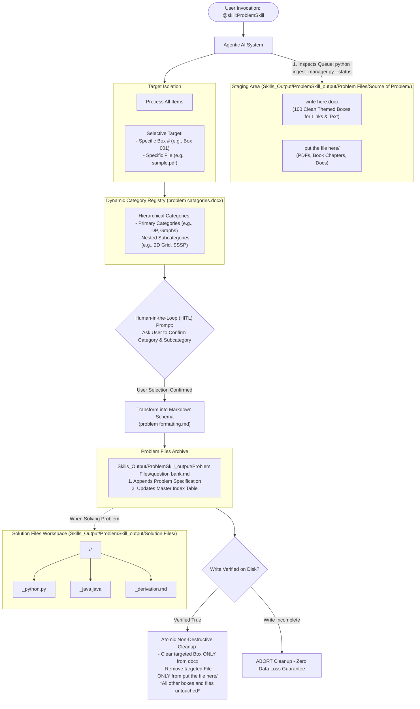

# Skill Architecture & Usage Instructions: `ProblemSkill`

For complete architectural details and visual flowcharts, consult:
- **Solution Files Architecture & Synthesis Pipeline**: [`SOLUTION_ARCHITECTURE.md`](SOLUTION_ARCHITECTURE.md)
- **Problem Statement Formatting**: [`problem formatting.md`](../../../../Skills_Output/ProblemSkill_output/Problem%20Files/problem%20formatting.md)
- **Solution Output Formatting**: [`output formating.md`](../../../../Skills_Output/ProblemSkill_output/output%20formating.md)

---

## 🏛️ System Architecture

`ProblemSkill` automates the intake, classification, safe archival, and template-guided solution synthesis of algorithmic problems without risk of data loss.



---

## 📖 Operational Instructions for Agents

### 1. Ingestion Triggers
- General check: `@skill:ProblemSkill` or `"check if there are any problems to process"`
- Targeted Box: `@skill:ProblemSkill process Box 1 from the doc`
- Targeted File: `@skill:ProblemSkill process sample.pdf`

### 2. Status Discovery via CLI
```bash
python .agent/skills/SkillsOnDynamicResources/ProblemSkill/scripts/ingest_manager.py --status
```
Outputs:
- Number of filled boxes in `write here.docx` with text previews.
- Number and file sizes of documents inside `put the file here/`.
- Summary list of dynamic categories.

### 3. Dynamic Category Extraction via CLI
```bash
python .agent/skills/SkillsOnDynamicResources/ProblemSkill/scripts/ingest_manager.py --categories
```
Extracts the real-time 2-level hierarchy (Primary Category $\to$ Subcategories) from [`problem catagories.docx`](../../../../Skills_Output/ProblemSkill_output/Problem%20Files/problem%20catagories.docx) to present in the user prompt.

### 4. Interactive HITL Selection Protocol
- **NEVER guess the topic or subcategory**.
- Present the dynamically loaded categories and prompt the user:
  > *"Which Primary Category and Subcategory does this problem belong to?"*
- Await user confirmation before appending to `question bank.md`.

### 5. Formatting Standards ([`problem formatting.md`](../../../../Skills_Output/ProblemSkill_output/Problem%20Files/problem%20formatting.md))
Format each problem entry with:
- Unique Problem ID & Title
- Metadata: Primary Category, Subcategory, Source, Source Link/Ref, Difficulty, Matching Template from `Skills_Input/Templates/`
- Problem Statement
- Input / Output Specifications
- Sample Tests with Explanations
- Constraints and Edge Cases

### 6. Zero-Loss Non-Destructive Cleanup
- **Rule**: NEVER delete a source file or clear a docx box until the entry is 100% written and verified inside `question bank.md`.
- **Atomic Scope**: Delete ONLY the processed target file or clear ONLY the processed box; never wipe the whole staging directory.

### 7. Solution Synthesis Standards ([`output formating.md`](../../../../Skills_Output/ProblemSkill_output/output%20formating.md))
When prompted to solve a problem:
- Place outputs into `Skills_Output/ProblemSkill_output/Solution Files/<Category>/<Subcategory>/`.
- Generate separate `<ID>_python.py` and `<ID>_java.java` code files.
- Generate `<ID>_derivation.md` strictly executing the matching template phases.
