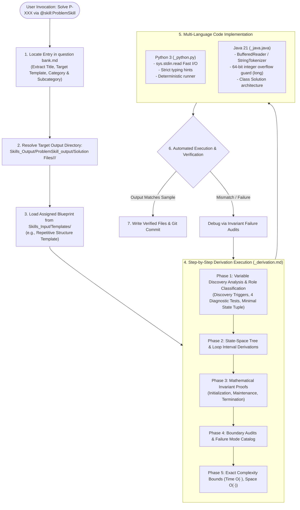

# Solution Files Architecture & Synthesis Pipeline: `ProblemSkill`

This document defines the technical architecture, directory topology, design paradigms, and multi-language implementation standards for the **Solution Files** generated by the [`ProblemSkill`](../SKILL.md).

---

## 🏛️ 1. Architectural Philosophy & Dual-Space Separation

In the *Science of Coding* framework, **`ProblemSkill`** enforces a clean separation of concerns between problem specifications and their synthesized solutions:

```
Skills_Output/ProblemSkill_output/
├── Problem Files/              # The "WHAT": Source staging, schemas, and question bank
│   ├── Source of Problem/      # Multi-source staging (write here.docx, put the file here/)
│   ├── problem catagories.docx # Dynamic 2-level taxonomy hierarchy
│   ├── problem formatting.md   # Problem statement schema
│   └── question bank.md        # Central canonical repository of formatted problems
│
└── Solution Files/             # The "HOW": Formal derivations, mathematical proofs, and code
    └── <Primary Category>/
        └── <Subcategory>/
            ├── <Problem-ID>_derivation.md
            ├── <Problem-ID>_python.py
            └── <Problem-ID>_java.java
```

### Core Tenets of the Solution Architecture:
1. **Zero Hallucination / Zero Ad-hoc Coding**: Code is never generated spontaneously. Every implementation is derived from an invariant-grounded blueprint in [`Skills_Input/Templates/`](../../../../Skills_Input/Templates/).
2. **Deterministic Folder Hierarchy**: Solutions are categorized under `Primary Category / Subcategory /`, matching the dynamic classification assigned during problem ingestion.
3. **Multi-Language Independence**: Python 3 and Java 21 are implemented in separate, standalone, runnable files named deterministically using the problem ID (`<Problem-ID>_python.py` and `<Problem-ID>_java.java`).
4. **Permanent Derivation Trace**: Code is always paired with `<Problem-ID>_derivation.md`, preserving the complete cognitive path from state exploration to Big-O bounds.

---

## 🌲 2. End-to-End Solution Lifecycle Pipeline



---

## 📁 3. Directory Layout & Concrete Example

Taking **Problem P-1** (*Series Summation: 1 + 2 + 3 + 4 + .............*) as a concrete instance:

```
Skills_Output/ProblemSkill_output/Solution Files/
└── Repetitive Structures/
    └── Pattern Printing/
        ├── P-1_derivation.md   # Mathematical derivation & state tree
        ├── P-1_python.py       # Standalone Python 3 runnable script
        └── P-1_java.java       # Standalone Java 21 runnable class
```

---

## 📑 4. Deliverable Specifications

### 4.1 Derivation Document (`<Problem-ID>_derivation.md`)
The derivation document documents the complete reasoning process across five mandatory phases:
- **Phase 1: State Definition & Role Classification**:
  - Inventories all variables.
  - Classifies each into Free (stepper/walker $\to$ becomes a loop), Carried (gatherer/holder $\to$ accumulator), Derived (formula $\to$ no loop), or Fixed (problem constant).
  - Establishes the minimal state note: $\text{State} = (\text{Free}, \text{Carried})$.
- **Phase 2: State-Space & Relationship Derivation**:
  - Derives loop boundaries and step sizes.
  - Generates the text-based ASCII State-Space Tree illustrating state transitions and leaf counts.
- **Phase 3: Mathematical Invariant Formulation**:
  - Formalizes inductive invariants for Initialization ($i = \text{start}$), Maintenance ($i \to i+1$), and Termination ($i = \text{end} + 1$).
- **Phase 4: Boundary Audits & Failure Mode Checks**:
  - Systematically checks empty inputs ($N=0, 1$), maximum constraints, and edge configurations.
- **Phase 5: Complexity Analysis**:
  - Analyzes exact leaf count in the state-space tree to determine Time $\mathcal{O}(\cdot)$ and auxiliary Space $\mathcal{O}(\cdot)$.

### 4.2 Python Solution (`<Problem-ID>_python.py`)
- Python 3.10+ standard.
- Complete fast I/O processing via `sys.stdin.read().split()`.
- Top metadata docstring linking Problem ID, Category, Template, and Complexity.
- Modular `solve()` function with `if __name__ == "__main__":` entrypoint.

### 4.3 Java Solution (`<Problem-ID>_java.java`)
- Java 21 LTS standard.
- Fast input reading via `BufferedReader` and `StringTokenizer`.
- Class declared package-private (`class Solution`) to facilitate multi-file testing without public class filename conflicts.
- 64-bit integer overflow guard (`long`) applied proactively to accumulators and counters whenever $N \ge 10^4$.

---

## 🔗 5. Bidirectional Linkage

Every solution file maintains bidirectional trace links:
- The derivation file links back to the original statement anchor in [`question bank.md#<problem-id>`](../../../../Skills_Output/ProblemSkill_output/Problem%20Files/question%20bank.md).
- The derivation file links to the foundational methodology in [`Skills_Input/Templates/`](../../../../Skills_Input/Templates/).
- The code files embed metadata tags in their headers, allowing both human engineers and AI agents to trace code directly back to its mathematical derivation and problem statement.

