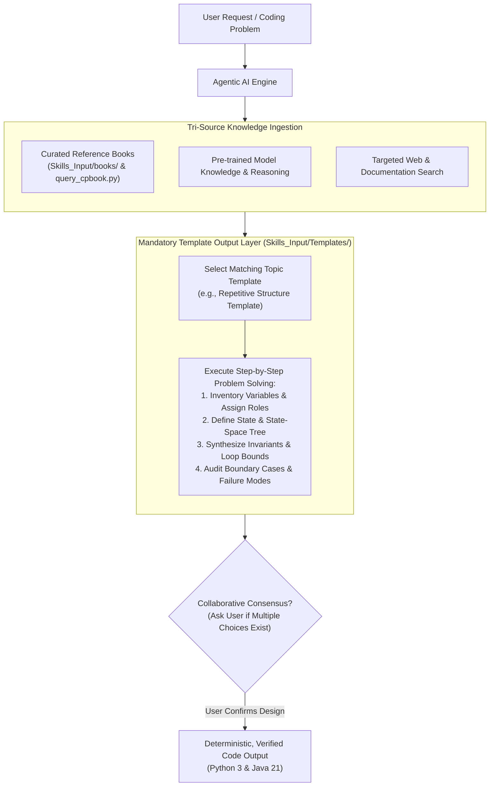

# Architecture & Operational Mechanics: `cpbook4` Skill

## 1. System Overview & Purpose

The `cpbook4` skill is a **portable, self-contained, agent-agnostic knowledge and retrieval module** encapsulating comprehensive reference volumes:
* **Volume 1 (`Part-1.pdf`)**: 329 pages (Data Structures, Paradigms, Graphs)
* **Volume 2 (`Part-2.pdf`)**: 352 pages (Math, Strings, Geometry, Advanced Topics, Rare Topics)
* **Total Volume**: 681 pages, ~328,000 words, ~436,000 tokens.

This package can be moved into any AI agent environment (Antigravity, Claude Code, Cursor, AutoGPT, custom LangChain/LlamaIndex pipelines) without modifying agent source code.

---

## 2. Directory Layout of `cpbook4` Skill

```
.agent/skills/SkillsOnFixedResources/cpbook4/
├── SkillArchitecture/
│   ├── ARCHITECTURE.md             <-- Detailed operational manual (this file)
│   └── README.md                   <-- High-level overview & visual workflow
├── SKILL.md                        <-- Universal agent entrypoint & decision rules
├── references/
│   ├── table_of_contents.md        <-- Fast human & agent markdown topic index with page numbers
│   ├── toc_book1.json              <-- Machine-readable outline tree for Book 1
│   └── toc_book2.json              <-- Machine-readable outline tree for Book 2
└── scripts/
    └── query_cpbook.py             <-- Resilient, UTF-8 safe CLI search & page extractor
```

*(Note: Reference books are stored centrally under [`Skills_Input/books/Overall/`](../../../../../Skills_Input/books/Overall/))*

---

## 3. High-Level Architecture Diagram



---

## 4. Query CLI System & Zero-Token Indexing

The retrieval engine resolves the context window degradation problem through a two-phase retrieval pattern:

### Phase 1: Zero-Token Routing (Agent Memory / System Prompt)
Instead of consuming context tokens by feeding raw book text to the LLM, the agent reads only the high-level topic index from [`references/table_of_contents.md`](../references/table_of_contents.md). The table of contents maps every concept to its exact PDF page range.

### Phase 2: Targeted Extraction via CLI
Once the agent identifies the relevant page range, it executes `query_cpbook.py`:
```bash
python .agent/skills/SkillsOnFixedResources/cpbook4/scripts/query_cpbook.py extract --book 1 --start 143 --end 148
```
The script loads only pages 143–148, parses the text with `pypdf`, and outputs pure text directly into the agent's context window.

---

## 5. Decision Rules for Data Structures & Algorithms

When evaluating which algorithm or data structure to use, follow the comprehensive matrix outlined in [`SKILL.md`](../SKILL.md).
