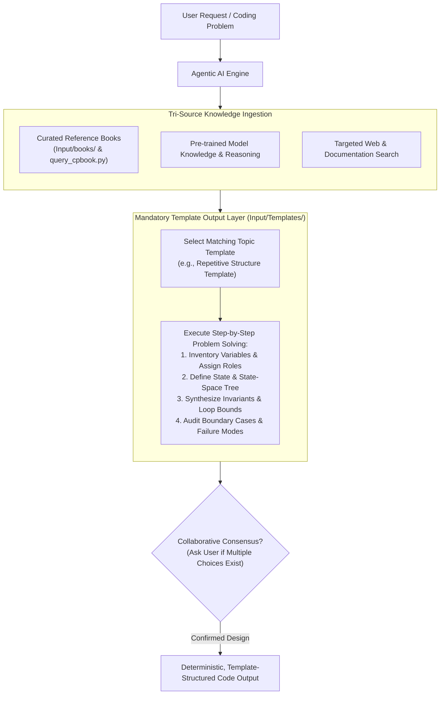

# Architecture & Operational Mechanics: `cpbook4` Skill

## 1. System Overview & Purpose

The `cpbook4` skill is a **portable, self-contained, agent-agnostic knowledge and retrieval module** encapsulating comprehensive reference volumes:
* **Volume 1 (`Part-1.pdf`)**: 329 pages (Data Structures, Paradigms, Graphs)
* **Volume 2 (`Part-2.pdf`)**: 352 pages (Math, Strings, Geometry, Advanced Topics, Rare Topics)
* **Total Volume**: 681 pages, ~328,000 words, ~436,000 tokens.

This package can be moved into any AI agent environment (Antigravity, Claude Code, Cursor, AutoGPT, custom LangChain/LlamaIndex pipelines) without modifying agent source code.

---

## 2. Directory Layout of `cpbook4` Skill

```
.agent/skills/SkillsOnFixedResources/cpbook4/
├── SkillArchitecture/
│   ├── ARCHITECTURE.md             <-- Detailed operational manual (this file)
│   └── README.md                   <-- High-level overview & visual workflow
├── SKILL.md                        <-- Universal agent entrypoint & decision rules
├── references/
│   ├── table_of_contents.md        <-- Fast human & agent markdown topic index with page numbers
│   ├── toc_book1.json              <-- Machine-readable outline tree for Book 1
│   └── toc_book2.json              <-- Machine-readable outline tree for Book 2
└── scripts/
    └── query_cpbook.py             <-- Resilient, UTF-8 safe CLI search & page extractor
```

*(Note: Reference books are stored centrally under [`Input/books/`](../../../../Input/books/))*

---

## 3. High-Level Architecture Diagram



---

## 4. Why This Architecture? (Context Efficiency + Structured Problem Solving)

Loading raw text of 436,000 tokens into an LLM context window at every step causes context overflow, hallucinated details, and high latency. Furthermore, retrieving raw algorithmic theory without a structured decomposition methodology causes agents to guess loops and produce unverified code.

### Hybrid Knowledge Ingestion & Mandatory Template Output Pipeline:

The architecture combines open knowledge ingestion with strictly constrained, template-guided output generation:

1. **Knowledge Ingestion (Tri-Source Learning)**:
   - **Curated Textbooks (`skill/books/`)**: Precision page extractions via `query_cpbook.py extract` provide mathematically rigorous proofs, data structure layouts, and invariant formulas directly from authoritative books.
   - **Pre-trained LLM Knowledge**: The agent leverages its core training for programming language idioms, syntax conventions, and algorithmic intuition.
   - **Targeted Web Search**: Online judge lookups and real-time documentation checks for niche platform variations.

2. **Output Generation (Mandatory Template Enforcement)**:
   - Regardless of where the agent learned the underlying facts, **all problem-solving solutions must be structured and generated according to the designated template in `Templates/`**.
   - The agent is not permitted to guess or produce ad-hoc logic; it must systematically execute the phased steps defined in the template (e.g., candidate variable inventory, role assignment, minimal state identification, state-space tree construction, transition definition, termination progress checks, and edge-case auditing).

3. **Modular Template Expansion**:
   - The `Templates/` directory serves as an expanding repository of specialized problem-solving blueprints (e.g., Repetitive Structures, State-Space Search, Divide & Conquer, Dynamic Programming, and Graph Modeling), each defining the exact conceptual steps for that domain.

---

## 5. Portability & Cross-Agent Usage

This skill has zero proprietary dependencies:
- Written in standard Markdown, JSON, and standard Python (`pypdf`).
- Works on Windows, Linux, and macOS.
- Can be zipped and shared with any other project or AI platform.

### How to use across specific Agentic AIs:

#### 1. Google Antigravity
- Place or point to the skill in `.agent/skills/cpbook4/SKILL.md` (pre-configured in this repository).
- Antigravity automatically indexes the skill upon workspace startup.
- Mention `@skill:cpbook4` or ask algorithm questions directly in chat; the agent will consult `references/table_of_contents.md` and invoke `scripts/query_cpbook.py` as needed.

#### 2. Claude Code
- Claude Code natively searches for skills under `.claude/skills/<skill-name>/SKILL.md`.
- You can enable it by copying `skill/SKILL.md` to `.claude/skills/cpbook4/SKILL.md`, or by adding a reference line to your root `CLAUDE.md`:
  ```markdown
  Refer to `skill/SKILL.md` for algorithm design and reference queries.
  ```
- Invoke by asking Claude Code: *"Consult the cpbook4 skill to find the optimal DP approach for Longest Common Subsequence."*

#### 3. OpenAI Codex / Cursor / Custom Agent Frameworks
- For Codex, Cursor, Copilot Workspace, or custom LangChain/AutoGPT agents:
- Include a directive in `.cursorrules`, `AGENTS.md`, or the agent system prompt:
  ```markdown
  For algorithmic problems, consult the skill in `skill/SKILL.md`. Use `python skill/scripts/query_cpbook.py search|extract` to retrieve exact pages and code patterns from `skill/books/`.
  ```
- The agent will use its bash/terminal tool to query the books deterministically.
