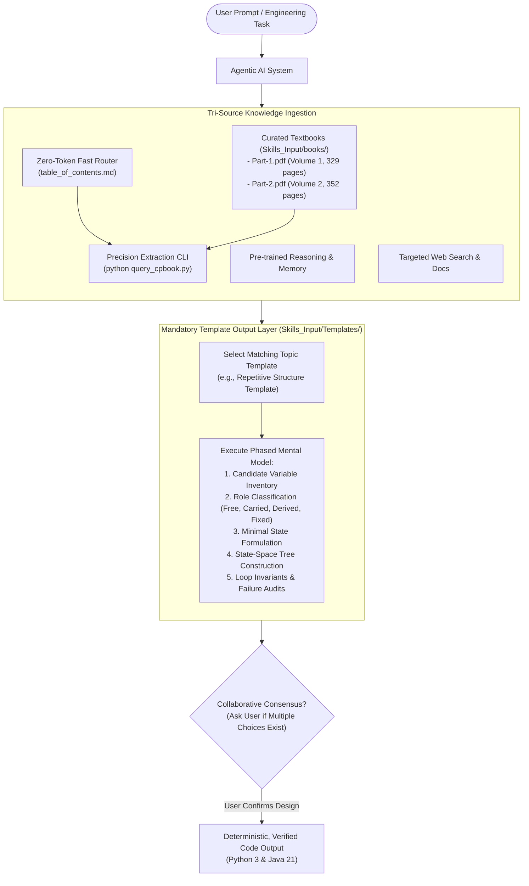

# Skill Architecture & Usage Instructions: `cpbook4`

This document defines the technical architecture, execution pipeline, and usage guidelines for the **`cpbook4`** skill.

---

## 🏛️ System Architecture

The `cpbook4` skill connects any agentic AI system to deep algorithmic knowledge without suffering from context exhaustion, token window degradation, or hallucinations.



---

## 📖 Operational Instructions for Agents

### 1. Collaborative Design Check (Mandatory Rule)
- **Rule**: If a problem has multiple viable algorithmic solutions (e.g., Fenwick Tree vs Segment Tree, Dijkstra vs SPFA, Kruskal vs Prim, Memoized DP vs Tabulated DP), the agent **MUST** present the candidate trade-offs (Time, Space, Implementation complexity) and ask the user for their preference before writing code.

### 2. Surgical Retrieval via CLI
Instead of dumping full PDF chapters, use the precision CLI:
```bash
python .agent/skills/SkillsOnFixedResources/cpbook4/scripts/query_cpbook.py search --book 1 --query "Fenwick" --limit 5
python .agent/skills/SkillsOnFixedResources/cpbook4/scripts/query_cpbook.py extract --book 1 --start 143 --end 148
```

### 3. Template Enforcement
Every algorithmic solution generated must strictly follow the phases in [`Skills_Input/Templates/`](../../../../../Skills_Input/Templates/).
