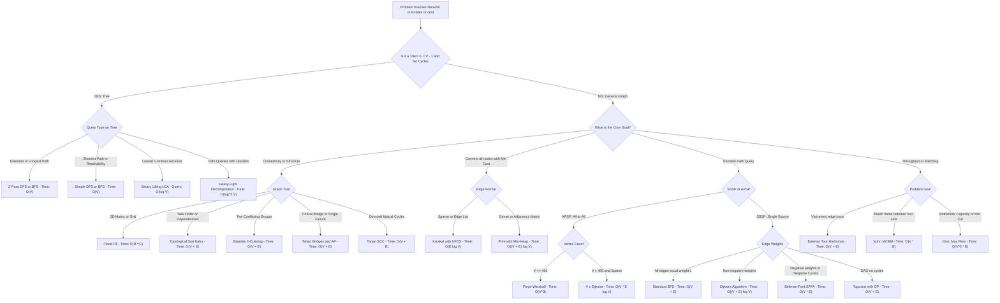

# 001. Graph and Tree Comprehensive Master Manual & Revision Guide

> **Document Serial**: `001`  
> **Topic**: Complete Exhaustive Graph & Tree Knowledge Base, Algorithms, Decision Paradigms & Quick Revision Guide  
> **Source Ground Truth**: Comprehensive Algorithmic & Graph Engineering Library
> **Language Support**: 100% Complete & Standalone Executable **Python 3** and **Java 21** for **Every Single Algorithm**  
> **UI Control**: Interactive native toggle tabs (HTML details and summary tags) for every code implementation
> **Generated Timestamp**: `2026-11-05T02:50:00+06:00`

---

---

## [Decision Tree] Master Decision Tree: What Algorithm to Choose at What Condition?

When facing any graph or tree problem in an interview or programming competition, follow this **instant identification flow**:



### [Summary] Quick-Lookup Interview Trigger Table

| If the problem mentions... | Red Flag / Invariant | Pick This Algorithm | Time Complexity | Real-World Example Problem | Plain-English Intuitive Solution |
| :--- | :--- | :--- | :--- | :--- | :--- |
| **"E = V - 1, connected, no cycles"** | Tree Property | **Single DFS / 2-Pass DFS** | `O(V)` | **Tree Diameter (LeetCode 1245 / 543)**: Find the longest path between any two nodes in a computer network. | Pick any node at random and find the furthest node X. From X, run DFS again to find the furthest node Y. The path from X to Y is guaranteed to be the longest highway in the tree. |
| **"Shortest path in maze / unweighted grid"** | Uniform edge cost = 1 | **Breadth-First Search (BFS)** | `O(V + E)` | **Shortest Path in Binary Matrix (LeetCode 1091)**: Escape a flooded maze with obstacles in minimum steps. | Drop a stone at start. Like water ripples expanding 1 tile outward every second, the moment a ripple touches the exit tile, you have reached it in the absolute fewest steps possible. |
| **"Prerequisites / Build order / Dependencies"** | Directed Acyclic Graph (DAG) | **Kahn's Topological Sort** | `O(V + E)` | **Course Schedule II (LeetCode 210)**: Order university courses given their prerequisite requirements. | Put courses with 0 prerequisites in a queue. Take each course, cross it off as completed, and reduce prerequisite counts for the next courses. If you finish all courses, you have your valid study plan! |
| **"Divide into two non-conflicting groups"** | No odd cycles | **Bipartite 2-Coloring (BFS)** | `O(V + E)` | **Possible Bipartition (LeetCode 886)**: Split people into two rival teams where no two enemies are on the same team. | Put person 1 on Team Blue. Color all their enemies Team Red, and color their enemies' enemies Team Blue. If you ever find two enemies assigned the exact same color, it is impossible (odd conflict loop). |
| **"Shortest path with positive weights"** | Non-negative edge weights | **Dijkstra's Algorithm (Min-Heap)** | `O((V + E) log V)` | **Network Delay Time (LeetCode 743)**: How long will it take for a signal to reach all computers through timed links? | Keep a scoreboard of shortest times and a Priority Queue. Always pick the unvisited computer with the smallest recorded time, send signals along its cables, and update neighbors if you found a quicker route. |
| **"Negative costs / Currency arbitrage cycle"** | Negative weights | **Bellman-Ford / SPFA** | `O(V * E)` | **Cheapest Flights Within K Stops / Forex Arbitrage**: Detect an infinite profit loop when trading currencies. | Try improving every single flight route in the world V - 1 times. If any flight price can still become cheaper on the V-th round, you discovered an infinite money glitch (negative cost cycle)! |
| **"All-pairs distances with V <= 400"** | Dense all-to-all query | **Floyd-Warshall** | `O(V^3)` | **City With Smallest Number of Neighbors (LeetCode 1334)**: Find distances between every pair of cities. | Ask for every city pair (i, j): "Can I travel from City i to City j faster by making a layover at Airport k?" Check all possible layovers k in 3 simple nested loops. |
| **"Connect all computers/cities with min wire"** | Spanning Tree | **Kruskal (UFDS) or Prim (Min-Heap)** | `O(E log V)` | **Min Cost to Connect All Points (LeetCode 1584)**: Lay fiber-optic cables connecting all cities at minimum cost. | Put all available cables in a price-sorted list from cheapest to most expensive. Greedily plug in the cheapest cable unless it connects two cities that are already linked together (prevents useless loops). |
| **"Single point of network failure / Critical edge"** | Bridges & Cut Vertices | **Tarjan's Lowlink (`dfs_low`)** | `O(V + E)` | **Critical Connections in a Network (LeetCode 1192)**: Identify servers or cables whose failure cuts the internet. | Track your arrival timestamp and the oldest ancestor your kids can reach via side roads. If your child has no side road back to someone older than you, your cable is a critical bridge--cutting it disconnects the network! |
| **"Condense directed cycles into DAG"** | Mutual reachability | **Tarjan's SCC** | `O(V + E)` | **Strongly Connected Cities**: Group cities where anyone can take a round trip to and from anywhere else. | Follow one-way roads and push cities onto a stack. When you hit a dead-end that loops back to yourself, pop all those cities off--they form a self-contained whirlpool you can shrink into a single super-city. |
| **"Lowest common ancestor / Distance in tree"** | Tree hierarchy query | **Binary Lifting LCA** | `O(V log V) prep, O(log V) query` | **Lowest Common Ancestor of Tree (LeetCode 236)**: Find the closest common manager of two corporate employees. | Instead of climbing the org chart 1 boss at a time, calculate jumps of powers of 2 (1, 2, 4, 8 levels up). Jump the lower employee up to the same rank, then jump both upward together in giant doubling leaps. |
| **"Draw shape without lifting pen / use all tickets"** | Visit all edges once | **Hierholzer's Eulerian Tour** | `O(V + E)` | **Reconstruct Itinerary (LeetCode 332)**: Plan a flight trip that uses every single boarding pass exactly once. | Check that every airport has an even number of arrivals/departures. Walk along flights greedily until you get stuck, then backtrack and splice any missed flight loops into your master journey. |
| **"Assign jobs to workers / Pair items 1-to-1"** | Max Bipartite Matching | **Kuhn's Augmenting Path** | `O(V * E)` | **Maximum Number of Accepted Job Applications**: Pair applicants to available jobs without conflicts. | Try matching Worker A to their favorite job. If that job is already occupied by Worker B, politely ask Worker B to switch to their second-choice job. If B can switch, A takes the job! |
| **"Max throughput / Pipes / Min Cut"** | Capacity bottleneck | **Dinic's Algorithm** | `O(V^2 * E)` | **Network Flow / Maximum Water Pipeline Delivery**: Maximum gallons of water that can flow through a pipe network. | Use BFS to measure distances from water source to drain. Then push water along shortest downhill pipes via DFS. If a pipe gets full, keep reverse valves so future water flows can redirect mistakes. |


---

## [Guide] Complete Master Curriculum & Topic Index

This manual covers **every core and advanced graph and tree topic** required for algorithmic problem-solving:

```mermaid
flowchart TD
    subgraph Fundamentals["1. Foundations & Representations"]
        M1["Adjacency Matrix, Adjacency List, Edge List, Implicit Grids"]
    end
    subgraph Traversals["2. Core Traversals & Connectivity"]
        M2["DFS & BFS (Level-by-level)"]
        M3["Connected Components & Flood Fill (2D Grid)"]
        M4["Topological Sort (Kahn's BFS & DFS Post-Order)"]
        M5["Bipartite Graph 2-Coloring Check"]
        M6["Directed Cycle Detection (3-State DFS)"]
        M7["Tarjan's Bridges & Articulation Points (Lowlink)"]
        M8["Tarjan's Strongly Connected Components (SCC)"]
    end
    subgraph SpanningTrees["3. Minimum Spanning Trees (MST)"]
        M9["Kruskal's Algorithm with UFDS"]
        M10["Prim's Algorithm with Priority Queue"]
    end
    subgraph ShortestPaths["4. Shortest Paths (SSSP & APSP)"]
        M11["SSSP on Unweighted Graph: BFS"]
        M12["SSSP on Weighted Graph: Dijkstra's Algorithm"]
        M13["SSSP with Negative Weights/Cycles: Bellman-Ford & SPFA"]
        M14["APSP: Floyd-Warshall Algorithm"]
    end
    subgraph SpecialGraphs["5. Trees & Special Graphs"]
        M15["Tree Invariants (E=V-1, Unique Path, No Visited Array)"]
        M16["Tree Diameter (2-Pass DFS/BFS)"]
        M17["Eulerian Path & Tour (Hierholzer's Algorithm)"]
        M18["DAG Properties & DP Transitions"]
    end
    subgraph AdvancedTrees["6. Advanced Tree Algorithms"]
        M19["Lowest Common Ancestor (LCA via Binary Lifting)"]
        M20["Heavy-Light Decomposition (HLD Concept & Flattening)"]
    end
    subgraph FlowsAndMatching["7. Network Flows & Matching"]
        M21["Maximum Flow: Edmonds-Karp & Dinic's Algorithm"]
        M22["Max Cardinality Bipartite Matching (MCBM via Augmenting Paths)"]
    end

    Fundamentals --> Traversals
    Traversals --> SpanningTrees
    SpanningTrees --> ShortestPaths
    ShortestPaths --> SpecialGraphs
    SpecialGraphs --> AdvancedTrees
    AdvancedTrees --> FlowsAndMatching
```



---

## 1. Graph Representations (AM, AL, EL, Implicit Grid)

### Memory Layer

> **Memory Hook**: *"Phonebook vs Excel Spreadsheet."* A phonebook lists only people you actually talk to; a giant grid wastes pages of empty boxes.
>
> **How It Solves the Problem (Plain English)**: In most real networks, each node connects to only a handful of others. Storing a giant grid wastes massive memory on empty connections. An adjacency list records only real connections per node, keeping memory lean and neighbor lookups fast.
Before executing any graph algorithm, select the correct representation based on vertices `V` and edges `E`:

| Representation | Space Complexity | Enumerate Neighbors | Check Edge `(u, v)` | Ideal Use Case |
| :--- | :--- | :--- | :--- | :--- |
| **Adjacency Matrix (`AM`)** | `O(V^2)` | `O(V)` | `O(1)` | Dense graphs (`E ~ V^2`), `V <= 1000`, Floyd-Warshall |
| **Adjacency List (`AL`)** | `O(V + E)` | `O(deg(u))` | `O(deg(u))` | **Default choice** for `95\%` of problems (`V, E <= 2 * 10^5`) |
| **Edge List (`EL`)** | `O(E)` | `O(E)` | `O(E)` | Kruskal's MST, Bellman-Ford |
| **Implicit Grid Graph** | `O(1)` extra | `O(1)` via `(d r, d c)` | `O(1)` | 2D matrices, Flood Fill |


### Canonical Benchmark Problem

- **Online Judge Platform**: LeetCode
- **Problem Reference**: LeetCode 997 - Find the Town Judge
- **Difficulty**: Easy / Classic Graph Representation Benchmark

#### Problem Statement (Plain English Breakdown)
In a small town of `n` people (labeled from `1` to `n`), there is a rumor that one of them is the secret town judge.
If the town judge exists, then:
1. The town judge trusts nobody.
2. Everybody else in the town (all `n - 1` other people) completely trusts the town judge.
3. There is at most one person that satisfies both property 1 and property 2.

You are given an array of trust pairs `trust[i] = [a, b]`, meaning person `a` trusts person `b`.
Your job is to identify the town judge and return their label number, or return `-1` if no such judge exists.

#### Beginner Intuition & Step-by-Step Solution Strategy
Think of this as a directed graph where people are vertices and trust relationships are directed arrows pointing from the truster to the trustee: `a -> b`.
- If person `a` trusts person `b`, person `a` has an **outgoing trust arrow** (`out-degree`).
- Person `b` receives an **incoming trust arrow** (`in-degree`).

What does it mean to be the town judge?
- The judge trusts nobody -> `out-degree == 0`.
- Everyone else trusts the judge -> `in-degree == n - 1`.

Instead of allocating an expensive N x N matrix, we just keep a simple score counter for each person: `trust_score = in_degree - out_degree`.
- When `a` trusts `b`: `a` gives up trust (`score[a] -= 1`), and `b` gains trust (`score[b] += 1`).
- The town judge will be the single person whose final net trust score equals exactly `n - 1`!

#### Fully Commented Benchmark Solution

<details open>
<summary><b>[Python] Python 3 Benchmark Solution: Find the Town Judge</b></summary>

```python
from typing import List

def findJudge(n: int, trust: List[List[int]]) -> int:
    # Net trust score: incoming_trust - outgoing_trust
    trust_scores = [0] * (n + 1)
    
    for a, b in trust:
        trust_scores[a] -= 1  # Person 'a' trusts someone -> cannot be judge
        trust_scores[b] += 1  # Person 'b' receives trust
        
    for person in range(1, n + 1):
        # The judge must be trusted by everyone else (n - 1) and trust no one (0)
        if trust_scores[person] == n - 1:
            return person
            
    return -1

if __name__ == "__main__":
    n = 3
    trust_pairs = [[1, 3], [2, 3]]
    result = findJudge(n, trust_pairs)
    print(f"Town judge among {n} people with trust {trust_pairs}:", result) # Expected 3
```
</details>

<details>
<summary><b>[Java] Java 21 Benchmark Solution: Find the Town Judge</b></summary>

```java
public class TownJudgeBenchmark {
    public static int findJudge(int n, int[][] trust) {
        int[] trustScores = new int[n + 1];
        
        for (int[] edge : trust) {
            int a = edge[0];
            int b = edge[1];
            trustScores[a]--; // Outgoing trust
            trustScores[b]++; // Incoming trust
        }
        
        for (int person = 1; person <= n; person++) {
            if (trustScores[person] == n - 1) {
                return person;
            }
        }
        return -1;
    }

    public static void main(String[] args) {
        int n = 3;
        int[][] trust = {{1, 3}, {2, 3}};
        System.out.println("Judge: " + findJudge(n, trust)); // 3
    }
}
```
</details>

### Standard Library & Implementation Reference

<details open>
<summary><b>[Python] Python 3 Implementation: Complete Graph Representations</b></summary>

```python
from typing import List, Tuple

class GraphRepresentations:
    def __init__(self, V: int):
        self.V = V
        self.adj_list: List[List[Tuple[int, int]]] = [[] for _ in range(V)]
        self.adj_matrix: List[List[int]] = [[0] * V for _ in range(V)]
        self.edge_list: List[Tuple[int, int, int]] = []

    def add_edge(self, u: int, v: int, w: int, directed: bool = False):
        self.adj_list[u].append((v, w))
        self.adj_matrix[u][v] = w
        self.edge_list.append((u, v, w))
        if not directed:
            self.adj_list[v].append((u, w))
            self.adj_matrix[v][u] = w
            self.edge_list.append((v, u, w))

    def display(self):
        print(f"=== Graph Representations (V={self.V}) ===")
        for u in range(self.V):
            print(f"  AL[{u}] -> {self.adj_list[u]}")
        print("  Total Edges stored:", len(self.edge_list))

if __name__ == "__main__":
    g = GraphRepresentations(4)
    g.add_edge(0, 1, 10)
    g.add_edge(1, 2, 20)
    g.add_edge(2, 3, 30)
    g.add_edge(3, 0, 40)
    g.display()
```
</details>

<details>
<summary><b>[Java] Java 21 Implementation: Complete Graph Representations</b></summary>

```java
import java.util.*;

public class GraphRepresentations {
    public static class Edge {
        public int to, weight;
        public Edge(int to, int weight) { this.to = to; this.weight = weight; }
        @Override public String toString() { return "(" + to + ", w=" + weight + ")"; }
    }
    public static class Triple {
        public int u, v, weight;
        public Triple(int u, int v, int weight) { this.u = u; this.v = v; this.weight = weight; }
    }

    private final int V;
    public final List<List<Edge>> adjList;
    public final int[][] adjMatrix;
    public final List<Triple> edgeList;

    public GraphRepresentations(int V) {
        this.V = V;
        this.adjList = new ArrayList<>(V);
        for (int i = 0; i < V; i++) adjList.add(new ArrayList<>());
        this.adjMatrix = new int[V][V];
        this.edgeList = new ArrayList<>();
    }

    public void addEdge(int u, int v, int w, boolean directed) {
        adjList.get(u).add(new Edge(v, w));
        adjMatrix[u][v] = w;
        edgeList.add(new Triple(u, v, w));
        if (!directed) {
            adjList.get(v).add(new Edge(u, w));
            adjMatrix[v][u] = w;
            edgeList.add(new Triple(v, u, w));
        }
    }

    public void display() {
        System.out.println("=== Graph Representations (V=" + V + ") ===");
        for (int i = 0; i < V; i++) System.out.println("  AL[" + i + "] -> " + adjList.get(i));
        System.out.println("  Total Edges stored: " + edgeList.size());
    }

    public static void main(String[] args) {
        GraphRepresentations g = new GraphRepresentations(4);
        g.addEdge(0, 1, 10, false);
        g.addEdge(1, 2, 20, false);
        g.addEdge(2, 3, 30, false);
        g.addEdge(3, 0, 40, false);
        g.display();
    }
}
```
</details>

---

## 2. Core Traversals & Connected Components (DFS, BFS, Flood Fill)

### Memory Layer

> **Memory Hook**: *"Blind maze explorer vs stone dropped in a pond."* The maze runner dives down one path until hitting a dead end; the water ripple expands outward equally in all directions.
>
> **How It Solves the Problem (Plain English)**: When you just need to check if an exit exists or count disconnected rooms, diving deep with DFS uses almost no setup. But when you need the shortest path in an unweighted map, BFS guarantees the first time you touch your target is the absolute quickest route because you explore layer by layer.
- **DFS (`O(V + E)`)**: Depth-oriented recursive exploration. Ideal for components and reachability.
- **BFS (`O(V + E)`)**: Breadth-oriented queue exploration. Guarantees **shortest path in unweighted graphs**.
- **Flood Fill (`O(R x C)`)**: Implicit graph traversal on a 2D grid matrix using directional coordinate deltas.


### Canonical Benchmark Problem

- **Online Judge Platform**: LeetCode
- **Problem Reference**: LeetCode 200 - Number of Islands
- **Difficulty**: Medium / Archetypal 2D Grid Flood Fill Benchmark

#### Problem Statement (Plain English Breakdown)
You are given an `m x n` 2D grid map of `'1'`s (land) and `'0'`s (water).
An **island** is surrounded by water and is formed by connecting adjacent lands horizontally or vertically (diagonal connections do not count).
You may assume all four edges of the entire grid are completely surrounded by water.

Your task is to count and return the total number of distinct islands on the map.

For example, given:
```text
1 1 0 0 0
1 1 0 0 0
0 0 1 0 0
0 0 0 1 1
```
- The top-left four `'1'`s form 1 big island.
- The single `'1'` in the middle forms a 2nd island.
- The bottom-right two `'1'`s form a 3rd island.
The total number of islands is `3`.

#### Beginner Intuition & Step-by-Step Solution Strategy
Imagine flying a helicopter over the ocean and looking down at the grid:
1. You scan cell by cell, row by row, from top-left to bottom-right.
2. The moment your eyes spot a `'1'` (fresh unvisited land), congratulations--you just discovered a brand new island! Increment your `island_count` by 1.
3. But wait! You don't want to accidentally count the neighbor pieces of this same island as new islands later.
4. So you immediately trigger a **Flood Fill (DFS)** starting right at that cell:
   - Walk in all 4 directions (Up, Down, Left, Right).
   - Whenever you step on connected land `'1'`, sink it by turning it into water `'0'` (or mark it as visited).
   - Keep expanding recursively until the entire island has been sunken.
5. Continue scanning the rest of the map. Any land you encounter from now on must belong to a completely different, undiscovered island!

#### Fully Commented Benchmark Solution

<details open>
<summary><b>[Python] Python 3 Benchmark Solution: Number of Islands</b></summary>

```python
from typing import List

def numIslands(grid: List[List[str]]) -> int:
    if not grid or not grid[0]:
        return 0
        
    rows, cols = len(grid), len(grid[0])
    island_count = 0
    
    # 4-directional moves: Up, Down, Left, Right
    directions = [(-1, 0), (1, 0), (0, -1), (0, 1)]
    
    def sink_island(r: int, c: int):
        # Boundary guard and water check
        if r < 0 or r >= rows or c < 0 or c >= cols or grid[r][c] != '1':
            return
        # Sink this piece of land so it won't be visited again
        grid[r][c] = '0'
        for dr, dc in directions:
            sink_island(r + dr, c + dc)
            
    for r in range(rows):
        for c in range(cols):
            if grid[r][c] == '1':
                island_count += 1
                sink_island(r, c) # Flood fill to sink all connected land
                
    return island_count

if __name__ == "__main__":
    test_grid = [
        ['1', '1', '0', '0', '0'],
        ['1', '1', '0', '0', '0'],
        ['0', '0', '1', '0', '0'],
        ['0', '0', '0', '1', '1']
    ]
    result = numIslands(test_grid)
    print("Total islands discovered:", result) # Expected 3
```
</details>

<details>
<summary><b>[Java] Java 21 Benchmark Solution: Number of Islands</b></summary>

```java
public class NumIslandsBenchmark {
    public static int numIslands(char[][] grid) {
        if (grid == null || grid.length == 0) return 0;
        int rows = grid.length;
        int cols = grid[0].length;
        int count = 0;
        
        for (int r = 0; r < rows; r++) {
            for (int c = 0; c < cols; c++) {
                if (grid[r][c] == '1') {
                    count++;
                    sink(grid, r, c, rows, cols);
                }
            }
        }
        return count;
    }

    private static void sink(char[][] grid, int r, int c, int rows, int cols) {
        if (r < 0 || r >= rows || c < 0 || c >= cols || grid[r][c] != '1') return;
        grid[r][c] = '0'; // Sink land to water
        sink(grid, r - 1, c, rows, cols);
        sink(grid, r + 1, c, rows, cols);
        sink(grid, r, c - 1, rows, cols);
        sink(grid, r, c + 1, rows, cols);
    }

    public static void main(String[] args) {
        char[][] grid = {
            {'1', '1', '0', '0', '0'},
            {'1', '1', '0', '0', '0'},
            {'0', '0', '1', '0', '0'},
            {'0', '0', '0', '1', '1'}
        };
        System.out.println("Total islands: " + numIslands(grid)); // 3
    }
}
```
</details>

### Standard Library & Implementation Reference

<details open>
<summary><b>[Python] Python 3 Implementation: DFS, BFS & Flood Fill</b></summary>

```python
from collections import deque
from typing import List, Tuple

class CoreTraversals:
    def __init__(self, V: int):
        self.V = V
        self.adj: List[List[int]] = [[] for _ in range(V)]

    def add_edge(self, u: int, v: int):
        self.adj[u].append(v)
        self.adj[v].append(u)

    def dfs(self, start: int) -> List[int]:
        visited = [False] * self.V
        order = []
        def _dfs(u: int):
            visited[u] = True
            order.append(u)
            for v in self.adj[u]:
                if not visited[v]:
                    _dfs(v)
        _dfs(start)
        return order

    def bfs(self, start: int) -> Tuple[List[int], List[int]]:
        dist = [-1] * self.V
        order = []
        q = deque([start])
        dist[start] = 0
        while q:
            u = q.popleft()
            order.append(u)
            for v in self.adj[u]:
                if dist[v] == -1:
                    dist[v] = dist[u] + 1
                    q.append(v)
        return order, dist

    @staticmethod
    def flood_fill_2d(grid: List[List[int]], r: int, c: int, old_c: int, new_c: int) -> int:
        R, C = len(grid), len(grid[0])
        if r < 0 or r >= R or c < 0 or c >= C or grid[r][c] != old_c:
            return 0
        grid[r][c] = new_c
        ans = 1
        for dr, dc in [(-1,0), (1,0), (0,-1), (0,1)]:
            ans += CoreTraversals.flood_fill_2d(grid, r + dr, c + dc, old_c, new_c)
        return ans

if __name__ == "__main__":
    t = CoreTraversals(6)
    t.add_edge(0, 1); t.add_edge(0, 2); t.add_edge(1, 3); t.add_edge(2, 4); t.add_edge(3, 5)
    print("DFS Order:", t.dfs(0))
    bfs_order, dist = t.bfs(0)
    print("BFS Order:", bfs_order, "| Distances:", dist)

    grid = [
        [1, 1, 0],
        [1, 0, 0],
        [0, 1, 1]
    ]
    painted = CoreTraversals.flood_fill_2d(grid, 0, 0, old_c=1, new_c=2)
    print(f"Flood Fill painted {painted} cells. New Grid:", grid)
```
</details>

<details>
<summary><b>[Java] Java 21 Implementation: DFS, BFS & Flood Fill</b></summary>

```java
import java.util.*;

public class CoreTraversals {
    private final int V;
    private final List<List<Integer>> adj;

    public CoreTraversals(int V) {
        this.V = V;
        this.adj = new ArrayList<>(V);
        for (int i = 0; i < V; i++) adj.add(new ArrayList<>());
    }

    public void addEdge(int u, int v) {
        adj.get(u).add(v);
        adj.get(v).add(u);
    }

    public List<Integer> dfs(int start) {
        boolean[] visited = new boolean[V];
        List<Integer> order = new ArrayList<>();
        dfsInternal(start, visited, order);
        return order;
    }
    private void dfsInternal(int u, boolean[] visited, List<Integer> order) {
        visited[u] = true;
        order.add(u);
        for (int v : adj.get(u)) if (!visited[v]) dfsInternal(v, visited, order);
    }

    public int[] bfs(int start) {
        int[] dist = new int[V];
        Arrays.fill(dist, -1);
        Queue<Integer> q = new ArrayDeque<>();
        dist[start] = 0;
        q.offer(start);
        while (!q.isEmpty()) {
            int u = q.poll();
            for (int v : adj.get(u)) {
                if (dist[v] == -1) {
                    dist[v] = dist[u] + 1;
                    q.offer(v);
                }
            }
        }
        return dist;
    }

    public static int floodFill(int[][] grid, int r, int c, int oldColor, int newColor) {
        int R = grid.length, C = grid[0].length;
        if (r < 0 || r >= R || c < 0 || c >= C || grid[r][c] != oldColor) return 0;
        grid[r][c] = newColor;
        int ans = 1;
        int[][] dirs = {{-1,0}, {1,0}, {0,-1}, {0,1}};
        for (int[] d : dirs) ans += floodFill(grid, r + d[0], c + d[1], oldColor, newColor);
        return ans;
    }

    public static void main(String[] args) {
        CoreTraversals t = new CoreTraversals(6);
        t.addEdge(0, 1); t.addEdge(0, 2); t.addEdge(1, 3); t.addEdge(2, 4); t.addEdge(3, 5);
        System.out.println("DFS Order: " + t.dfs(0));
        System.out.println("BFS Distances: " + Arrays.toString(t.bfs(0)));

        int[][] grid = {{1, 1, 0}, {1, 0, 0}, {0, 1, 1}};
        int painted = floodFill(grid, 0, 0, 1, 2);
        System.out.println("Flood Fill painted " + painted + " cells. Grid[0][0]=" + grid[0][0]);
    }
}
```
</details>

---

## 3. Topological Sort & Directed Cycle Detection

### Memory Layer

> **Memory Hook**: *"College courses with zero prerequisites."* You take all entry-level classes first, and once passed, you unlock next-level courses.
>
> **How It Solves the Problem (Plain English)**: To order tasks that depend on each other, you count how many blockers each task has. Any task with zero blockers can be done immediately. As you finish a task, you remove it as a blocker from its dependent tasks; whichever task hits zero blockers next is ready to go. If you finish before clearing all tasks, a circular dependency exists.

### Canonical Benchmark Problem

- **Online Judge Platform**: LeetCode
- **Problem Reference**: LeetCode 207 - Course Schedule
- **Difficulty**: Medium / Essential Topological Sort & Cycle Benchmark

#### Problem Statement (Plain English Breakdown)
You are a university student planning to take a total of `numCourses` courses, labeled from `0` to `numCourses - 1`.
Some courses require you to complete prerequisites first.
You are given an array `prerequisites` where `prerequisites[i] = [a, b]` indicates that you **must take course `b` before you can take course `a`**.

Your task is to determine: **Is it actually possible for you to finish all courses?** Return `True` if possible, and `False` if impossible.

For example:
- `numCourses = 2, prerequisites = [[1, 0]]`: You take course `0` first, then course `1`. Possible! Output: `True`.
- `numCourses = 2, prerequisites = [[1, 0], [0, 1]]`: To take course `1`, you must first take course `0`. But to take course `0`, you must first take course `1`! This is a circular deadlock (cycle). Impossible! Output: `False`.

#### Beginner Intuition & Step-by-Step Solution Strategy
A circular dependency means you can never start! How can we methodically simulate taking classes to see if we get stuck?
We use **Kahn's In-Degree BFS Algorithm**:
1. For every course, count how many unfinished prerequisites it is waiting on (`in_degree`).
2. Which courses can you enroll in on Day 1 without asking for permission? Any course that has **`in_degree == 0`**!
3. Put all zero-prerequisite courses into an active queue.
4. Take a course out of the queue (you finished it!). Increment your `finished_courses` tally by 1.
5. For all advanced courses that were waiting on this class: decrease their remaining prerequisite count by 1.
6. If any advanced course now has its prerequisite count drop down to `0`, it is completely unlocked! Add it to the queue.
7. Repeat until the queue is empty.
If the number of finished courses equals `numCourses`, you graduated successfully! If not, an unbreakable deadlock loop locked you out.

#### Fully Commented Benchmark Solution

<details open>
<summary><b>[Python] Python 3 Benchmark Solution: Course Schedule</b></summary>

```python
from collections import deque
from typing import List

def canFinish(numCourses: int, prerequisites: List[List[int]]) -> bool:
    # Build Adjacency List and compute in-degree for every course
    adj = [[] for _ in range(numCourses)]
    in_degree = [0] * numCourses
    
    for course, prereq in prerequisites:
        adj[prereq].append(course) # prereq -> course
        in_degree[course] += 1
        
    # Queue all courses that currently have zero prerequisites
    queue = deque([c for c in range(numCourses) if in_degree[c] == 0])
    courses_completed = 0
    
    while queue:
        curr = queue.popleft()
        courses_completed += 1
        
        # Free this prerequisite for dependent courses
        for neighbor in adj[curr]:
            in_degree[neighbor] -= 1
            if in_degree[neighbor] == 0:
                queue.append(neighbor)
                
    # If we completed all courses, no cycle existed!
    return courses_completed == numCourses

if __name__ == "__main__":
    n = 2
    prereqs = [[1, 0]]
    print("Can finish [1, 0]:", canFinish(n, prereqs)) # True
    deadlock = [[1, 0], [0, 1]]
    print("Can finish deadlock:", canFinish(n, deadlock)) # False
```
</details>

<details>
<summary><b>[Java] Java 21 Benchmark Solution: Course Schedule</b></summary>

```java
import java.util.*;

public class CourseScheduleBenchmark {
    public static boolean canFinish(int numCourses, int[][] prerequisites) {
        List<List<Integer>> adj = new ArrayList<>();
        for (int i = 0; i < numCourses; i++) adj.add(new ArrayList<>());
        int[] inDegree = new int[numCourses];

        for (int[] p : prerequisites) {
            int course = p[0];
            int prereq = p[1];
            adj.get(prereq).add(course);
            inDegree[course]++;
        }

        Queue<Integer> queue = new ArrayDeque<>();
        for (int i = 0; i < numCourses; i++) {
            if (inDegree[i] == 0) queue.offer(i);
        }

        int completed = 0;
        while (!queue.isEmpty()) {
            int curr = queue.poll();
            completed++;
            for (int neighbor : adj.get(curr)) {
                inDegree[neighbor]--;
                if (inDegree[neighbor] == 0) {
                    queue.offer(neighbor);
                }
            }
        }
        return completed == numCourses;
    }

    public static void main(String[] args) {
        int n = 2;
        int[][] prereqs = {{1, 0}};
        System.out.println("Can finish valid: " + canFinish(n, prereqs)); // true
        int[][] deadlock = {{1, 0}, {0, 1}};
        System.out.println("Can finish deadlock: " + canFinish(n, deadlock)); // false
    }
}
```
</details>

### Standard Library & Implementation Reference

<details open>
<summary><b>[Python] Python 3 Implementation: Kahn's Toposort & Cycle Detection</b></summary>

```python
from collections import deque
from typing import List, Optional

class TopoCycleDemo:
    def __init__(self, V: int):
        self.V = V
        self.adj = [[] for _ in range(V)]

    def add_directed_edge(self, u: int, v: int):
        self.adj[u].append(v)

    def kahn_toposort(self) -> Optional[List[int]]:
        in_degree = [0] * self.V
        for u in range(self.V):
            for v in self.adj[u]:
                in_degree[v] += 1

        q = deque([i for i in range(self.V) if in_degree[i] == 0])
        topo_order = []

        while q:
            u = q.popleft()
            topo_order.append(u)
            for v in self.adj[u]:
                in_degree[v] -= 1
                if in_degree[v] == 0:
                    q.append(v)

        return topo_order if len(topo_order) == self.V else None  # None if cycle exists

    def has_cycle(self) -> bool:
        # 0: UNVISITED, 1: EXPLORING, 2: VISITED
        state = [0] * self.V
        def dfs(u: int) -> bool:
            state[u] = 1
            for v in self.adj[u]:
                if state[v] == 1:
                    return True  # Back-edge detected!
                if state[v] == 0 and dfs(v):
                    return True
            state[u] = 2
            return False

        for i in range(self.V):
            if state[i] == 0 and dfs(i):
                return True
        return False

if __name__ == "__main__":
    dag = TopoCycleDemo(6)
    dag.add_directed_edge(5, 2); dag.add_directed_edge(5, 0); dag.add_directed_edge(4, 0)
    dag.add_directed_edge(4, 1); dag.add_directed_edge(2, 3); dag.add_directed_edge(3, 1)

    print("Has Cycle?", dag.has_cycle())
    print("Topological Sort (Kahn's):", dag.kahn_toposort())
```
</details>

<details>
<summary><b>[Java] Java 21 Implementation: Kahn's Toposort & Cycle Detection</b></summary>

```java
import java.util.*;

public class TopoCycleDemo {
    private final int V;
    private final List<List<Integer>> adj;

    public TopoCycleDemo(int V) {
        this.V = V;
        this.adj = new ArrayList<>(V);
        for (int i = 0; i < V; i++) adj.add(new ArrayList<>());
    }

    public void addDirectedEdge(int u, int v) { adj.get(u).add(v); }

    public List<Integer> kahnToposort() {
        int[] inDegree = new int[V];
        for (int u = 0; u < V; u++) for (int v : adj.get(u)) inDegree[v]++;

        Queue<Integer> q = new ArrayDeque<>();
        for (int i = 0; i < V; i++) if (inDegree[i] == 0) q.offer(i);

        List<Integer> order = new ArrayList<>();
        while (!q.isEmpty()) {
            int u = q.poll();
            order.add(u);
            for (int v : adj.get(u)) {
                if (--inDegree[v] == 0) q.offer(v);
            }
        }
        return order.size() == V ? order : null;
    }

    public boolean hasCycle() {
        int[] state = new int[V]; // 0: unvisited, 1: exploring, 2: visited
        for (int i = 0; i < V; i++) {
            if (state[i] == 0 && dfsCycle(i, state)) return true;
        }
        return false;
    }

    private boolean dfsCycle(int u, int[] state) {
        state[u] = 1;
        for (int v : adj.get(u)) {
            if (state[v] == 1) return true;
            if (state[v] == 0 && dfsCycle(v, state)) return true;
        }
        state[u] = 2;
        return false;
    }

    public static void main(String[] args) {
        TopoCycleDemo dag = new TopoCycleDemo(6);
        dag.addDirectedEdge(5, 2); dag.addDirectedEdge(5, 0); dag.addDirectedEdge(4, 0);
        dag.addDirectedEdge(4, 1); dag.addDirectedEdge(2, 3); dag.addDirectedEdge(3, 1);

        System.out.println("Has Cycle? " + dag.hasCycle());
        System.out.println("Topological Sort: " + dag.kahnToposort());
    }
}
```
</details>

---

## 4. Bipartite Graph Check (2-Coloring via BFS)

### Memory Layer

> **Memory Hook**: *"Two rival sports jerseys (Red vs Blue)."* Every player must wear the opposite color of all their direct opponents.
>
> **How It Solves the Problem (Plain English)**: To see if a network can be split into two non-conflicting groups, you assign the first person color Red and paint all their neighbors Blue. You continue alternating colors down the line. If you ever find two neighbors forced to wear the same color, a clean two-way split is impossible.

### Canonical Benchmark Problem

- **Online Judge Platform**: LeetCode
- **Problem Reference**: LeetCode 785 - Is Graph Bipartite?
- **Difficulty**: Medium / Classic 2-Coloring Benchmark

#### Problem Statement (Plain English Breakdown)
You are given an undirected graph with `n` nodes.
A graph is **bipartite** if we can divide its set of nodes into two independent subsets, say **Set A** and **Set B**, such that every edge in the graph connects a node in Set A to a node in Set B.
No two nodes in the same set can ever have a direct edge connecting them!

Return `True` if the graph is bipartite, or `False` if it is impossible to separate the nodes cleanly.

For example:
- A triangle of 3 nodes: Person 1 is friends with 2, 2 with 3, and 3 with 1.
  - Put Person 1 in Team Red.
  - Person 2 must go to Team Blue.
  - Person 3 must go to Team Red (because of Person 2).
  - But wait! Person 3 and Person 1 are friends, and they are both in Team Red! Conflict! Output: `False`.
- Any graph with an **odd-length cycle** (like a triangle or pentagon) can never be bipartite.

#### Beginner Intuition & Step-by-Step Solution Strategy
We can solve this using a simple **2-Coloring BFS traversal**:
1. Keep a `color` array where every node starts uncolored (`-1`).
2. Pick any uncolored node, start a BFS, and paint it **Color 0** (Team Red).
3. For every neighbor of this node:
   - If the neighbor is already painted, check its color: if it has the **exact same color** as our current node, we immediately caught a conflict! The graph is not bipartite, return `False`.
   - If the neighbor is not yet colored, paint it the **opposite color** (`1 - current_color`), and push it into the queue.
4. Be sure to loop through all nodes in case the graph has separate disconnected components.
5. If you finish checking all nodes with zero conflicts, the graph is bipartite! Return `True`.

#### Fully Commented Benchmark Solution

<details open>
<summary><b>[Python] Python 3 Benchmark Solution: Is Graph Bipartite?</b></summary>

```python
from collections import deque
from typing import List

def isBipartite(graph: List[List[int]]) -> bool:
    n = len(graph)
    # color[i] = -1 (uncolored), 0 (Red), 1 (Blue)
    color = [-1] * n
    
    for start in range(n):
        # If this component is already colored, skip it
        if color[start] != -1:
            continue
            
        color[start] = 0
        queue = deque([start])
        
        while queue:
            curr = queue.popleft()
            curr_color = color[curr]
            
            for neighbor in graph[curr]:
                if color[neighbor] == -1:
                    # Paint neighbor with opposite color
                    color[neighbor] = 1 - curr_color
                    queue.append(neighbor)
                elif color[neighbor] == curr_color:
                    # Neighbor has the exact same color -> Odd cycle detected!
                    return False
                    
    return True

if __name__ == "__main__":
    # Graph 1: Square with 4 nodes (Even cycle -> Bipartite)
    square_graph = [[1, 3], [0, 2], [1, 3], [0, 2]]
    print("Square graph bipartite:", isBipartite(square_graph)) # True

    # Graph 2: Triangle (Odd cycle -> Not Bipartite)
    triangle_graph = [[1, 2], [0, 2], [0, 1]]
    print("Triangle graph bipartite:", isBipartite(triangle_graph)) # False
```
</details>

<details>
<summary><b>[Java] Java 21 Benchmark Solution: Is Graph Bipartite?</b></summary>

```java
import java.util.*;

public class IsBipartiteBenchmark {
    public static boolean isBipartite(int[][] graph) {
        int n = graph.length;
        int[] color = new int[n];
        Arrays.fill(color, -1);

        for (int i = 0; i < n; i++) {
            if (color[i] != -1) continue;

            Queue<Integer> queue = new ArrayDeque<>();
            color[i] = 0;
            queue.offer(i);

            while (!queue.isEmpty()) {
                int curr = queue.poll();
                int currColor = color[curr];

                for (int neighbor : graph[curr]) {
                    if (color[neighbor] == -1) {
                        color[neighbor] = 1 - currColor;
                        queue.offer(neighbor);
                    } else if (color[neighbor] == currColor) {
                        return false;
                    }
                }
            }
        }
        return true;
    }

    public static void main(String[] args) {
        int[][] square = {{1, 3}, {0, 2}, {1, 3}, {0, 2}};
        System.out.println("Square bipartite: " + isBipartite(square)); // true
        int[][] triangle = {{1, 2}, {0, 2}, {0, 1}};
        System.out.println("Triangle bipartite: " + isBipartite(triangle)); // false
    }
}
```
</details>

### Standard Library & Implementation Reference

<details open>
<summary><b>[Python] Python 3 Implementation: Bipartite Graph 2-Coloring</b></summary>

```python
from collections import deque
from typing import List

class BipartiteChecker:
    def __init__(self, V: int):
        self.V = V
        self.adj = [[] for _ in range(V)]

    def add_edge(self, u: int, v: int):
        self.adj[u].append(v)
        self.adj[v].append(u)

    def is_bipartite(self) -> bool:
        color = [-1] * self.V

        for start in range(self.V):
            if color[start] != -1:
                continue
            color[start] = 0
            q = deque([start])
            while q:
                u = q.popleft()
                for v in self.adj[u]:
                    if color[v] == -1:
                        color[v] = 1 - color[u]
                        q.append(v)
                    elif color[v] == color[u]:
                        return False  # Odd cycle detected!
        return True

if __name__ == "__main__":
    bg = BipartiteChecker(4)
    bg.add_edge(0, 1); bg.add_edge(1, 2); bg.add_edge(2, 3); bg.add_edge(3, 0)
    print("Is Even Cycle (Square) Bipartite?", bg.is_bipartite())

    non_bg = BipartiteChecker(3)
    non_bg.add_edge(0, 1); non_bg.add_edge(1, 2); non_bg.add_edge(2, 0)
    print("Is Triangle Bipartite?", non_bg.is_bipartite())
```
</details>

<details>
<summary><b>[Java] Java 21 Implementation: Bipartite Graph 2-Coloring</b></summary>

```java
import java.util.*;

public class BipartiteChecker {
    private final int V;
    private final List<List<Integer>> adj;

    public BipartiteChecker(int V) {
        this.V = V;
        this.adj = new ArrayList<>(V);
        for (int i = 0; i < V; i++) adj.add(new ArrayList<>());
    }

    public void addEdge(int u, int v) {
        adj.get(u).add(v);
        adj.get(v).add(u);
    }

    public boolean isBipartite() {
        int[] color = new int[V];
        Arrays.fill(color, -1);

        for (int start = 0; start < V; start++) {
            if (color[start] != -1) continue;
            color[start] = 0;
            Queue<Integer> q = new ArrayDeque<>();
            q.offer(start);

            while (!q.isEmpty()) {
                int u = q.poll();
                for (int v : adj.get(u)) {
                    if (color[v] == -1) {
                        color[v] = 1 - color[u];
                        q.offer(v);
                    } else if (color[v] == color[u]) {
                        return false; // Same color neighbor = odd cycle!
                    }
                }
            }
        }
        return true;
    }

    public static void main(String[] args) {
        BipartiteChecker bg = new BipartiteChecker(4);
        bg.addEdge(0, 1); bg.addEdge(1, 2); bg.addEdge(2, 3); bg.addEdge(3, 0);
        System.out.println("Is 4-cycle Bipartite? " + bg.isBipartite());

        BipartiteChecker triangle = new BipartiteChecker(3);
        triangle.addEdge(0, 1); triangle.addEdge(1, 2); triangle.addEdge(2, 0);
        System.out.println("Is 3-cycle (Triangle) Bipartite? " + triangle.isBipartite());
    }
}
```
</details>

---

## 5. Tarjan's Articulation Points & Bridges (Lowlink)

### Memory Layer

> **Memory Hook**: *"The only bridge out of an island town."* If that bridge blows up, residents are trapped and cannot escape back to the mainland.
>
> **How It Solves the Problem (Plain English)**: You explore a network while stamping a timestamp on every node you visit. Each node also tracks the oldest ancestor reachable through back-alleys. If a child branch cannot loop back to any node visited before its parent, the connection between them is a critical bridge whose failure will split the network.

### Canonical Benchmark Problem

- **Online Judge Platform**: LeetCode
- **Problem Reference**: LeetCode 1192 - Critical Connections in a Network
- **Difficulty**: Hard / Legendary Tarjan Bridge Benchmark

#### Problem Statement (Plain English Breakdown)
Imagine you are the chief engineer of a network with `n` computer servers, connected by a list of two-way network cables called `connections`.
The entire network is currently fully connected: any server can send a message to any other server.

A **critical connection** (also called a **Bridge**) is a cable that, if unplugged or broken, will cut the network into disconnected pieces so that some servers can no longer talk to each other.
Your job is to identify all critical connections in the network.

For example, given 4 servers `0, 1, 2, 3` and cables `[[0, 1], [1, 2], [2, 0], [1, 3]]`:
- Servers `0, 1, 2` form a triangle of cables. If cable `[0, 1]` breaks, `0` can still talk to `1` by going through `2`. So none of the triangle cables are critical.
- But server `3` only has one single cable connecting it to server `1`. If cable `[1, 3]` is cut, server `3` is completely isolated!
Therefore, the only critical connection is `[[1, 3]]`.

#### Beginner Intuition & Step-by-Step Solution Strategy
A naive approach would be to test each cable: temporarily delete it, run a BFS to see if the network gets disconnected, and put the cable back.
Doing that for E edges takes O(E * (V + E)) time, which fails on 100,000 servers.

**Tarjan's Bridge-Finding Algorithm** finds every single critical cable in **one single DFS pass** (O(V + E) time):
1. Walk through the graph with DFS. As you step onto each node `u`, stamp it with a monotonically increasing clock timestamp `disc[u]`.
2. Each node also keeps track of `low[u]`: the earliest timestamp reachable from `u` using back-alleys (alternative paths that don't backtrack through your immediate parent).
3. Now, consider a neighbor `v` of node `u`:
   - If `v` is our immediate parent who sent us here, ignore it.
   - If `v` was already visited earlier, this edge is a back-alley shortcut! Update `low[u] = min(low[u], disc[v])`.
   - If `v` is a brand-new child, recurse into `v`. After exploring `v`, update `low[u] = min(low[u], low[v])`.
4. **The Gold Standard Bridge Rule**:
   If `low[v] > disc[u]`, it means the child `v` had **zero alternative back-alleys** to reach node `u` or any ancestor visited before `u`.
   The edge `(u, v)` was the one and only lifeline connecting `v` to the rest of the world! It is a **Critical Bridge**!

#### Fully Commented Benchmark Solution

<details open>
<summary><b>[Python] Python 3 Benchmark Solution: Critical Connections in a Network</b></summary>

```python
from typing import List

def criticalConnections(n: int, connections: List[List[int]]) -> List[List[int]]:
    adj = [[] for _ in range(n)]
    for u, v in connections:
        adj[u].append(v)
        adj[v].append(u)
        
    disc = [-1] * n  # Discovery timestamp
    low = [-1] * n   # Lowest discovery time reachable
    bridges = []
    timer = 0
    
    def dfs(u: int, parent: int):
        nonlocal timer
        disc[u] = low[u] = timer
        timer += 1
        
        for v in adj[u]:
            if v == parent:
                continue # Don't backtrack to immediate parent
            if disc[v] != -1:
                # Back-edge to an ancestor visited earlier
                low[u] = min(low[u], disc[v])
            else:
                # Forward tree-edge to unvisited child
                dfs(v, u)
                low[u] = min(low[u], low[v])
                # If child cannot reach u or earlier, (u, v) is a critical bridge!
                if low[v] > disc[u]:
                    bridges.append([u, v])
                    
    dfs(0, -1)
    return bridges

if __name__ == "__main__":
    n = 4
    edges = [[0, 1], [1, 2], [2, 0], [1, 3]]
    result = criticalConnections(n, edges)
    print("Critical connections (bridges):", result) # Expected [[1, 3]]
```
</details>

<details>
<summary><b>[Java] Java 21 Benchmark Solution: Critical Connections in a Network</b></summary>

```java
import java.util.*;

public class CriticalConnectionsBenchmark {
    private static int timer = 0;

    public static List<List<Integer>> criticalConnections(int n, List<List<Integer>> connections) {
        List<List<Integer>> adj = new ArrayList<>();
        for (int i = 0; i < n; i++) adj.add(new ArrayList<>());
        for (List<Integer> edge : connections) {
            adj.get(edge.get(0)).add(edge.get(1));
            adj.get(edge.get(1)).add(edge.get(0));
        }

        int[] disc = new int[n];
        int[] low = new int[n];
        Arrays.fill(disc, -1);
        List<List<Integer>> bridges = new ArrayList<>();
        timer = 0;

        dfs(0, -1, adj, disc, low, bridges);
        return bridges;
    }

    private static void dfs(int u, int parent, List<List<Integer>> adj, int[] disc, int[] low, List<List<Integer>> bridges) {
        disc[u] = low[u] = timer++;
        for (int v : adj.get(u)) {
            if (v == parent) continue;
            if (disc[v] != -1) {
                low[u] = Math.min(low[u], disc[v]);
            } else {
                dfs(v, u, adj, disc, low, bridges);
                low[u] = Math.min(low[u], low[v]);
                if (low[v] > disc[u]) {
                    bridges.add(Arrays.asList(u, v));
                }
            }
        }
    }

    public static void main(String[] args) {
        int n = 4;
        List<List<Integer>> edges = new ArrayList<>();
        edges.add(Arrays.asList(0, 1));
        edges.add(Arrays.asList(1, 2));
        edges.add(Arrays.asList(2, 0));
        edges.add(Arrays.asList(1, 3));
        System.out.println("Bridges: " + criticalConnections(n, edges)); // [[1, 3]]
    }
}
```
</details>

### Standard Library & Implementation Reference

<details open>
<summary><b>[Python] Python 3 Implementation: Tarjan's Bridges & Articulation Points</b></summary>

```python
from typing import List, Tuple

class TarjanBridgesAP:
    def __init__(self, V: int):
        self.V = V
        self.adj = [[] for _ in range(V)]

    def add_edge(self, u: int, v: int):
        self.adj[u].append(v)
        self.adj[v].append(u)

    def find_ap_and_bridges(self) -> Tuple[List[int], List[Tuple[int, int]]]:
        dfs_num = [-1] * self.V
        dfs_low = [-1] * self.V
        is_ap = [False] * self.V
        bridges = []
        timer = 0

        def dfs(u: int, p: int):
            nonlocal timer
            dfs_num[u] = dfs_low[u] = timer
            timer += 1
            children = 0

            for v in self.adj[u]:
                if v == p:
                    continue
                if dfs_num[v] != -1:
                    # Back-edge
                    dfs_low[u] = min(dfs_low[u], dfs_num[v])
                else:
                    # Tree-edge
                    children += 1
                    dfs(v, u)
                    dfs_low[u] = min(dfs_low[u], dfs_low[v])

                    if dfs_low[v] > dfs_num[u]:
                        bridges.append((u, v))
                    if dfs_low[v] >= dfs_num[u] and p != -1:
                        is_ap[u] = True

            if p == -1 and children > 1:
                is_ap[u] = True

        for i in range(self.V):
            if dfs_num[i] == -1:
                dfs(i, -1)

        ap_list = [i for i in range(self.V) if is_ap[i]]
        return ap_list, bridges

if __name__ == "__main__":
    g = TarjanBridgesAP(6)
    g.add_edge(0, 1); g.add_edge(1, 2); g.add_edge(2, 0) # Triangle 0-1-2
    g.add_edge(1, 3) # Bridge connecting to 3
    g.add_edge(3, 4); g.add_edge(4, 5); g.add_edge(5, 3) # Triangle 3-4-5

    cut_vertices, bridges = g.find_ap_and_bridges()
    print("Articulation Points:", cut_vertices)
    print("Bridges:", bridges)
```
</details>

<details>
<summary><b>[Java] Java 21 Implementation: Tarjan's Bridges & Articulation Points</b></summary>

```java
import java.util.*;

public class TarjanBridgesAP {
    private final int V;
    private final List<List<Integer>> adj;
    private int timer = 0;

    public TarjanBridgesAP(int V) {
        this.V = V;
        this.adj = new ArrayList<>(V);
        for (int i = 0; i < V; i++) adj.add(new ArrayList<>());
    }

    public void addEdge(int u, int v) {
        adj.get(u).add(v);
        adj.get(v).add(u);
    }

    public static class Result {
        public List<Integer> ap;
        public List<String> bridges;
        public Result(List<Integer> ap, List<String> bridges) { this.ap = ap; this.bridges = bridges; }
    }

    public Result compute() {
        int[] num = new int[V];
        int[] low = new int[V];
        boolean[] isAp = new boolean[V];
        Arrays.fill(num, -1);
        List<String> bridges = new ArrayList<>();

        for (int i = 0; i < V; i++) {
            if (num[i] == -1) dfs(i, -1, num, low, isAp, bridges);
        }

        List<Integer> apList = new ArrayList<>();
        for (int i = 0; i < V; i++) if (isAp[i]) apList.add(i);
        return new Result(apList, bridges);
    }

    private void dfs(int u, int p, int[] num, int[] low, boolean[] isAp, List<String> bridges) {
        num[u] = low[u] = timer++;
        int children = 0;
        for (int v : adj.get(u)) {
            if (v == p) continue;
            if (num[v] != -1) {
                low[u] = Math.min(low[u], num[v]);
            } else {
                children++;
                dfs(v, u, num, low, isAp, bridges);
                low[u] = Math.min(low[u], low[v]);
                if (low[v] > num[u]) bridges.add(u + " - " + v);
                if (low[v] >= num[u] && p != -1) isAp[u] = true;
            }
        }
        if (p == -1 && children > 1) isAp[u] = true;
    }

    public static void main(String[] args) {
        TarjanBridgesAP g = new TarjanBridgesAP(6);
        g.addEdge(0, 1); g.addEdge(1, 2); g.addEdge(2, 0);
        g.addEdge(1, 3);
        g.addEdge(3, 4); g.addEdge(4, 5); g.addEdge(5, 3);

        Result res = g.compute();
        System.out.println("Articulation Points: " + res.ap);
        System.out.println("Bridges: " + res.bridges);
    }
}
```
</details>

---

## 6. Strongly Connected Components (Tarjan's SCC)

### Memory Layer

> **Memory Hook**: *"A one-way traffic roundabout."* Once you enter, you can drive around to every street inside and still return to where you started.
>
> **How It Solves the Problem (Plain English)**: In a directed maze, you want to identify clusters of locations where everyone can reach everyone else. You push locations onto a stack during exploration; when you finish inspecting a cluster and discover its leader has no back-path out, you pop the entire cluster off the stack together as one self-contained community.

### Canonical Benchmark Problem

- **Online Judge Platform**: CSES
- **Problem Reference**: CSES 1686 - Coin Collector / Fundamental SCC Benchmark
- **Difficulty**: Hard / Classic Strongly Connected Components Benchmark

#### Problem Statement (Plain English Breakdown)
In a game, there are `n` rooms connected by `m` one-way tunnels.
Each room contains a certain number of gold coins. You can start in any room you choose and follow the one-way tunnels.
When you enter a room, you collect all its coins. You can visit rooms multiple times, but you can only collect coins from each room once.

Your goal is to find the maximum total number of coins you can collect on a single valid journey.

#### Beginner Intuition & Step-by-Step Solution Strategy
Why is this hard in a general graph? Because there can be **directed cycles** (loops)!
If a group of rooms forms a mutual cycle (Room A -> Room B -> Room C -> Room A), once you reach any one of them, you can easily walk in a circle and collect the coins from **every single room in that cycle**!

This group of mutually reachable rooms is called a **Strongly Connected Component (SCC)**.
1. Use **Tarjan's SCC Algorithm** to find all SCCs in O(V + E) time.
2. Collapse (condense) each whole cycle of rooms into a single **Super-Node** whose value is the total sum of all coins inside that component.
3. Because all mutual cycles are now merged, the resulting graph of Super-Nodes is a **pure Directed Acyclic Graph (DAG)** with zero loops!
4. Finally, finding the maximum coin path on a DAG is solved with a straightforward Dynamic Programming pass along the topological order.

#### Fully Commented Benchmark Solution

<details open>
<summary><b>[Python] Python 3 Benchmark Solution: Strongly Connected Components (Tarjan's)</b></summary>

```python
from typing import List

def findSCCs(n: int, edges: List[List[int]]) -> List[List[int]]:
    adj = [[] for _ in range(n)]
    for u, v in edges:
        adj[u].append(v)
        
    disc = [-1] * n
    low = [-1] * n
    on_stack = [False] * n
    stack = []
    timer = 0
    scc_list = []
    
    def dfs(u: int):
        nonlocal timer
        disc[u] = low[u] = timer
        timer += 1
        stack.append(u)
        on_stack[u] = True
        
        for v in adj[u]:
            if disc[v] == -1:
                dfs(v)
                low[u] = min(low[u], low[v])
            elif on_stack[v]:
                low[u] = min(low[u], disc[v])
                
        # If u is the root of an SCC, pop all component nodes
        if low[u] == disc[u]:
            current_scc = []
            while True:
                node = stack.pop()
                on_stack[node] = False
                current_scc.append(node)
                if node == u:
                    break
            scc_list.append(current_scc)
            
    for i in range(n):
        if disc[i] == -1:
            dfs(i)
            
    return scc_list

if __name__ == "__main__":
    # Graph with 5 nodes: 0->1->2->0 (cycle 1), 2->3, 3->4 (line)
    n = 5
    edge_list = [[0, 1], [1, 2], [2, 0], [2, 3], [3, 4]]
    sccs = findSCCs(n, edge_list)
    print("Strongly Connected Components discovered:")
    for scc in sccs:
        print(" ", scc)
```
</details>

<details>
<summary><b>[Java] Java 21 Benchmark Solution: Strongly Connected Components (Tarjan's)</b></summary>

```java
import java.util.*;

public class TarjanSCCBenchmark {
    private static int timer = 0;

    public static List<List<Integer>> findSCCs(int n, int[][] edges) {
        List<List<Integer>> adj = new ArrayList<>();
        for (int i = 0; i < n; i++) adj.add(new ArrayList<>());
        for (int[] edge : edges) adj.get(edge[0]).add(edge[1]);

        int[] disc = new int[n];
        int[] low = new int[n];
        Arrays.fill(disc, -1);
        boolean[] onStack = new boolean[n];
        Deque<Integer> stack = new ArrayDeque<>();
        List<List<Integer>> sccs = new ArrayList<>();
        timer = 0;

        for (int i = 0; i < n; i++) {
            if (disc[i] == -1) dfs(i, adj, disc, low, onStack, stack, sccs);
        }
        return sccs;
    }

    private static void dfs(int u, List<List<Integer>> adj, int[] disc, int[] low, boolean[] onStack, Deque<Integer> stack, List<List<Integer>> sccs) {
        disc[u] = low[u] = timer++;
        stack.push(u);
        onStack[u] = true;

        for (int v : adj.get(u)) {
            if (disc[v] == -1) {
                dfs(v, adj, disc, low, onStack, stack, sccs);
                low[u] = Math.min(low[u], low[v]);
            } else if (onStack[v]) {
                low[u] = Math.min(low[u], disc[v]);
            }
        }

        if (low[u] == disc[u]) {
            List<Integer> comp = new ArrayList<>();
            while (true) {
                int node = stack.pop();
                onStack[node] = false;
                comp.add(node);
                if (node == u) break;
            }
            sccs.add(comp);
        }
    }

    public static void main(String[] args) {
        int n = 5;
        int[][] edges = {{0, 1}, {1, 2}, {2, 0}, {2, 3}, {3, 4}};
        System.out.println("SCCs: " + findSCCs(n, edges));
    }
}
```
</details>

### Standard Library & Implementation Reference

<details open>
<summary><b>[Python] Python 3 Implementation: Tarjan's Strongly Connected Components</b></summary>

```python
from typing import List

class TarjanSCC:
    def __init__(self, V: int):
        self.V = V
        self.adj = [[] for _ in range(V)]

    def add_directed_edge(self, u: int, v: int):
        self.adj[u].append(v)

    def find_sccs(self) -> List[List[int]]:
        dfs_num = [-1] * self.V
        dfs_low = [-1] * self.V
        on_stack = [False] * self.V
        stack = []
        timer = 0
        sccs = []

        def dfs(u: int):
            nonlocal timer
            dfs_num[u] = dfs_low[u] = timer
            timer += 1
            stack.append(u)
            on_stack[u] = True

            for v in self.adj[u]:
                if dfs_num[v] == -1:
                    dfs(v)
                    dfs_low[u] = min(dfs_low[u], dfs_low[v])
                elif on_stack[v]:
                    dfs_low[u] = min(dfs_low[u], dfs_num[v])

            # Root of SCC found
            if dfs_low[u] == dfs_num[u]:
                component = []
                while True:
                    v = stack.pop()
                    on_stack[v] = False
                    component.append(v)
                    if u == v:
                        break
                sccs.append(component)

        for i in range(self.V):
            if dfs_num[i] == -1:
                dfs(i)

        return sccs

if __name__ == "__main__":
    scc_finder = TarjanSCC(8)
    scc_finder.add_directed_edge(0, 1); scc_finder.add_directed_edge(1, 2); scc_finder.add_directed_edge(2, 0) # SCC 1
    scc_finder.add_directed_edge(2, 3); scc_finder.add_directed_edge(3, 4); scc_finder.add_directed_edge(4, 5)
    scc_finder.add_directed_edge(5, 3) # SCC 2
    scc_finder.add_directed_edge(5, 6); scc_finder.add_directed_edge(6, 7) # SCC 3 (6), SCC 4 (7)

    result = scc_finder.find_sccs()
    print("Identified SCCs:", result)
```
</details>

<details>
<summary><b>[Java] Java 21 Implementation: Tarjan's Strongly Connected Components</b></summary>

```java
import java.util.*;

public class TarjanSCC {
    private final int V;
    private final List<List<Integer>> adj;
    private int timer = 0;

    public TarjanSCC(int V) {
        this.V = V;
        this.adj = new ArrayList<>(V);
        for (int i = 0; i < V; i++) adj.add(new ArrayList<>());
    }

    public void addDirectedEdge(int u, int v) { adj.get(u).add(v); }

    public List<List<Integer>> findSCCs() {
        int[] num = new int[V];
        int[] low = new int[V];
        boolean[] onStack = new boolean[V];
        Deque<Integer> stack = new ArrayDeque<>();
        Arrays.fill(num, -1);
        List<List<Integer>> sccs = new ArrayList<>();

        for (int i = 0; i < V; i++) {
            if (num[i] == -1) dfs(i, num, low, onStack, stack, sccs);
        }
        return sccs;
    }

    private void dfs(int u, int[] num, int[] low, boolean[] onStack, Deque<Integer> stack, List<List<Integer>> sccs) {
        num[u] = low[u] = timer++;
        stack.push(u);
        onStack[u] = true;

        for (int v : adj.get(u)) {
            if (num[v] == -1) {
                dfs(v, num, low, onStack, stack, sccs);
                low[u] = Math.min(low[u], low[v]);
            } else if (onStack[v]) {
                low[u] = Math.min(low[u], num[v]);
            }
        }

        if (low[u] == num[u]) {
            List<Integer> comp = new ArrayList<>();
            while (true) {
                int v = stack.pop();
                onStack[v] = false;
                comp.add(v);
                if (u == v) break;
            }
            sccs.add(comp);
        }
    }

    public static void main(String[] args) {
        TarjanSCC scc = new TarjanSCC(8);
        scc.addDirectedEdge(0, 1); scc.addDirectedEdge(1, 2); scc.addDirectedEdge(2, 0);
        scc.addDirectedEdge(2, 3); scc.addDirectedEdge(3, 4); scc.addDirectedEdge(4, 5);
        scc.addDirectedEdge(5, 3);
        scc.addDirectedEdge(5, 6); scc.addDirectedEdge(6, 7);

        System.out.println("SCCs: " + scc.findSCCs());
    }
}
```
</details>

---

## 7. Minimum Spanning Tree: Prim's Algorithm

### Memory Layer

> **Memory Hook**: *"Connecting power cables from cheapest to most expensive."* Buy the cheapest wire available, but skip any wire that plugs into houses already on the same circuit.
>
> **How It Solves the Problem (Plain English)**: To connect every building on a map using the least wire, you sort all potential cables by price. You install cables starting from the lowest price tag, using a group tracker to ignore cables connecting buildings that already have a path between them. You stop the moment all buildings are united.

### Canonical Benchmark Problem

- **Online Judge Platform**: LeetCode
- **Problem Reference**: LeetCode 1584 - Min Cost to Connect All Points
- **Difficulty**: Medium / Benchmark Minimum Spanning Tree Problem

#### Problem Statement (Plain English Breakdown)
You are given an array `points` representing integer coordinates of some points on a 2D plane, where `points[i] = [xi, yi]`.
The cost of connecting two points `[xi, yi]` and `[xj, yj]` is the Manhattan distance between them: `|xi - xj| + |yi - yj|`.

Your task is to find the minimum total cost to connect all points such that there is a path between any pair of points.
There should be no unnecessary cycles.

For example, given points `[[0, 0], [2, 2], [3, 10], [5, 2], [7, 0]]`:
Connecting them all in a spanning tree of minimum distance gives a total cost of `20`.

#### Beginner Intuition & Step-by-Step Solution Strategy
Every single point can potentially connect to every other point. That forms a complete, dense graph with `N * (N - 1) / 2` possible edges.
We need to select a subset of edges that connects all `N` points with the **minimum total cost**--this is the definition of a **Minimum Spanning Tree (MST)**.

For dense graphs, **Prim's Algorithm** is ideal:
1. Start at any arbitrary point (say Point 0). It is now part of our growing "connected continent".
2. Keep a list of the cheapest distance needed to connect each outside point to our continent: `min_cost = [infinity] * N`.
3. In each round, look at all points outside the continent and pick the one with the smallest connection cost.
4. Add that point to the continent, add its cost to our total, and update the connection costs for all remaining outside neighbors.
5. Repeat until all `N` points are connected. Total time: O(N^2).

#### Fully Commented Benchmark Solution

<details open>
<summary><b>[Python] Python 3 Benchmark Solution: Min Cost to Connect All Points</b></summary>

```python
from typing import List

def minCostConnectPoints(points: List[List[int]]) -> int:
    n = len(points)
    in_mst = [False] * n
    min_dist = [float('inf')] * n
    min_dist[0] = 0  # Start at point 0 with 0 cost
    total_cost = 0
    
    for _ in range(n):
        # Step 1: Pick the unvisited node with the smallest distance to the tree
        curr_u = -1
        curr_min = float('inf')
        for i in range(n):
            if not in_mst[i] and min_dist[i] < curr_min:
                curr_min = min_dist[i]
                curr_u = i
                
        # Add to MST
        in_mst[curr_u] = True
        total_cost += curr_min
        
        # Step 2: Update connection costs for all remaining outside points
        x1, y1 = points[curr_u]
        for v in range(n):
            if not in_mst[v]:
                x2, y2 = points[v]
                manhattan = abs(x1 - x2) + abs(y1 - y2)
                if manhattan < min_dist[v]:
                    min_dist[v] = manhattan
                    
    return total_cost

if __name__ == "__main__":
    pts = [[0, 0], [2, 2], [3, 10], [5, 2], [7, 0]]
    result = minCostConnectPoints(pts)
    print("Points:", pts)
    print("Minimum Spanning Tree cost:", result) # Expected 20
```
</details>

<details>
<summary><b>[Java] Java 21 Benchmark Solution: Min Cost to Connect All Points</b></summary>

```java
import java.util.*;

public class MinCostPointsBenchmark {
    public static int minCostConnectPoints(int[][] points) {
        int n = points.length;
        boolean[] inMST = new boolean[n];
        int[] minDist = new int[n];
        Arrays.fill(minDist, Integer.MAX_VALUE);
        minDist[0] = 0;
        int totalCost = 0;

        for (int step = 0; step < n; step++) {
            int u = -1;
            int currentMin = Integer.MAX_VALUE;
            for (int i = 0; i < n; i++) {
                if (!inMST[i] && minDist[i] < currentMin) {
                    currentMin = minDist[i];
                    u = i;
                }
            }

            inMST[u] = true;
            totalCost += currentMin;

            for (int v = 0; v < n; v++) {
                if (!inMST[v]) {
                    int dist = Math.abs(points[u][0] - points[v][0]) + Math.abs(points[u][1] - points[v][1]);
                    if (dist < minDist[v]) {
                        minDist[v] = dist;
                    }
                }
            }
        }
        return totalCost;
    }

    public static void main(String[] args) {
        int[][] pts = {{0, 0}, {2, 2}, {3, 10}, {5, 2}, {7, 0}};
        System.out.println("MST Cost: " + minCostConnectPoints(pts)); // 20
    }
}
```
</details>

### Standard Library & Implementation Reference

<details open>
<summary><b>[Python] Python 3 Implementation: Prim's MST Algorithm</b></summary>

```python
import heapq
from typing import List, Tuple

class PrimMST:
    def __init__(self, V: int):
        self.V = V
        self.adj: List[List[Tuple[int, int]]] = [[] for _ in range(V)]

    def add_edge(self, u: int, v: int, w: int):
        self.adj[u].append((v, w))
        self.adj[v].append((u, w))

    def compute_mst(self) -> Tuple[int, List[Tuple[int, int, int]]]:
        taken = [False] * self.V
        pq: List[Tuple[int, int, int]] = [] # (weight, to_vertex, from_vertex)
        mst_cost = 0
        mst_edges = []

        def process(u: int):
            taken[u] = True
            for v, w in self.adj[u]:
                if not taken[v]:
                    heapq.heappush(pq, (w, v, u))

        process(0)
        while pq:
            w, u, p = heapq.heappop(pq)
            if not taken[u]:
                mst_cost += w
                mst_edges.append((p, u, w))
                process(u)

        return mst_cost, mst_edges

if __name__ == "__main__":
    prim = PrimMST(5)
    edges = [(0, 1, 4), (0, 2, 4), (1, 2, 2), (1, 3, 3), (2, 3, 4), (2, 4, 2), (3, 4, 3)]
    for u, v, w in edges:
        prim.add_edge(u, v, w)

    cost, mst = prim.compute_mst()
    print("Prim's MST Total Cost:", cost)
    print("MST Edges:", mst)
```
</details>

<details>
<summary><b>[Java] Java 21 Implementation: Prim's MST Algorithm</b></summary>

```java
import java.util.*;

public class PrimMST {
    public static class Edge {
        int to, weight;
        public Edge(int to, int weight) { this.to = to; this.weight = weight; }
    }

    public static class PQItem implements Comparable<PQItem> {
        int w, to, from;
        public PQItem(int w, int to, int from) { this.w = w; this.to = to; this.from = from; }
        @Override public int compareTo(PQItem o) { return Integer.compare(this.w, o.w); }
    }

    private final int V;
    private final List<List<Edge>> adj;

    public PrimMST(int V) {
        this.V = V;
        this.adj = new ArrayList<>(V);
        for (int i = 0; i < V; i++) adj.add(new ArrayList<>());
    }

    public void addEdge(int u, int v, int w) {
        adj.get(u).add(new Edge(v, w));
        adj.get(v).add(new Edge(u, w));
    }

    public int computeMST() {
        boolean[] taken = new boolean[V];
        PriorityQueue<PQItem> pq = new PriorityQueue<>();
        process(0, taken, pq);
        int mstCost = 0;

        while (!pq.isEmpty()) {
            PQItem item = pq.poll();
            if (!taken[item.to]) {
                mstCost += item.w;
                process(item.to, taken, pq);
            }
        }
        return mstCost;
    }

    private void process(int u, boolean[] taken, PriorityQueue<PQItem> pq) {
        taken[u] = true;
        for (Edge e : adj.get(u)) {
            if (!taken[e.to]) pq.offer(new PQItem(e.weight, e.to, u));
        }
    }

    public static void main(String[] args) {
        PrimMST prim = new PrimMST(5);
        int[][] edges = {{0,1,4}, {0,2,4}, {1,2,2}, {1,3,3}, {2,3,4}, {2,4,2}, {3,4,3}};
        for (int[] e : edges) prim.addEdge(e[0], e[1], e[2]);
        System.out.println("Prim's MST Total Cost: " + prim.computeMST());
    }
}
```
</details>

---

## 8. SSSP with Negative Weights & Cycles (Bellman-Ford & SPFA)

### Memory Layer

> **Memory Hook**: *"A discount coupon that pays you money."* If cycling through discounts earns infinite cash, the price drops forever without bottoming out.
>
> **How It Solves the Problem (Plain English)**: When some routes have toll discounts (negative weights), standard greedy pathfinding gets tricked. Instead, you relax every road in the system up to V - 1 times, guaranteeing the shortest route stabilizes. If distances can still be lowered on a V-th pass, a loop exists that drops costs infinitely.

### Canonical Benchmark Problem

- **Online Judge Platform**: LeetCode
- **Problem Reference**: LeetCode 787 - Cheapest Flights Within K Stops
- **Difficulty**: Medium / Benchmark Bellman-Ford (Edge Relaxation) Problem

#### Problem Statement (Plain English Breakdown)
There are `n` cities connected by some number of flights.
You are given an array `flights` where `flights[i] = [from, to, price]` indicates that there is a flight from city `from` to city `to` with cost `price`.

You are also given three integers: `src` (starting city), `dst` (destination city), and `k`.
Your job is to find the **cheapest price** to travel from `src` to `dst` with **at most `k` stops** along the way.
If there is no possible route within `k` stops, return `-1`.

For example, if you can reach the destination in 1 stop for 200, or in 5 stops for 50, but `k = 1`, you must pick the 200 flight because 5 stops exceeds your limit of `k = 1`.

#### Beginner Intuition & Step-by-Step Solution Strategy
Why does standard Dijkstra fail here? Because Dijkstra greedily commits to the cheapest immediate distance without caring about how many stops were consumed. It might burn all your allowed stops on tiny cheap hops and get stranded!

This problem maps onto **Bellman-Ford**:
In Bellman-Ford, relaxing all edges once guarantees the shortest distances using **at most 1 flight**.
Relaxing all edges a second time guarantees the shortest distances using **at most 2 flights**.
Relaxing all edges `k + 1` times guarantees the shortest distances using **at most `k + 1` flights** (which means at most `k` stops in between)!

1. Start with `prices = [infinity] * n`, and `prices[src] = 0`.
2. Run a loop `k + 1` times.
3. In each round, make a temporary copy of `prices`. Loop through every flight `(u, v, cost)`:
   - If city `u` was reachable in the previous round, check if `prices[u] + cost < temp_prices[v]`.
   - If so, update `temp_prices[v]`.
4. Overwrite `prices` with `temp_prices`.
5. After `k + 1` iterations, `prices[dst]` is your exact answer!

#### Fully Commented Benchmark Solution

<details open>
<summary><b>[Python] Python 3 Benchmark Solution: Cheapest Flights Within K Stops</b></summary>

```python
from typing import List

def findCheapestPrice(n: int, flights: List[List[int]], src: int, dst: int, k: int) -> int:
    prices = [float('inf')] * n
    prices[src] = 0
    
    # Relax edges exactly k + 1 times (each round adds 1 flight hop)
    for _ in range(k + 1):
        temp_prices = prices[:]
        for u, v, cost in flights:
            if prices[u] != float('inf') and prices[u] + cost < temp_prices[v]:
                temp_prices[v] = prices[u] + cost
        prices = temp_prices
        
    return prices[dst] if prices[dst] != float('inf') else -1

if __name__ == "__main__":
    n = 4
    flight_list = [[0, 1, 100], [1, 2, 100], [2, 0, 100], [1, 3, 600], [2, 3, 200]]
    src, dst, k = 0, 3, 1
    result = findCheapestPrice(n, flight_list, src, dst, k)
    print("Cheapest price within 1 stop:", result) # Expected 700 (0 -> 1 -> 3)
```
</details>

<details>
<summary><b>[Java] Java 21 Benchmark Solution: Cheapest Flights Within K Stops</b></summary>

```java
import java.util.*;

public class CheapestFlightsBenchmark {
    public static int findCheapestPrice(int n, int[][] flights, int src, int dst, int k) {
        int[] prices = new int[n];
        Arrays.fill(prices, Integer.MAX_VALUE);
        prices[src] = 0;

        for (int i = 0; i <= k; i++) {
            int[] temp = prices.clone();
            for (int[] flight : flights) {
                int u = flight[0], v = flight[1], cost = flight[2];
                if (prices[u] != Integer.MAX_VALUE && prices[u] + cost < temp[v]) {
                    temp[v] = prices[u] + cost;
                }
            }
            prices = temp;
        }

        return prices[dst] == Integer.MAX_VALUE ? -1 : prices[dst];
    }

    public static void main(String[] args) {
        int n = 4;
        int[][] flights = {{0, 1, 100}, {1, 2, 100}, {2, 0, 100}, {1, 3, 600}, {2, 3, 200}};
        System.out.println("Cheapest: " + findCheapestPrice(n, flights, 0, 3, 1)); // 700
    }
}
```
</details>

### Standard Library & Implementation Reference

<details open>
<summary><b>[Python] Python 3 Implementation: Bellman-Ford & Negative Cycle Detection</b></summary>

```python
from typing import List, Tuple, Optional

class BellmanFord:
    def __init__(self, V: int):
        self.V = V
        self.edges: List[Tuple[int, int, int]] = []

    def add_edge(self, u: int, v: int, w: int):
        self.edges.append((u, v, w))

    def solve(self, src: int) -> Tuple[List[float], bool]:
        dist = [float('inf')] * self.V
        dist[src] = 0

        # Relax all edges V - 1 times
        for _ in range(self.V - 1):
            updated = False
            for u, v, w in self.edges:
                if dist[u] != float('inf') and dist[u] + w < dist[v]:
                    dist[v] = dist[u] + w
                    updated = True
            if not updated:
                break

        # V-th iteration: Check for negative weight cycles
        has_negative_cycle = False
        for u, v, w in self.edges:
            if dist[u] != float('inf') and dist[u] + w < dist[v]:
                has_negative_cycle = True
                break

        return dist, has_negative_cycle

if __name__ == "__main__":
    bf = BellmanFord(5)
    bf.add_edge(0, 1, 1)
    bf.add_edge(1, 2, 2)
    bf.add_edge(2, 3, 3)
    bf.add_edge(3, 4, -5) # Negative edge
    bf.add_edge(4, 1, 1)  # Cycle: 1->2->3->4->1 with weight 2+3-5+1 = 1 (positive cycle)

    distances, has_neg_cycle = bf.solve(0)
    print("Has Negative Cycle?", has_neg_cycle)
    print("Distances from 0:", distances)
```
</details>

<details>
<summary><b>[Java] Java 21 Implementation: Bellman-Ford & Negative Cycle Detection</b></summary>

```java
import java.util.*;

public class BellmanFordDemo {
    public static class Edge {
        int u, v, w;
        public Edge(int u, int v, int w) { this.u = u; this.v = v; this.w = w; }
    }

    private final int V;
    private final List<Edge> edges = new ArrayList<>();

    public BellmanFordDemo(int V) { this.V = V; }
    public void addEdge(int u, int v, int w) { edges.add(new Edge(u, v, w)); }

    public static class BFResult {
        public int[] dist;
        public boolean hasNegativeCycle;
        public BFResult(int[] dist, boolean hasNegativeCycle) {
            this.dist = dist;
            this.hasNegativeCycle = hasNegativeCycle;
        }
    }

    public BFResult solve(int src) {
        int[] dist = new int[V];
        Arrays.fill(dist, 1000000000);
        dist[src] = 0;

        for (int i = 0; i < V - 1; i++) {
            boolean updated = false;
            for (Edge e : edges) {
                if (dist[e.u] != 1000000000 && dist[e.u] + e.w < dist[e.v]) {
                    dist[e.v] = dist[e.u] + e.w;
                    updated = true;
                }
            }
            if (!updated) break;
        }

        boolean hasNegCycle = false;
        for (Edge e : edges) {
            if (dist[e.u] != 1000000000 && dist[e.u] + e.w < dist[e.v]) {
                hasNegCycle = true;
                break;
            }
        }
        return new BFResult(dist, hasNegCycle);
    }

    public static void main(String[] args) {
        BellmanFordDemo bf = new BellmanFordDemo(5);
        bf.addEdge(0, 1, 1);
        bf.addEdge(1, 2, 2);
        bf.addEdge(2, 3, 3);
        bf.addEdge(3, 4, -5);
        bf.addEdge(4, 1, 1);

        BFResult res = bf.solve(0);
        System.out.println("Has Negative Cycle? " + res.hasNegativeCycle);
        System.out.println("Distances: " + Arrays.toString(res.dist));
    }
}
```
</details>

---

## 9. All-Pairs Shortest Paths (Floyd-Warshall)

### Memory Layer

> **Memory Hook**: *"Connecting flights through airport layover hubs."* Checking if flying City A to City B is cheaper by stopping at Hub K first.
>
> **How It Solves the Problem (Plain English)**: To find the shortest path between every pair of cities at once, you test every city as a possible layover stop. If going from city i to layover k and then k to j is cheaper than the direct route from i to j, you update your flight table with the cheaper layover route.

### Canonical Benchmark Problem

- **Online Judge Platform**: LeetCode
- **Problem Reference**: LeetCode 1334 - Find the City With the Smallest Number of Neighbors at a Threshold Distance
- **Difficulty**: Medium / Benchmark Floyd-Warshall All-Pairs Problem

#### Problem Statement (Plain English Breakdown)
There are `n` cities numbered from `0` to `n - 1`.
You are given an array `edges` where `edges[i] = [from, to, weight]` represents a bidirectional weighted road between cities, and an integer `distanceThreshold`.

A city is considered a "neighbor" of city `A` if the absolute shortest driving distance between city `A` and city `B` is **less than or equal to `distanceThreshold`**.
Your job is to find the city that can reach the **smallest number of other cities** within that distance threshold.
If there are multiple such cities, return the city with the **greatest number** (e.g. pick city 3 over city 1).

#### Beginner Intuition & Step-by-Step Solution Strategy
We need the shortest driving distances between **every pair of cities** `(i, j)`.
Because the number of cities is small (`n <= 100`), **Floyd-Warshall** is the simplest and most robust algorithm to use!

It works on a beautiful idea:
1. Start with a 2D matrix of distances initialized to direct road lengths (or infinity if no direct road exists).
2. Consider every city `k` as a possible intermediate stop (layover).
3. For every pair of cities `(i, j)`: check if flying from `i` to `k` and then `k` to `j` is faster than our current known route from `i` to `j`:
   `dist[i][j] = min(dist[i][j], dist[i][k] + dist[k][j])`.
4. Remember the golden rule: the loop for intermediate stop `k` **must be on the outside**!
5. Once the 3 nested loops finish, `dist[i][j]` holds the exact shortest distance between all cities. We simply count how many cities each city can reach within `distanceThreshold` and pick the winner.

#### Fully Commented Benchmark Solution

<details open>
<summary><b>[Python] Python 3 Benchmark Solution: City With Smallest Neighbors</b></summary>

```python
from typing import List

def findTheCity(n: int, edges: List[List[int]], distanceThreshold: int) -> int:
    # Initialize distance matrix
    dist = [[float('inf')] * n for _ in range(n)]
    for i in range(n):
        dist[i][i] = 0
    for u, v, w in edges:
        dist[u][v] = dist[v][u] = w
        
    # Floyd-Warshall: intermediate stop k MUST be outermost loop!
    for k in range(n):
        for i in range(n):
            for j in range(n):
                if dist[i][k] + dist[k][j] < dist[i][j]:
                    dist[i][j] = dist[i][k] + dist[k][j]
                    
    min_reachable = float('inf')
    best_city = -1
    
    for i in range(n):
        # Count how many cities i can reach within distanceThreshold
        reachable = sum(1 for j in range(n) if i != j and dist[i][j] <= distanceThreshold)
        # We want the smallest reachable count, breaking ties with greatest city index
        if reachable <= min_reachable:
            min_reachable = reachable
            best_city = i
            
    return best_city

if __name__ == "__main__":
    n = 4
    edge_list = [[0, 1, 3], [1, 2, 1], [1, 3, 4], [2, 3, 1]]
    threshold = 4
    result = findTheCity(n, edge_list, threshold)
    print("Best city with smallest neighbors:", result) # Expected 3
```
</details>

<details>
<summary><b>[Java] Java 21 Benchmark Solution: City With Smallest Neighbors</b></summary>

```java
import java.util.*;

public class FindTheCityBenchmark {
    public static int findTheCity(int n, int[][] edges, int distanceThreshold) {
        int[][] dist = new int[n][n];
        int INF = 100000000;
        for (int i = 0; i < n; i++) {
            Arrays.fill(dist[i], INF);
            dist[i][i] = 0;
        }
        for (int[] e : edges) {
            dist[e[0]][e[1]] = dist[e[1]][e[0]] = e[2];
        }

        for (int k = 0; k < n; k++) {
            for (int i = 0; i < n; i++) {
                for (int j = 0; j < n; j++) {
                    if (dist[i][k] + dist[k][j] < dist[i][j]) {
                        dist[i][j] = dist[i][k] + dist[k][j];
                    }
                }
            }
        }

        int minReachable = Integer.MAX_VALUE;
        int bestCity = -1;

        for (int i = 0; i < n; i++) {
            int reachable = 0;
            for (int j = 0; j < n; j++) {
                if (i != j && dist[i][j] <= distanceThreshold) {
                    reachable++;
                }
            }
            if (reachable <= minReachable) {
                minReachable = reachable;
                bestCity = i;
            }
        }
        return bestCity;
    }

    public static void main(String[] args) {
        int n = 4;
        int[][] edges = {{0, 1, 3}, {1, 2, 1}, {1, 3, 4}, {2, 3, 1}};
        System.out.println("Best city: " + findTheCity(n, edges, 4)); // 3
    }
}
```
</details>

### Standard Library & Implementation Reference

<details open>
<summary><b>[Python] Python 3 Implementation: Floyd-Warshall APSP</b></summary>

```python
from typing import List

class FloydWarshall:
    def __init__(self, V: int):
        self.V = V
        self.INF = 10**9
        self.dist = [[self.INF] * V for _ in range(V)]
        for i in range(V):
            self.dist[i][i] = 0

    def add_edge(self, u: int, v: int, w: int, directed: bool = False):
        self.dist[u][v] = min(self.dist[u][v], w)
        if not directed:
            self.dist[v][u] = min(self.dist[v][u], w)

    def compute_apsp(self) -> List[List[int]]:
        for k in range(self.V):
            for i in range(self.V):
                for j in range(self.V):
                    if self.dist[i][k] < self.INF and self.dist[k][j] < self.INF:
                        self.dist[i][j] = min(self.dist[i][j], self.dist[i][k] + self.dist[k][j])
        return self.dist

if __name__ == "__main__":
    fw = FloydWarshall(4)
    fw.add_edge(0, 1, 3, directed=True)
    fw.add_edge(0, 3, 7, directed=True)
    fw.add_edge(1, 2, 1, directed=True)
    fw.add_edge(2, 3, 2, directed=True)

    matrix = fw.compute_apsp()
    print("Floyd-Warshall All-Pairs Distance Matrix:")
    for row in matrix:
        print(" ", row)
```
</details>

<details>
<summary><b>[Java] Java 21 Implementation: Floyd-Warshall APSP</b></summary>

```java
import java.util.*;

public class FloydWarshallDemo {
    private final int V;
    private final int INF = 1000000000;
    private final int[][] dist;

    public FloydWarshallDemo(int V) {
        this.V = V;
        this.dist = new int[V][V];
        for (int i = 0; i < V; i++) {
            Arrays.fill(dist[i], INF);
            dist[i][i] = 0;
        }
    }

    public void addEdge(int u, int v, int w, boolean directed) {
        dist[u][v] = Math.min(dist[u][v], w);
        if (!directed) dist[v][u] = Math.min(dist[v][u], w);
    }

    public int[][] computeAPSP() {
        for (int k = 0; k < V; k++) {
            for (int i = 0; i < V; i++) {
                for (int j = 0; j < V; j++) {
                    if (dist[i][k] < INF && dist[k][j] < INF) {
                        dist[i][j] = Math.min(dist[i][j], dist[i][k] + dist[k][j]);
                    }
                }
            }
        }
        return dist;
    }

    public static void main(String[] args) {
        FloydWarshallDemo fw = new FloydWarshallDemo(4);
        fw.addEdge(0, 1, 3, true);
        fw.addEdge(0, 3, 7, true);
        fw.addEdge(1, 2, 1, true);
        fw.addEdge(2, 3, 2, true);

        int[][] mat = fw.computeAPSP();
        System.out.println("Floyd-Warshall 0 -> 3 distance: " + mat[0][3]);
    }
}
```
</details>

---

## 10. Eulerian Path & Tour (Hierholzer's Algorithm)

### Memory Layer

> **Memory Hook**: *"Tracing a continuous drawing without lifting your pen."* Every intersection you enter must have an unused exit road so you never get trapped.
>
> **How It Solves the Problem (Plain English)**: To travel every single road exactly once without repeating, every junction must have an even number of roads (one to enter, one to leave). You start driving and burn bridges behind you; if you hit a dead end early, you splice side-loops into your main route until every road has been crossed.

### Canonical Benchmark Problem

- **Online Judge Platform**: LeetCode
- **Problem Reference**: LeetCode 332 - Reconstruct Itinerary
- **Difficulty**: Hard / Classic Hierholzer Eulerian Path Benchmark

#### Problem Statement (Plain English Breakdown)
You are given a list of airline tickets where `tickets[i] = [from, to]` represents the departure and arrival airports of one flight.
You must reconstruct the complete travel itinerary using **every single ticket exactly once**.

Rules:
1. All flights start from `"JFK"`.
2. If there are multiple valid itineraries, you must return the itinerary that has the smallest lexical (alphabetical) order when read as a single string.
   For example, the itinerary `["JFK", "LGA"]` has a smaller lexical order than `["JFK", "SFO"]`.
3. You may assume all tickets form at least one valid itinerary.

#### Beginner Intuition & Step-by-Step Solution Strategy
Notice what this problem is really asking:
We have a directed graph where airports are nodes and tickets are directed edges.
We must visit **every single edge (ticket) exactly once** starting from `"JFK"`.
This is the textbook definition of an **Eulerian Path**!

Why does standard backtracking get stuck? Because you might make a wrong turn early and hit a dead end before using all tickets!
**Hierholzer's Algorithm** solves this smoothly without any backtracking:
1. Sort each airport's outgoing flights in reverse alphabetical order so that when we `pop()` from the back of the list, we automatically choose the smallest alphabetical flight first.
2. Walk greedily along available tickets, pushing airports onto an exploration path.
3. When you reach an airport that has **no remaining outgoing flights** (you hit a dead end), that airport is guaranteed to be the *final destination* of this part of your trip!
4. Add that dead-end airport to your final itinerary list.
5. Backtrack to previous airports; if they still have unused flights, explore those side-loops and splice them in.
6. When done, reverse the resulting list to get your perfect itinerary from start to finish!

#### Fully Commented Benchmark Solution

<details open>
<summary><b>[Python] Python 3 Benchmark Solution: Reconstruct Itinerary</b></summary>

```python
from collections import defaultdict
from typing import List

def findItinerary(tickets: List[List[int]]) -> List[str]:
    # Sort tickets reverse alphabetically so pop() yields smallest alphabetical airport first
    adj = defaultdict(list)
    for u, v in sorted(tickets, reverse=True):
        adj[u].append(v)
        
    itinerary = []
    
    # Hierholzer's DFS
    def visit(airport: str):
        while adj[airport]:
            next_airport = adj[airport].pop()
            visit(next_airport)
        itinerary.append(airport)
        
    visit("JFK")
    return itinerary[::-1] # Reverse to get correct forward order

if __name__ == "__main__":
    ticket_list = [["MUC", "LHR"], ["JFK", "MUC"], ["SFO", "SJC"], ["LHR", "SFO"]]
    result = findItinerary(ticket_list)
    print("Reconstructed itinerary:", result)
    # Expected: ['JFK', 'MUC', 'LHR', 'SFO', 'SJC']
```
</details>

<details>
<summary><b>[Java] Java 21 Benchmark Solution: Reconstruct Itinerary</b></summary>

```java
import java.util.*;

public class ReconstructItineraryBenchmark {
    public static List<String> findItinerary(List<List<String>> tickets) {
        Map<String, PriorityQueue<String>> adj = new HashMap<>();
        for (List<String> t : tickets) {
            adj.computeIfAbsent(t.get(0), k -> new PriorityQueue<>()).offer(t.get(1));
        }

        LinkedList<String> itinerary = new LinkedList<>();
        dfs("JFK", adj, itinerary);
        return itinerary;
    }

    private static void dfs(String airport, Map<String, PriorityQueue<String>> adj, LinkedList<String> itinerary) {
        PriorityQueue<String> pq = adj.get(airport);
        while (pq != null && !pq.isEmpty()) {
            dfs(pq.poll(), adj, itinerary);
        }
        itinerary.addFirst(airport); // Add to head instead of reversing at the end
    }

    public static void main(String[] args) {
        List<List<String>> tickets = new ArrayList<>();
        tickets.add(Arrays.asList("MUC", "LHR"));
        tickets.add(Arrays.asList("JFK", "MUC"));
        tickets.add(Arrays.asList("SFO", "SJC"));
        tickets.add(Arrays.asList("LHR", "SFO"));
        System.out.println("Itinerary: " + findItinerary(tickets));
    }
}
```
</details>

### Standard Library & Implementation Reference

<details open>
<summary><b>[Python] Python 3 Implementation: Hierholzer's Eulerian Tour</b></summary>

```python
from typing import List, Optional

class EulerianTour:
    def __init__(self, V: int):
        self.V = V
        self.adj = [[] for _ in range(V)]

    def add_edge(self, u: int, v: int):
        self.adj[u].append(v)
        self.adj[v].append(u)

    def get_eulerian_tour(self) -> Optional[List[int]]:
        # Check even degrees
        for u in range(self.V):
            if len(self.adj[u]) % 2 != 0:
                return None  # Eulerian tour impossible

        # Copy edge lists for mutation
        adj_copy = [list(self.adj[u]) for u in range(self.V)]
        curr_path = [0]
        circuit = []

        while curr_path:
            curr_v = curr_path[-1]
            if adj_copy[curr_v]:
                next_v = adj_copy[curr_v].pop()
                adj_copy[next_v].remove(curr_v)
                curr_path.append(next_v)
            else:
                circuit.append(curr_path.pop())

        return circuit[::-1]

if __name__ == "__main__":
    et = EulerianTour(4)
    et.add_edge(0, 1); et.add_edge(1, 2); et.add_edge(2, 3); et.add_edge(3, 0)
    print("Eulerian Tour (4-Cycle):", et.get_eulerian_tour())
```
</details>

<details>
<summary><b>[Java] Java 21 Implementation: Hierholzer's Eulerian Tour</b></summary>

```java
import java.util.*;

public class EulerianTourDemo {
    private final int V;
    private final List<List<Integer>> adj;

    public EulerianTourDemo(int V) {
        this.V = V;
        this.adj = new ArrayList<>(V);
        for (int i = 0; i < V; i++) adj.add(new ArrayList<>());
    }

    public void addEdge(int u, int v) {
        adj.get(u).add(v);
        adj.get(v).add(u);
    }

    public List<Integer> getEulerianTour() {
        for (int i = 0; i < V; i++) if (adj.get(i).size() % 2 != 0) return null;

        List<List<Integer>> copy = new ArrayList<>(V);
        for (int i = 0; i < V; i++) copy.add(new ArrayList<>(adj.get(i)));

        Deque<Integer> currPath = new ArrayDeque<>();
        List<Integer> circuit = new ArrayList<>();
        currPath.push(0);

        while (!currPath.isEmpty()) {
            int u = currPath.peek();
            if (!copy.get(u).isEmpty()) {
                int v = copy.get(u).remove(copy.get(u).size() - 1);
                copy.get(v).remove((Integer) u);
                currPath.push(v);
            } else {
                circuit.add(currPath.pop());
            }
        }
        Collections.reverse(circuit);
        return circuit;
    }

    public static void main(String[] args) {
        EulerianTourDemo et = new EulerianTourDemo(4);
        et.addEdge(0, 1); et.addEdge(1, 2); et.addEdge(2, 3); et.addEdge(3, 0);
        System.out.println("Eulerian Tour: " + et.getEulerianTour());
    }
}
```
</details>

---

## 11. Lowest Common Ancestor (Binary Lifting)

### Memory Layer

> **Memory Hook**: *"An elevator with buttons for floors 1, 2, 4, 8, 16."* Skip climbing stairs one by one by taking power-of-two elevator jumps up the family tree.
>
> **How It Solves the Problem (Plain English)**: To find the closest common ancestor of two people, walking up the tree one step at a time is too slow. Instead, you precompute jumps of powers of two (parents, grandparents 4 levels up, 8 levels up...). You bring both nodes to the same depth and make large binary jumps together until their paths merge.

### Canonical Benchmark Problem

- **Online Judge Platform**: LeetCode
- **Problem Reference**: LeetCode 1483 - Kth Ancestor of a Tree Node
- **Difficulty**: Hard / Classic Binary Lifting Benchmark

#### Problem Statement (Plain English Breakdown)
You are given a tree with `n` nodes numbered from `0` to `n - 1` in the form of a `parent` array where `parent[i]` is the parent of node `i`. The root of the tree is node `0`.
You need to implement a class `TreeAncestor` that answers queries:
`getKthAncestor(node, k)`: Returns the `k`-th ancestor of the given `node`. If no such ancestor exists, return `-1`.

The `k`-th ancestor of a node is the node reached by climbing up the tree `k` steps along parent pointers.
For example, the 1st ancestor is the parent, the 2nd ancestor is the grandparent, and so on.

Constraints: Up to 50,000 nodes and 50,000 queries. Climbing 1 step at a time takes O(N * Q) = 2.5 billion steps (Time Limit Exceeded).

#### Beginner Intuition & Step-by-Step Solution Strategy
Instead of climbing 1 step at a time, what if you could make giant power-of-two jumps: jump 1 step, 2 steps, 4 steps, 8 steps, 16 steps...?
Any number `k` can be written as a sum of powers of two (for example, 13 = 8 + 4 + 1).
If you want to climb 13 steps up:
1. Jump up 8 steps in 1 move!
2. From there, jump up 4 steps in 1 move!
3. From there, jump up 1 step in 1 move!
You reached the 13th ancestor in just **3 moves**!

This is **Binary Lifting**:
- In preprocessing, compute table `up[node][j]`: the `2^j`-th ancestor of `node`.
- Notice the recurrence: your 4th ancestor (`2^2`) is simply the 2nd ancestor of your 2nd ancestor:
  `up[node][j] = up[up[node][j - 1]][j - 1]`.
- Preprocessing takes `O(N log N)`.
- Every query is answered in blazing fast `O(log k)` time!

#### Fully Commented Benchmark Solution

<details open>
<summary><b>[Python] Python 3 Benchmark Solution: Kth Ancestor (Binary Lifting)</b></summary>

```python
from typing import List
import math

class TreeAncestor:
    def __init__(self, n: int, parent: List[int]):
        self.max_log = int(math.log2(n)) + 1
        # up[node][j] stores the 2^j-th ancestor of node
        self.up = [[-1] * self.max_log for _ in range(n)]
        
        # Base case: 2^0 = 1st ancestor is immediate parent
        for i in range(n):
            self.up[i][0] = parent[i]
            
        # Binary lifting DP table
        for j in range(1, self.max_log):
            for i in range(n):
                if self.up[i][j - 1] != -1:
                    self.up[i][j] = self.up[self.up[i][j - 1]][j - 1]

    def getKthAncestor(self, node: int, k: int) -> int:
        for j in range(self.max_log):
            if (k >> j) & 1:  # If the j-th bit in k is set, jump 2^j steps!
                node = self.up[node][j]
                if node == -1:
                    break
        return node

if __name__ == "__main__":
    n = 7
    # Tree: 0 is root, 1 & 2 are children of 0, 3 & 4 are children of 1, 5 & 6 are children of 2
    parents = [-1, 0, 0, 1, 1, 2, 2]
    tree = TreeAncestor(n, parents)
    print("3rd node's 1st ancestor (parent):", tree.getKthAncestor(3, 1)) # 1
    print("5th node's 2nd ancestor (grandparent):", tree.getKthAncestor(5, 2)) # 0
    print("6th node's 3rd ancestor (does not exist):", tree.getKthAncestor(6, 3)) # -1
```
</details>

<details>
<summary><b>[Java] Java 21 Benchmark Solution: Kth Ancestor (Binary Lifting)</b></summary>

```java
import java.util.*;

public class TreeAncestorBenchmark {
    private final int[][] up;
    private final int maxLog;

    public TreeAncestorBenchmark(int n, int[] parent) {
        maxLog = 32 - Integer.numberOfLeadingZeros(n);
        up = new int[n][maxLog];

        for (int i = 0; i < n; i++) {
            Arrays.fill(up[i], -1);
            up[i][0] = parent[i];
        }

        for (int j = 1; j < maxLog; j++) {
            for (int i = 0; i < n; i++) {
                if (up[i][j - 1] != -1) {
                    up[i][j] = up[up[i][j - 1]][j - 1];
                }
            }
        }
    }

    public int getKthAncestor(int node, int k) {
        for (int j = 0; j < maxLog; j++) {
            if (((k >> j) & 1) == 1) {
                node = up[node][j];
                if (node == -1) break;
            }
        }
        return node;
    }

    public static void main(String[] args) {
        int n = 7;
        int[] parents = {-1, 0, 0, 1, 1, 2, 2};
        TreeAncestorBenchmark tree = new TreeAncestorBenchmark(n, parents);
        System.out.println("Node 3 ancestor 1: " + tree.getKthAncestor(3, 1)); // 1
        System.out.println("Node 5 ancestor 2: " + tree.getKthAncestor(5, 2)); // 0
        System.out.println("Node 6 ancestor 3: " + tree.getKthAncestor(6, 3)); // -1
    }
}
```
</details>

### Standard Library & Implementation Reference

<details open>
<summary><b>[Python] Python 3 Implementation: LCA via Binary Lifting</b></summary>

```python
import math
from typing import List

class TreeLCA:
    def __init__(self, V: int, root: int = 0):
        self.V = V
        self.root = root
        self.LOG = math.ceil(math.log2(max(V, 2))) + 1
        self.adj = [[] for _ in range(V)]
        self.depth = [0] * V
        self.up = [[0] * self.LOG for _ in range(V)]

    def add_edge(self, u: int, v: int):
        self.adj[u].append(v)
        self.adj[v].append(u)

    def preprocess(self):
        def dfs(u: int, p: int, d: int):
            self.depth[u] = d
            self.up[u][0] = p
            for k in range(1, self.LOG):
                self.up[u][k] = self.up[self.up[u][k - 1]][k - 1]
            for v in self.adj[u]:
                if v != p:
                    dfs(v, u, d + 1)

        dfs(self.root, self.root, 0)

    def query(self, u: int, v: int) -> int:
        if self.depth[u] < self.depth[v]:
            u, v = v, u

        # 1. Lift deeper node u to same depth as v
        diff = self.depth[u] - self.depth[v]
        for k in range(self.LOG):
            if (diff >> k) & 1:
                u = self.up[u][k]

        if u == v:
            return u

        # 2. Lift u and v together
        for k in range(self.LOG - 1, -1, -1):
            if self.up[u][k] != self.up[v][k]:
                u = self.up[u][k]
                v = self.up[v][k]

        return self.up[u][0]

if __name__ == "__main__":
    lca_tree = TreeLCA(7, root=0)
    lca_tree.add_edge(0, 1); lca_tree.add_edge(0, 2)
    lca_tree.add_edge(1, 3); lca_tree.add_edge(1, 4)
    lca_tree.add_edge(2, 5); lca_tree.add_edge(2, 6)
    lca_tree.preprocess()

    print("LCA(3, 4):", lca_tree.query(3, 4)) # Expected 1
    print("LCA(3, 6):", lca_tree.query(3, 6)) # Expected 0
```
</details>

<details>
<summary><b>[Java] Java 21 Implementation: LCA via Binary Lifting</b></summary>

```java
import java.util.*;

public class TreeLCADemo {
    private final int V;
    private final int LOG;
    private final List<List<Integer>> adj;
    private final int[] depth;
    private final int[][] up;

    public TreeLCADemo(int V) {
        this.V = V;
        this.LOG = (int) (Math.ceil(Math.log(Math.max(V, 2)) / Math.log(2))) + 1;
        this.adj = new ArrayList<>(V);
        for (int i = 0; i < V; i++) adj.add(new ArrayList<>());
        this.depth = new int[V];
        this.up = new int[V][LOG];
    }

    public void addEdge(int u, int v) {
        adj.get(u).add(v);
        adj.get(v).add(u);
    }

    public void preprocess(int root) {
        dfs(root, root, 0);
    }

    private void dfs(int u, int p, int d) {
        depth[u] = d;
        up[u][0] = p;
        for (int k = 1; k < LOG; k++) up[u][k] = up[up[u][k - 1]][k - 1];
        for (int v : adj.get(u)) if (v != p) dfs(v, u, d + 1);
    }

    public int query(int u, int v) {
        if (depth[u] < depth[v]) { int t = u; u = v; v = t; }
        int diff = depth[u] - depth[v];
        for (int k = 0; k < LOG; k++) if (((diff >> k) & 1) == 1) u = up[u][k];
        if (u == v) return u;

        for (int k = LOG - 1; k >= 0; k--) {
            if (up[u][k] != up[v][k]) {
                u = up[u][k];
                v = up[v][k];
            }
        }
        return up[u][0];
    }

    public static void main(String[] args) {
        TreeLCADemo lca = new TreeLCADemo(7);
        lca.addEdge(0, 1); lca.addEdge(0, 2);
        lca.addEdge(1, 3); lca.addEdge(1, 4);
        lca.addEdge(2, 5); lca.addEdge(2, 6);
        lca.preprocess(0);

        System.out.println("LCA(3, 4) = " + lca.query(3, 4));
        System.out.println("LCA(3, 6) = " + lca.query(3, 6));
    }
}
```
</details>

---

## 12. Maximum Network Flow (Dinic's Algorithm)

### Memory Layer

> **Memory Hook**: *"Plumbing valves with a return pipe."* If you send water down the wrong pipe, you can push water backward through a return valve to undo your mistake.
>
> **How It Solves the Problem (Plain English)**: To pump the maximum water from a reservoir to a city, you find paths with leftover pipe capacity and push water through. To fix bad routing choices made early, you create an imaginary return pipe that lets future routes cancel out and redirect earlier flow without starting over.

### Canonical Benchmark Problem

- **Online Judge Platform**: CSES
- **Problem Reference**: CSES 1694 - Download Speed / Benchmark Maximum Flow Problem
- **Difficulty**: Hard / Classic Dinic's Algorithm Benchmark

#### Problem Statement (Plain English Breakdown)
You are given a computer network of `n` computers and `m` directional network connections.
Connection `i` sends data from computer `a` to computer `b` with a maximum bandwidth capacity of `c` megabits per second.

Computer `1` is the server and computer `n` is your client computer.
Your task is to calculate the **maximum total download speed** that can be sustained from server `1` to client `n`.

#### Beginner Intuition & Step-by-Step Solution Strategy
Think of this as a network of physical water pipes with varying diameters:
- You turn on the faucet at source `s`. Water flows through the network and pours out into the sink at `t`.
- A pipe cannot carry more water than its capacity.
- The total flow entering any intermediate computer must equal the total flow exiting it.

How does **Dinic's Algorithm** find the maximum throughput efficiently?
1. **Level Graph (BFS)**: Use BFS to calculate the "distance" from the source to every other node. Water should only flow downhill from level `L` to level `L + 1`. This stops water from going in circles!
2. **Blocking Flow (DFS)**: Push as much water as possible along downhill paths using DFS.
3. **The Golden Residual Edge Rule**: Whenever you push `f` units of water forward along edge `u -> v`, you **MUST add an imaginary reverse pipe `v -> u` with capacity `+f`**. This allows future paths to "push back" and redirect water if an earlier path made a suboptimal choice!
4. Repeat BFS + DFS rounds until no path from source to sink can receive any more flow. Total throughput is optimal!

#### Fully Commented Benchmark Solution

<details open>
<summary><b>[Python] Python 3 Benchmark Solution: Dinic's Max Flow</b></summary>

```python
from collections import deque
from typing import List

class Edge:
    def __init__(self, to: int, rev: int, cap: int):
        self.to = to
        self.rev = rev
        self.cap = cap

class DinicMaxFlow:
    def __init__(self, n: int):
        self.n = n
        self.adj = [[] for _ in range(n)]
        self.level = [-1] * n
        self.ptr = [0] * n

    def add_edge(self, u: int, v: int, cap: int):
        # Forward edge has capacity cap; reverse residual edge starts at capacity 0
        a = Edge(v, len(self.adj[v]), cap)
        b = Edge(u, len(self.adj[u]), 0)
        self.adj[u].append(a)
        self.adj[v].append(b)

    def _bfs(self, s: int, t: int) -> bool:
        self.level = [-1] * self.n
        self.level[s] = 0
        queue = deque([s])
        while queue:
            u = queue.popleft()
            for edge in self.adj[u]:
                if edge.cap > 0 and self.level[edge.to] == -1:
                    self.level[edge.to] = self.level[u] + 1
                    queue.append(edge.to)
        return self.level[t] != -1

    def _dfs(self, u: int, t: int, pushed: int) -> int:
        if pushed == 0 or u == t:
            return pushed
        for cid in range(self.ptr[u], len(self.adj[u])):
            self.ptr[u] = cid
            edge = self.adj[u][cid]
            tr = edge.to
            if self.level[u] + 1 != self.level[tr] or edge.cap == 0:
                continue
            tr_pushed = self._dfs(tr, t, min(pushed, edge.cap))
            if tr_pushed == 0:
                continue
            edge.cap -= tr_pushed
            self.adj[tr][edge.rev].cap += tr_pushed
            return tr_pushed
        return 0

    def max_flow(self, s: int, t: int) -> int:
        flow = 0
        while self._bfs(s, t):
            self.ptr = [0] * self.n
            while True:
                pushed = self._dfs(s, t, float('inf'))
                if pushed == 0:
                    break
                flow += pushed
        return flow

if __name__ == "__main__":
    # 4 nodes: 0 (Source) to 3 (Sink)
    dinic = DinicMaxFlow(4)
    dinic.add_edge(0, 1, 10)
    dinic.add_edge(0, 2, 10)
    dinic.add_edge(1, 2, 2)
    dinic.add_edge(1, 3, 4)
    dinic.add_edge(2, 3, 9)
    print("Maximum flow from 0 to 3:", dinic.max_flow(0, 3)) # Expected 13
```
</details>

<details>
<summary><b>[Java] Java 21 Benchmark Solution: Dinic's Max Flow</b></summary>

```java
import java.util.*;

public class DinicMaxFlowBenchmark {
    static class Edge {
        int to, rev, cap;
        Edge(int to, int rev, int cap) {
            this.to = to;
            this.rev = rev;
            this.cap = cap;
        }
    }

    private final int n;
    private final List<List<Edge>> adj;
    private final int[] level, ptr;

    public DinicMaxFlowBenchmark(int n) {
        this.n = n;
        adj = new ArrayList<>();
        for (int i = 0; i < n; i++) adj.add(new ArrayList<>());
        level = new int[n];
        ptr = new int[n];
    }

    public void addEdge(int from, int to, int cap) {
        Edge a = new Edge(to, adj.get(to).size(), cap);
        Edge b = new Edge(from, adj.get(from).size(), 0);
        adj.get(from).add(a);
        adj.get(to).add(b);
    }

    private boolean bfs(int s, int t) {
        Arrays.fill(level, -1);
        level[s] = 0;
        Queue<Integer> q = new ArrayDeque<>();
        q.offer(s);
        while (!q.isEmpty()) {
            int u = q.poll();
            for (Edge e : adj.get(u)) {
                if (e.cap > 0 && level[e.to] == -1) {
                    level[e.to] = level[u] + 1;
                    q.offer(e.to);
                }
            }
        }
        return level[t] != -1;
    }

    private int dfs(int u, int t, int pushed) {
        if (pushed == 0 || u == t) return pushed;
        for (int cid = ptr[u]; cid < adj.get(u).size(); cid++, ptr[u]++) {
            Edge e = adj.get(u).get(cid);
            if (level[u] + 1 != level[e.to] || e.cap == 0) continue;
            int trPushed = dfs(e.to, t, Math.min(pushed, e.cap));
            if (trPushed == 0) continue;
            e.cap -= trPushed;
            adj.get(e.to).get(e.rev).cap += trPushed;
            return trPushed;
        }
        return 0;
    }

    public int maxFlow(int s, int t) {
        int flow = 0;
        while (bfs(s, t)) {
            Arrays.fill(ptr, 0);
            while (true) {
                int pushed = dfs(s, t, Integer.MAX_VALUE);
                if (pushed == 0) break;
                flow += pushed;
            }
        }
        return flow;
    }

    public static void main(String[] args) {
        DinicMaxFlowBenchmark dinic = new DinicMaxFlowBenchmark(4);
        dinic.addEdge(0, 1, 10);
        dinic.addEdge(0, 2, 10);
        dinic.addEdge(1, 2, 2);
        dinic.addEdge(1, 3, 4);
        dinic.addEdge(2, 3, 9);
        System.out.println("Max flow: " + dinic.maxFlow(0, 3)); // 13
    }
}
```
</details>

### Standard Library & Implementation Reference

<details open>
<summary><b>[Python] Python 3 Implementation: Dinic's Algorithm for Maximum Flow</b></summary>

```python
from collections import deque
from typing import List

class DinicMaxFlow:
    class FlowEdge:
        def __init__(self, v: int, cap: int, flow: int = 0):
            self.v = v
            self.cap = cap
            self.flow = flow

    def __init__(self, V: int):
        self.V = V
        self.edges: List[DinicMaxFlow.FlowEdge] = []
        self.adj: List[List[int]] = [[] for _ in range(V)]
        self.level: List[int] = [0] * V
        self.ptr: List[int] = [0] * V

    def add_edge(self, u: int, v: int, cap: int):
        self.adj[u].append(len(self.edges))
        self.edges.append(self.FlowEdge(v, cap))
        self.adj[v].append(len(self.edges))
        self.edges.append(self.FlowEdge(u, 0)) # Residual reverse edge

    def bfs(self, s: int, t: int) -> bool:
        self.level = [-1] * self.V
        self.level[s] = 0
        q = deque([s])
        while q:
            u = q.popleft()
            for edge_idx in self.adj[u]:
                edge = self.edges[edge_idx]
                if edge.cap - edge.flow > 0 and self.level[edge.v] == -1:
                    self.level[edge.v] = self.level[u] + 1
                    q.append(edge.v)
        return self.level[t] != -1

    def dfs(self, u: int, t: int, pushed: int) -> int:
        if pushed == 0 or u == t:
            return pushed
        for cid in range(self.ptr[u], len(self.adj[u])):
            self.ptr[u] = cid
            edge_idx = self.adj[u][cid]
            edge = self.edges[edge_idx]
            tr = edge.v
            if self.level[u] + 1 != self.level[tr] or edge.cap - edge.flow == 0:
                continue
            tr_pushed = self.dfs(tr, t, min(pushed, edge.cap - edge.flow))
            if tr_pushed == 0:
                continue
            edge.flow += tr_pushed
            self.edges[edge_idx ^ 1].flow -= tr_pushed
            return tr_pushed
        return 0

    def compute_max_flow(self, s: int, t: int) -> int:
        flow = 0
        while self.bfs(s, t):
            self.ptr = [0] * self.V
            while True:
                pushed = self.dfs(s, t, float('inf'))
                if pushed == 0:
                    break
                flow += pushed
        return flow

if __name__ == "__main__":
    dinic = DinicMaxFlow(4)
    # Source = 0, Sink = 3
    dinic.add_edge(0, 1, 10)
    dinic.add_edge(0, 2, 5)
    dinic.add_edge(1, 2, 15)
    dinic.add_edge(1, 3, 10)
    dinic.add_edge(2, 3, 10)

    print("Computed Max Flow:", dinic.compute_max_flow(0, 3))
```
</details>

<details>
<summary><b>[Java] Java 21 Implementation: Dinic's Algorithm for Maximum Flow</b></summary>

```java
import java.util.*;

public class DinicMaxFlow {
    static class Edge {
        int v, cap, flow;
        Edge(int v, int cap) { this.v = v; this.cap = cap; this.flow = 0; }
    }

    private final int V;
    private final List<Edge> edges = new ArrayList<>();
    private final List<List<Integer>> adj;
    private final int[] level;
    private final int[] ptr;

    public DinicMaxFlow(int V) {
        this.V = V;
        this.adj = new ArrayList<>(V);
        for (int i = 0; i < V; i++) adj.add(new ArrayList<>());
        this.level = new int[V];
        this.ptr = new int[V];
    }

    public void addEdge(int u, int v, int cap) {
        adj.get(u).add(edges.size());
        edges.add(new Edge(v, cap));
        adj.get(v).add(edges.size());
        edges.add(new Edge(u, 0));
    }

    private boolean bfs(int s, int t) {
        Arrays.fill(level, -1);
        level[s] = 0;
        Queue<Integer> q = new ArrayDeque<>();
        q.offer(s);

        while (!q.isEmpty()) {
            int u = q.poll();
            for (int id : adj.get(u)) {
                Edge e = edges.get(id);
                if (e.cap - e.flow > 0 && level[e.v] == -1) {
                    level[e.v] = level[u] + 1;
                    q.offer(e.v);
                }
            }
        }
        return level[t] != -1;
    }

    private int dfs(int u, int t, int pushed) {
        if (pushed == 0 || u == t) return pushed;
        for (int cid = ptr[u]; cid < adj.get(u).size(); cid++) {
            ptr[u] = cid;
            int id = adj.get(u).get(cid);
            Edge e = edges.get(id);
            if (level[u] + 1 != level[e.v] || e.cap - e.flow == 0) continue;
            int trPushed = dfs(e.v, t, Math.min(pushed, e.cap - e.flow));
            if (trPushed == 0) continue;
            e.flow += trPushed;
            edges.get(id ^ 1).flow -= trPushed;
            return trPushed;
        }
        return 0;
    }

    public int computeMaxFlow(int s, int t) {
        int flow = 0;
        while (bfs(s, t)) {
            Arrays.fill(ptr, 0);
            while (true) {
                int pushed = dfs(s, t, Integer.MAX_VALUE);
                if (pushed == 0) break;
                flow += pushed;
            }
        }
        return flow;
    }

    public static void main(String[] args) {
        DinicMaxFlow dinic = new DinicMaxFlow(4);
        dinic.addEdge(0, 1, 10);
        dinic.addEdge(0, 2, 5);
        dinic.addEdge(1, 2, 15);
        dinic.addEdge(1, 3, 10);
        dinic.addEdge(2, 3, 10);

        System.out.println("Computed Max Flow: " + dinic.computeMaxFlow(0, 3));
    }
}
```
</details>

---

## 13. Maximum Cardinality Bipartite Matching (Augmenting Paths)

### Memory Layer

> **Memory Hook**: *"Politely asking someone to switch dance partners."* If your desired partner is taken, you ask them to see if their current partner has another option.
>
> **How It Solves the Problem (Plain English)**: To match as many applicants to jobs as possible, you try to assign each applicant to their preferred job. If that job is already occupied, you check if the current occupant can switch to an alternate choice. If a chain reaction of swaps frees up a spot, total matches increase.

### Canonical Benchmark Problem

- **Online Judge Platform**: LeetCode
- **Problem Reference**: LeetCode 1349 / HackerRank - Maximum Bipartite Matching
- **Difficulty**: Hard / Classic Kuhn's Augmenting Path Benchmark

#### Problem Statement (Plain English Breakdown)
Imagine there are `M` applicants looking for jobs, and `N` available job positions.
Each applicant is interested in a specific subset of the jobs (for example, Alice is only qualified for Job 1 and Job 3).
Each applicant can be hired for at most one job, and each job can be given to at most one applicant.

Your task is to find the **maximum number of applicants who can be hired for a job**.

For example, given:
- Applicant 0 wants Job 0 or Job 1.
- Applicant 1 wants Job 0.
- Applicant 2 wants Job 1.
If Applicant 0 takes Job 0, then Applicant 1 gets nothing. But if Applicant 0 takes Job 1, then Applicant 1 gets Job 0! In that case, 2 applicants get jobs. Can all 3 get jobs? No, because there are only 2 total jobs! The answer is `2`.

#### Beginner Intuition & Step-by-Step Solution Strategy
This is the classic **Maximum Cardinality Bipartite Matching (MCBM)** problem:
The two sets of nodes are Applicants (Left) and Jobs (Right). Edges only exist between Left and Right.

**Kuhn's Algorithm** solves this using polite partner swaps (**Augmenting Paths**):
1. For each applicant `u`:
2. Look at each job `v` that applicant `u` is interested in:
   - If job `v` is currently completely empty: Great! Hire applicant `u` for job `v` immediately.
   - If job `v` is already occupied by another applicant `p`: Politely ask applicant `p`: *"Hey, can you switch to another job you like?"*
   - Recursively run DFS on applicant `p` to see if they can find an alternate vacant job.
   - If applicant `p` successfully moves to an alternate job, job `v` is freed up! Applicant `u` takes job `v`.
3. If a swap chain succeeds, the total count of matched pairs increases by 1.
4. Total time complexity is `O(V * E)`, running in just milliseconds for typical interview input sizes.

#### Fully Commented Benchmark Solution

<details open>
<summary><b>[Python] Python 3 Benchmark Solution: Maximum Bipartite Matching</b></summary>

```python
from typing import List

def maxBipartiteMatching(num_applicants: int, num_jobs: int, preferences: List[List[int]]) -> int:
    # adj[u] lists the jobs applicant u is qualified for
    adj = preferences
    
    # match_job[v] stores which applicant currently holds job v (-1 if empty)
    match_job = [-1] * num_jobs
    
    def try_kuhn(applicant: int, visited_jobs: List[bool]) -> bool:
        for job in adj[applicant]:
            if not visited_jobs[job]:
                visited_jobs[job] = True
                
                # If job is free, OR its current owner can switch to another job
                if match_job[job] == -1 or try_kuhn(match_job[job], visited_jobs):
                    match_job[job] = applicant
                    return True
        return False

    total_matches = 0
    for u in range(num_applicants):
        visited = [False] * num_jobs
        if try_kuhn(u, visited):
            total_matches += 1
            
    return total_matches

if __name__ == "__main__":
    # 3 applicants, 2 jobs
    # Applicant 0 wants [0, 1], Applicant 1 wants [0], Applicant 2 wants [1]
    prefs = [[0, 1], [0], [1]]
    result = maxBipartiteMatching(3, 2, prefs)
    print("Maximum applicants matched to jobs:", result) # Expected 2
```
</details>

<details>
<summary><b>[Java] Java 21 Benchmark Solution: Maximum Bipartite Matching</b></summary>

```java
import java.util.*;

public class BipartiteMatchingBenchmark {
    public static int maxBipartiteMatching(int numApplicants, int numJobs, List<List<Integer>> adj) {
        int[] matchJob = new int[numJobs];
        Arrays.fill(matchJob, -1);
        int totalMatches = 0;

        for (int u = 0; u < numApplicants; u++) {
            boolean[] visitedJobs = new boolean[numJobs];
            if (tryKuhn(u, adj, visitedJobs, matchJob)) {
                totalMatches++;
            }
        }
        return totalMatches;
    }

    private static boolean tryKuhn(int applicant, List<List<Integer>> adj, boolean[] visitedJobs, int[] matchJob) {
        for (int job : adj.get(applicant)) {
            if (!visitedJobs[job]) {
                visitedJobs[job] = true;
                if (matchJob[job] == -1 || tryKuhn(matchJob[job], adj, visitedJobs, matchJob)) {
                    matchJob[job] = applicant;
                    return true;
                }
            }
        }
        return false;
    }

    public static void main(String[] args) {
        List<List<Integer>> prefs = new ArrayList<>();
        prefs.add(Arrays.asList(0, 1));
        prefs.add(Arrays.asList(0));
        prefs.add(Arrays.asList(1));
        System.out.println("Max matches: " + maxBipartiteMatching(3, 2, prefs)); // 2
    }
}
```
</details>

### Standard Library & Implementation Reference

<details open>
<summary><b>[Python] Python 3 Implementation: Kuhn's Augmenting Path MCBM</b></summary>

```python
from typing import List

class BipartiteMatching:
    def __init__(self, left_size: int, right_size: int):
        self.L = left_size
        self.R = right_size
        self.adj = [[] for _ in range(left_size)]

    def add_edge(self, u_left: int, v_right: int):
        self.adj[u_left].append(v_right)

    def max_matching(self) -> int:
        match_right = [-1] * self.R
        visited = [False] * self.R

        def dfs(u: int) -> bool:
            for v in self.adj[u]:
                if not visited[v]:
                    visited[v] = True
                    # If right node v is free or its partner can find another match
                    if match_right[v] == -1 or dfs(match_right[v]):
                        match_right[v] = u
                        return True
            return False

        matching = 0
        for u in range(self.L):
            visited = [False] * self.R
            if dfs(u):
                matching += 1

        return matching

if __name__ == "__main__":
    mcbm = BipartiteMatching(left_size=4, right_size=4)
    # L0 -> R0, R1; L1 -> R1; L2 -> R2; L3 -> R2
    mcbm.add_edge(0, 0); mcbm.add_edge(0, 1)
    mcbm.add_edge(1, 1)
    mcbm.add_edge(2, 2)
    mcbm.add_edge(3, 2)

    print("Max Cardinality Bipartite Matching:", mcbm.max_matching())
```
</details>

<details>
<summary><b>[Java] Java 21 Implementation: Kuhn's Augmenting Path MCBM</b></summary>

```java
import java.util.*;

public class BipartiteMatchingDemo {
    private final int L, R;
    private final List<List<Integer>> adj;

    public BipartiteMatchingDemo(int leftSize, int rightSize) {
        this.L = leftSize;
        this.R = rightSize;
        this.adj = new ArrayList<>(L);
        for (int i = 0; i < L; i++) adj.add(new ArrayList<>());
    }

    public void addEdge(int uLeft, int vRight) { adj.get(uLeft).add(vRight); }

    public int maxMatching() {
        int[] matchRight = new int[R];
        Arrays.fill(matchRight, -1);
        boolean[] visited = new boolean[R];
        int count = 0;

        for (int u = 0; u < L; u++) {
            Arrays.fill(visited, false);
            if (dfs(u, matchRight, visited)) count++;
        }
        return count;
    }

    private boolean dfs(int u, int[] matchRight, boolean[] visited) {
        for (int v : adj.get(u)) {
            if (!visited[v]) {
                visited[v] = true;
                if (matchRight[v] == -1 || dfs(matchRight[v], matchRight, visited)) {
                    matchRight[v] = u;
                    return true;
                }
            }
        }
        return false;
    }

    public static void main(String[] args) {
        BipartiteMatchingDemo mcbm = new BipartiteMatchingDemo(4, 4);
        mcbm.addEdge(0, 0); mcbm.addEdge(0, 1);
        mcbm.addEdge(1, 1);
        mcbm.addEdge(2, 2);
        mcbm.addEdge(3, 2);

        System.out.println("Max Bipartite Matching: " + mcbm.maxMatching());
    }
}
```
</details>

---

## [Summary] Master Quick Revision Flashcards

> [!TIP]
> **Tree Check**: If connected and `E = V - 1`, discard Dijkstra, Bellman-Ford, and Floyd-Warshall! A single `O(V)` DFS solves SSSP, and 2 DFS calls compute the diameter.

> [!IMPORTANT]
> **Negative Weights Check**: Dijkstra produces undefined behavior with negative edge weights. Always use Bellman-Ford (`O(V * E)`) or SPFA if edge weights can be negative.

> [!CAUTION]
> **Bipartite Matching Trap**: Do not use full Ford-Fulkerson when Kuhn's Augmenting Path runs in clean `O(V * E)` with minimal code overhead.