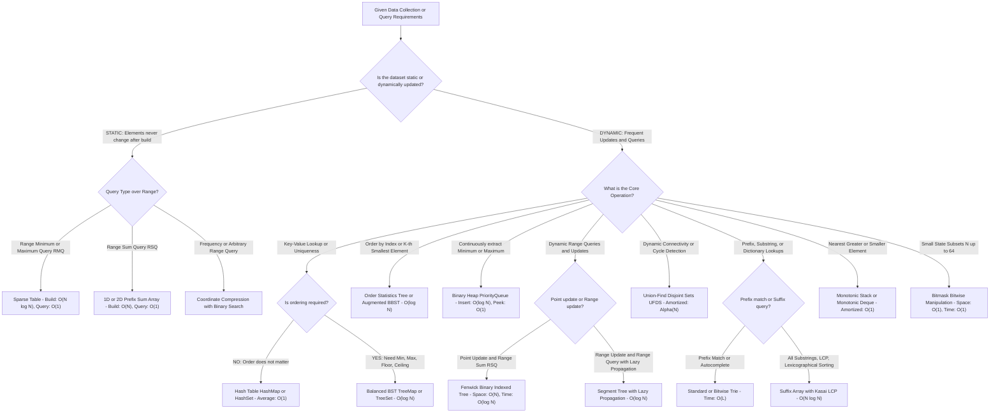
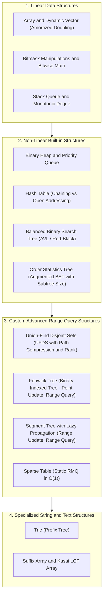

# 002. Data Structures Comprehensive Master Manual & Revision Guide

> **Document Serial**: `002`  
> **Topic**: Complete Exhaustive Data Structures Knowledge Base, Algorithmic Decision Paradigms & Quick Revision Guide  
> **Source Ground Truth**: Comprehensive Algorithmic & Data Structures Engineering Library  
> **Language Support**: 100% Complete & Standalone Executable **Python 3** and **Java 21** for **Every Single Data Structure**  
> **UI Control**: Interactive native toggle tabs (HTML details and summary tags) for every code implementation  
> **Generated Timestamp**: `2026-11-05T21:16:00+06:00`

---

---

## [Decision Tree] Master Decision Tree: What Data Structure to Choose at What Condition?

When designing software or solving high-performance algorithmic problems in an interview or production setting, follow this **instant structural routing flowchart**:



---

### [Summary] Quick-Lookup Interview Trigger Table

| If the problem mentions... | Invariant / Constraint | Pick This Data Structure | Time Complexity | Real-World Example Problem | Plain-English Intuitive Solution |
| :--- | :--- | :--- | :--- | :--- | :--- |
| **"Static range minimum query (RMQ) with zero updates"** | Immutable array, `O(1)` query needed | **Sparse Table** | Prep: `O(N log N)`, Query: `O(1)` | **Range Minimum Query in Immutable Telemetry**: Query lowest ping in historical sensor logs. | Precompute power-of-two jump tables `2^k`. Because finding min is idempotent (`min(A, A) = A`), overlap two intervals of length `2^k` that completely cover `[L, R]` in one single comparison. |
| **"Dynamic point update + prefix/range sum"** | Mutable array, prefix cumulative frequency | **Fenwick (Binary Indexed) Tree** | Space: `O(N)`, Update: `O(log N)`, Query: `O(log N)` | **Running Leaderboard Score Changes**: Update individual user scores and query total points in top rank range. | Use the lowest significant bit `LSB(i) = i & (-i)` to let each tree index manage a range of size `LSB(i)`. Fast to write and uses zero pointer overhead compared to trees. |
| **"Range update (add x to [L, R]) + Range min/sum query"** | Both updates and queries span arbitrary intervals | **Segment Tree with Lazy Propagation** | Space: `O(4N)`, Update: `O(log N)`, Query: `O(log N)` | **Hotel Room Booking Intervals (LeetCode 732)**: Add +5guest bookings to date ranges and check peak occupancy. | Build a binary tree where nodes represent intervals. Postpone updates to children by storing a "lazy" pending tag until a future query actually needs to visit that subtree. |
| **"Dynamic connectivity / Cycle detection in edges"** | Merging disjoint groups and checking connected status | **Union-Find Disjoint Sets (UFDS)** | Space: `O(N)`, Operations: `O(alpha(N)) ~ O(1)` | **Redundant Connection (LeetCode 684)**: Detect the exact edge that creates a loop in a network. | Each item points to its parent representative. Use path compression (flattening tree on find) and union by rank. If `find(u) == find(v)` before adding edge, a cycle is detected! |
| **"Next greater element / Stock span / Histogram area"** | Finding the nearest larger/smaller boundary | **Monotonic Stack** | Space: `O(N)`, Push/Pop Amortized: `O(1)` | **Largest Rectangle in Histogram (LeetCode 84)**: Find max rectangular area under bar chart heights. | Keep elements in strictly ascending order in a stack. When a smaller bar arrives, pop all taller bars--they have found their right boundary, allowing immediate rectangle width calculations. |
| **"Sliding window maximum / Min in rolling buffer"** | Rolling contiguous window of fixed size K | **Monotonic Deque** | Space: `O(K)`, Push/Pop Amortized: `O(1)` | **Sliding Window Maximum (LeetCode 239)**: Return max element in sliding window of size K. | Keep window element indices in a double-ended queue. Maintain values in descending order by evicting smaller elements from the back; evict out-of-window indices from the front. |
| **"Prefix matching / Word search / IP routing"** | Common string prefix sharing | **Trie (Prefix Tree)** | Space: `O(N * L)`, Search: `O(L)` | **Implement Trie (LeetCode 208)**: Autocomplete and dictionary word prefix validator. | Each tree node has an array or map of children (`a-z`). Follow edge characters letter-by-letter down the tree. Mark `is_end_of_word = true` at terminal letters. |
| **"Lexicographical substring queries / Longest repeat"** | All suffix ordering of a text string | **Suffix Array with Kasai LCP** | Space: `O(N)`, Build: `O(N log N)`, Query: `O(1)` | **Longest Duplicate Substring (LeetCode 1044)**: Find longest sequence of characters that repeats anywhere in text. | Sort all suffix indices lexicographically. Build the Longest Common Prefix (LCP) array in linear time using Kasai's algorithm; the maximum value in LCP gives the longest duplicate substring immediately. |
| **"Fast subset state / 20-30 flags packing"** | `N <= 60` discrete binary options | **Bitmask Operations** | Space: `O(1)`, Query/Update: `O(1)` | **Subsets & Assignment DP (LeetCode 78)**: Track completed tasks or visited cities as integer bits. | Store set elements in an integer's bits. `mask | (1 << i)` adds element `i`, `mask & ~(1 << i)` removes it, `(mask >> i) & 1` checks presence, and `mask & (-mask)` gets lowest set bit. |
| **"K-th smallest element with insertions / Rank query"** | Dynamic ordered multiset with indexing | **Order Statistics Tree (pb_ds / Augmented BST)** | Space: `O(N)`, Insertion: `O(log N)`, Find_by_order: `O(log N)` | **Find Median from Data Stream (LeetCode 295)**: Continuously query median value as numbers arrive. | Augment each node in a Balanced BST with a `subtree_size` field. Determine the K-th smallest element or the exact rank of a key in `O(log N)` by comparing against `left_child.size`. |
| **"Continuous min/max extraction"** | Always need extreme element | **Binary Heap (PriorityQueue)** | Space: `O(N)`, Insert: `O(log N)`, Extract-Min: `O(log N)` | **Merge K Sorted Lists (LeetCode 23)**: Merge K sorted streams into a single ascending list. | Store elements in a complete binary tree packed in an array. Parent of `i` is `i // 2`. Sift up on insert, sift down on extraction to guarantee root is always the extreme element. |
| **"Arbitrary values into contiguous indices [0..M-1]"** | Numbers up to `10^9`, but total distinct count `<= 10^5` | **Coordinate Compression** | Space: `O(N)`, Prep: `O(N log N)`, Lookup: `O(log N)` | **Count of Range Sum (LeetCode 327)**: Map extreme coordinate ranges to fit inside Segment/Fenwick Trees. | Sort unique elements in an array. Replace each original value with its 0-indexed position via binary search (`std::lower_bound` / `bisect_left`). |

---

## [Guide] Complete Master Curriculum & Topic Index

This manual covers **every core and advanced data structure** from fundamental linear libraries to specialized range-query and string-indexing structures:



---

## 1. Dynamic Array & Coordinate Compression

An **Array** is a contiguous block of memory with `O(1)` random access. A **Dynamic Array** (Python `list`, Java `ArrayList`) doubles its capacity upon reaching saturation, achieving `O(1)` amortized append.
**Coordinate Compression** maps arbitrary large coordinates (e.g., `-10^9 to 10^9`) to a compact contiguous rank space `[0..M-1]` in `O(N log N)`, making it possible to use arrays, Segment Trees, or Fenwick Trees without massive sparse tables.

### Memory Layer

> **Memory Hook**: *"Renaming scattered phone numbers to speed-dial buttons 1, 2, 3."* You don't need a keypad with 10-digit numbers; you just sort your contacts alphabetically and assign them buttons 0, 1, 2... based on their rank.
>
> **How It Solves the Problem (Plain English)**: If your numbers are huge (like -1,000,000,000 and +1,000,000,000), you can't use them as array slots without crashing your computer's memory. But if there are only 1,000 numbers in total, their exact values don't matter--only their relative order does. You sort them and replace them with their ranks: 0, 1, 2, ..., 999.

### Canonical Benchmark Problem

- **Online Judge Platform**: LeetCode
- **Problem Reference**: LeetCode 1365 - How Many Numbers Are Smaller Than the Current Number
- **Difficulty**: Easy / Classic Coordinate Compression Benchmark

#### Problem Statement (Plain English Breakdown)
You are given a list of integer numbers. For every single number in this list, your job is to find out how many *other* numbers in the entire list are strictly smaller than it.

For example, imagine you are looking at the list `[8, 1, 2, 2, 3]`:
- For `8`: The numbers smaller than it are `1, 2, 2, 3`. That is 4 numbers.
- For `1`: There are no numbers smaller than 1. That is 0 numbers.
- For the first `2`: Only `1` is smaller. That is 1 number.
- For the second `2`: Only `1` is smaller. That is 1 number.
- For `3`: The numbers smaller than it are `1, 2, 2`. That is 3 numbers.
The final answer we must return is `[4, 0, 1, 1, 3]`.

The values could be scattered, negative, or up to a billion in generalized versions (such as interval intersection problems), but the total number of items is modest.

#### Beginner Intuition & Step-by-Step Solution Strategy
A beginner might first think: "Why not just take each number one by one, loop through all other numbers, count how many are smaller, and write down the answer?"
While that works for a tiny list, it does double-work. If there are 100,000 numbers, checking every pair takes 10,000,000,000 comparisons, which completely freezes the computer.

Here is the clean coordinate compression strategy:
1. Make a copy of the numbers and sort them from smallest to largest.
2. In a sorted list, what does an element's index tell you? It tells you *exactly* how many numbers come before it! For example, if sorted numbers are `[1, 2, 2, 3, 8]`:
   - `1` is at index 0 (0 numbers are smaller than 1).
   - The first `2` is at index 1 (1 number is smaller than 2). We ignore subsequent duplicate 2s because they have the same rank.
   - `3` is at index 3 (3 numbers are smaller than 3).
   - `8` is at index 4 (4 numbers are smaller than 8).
3. We store this mapping from value to its first sorted index in a fast lookup table (hash map).
4. Finally, we walk through our original list in its initial order, look up each number in our map, and immediately get our answer in one step!

#### Fully Commented Benchmark Solution

<details open>
<summary><b>[Python] Python 3 Benchmark Solution: Smaller Numbers Count</b></summary>

```python
from typing import List, Dict

def smallerNumbersThanCurrent(nums: List[int]) -> List[int]:
    # Step 1: Sort a copy of the numbers to reveal their relative ranks
    sorted_nums = sorted(nums)
    
    # Step 2: Record the first index where each distinct number appears.
    # Because the list is sorted, that first index equals the count of strictly smaller numbers.
    rank_map: Dict[int, int] = {}
    for index, val in enumerate(sorted_nums):
        if val not in rank_map:
            rank_map[val] = index
            
    # Step 3: Map each original number directly to its precomputed rank
    return [rank_map[num] for num in nums]

if __name__ == "__main__":
    test_input = [8, 1, 2, 2, 3]
    result = smallerNumbersThanCurrent(test_input)
    print("Input numbers: ", test_input)
    print("Counts smaller:", result) # Expected: [4, 0, 1, 1, 3]
```
</details>

<details>
<summary><b>[Java] Java 21 Benchmark Solution: Smaller Numbers Count</b></summary>

```java
import java.util.*;

public class SmallerNumbersBenchmark {
    public static int[] smallerNumbersThanCurrent(int[] nums) {
        // Step 1: Clone and sort the array to establish relative ranking
        int[] sorted = nums.clone();
        Arrays.sort(sorted);
        
        // Step 2: Map each unique value to its very first index in the sorted order
        Map<Integer, Integer> rankMap = new HashMap<>();
        for (int i = 0; i < sorted.length; i++) {
            // Only record the first time we see the number (handles duplicates)
            rankMap.putIfAbsent(sorted[i], i);
        }
        
        // Step 3: Construct the result using the original order
        int[] result = new int[nums.length];
        for (int i = 0; i < nums.length; i++) {
            result[i] = rankMap.get(nums[i]);
        }
        return result;
    }

    public static void main(String[] args) {
        int[] testInput = {8, 1, 2, 2, 3};
        int[] result = smallerNumbersThanCurrent(testInput);
        System.out.println("Input:  " + Arrays.toString(testInput));
        System.out.println("Result: " + Arrays.toString(result)); // [4, 0, 1, 1, 3]
    }
}
```
</details>

### Standard Library & Implementation Reference

<details open>
<summary><b>[Python] Python 3 Implementation: Dynamic Array & Coordinate Compression</b></summary>

```python
import bisect
from typing import List, Dict

class CoordinateCompressor:
    def __init__(self, raw_values: List[int]):
        self.raw = raw_values
        # Sort and take unique values
        self.sorted_unique: List[int] = sorted(list(set(raw_values)))
        self.val_to_rank: Dict[int, int] = {val: idx for idx, val in enumerate(self.sorted_unique)}

    def get_rank(self, val: int) -> int:
        # O(1) via hash table or O(log M) via binary search
        return self.val_to_rank.get(val, bisect.bisect_left(self.sorted_unique, val))

    def get_val(self, rank: int) -> int:
        return self.sorted_unique[rank]

    def compress_array(self) -> List[int]:
        return [self.val_to_rank[x] for x in self.raw]

if __name__ == "__main__":
    coords = [1000000000, -500000000, 42, 1000000000, 42, 999]
    comp = CoordinateCompressor(coords)
    compressed = comp.compress_array()
    print("Original Coordinates:", coords)
    print("Compressed Ranks (0..M-1):", compressed)
    print("Distinct Values Count:", len(comp.sorted_unique))
    print("Value for Rank 0:", comp.get_val(0))
```
</details>

<details>
<summary><b>[Java] Java 21 Implementation: Dynamic Array & Coordinate Compression</b></summary>

```java
import java.util.*;

public class CoordinateCompressorDemo {
    private final int[] sortedUnique;
    private final Map<Integer, Integer> valToRank;

    public CoordinateCompressorDemo(int[] rawValues) {
        // Collect sorted unique elements
        TreeSet<Integer> set = new TreeSet<>();
        for (int v : rawValues) set.add(v);

        sortedUnique = new int[set.size()];
        valToRank = new HashMap<>();
        int rank = 0;
        for (int v : set) {
            sortedUnique[rank] = v;
            valToRank.put(v, rank);
            rank++;
        }
    }

    public int getRank(int val) {
        return valToRank.getOrDefault(val, -1);
    }

    public int getValue(int rank) {
        return sortedUnique[rank];
    }

    public int[] compressArray(int[] rawValues) {
        int[] res = new int[rawValues.length];
        for (int i = 0; i < rawValues.length; i++) {
            res[i] = valToRank.get(rawValues[i]);
        }
        return res;
    }

    public static void main(String[] args) {
        int[] coords = {1000000000, -500000000, 42, 1000000000, 42, 999};
        CoordinateCompressorDemo comp = new CoordinateCompressorDemo(coords);
        int[] compressed = comp.compressArray(coords);

        System.out.println("Original Coordinates: " + Arrays.toString(coords));
        System.out.println("Compressed Ranks: " + Arrays.toString(compressed));
        System.out.println("Rank of 42: " + comp.getRank(42));
        System.out.println("Value of Rank 0: " + comp.getValue(0));
    }
}
```
</details>

---

## 2. Bitmask & Bitwise Manipulation

A **Bitmask** uses the individual bits of an integer (32-bit `int` or 64-bit `long`) to represent a subset of up to 64 items. Every set operation (union, intersection, element toggle, lowest set bit isolation) executes in `O(1)` CPU cycles with zero memory overhead.

### Memory Layer

> **Memory Hook**: *"A bank of light switches on a control board."* Each switch is either ON (1) or OFF (0); checking or flipping any light is instant.
>
> **How It Solves the Problem (Plain English)**: Instead of using heavy lists or sets to remember whether you picked item 1, item 2, or item 3, you use a single integer. Each binary digit of the integer represents one item (1 = picked, 0 = not picked). You can add, remove, or check items instantly using simple math.

### Canonical Benchmark Problem

- **Online Judge Platform**: LeetCode
- **Problem Reference**: LeetCode 78 - Subsets (Power Set)
- **Difficulty**: Medium / Fundamental Bitmask Benchmark

#### Problem Statement (Plain English Breakdown)
You are given a list of unique numbers, for example `[1, 2, 3]`. You are asked to return *all possible subsets* that can be created from these numbers (also known as the Power Set).

What is a subset? A subset is any combination of elements you can form by deciding, for each element, whether to keep it or leave it behind.
For `[1, 2, 3]`, all possible subsets are:
- The empty set: `[]` (we picked nothing)
- Sets with 1 item: `[1]`, `[2]`, `[3]`
- Sets with 2 items: `[1, 2]`, `[1, 3]`, `[2, 3]`
- The complete set: `[1, 2, 3]`
In total, for 3 numbers, there are exactly 2^3 = 8 subsets.

#### Beginner Intuition & Step-by-Step Solution Strategy
Notice that for every single number in the list, there are only two choices:
- Choice 0: Leave it out.
- Choice 1: Include it.

If there are N numbers, there are 2^N total choices. This matches binary numbers perfectly!
Let us write out the binary numbers from 0 up to 7 (which is 2^3 - 1):
- `000` in binary means: don't take element 0, don't take element 1, don't take element 2 -> `[]`
- `001` in binary means: take element 0 -> `[1]`
- `010` in binary means: take element 1 -> `[2]`
- `011` in binary means: take element 0 and element 1 -> `[1, 2]`
- `100` in binary means: take element 2 -> `[3]`
- `101` in binary means: take element 0 and element 2 -> `[1, 3]`
- `110` in binary means: take element 1 and element 2 -> `[2, 3]`
- `111` in binary means: take element 0, 1, and 2 -> `[1, 2, 3]`

Instead of writing complex recursive backtracking with helper functions and state rollbacks, we can just run a simple counting loop from `0` to `(2^N) - 1`. For each number in our loop, we inspect its binary digits: if the i-th bit is 1, we add `nums[i]` to our subset!

#### Fully Commented Benchmark Solution

<details open>
<summary><b>[Python] Python 3 Benchmark Solution: Bitmask Subsets</b></summary>

```python
from typing import List

def subsets(nums: List[int]) -> List[List[int]]:
    n = len(nums)
    total_subsets = 1 << n  # 1 << n computes 2^n in O(1) time
    all_subsets = []
    
    # Loop through every integer mask from 0 up to 2^n - 1
    for mask in range(total_subsets):
        current_subset = []
        for i in range(n):
            # Check if the i-th bit in mask is turned ON (equals 1)
            if (mask >> i) & 1:
                current_subset.append(nums[i])
        all_subsets.append(current_subset)
        
    return all_subsets

if __name__ == "__main__":
    nums = [1, 2, 3]
    result = subsets(nums)
    print(f"Generated {len(result)} subsets for {nums}:")
    for s in result:
        print(" ", s)
```
</details>

<details>
<summary><b>[Java] Java 21 Benchmark Solution: Bitmask Subsets</b></summary>

```java
import java.util.*;

public class BitmaskSubsetsBenchmark {
    public static List<List<Integer>> subsets(int[] nums) {
        int n = nums.length;
        int totalSubsets = 1 << n; // 2^n total subsets
        List<List<Integer>> result = new ArrayList<>();
        
        // Loop from 0 to 2^n - 1
        for (int mask = 0; mask < totalSubsets; mask++) {
            List<Integer> currentSubset = new ArrayList<>();
            for (int i = 0; i < n; i++) {
                // Check if the i-th switch is ON
                if (((mask >> i) & 1) == 1) {
                    currentSubset.add(nums[i]);
                }
            }
            result.add(currentSubset);
        }
        return result;
    }

    public static void main(String[] args) {
        int[] nums = {1, 2, 3};
        List<List<Integer>> allSubsets = subsets(nums);
        System.out.println("Total subsets: " + allSubsets.size());
        for (List<Integer> subset : allSubsets) {
            System.out.println("  " + subset);
        }
    }
}
```
</details>

### Standard Library & Implementation Reference

<details open>
<summary><b>[Python] Python 3 Implementation: Bitmask Manipulation</b></summary>

```python
class BitmaskOperations:
    @staticmethod
    def set_bit(mask: int, i: int) -> int:
        return mask | (1 << i)

    @staticmethod
    def clear_bit(mask: int, i: int) -> int:
        return mask & ~(1 << i)

    @staticmethod
    def toggle_bit(mask: int, i: int) -> int:
        return mask ^ (1 << i)

    @staticmethod
    def check_bit(mask: int, i: int) -> bool:
        return bool((mask >> i) & 1)

    @staticmethod
    def get_lowest_set_bit(mask: int) -> int:
        return mask & (-mask)

    @staticmethod
    def count_set_bits(mask: int) -> int:
        count = 0
        while mask > 0:
            mask = mask & (mask - 1)  # Clear lowest set bit
            count += 1
        return count

    @staticmethod
    def generate_all_subsets(n: int):
        # Generates all 2^n subsets
        subsets = []
        for mask in range(1 << n):
            current = [i for i in range(n) if (mask >> i) & 1]
            subsets.append(current)
        return subsets

if __name__ == "__main__":
    b = BitmaskOperations()
    mask = 0
    mask = b.set_bit(mask, 1)  # Turn on 1
    mask = b.set_bit(mask, 3)  # Turn on 3 (mask = 1010 in binary = 10)
    print("Mask binary:", bin(mask), "| Value:", mask)
    print("Is bit 1 set?", b.check_bit(mask, 1))
    print("Is bit 2 set?", b.check_bit(mask, 2))
    print("Lowest set bit (LSB):", b.get_lowest_set_bit(mask))
    print("Number of set bits:", b.count_set_bits(mask))
    print("All subsets of size 3 count:", len(b.generate_all_subsets(3)))
```
</details>

<details>
<summary><b>[Java] Java 21 Implementation: Bitmask Manipulation</b></summary>

```java
import java.util.*;

public class BitmaskDemo {
    public static int setBit(int mask, int i) { return mask | (1 << i); }
    public static int clearBit(int mask, int i) { return mask & ~(1 << i); }
    public static int toggleBit(int mask, int i) { return mask ^ (1 << i); }
    public static boolean checkBit(int mask, int i) { return ((mask >> i) & 1) == 1; }
    public static int getLSB(int mask) { return mask & (-mask); }

    public static int countSetBits(int mask) {
        int count = 0;
        while (mask > 0) {
            mask &= (mask - 1);
            count++;
        }
        return count;
    }

    public static List<List<Integer>> generateSubsets(int n) {
        List<List<Integer>> res = new ArrayList<>();
        int total = 1 << n;
        for (int mask = 0; mask < total; mask++) {
            List<Integer> sub = new ArrayList<>();
            for (int i = 0; i < n; i++) {
                if (((mask >> i) & 1) == 1) sub.add(i);
            }
            res.add(sub);
        }
        return res;
    }

    public static void main(String[] args) {
        int mask = 0;
        mask = setBit(mask, 1);
        mask = setBit(mask, 3);

        System.out.println("Mask: " + mask + " (Binary: " + Integer.toBinaryString(mask) + ")");
        System.out.println("Is bit 1 set? " + checkBit(mask, 1));
        System.out.println("Is bit 2 set? " + checkBit(mask, 2));
        System.out.println("Lowest set bit (LSB): " + getLSB(mask));
        System.out.println("Count of set bits: " + countSetBits(mask));
        System.out.println("Generated subsets count for n=3: " + generateSubsets(3).size());
    }
}
```
</details>

---

## 3. Monotonic Stack & Monotonic Deque

A **Monotonic Stack** maintains its elements in strictly monotonic (increasing or decreasing) order. Each element is pushed and popped at most once, providing an `O(N)` solution for finding the **Nearest Greater or Smaller Element** for every item in an array.
A **Monotonic Deque** extends this to a sliding window of size `K`, maintaining elements in monotonic order by popping outdated indices from the front and smaller values from the back in amortized `O(1)` per window step.

### Memory Layer

> **Memory Hook**: *"Standing in line at a movie theater."* If someone taller stands in front of you, you can't see the screen anymore (you get kicked out of view).
>
> **How It Solves the Problem (Plain English)**: As you scan a list of numbers, you only care about numbers that still have a chance of being the "next bigger" thing. Whenever a new number arrives that is bigger than what you've seen, it kicks out all the smaller numbers behind it because they are blocked and will never be needed again. For sliding windows, old numbers also leave from the front as time expires.

### Canonical Benchmark Problem

- **Online Judge Platform**: LeetCode
- **Problem Reference**: LeetCode 84 - Largest Rectangle in Histogram
- **Difficulty**: Hard / Legendary Monotonic Stack Benchmark

#### Problem Statement (Plain English Breakdown)
Imagine you are looking at a bar chart (histogram) where each bar has a width of 1 unit, but the bars have different heights.
For example, given heights: `[2, 1, 5, 6, 2, 3]`.

You want to find the largest rectangular box that can fit completely inside these bars without sticking out into empty air.
- You can make a rectangle of height 1 spanning all 6 bars -> Area = 1 * 6 = 6.
- You can make a rectangle using the two tallest bars of height 5 and 6 -> Minimum height across them is 5, width is 2 -> Area = 5 * 2 = 10.
The maximum possible rectangular area here is 10.

#### Beginner Intuition & Step-by-Step Solution Strategy
A beginner might try every possible pair of left and right boundaries, find the minimum height between them, and compute `height * width`. But checking every pair of bars takes O(N^2) time, which fails when N = 100,000 bars.

Let us ask a smarter question from the perspective of each individual bar:
"If bar `i` is the shortest bar in a rectangle, how far can that rectangle expand to the left and to the right?"
- It can expand to the left until it hits a bar that is *shorter* than it.
- It can expand to the right until it hits a bar that is *shorter* than it.

Once we know the index of the first shorter bar on the left and the first shorter bar on the right, the width is simply `right_boundary - left_boundary - 1`, and the area is `heights[i] * width`.

How do we find these boundaries in one single pass? With a **Monotonic Stack**:
1. We keep a stack of bar indices whose heights are strictly increasing.
2. When we walk across the histogram and see a bar that is *shorter* than the bar on top of the stack, that shorter bar is the official right boundary for the taller bar on top!
3. We pop the taller bar from the stack. Its left boundary is simply whatever bar is now sitting right beneath it in the stack.
4. We calculate its area immediately! Because every bar is pushed once and popped once, the whole problem is solved in O(N) time.

#### Fully Commented Benchmark Solution

<details open>
<summary><b>[Python] Python 3 Benchmark Solution: Largest Rectangle in Histogram</b></summary>

```python
from typing import List

def largestRectangleArea(heights: List[int]) -> int:
    # Add a zero height sentinel at the end to force all remaining bars to pop
    extended_heights = heights + [0]
    stack = []  # Stores indices of bars in strictly ascending height order
    max_area = 0
    
    for current_idx, current_h in enumerate(extended_heights):
        # While the current bar is shorter than the bar on top of our stack,
        # the current bar serves as the right boundary for the bar on top!
        while stack and extended_heights[stack[-1]] > current_h:
            popped_idx = stack.pop()
            h = extended_heights[popped_idx]
            
            # If stack is empty, it expanded all the way to index 0 (width = current_idx)
            # Otherwise, the new top of the stack is the first shorter bar on the left
            left_boundary = stack[-1] if stack else -1
            width = current_idx - left_boundary - 1
            max_area = max(max_area, h * width)
            
        stack.append(current_idx)
        
    return max_area

if __name__ == "__main__":
    bars = [2, 1, 5, 6, 2, 3]
    result = largestRectangleArea(bars)
    print("Histogram heights:", bars)
    print("Maximum rectangular area:", result) # Expected 10
```
</details>

<details>
<summary><b>[Java] Java 21 Benchmark Solution: Largest Rectangle in Histogram</b></summary>

```java
import java.util.*;

public class HistogramBenchmark {
    public static int largestRectangleArea(int[] heights) {
        int n = heights.length;
        // Append a 0-height sentinel at the end
        int[] h = new int[n + 1];
        System.arraycopy(heights, 0, h, 0, n);
        h[n] = 0;
        
        Deque<Integer> stack = new ArrayDeque<>();
        int maxArea = 0;
        
        for (int i = 0; i <= n; i++) {
            // While current bar is lower than stack top bar, compute rectangle for stack top
            while (!stack.isEmpty() && h[stack.peek()] > h[i]) {
                int poppedIndex = stack.pop();
                int height = h[poppedIndex];
                int leftBoundary = stack.isEmpty() ? -1 : stack.peek();
                int width = i - leftBoundary - 1;
                maxArea = Math.max(maxArea, height * width);
            }
            stack.push(i);
        }
        return maxArea;
    }

    public static void main(String[] args) {
        int[] bars = {2, 1, 5, 6, 2, 3};
        System.out.println("Max area: " + largestRectangleArea(bars)); // 10
    }
}
```
</details>

### Standard Library & Implementation Reference

<details open>
<summary><b>[Python] Python 3 Implementation: Monotonic Stack & Deque</b></summary>

```python
from collections import deque
from typing import List

class MonotonicStructures:
    @staticmethod
    def next_greater_elements(nums: List[int]) -> List[int]:
        # Returns an array where ans[i] is the next greater element to the right of nums[i]
        n = len(nums)
        ans = [-1] * n
        stack = []  # stores indices

        for i in range(n):
            while stack and nums[stack[-1]] < nums[i]:
                prev_idx = stack.pop()
                ans[prev_idx] = nums[i]
            stack.append(i)
        return ans

    @staticmethod
    def max_sliding_window(nums: List[int], k: int) -> List[int]:
        # O(N) sliding window maximum using Monotonic Deque
        q = deque()  # stores indices
        res = []

        for i in range(len(nums)):
            # 1. Evict elements out of the current sliding window
            if q and q[0] < i - k + 1:
                q.popleft()

            # 2. Maintain descending order in deque (evict smaller elements from back)
            while q and nums[q[-1]] <= nums[i]:
                q.pop()

            q.append(i)

            # 3. Add +5to result once first window is formed
            if i >= k - 1:
                res.append(nums[q[0]])

        return res

if __name__ == "__main__":
    ms = MonotonicStructures()
    arr = [2, 1, 5, 6, 2, 3]
    print("Original Array:", arr)
    print("Next Greater Elements:", ms.next_greater_elements(arr))
    window_max = ms.max_sliding_window([1, 3, -1, -3, 5, 3, 6, 7], k=3)
    print("Sliding Window Maximum (k=3):", window_max)
```
</details>

<details>
<summary><b>[Java] Java 21 Implementation: Monotonic Stack & Deque</b></summary>

```java
import java.util.*;

public class MonotonicStructuresDemo {
    public static int[] nextGreaterElements(int[] nums) {
        int n = nums.length;
        int[] ans = new int[n];
        Arrays.fill(ans, -1);
        Deque<Integer> stack = new ArrayDeque<>(); // stores indices

        for (int i = 0; i < n; i++) {
            while (!stack.isEmpty() && nums[stack.peek()] < nums[i]) {
                int prevIdx = stack.pop();
                ans[prevIdx] = nums[i];
            }
            stack.push(i);
        }
        return ans;
    }

    public static int[] maxSlidingWindow(int[] nums, int k) {
        if (nums == null || nums.length == 0 || k <= 0) return new int[0];
        int n = nums.length;
        int[] res = new int[n - k + 1];
        Deque<Integer> deque = new ArrayDeque<>(); // stores indices

        for (int i = 0; i < n; i++) {
            // Evict indices outside current window
            if (!deque.isEmpty() && deque.peekFirst() < i - k + 1) {
                deque.pollFirst();
            }
            // Maintain monotonic descending order
            while (!deque.isEmpty() && nums[deque.peekLast()] <= nums[i]) {
                deque.pollLast();
            }
            deque.offerLast(i);

            if (i >= k - 1) {
                res[i - k + 1] = nums[deque.peekFirst()];
            }
        }
        return res;
    }

    public static void main(String[] args) {
        int[] arr = {2, 1, 5, 6, 2, 3};
        System.out.println("Original: " + Arrays.toString(arr));
        System.out.println("Next Greater: " + Arrays.toString(nextGreaterElements(arr)));

        int[] stream = {1, 3, -1, -3, 5, 3, 6, 7};
        int[] windowMax = maxSlidingWindow(stream, 3);
        System.out.println("Sliding Window Max (k=3): " + Arrays.toString(windowMax));
    }
}
```
</details>

---

## 4. Binary Heap & Priority Queue

A **Binary Heap** is a complete binary tree packed efficiently into a 1D array where every parent satisfies the heap property relative to its children (Min-Heap: `parent <= children`; Max-Heap: `parent >= children`).
Because the tree is complete, the parent of index `i` is `i // 2` (or `(i - 1) // 2` in 0-indexed arrays), and its children are `2 * i + 1` and `2 * i + 2`.
- **Insert**: Append at leaf, `sift_up` in `O(log N)`.
- **Extract Extremum**: Swap root with last leaf, pop, `sift_down` in `O(log N)`.
- **Heapify**: Bottom-up construction of an entire heap from an array in `O(N)` linear time.

### Memory Layer

> **Memory Hook**: *"A strict military chain of command."* The General is always at the top; a strong newcomer challenges their officer to rise up the ranks until hitting someone better.
>
> **How It Solves the Problem (Plain English)**: You pack a complete pyramid of numbers into a simple flat list. The most important number is always at the very top. When you add a new number, you place it at the bottom and let it bubble up past anyone weaker. When you take the top number, you fill the hole with a bottom number and let it sink down until order is restored.

### Canonical Benchmark Problem

- **Online Judge Platform**: LeetCode
- **Problem Reference**: LeetCode 23 - Merge k Sorted Lists
- **Difficulty**: Hard / Classic Priority Queue (Heap) Benchmark

#### Problem Statement (Plain English Breakdown)
You are given an array of `k` linked lists, where each individual list is already sorted in ascending order from smallest to largest.
Your task is to merge all `k` lists together into one single giant sorted linked list and return it.

For example, imagine you are given 3 sorted lists:
- List 1: `1 -> 4 -> 5`
- List 2: `1 -> 3 -> 4`
- List 3: `2 -> 6`
When you merge them all together into one continuous line, the result should be:
`1 -> 1 -> 2 -> 3 -> 4 -> 4 -> 5 -> 6`.

#### Beginner Intuition & Step-by-Step Solution Strategy
A beginner might say: "Let's take every single node, dump them all into a giant array, sort the array with a standard sort, and rebuild a linked list."
While that works, it ignores the valuable fact that the lists are *already individually sorted*!

Think about real life: imagine 3 lines of students waiting outside a cafeteria, each line sorted by height from shortest to tallest.
- Who could possibly be the shortest person among everyone? Only the person standing at the very front of Line 1, Line 2, or Line 3!
- You never have to check people in the back of the lines. You only ever compare the people at the **heads** of the active lines.

This is the exact problem a **Min-Heap (Priority Queue)** solves:
1. Put the front element of each of the `k` lists into a Min-Heap. The heap only holds `k` elements at any time.
2. Pull out the smallest item from the heap. This item is guaranteed to be the overall minimum among all available choices! Attach it to your merged list.
3. Whoever was standing right behind that person in their original list steps forward to the front. You push that next person into the heap.
4. Repeat this until the heap is empty.
Because the heap only ever holds `k` elements, inserting and extracting takes only `O(log k)` time. If there are `N` total numbers across all lists, the total time is `O(N log k)`.

#### Fully Commented Benchmark Solution

<details open>
<summary><b>[Python] Python 3 Benchmark Solution: Merge K Sorted Lists</b></summary>

```python
import heapq
from typing import List, Optional

class ListNode:
    def __init__(self, val=0, next=None):
        self.val = val
        self.next = next

def mergeKLists(lists: List[Optional[ListNode]]) -> Optional[ListNode]:
    # Min-heap stores tuples: (node_value, unique_counter, node_object)
    # The unique counter prevents comparison errors when node values are equal
    heap = []
    counter = 0
    
    # Step 1: Push the head of each non-empty list into the heap
    for head in lists:
        if head:
            heapq.heappush(heap, (head.val, counter, head))
            counter += 1
            
    dummy_head = ListNode(0)
    current = dummy_head
    
    # Step 2: Continuously extract the minimum node and advance that list
    while heap:
        val, _, min_node = heapq.heappop(heap)
        current.next = min_node
        current = current.next
        
        # If the extracted node has a next node, push that successor into the heap
        if min_node.next:
            heapq.heappush(heap, (min_node.next.val, counter, min_node.next))
            counter += 1
            
    return dummy_head.next

# Helper to print linked lists for verification
def print_list(node: Optional[ListNode]):
    vals = []
    while node:
        vals.append(str(node.val))
        node = node.next
    print(" -> ".join(vals))

if __name__ == "__main__":
    # Create List 1: 1 -> 4 -> 5
    l1 = ListNode(1, ListNode(4, ListNode(5)))
    # Create List 2: 1 -> 3 -> 4
    l2 = ListNode(1, ListNode(3, ListNode(4)))
    # Create List 3: 2 -> 6
    l3 = ListNode(2, ListNode(6))
    
    merged = mergeKLists([l1, l2, l3])
    print("Merged K Sorted Lists result:")
    print_list(merged) # 1 -> 1 -> 2 -> 3 -> 4 -> 4 -> 5 -> 6
```
</details>

<details>
<summary><b>[Java] Java 21 Benchmark Solution: Merge K Sorted Lists</b></summary>

```java
import java.util.*;

public class MergeKSortedListsBenchmark {
    public static class ListNode {
        int val;
        ListNode next;
        ListNode(int val) { this.val = val; }
        ListNode(int val, ListNode next) { this.val = val; this.next = next; }
    }

    public static ListNode mergeKLists(ListNode[] lists) {
        if (lists == null || lists.length == 0) return null;
        
        // Priority queue sorted by node value ascending
        PriorityQueue<ListNode> minHeap = new PriorityQueue<>(Comparator.comparingInt(a -> a.val));
        
        // Step 1: Add the head of each non-empty list to the heap
        for (ListNode node : lists) {
            if (node != null) {
                minHeap.offer(node);
            }
        }
        
        ListNode dummy = new ListNode(0);
        ListNode current = dummy;
        
        // Step 2: Pop minimum, link to result, and insert successor
        while (!minHeap.isEmpty()) {
            ListNode smallest = minHeap.poll();
            current.next = smallest;
            current = current.next;
            
            if (smallest.next != null) {
                minHeap.offer(smallest.next);
            }
        }
        
        return dummy.next;
    }

    public static void main(String[] args) {
        ListNode l1 = new ListNode(1, new ListNode(4, new ListNode(5)));
        ListNode l2 = new ListNode(1, new ListNode(3, new ListNode(4)));
        ListNode l3 = new ListNode(2, new ListNode(6));
        
        ListNode merged = mergeKLists(new ListNode[]{l1, l2, l3});
        System.out.print("Merged: ");
        while (merged != null) {
            System.out.print(merged.val + (merged.next != null ? " -> " : ""));
            merged = merged.next;
        }
        System.out.println();
    }
}
```
</details>

### Standard Library & Implementation Reference

<details open>
<summary><b>[Python] Python 3 Implementation: Complete Binary Heap from Scratch</b></summary>

```python
from typing import List, Optional

class MinHeap:
    def __init__(self, elements: Optional[List[int]] = None):
        self.heap: List[int] = []
        if elements:
            self.heap = list(elements)
            # O(N) bottom-up heapify
            for i in range((len(self.heap) - 2) // 2, -1, -1):
                self._sift_down(i)

    def push(self, val: int):
        self.heap.append(val)
        self._sift_up(len(self.heap) - 1)

    def pop(self) -> int:
        if not self.heap:
            raise IndexError("pop from empty heap")
        min_val = self.heap[0]
        last_val = self.heap.pop()
        if self.heap:
            self.heap[0] = last_val
            self._sift_down(0)
        return min_val

    def peek(self) -> int:
        if not self.heap:
            raise IndexError("peek from empty heap")
        return self.heap[0]

    def _sift_up(self, idx: int):
        parent = (idx - 1) // 2
        while idx > 0 and self.heap[idx] < self.heap[parent]:
            self.heap[idx], self.heap[parent] = self.heap[parent], self.heap[idx]
            idx = parent
            parent = (idx - 1) // 2

    def _sift_down(self, idx: int):
        n = len(self.heap)
        while True:
            left = 2 * idx + 1
            right = 2 * idx + 2
            smallest = idx

            if left < n and self.heap[left] < self.heap[smallest]:
                smallest = left
            if right < n and self.heap[right] < self.heap[smallest]:
                smallest = right

            if smallest != idx:
                self.heap[idx], self.heap[smallest] = self.heap[smallest], self.heap[idx]
                idx = smallest
            else:
                break

    def __len__(self):
        return len(self.heap)

if __name__ == "__main__":
    h = MinHeap([9, 3, 5, 1, 7, 2, 8])
    print("Heapified array representation:", h.heap)
    print("Extracted Min:", h.pop())
    h.push(0)
    print("Peek Min after pushing 0:", h.peek())
    extracted = []
    while len(h) > 0:
        extracted.append(h.pop())
    print("Sorted elements popped from MinHeap:", extracted)
```
</details>

<details>
<summary><b>[Java] Java 21 Implementation: Complete Binary Heap from Scratch</b></summary>

```java
import java.util.*;

public class MinHeapDemo {
    private int[] heap;
    private int size;

    public MinHeapDemo(int capacity) {
        this.heap = new int[capacity];
        this.size = 0;
    }

    public void push(int val) {
        if (size == heap.length) {
            heap = Arrays.copyOf(heap, heap.length * 2);
        }
        heap[size] = val;
        siftUp(size);
        size++;
    }

    public int pop() {
        if (size == 0) throw new NoSuchElementException("Heap is empty");
        int minVal = heap[0];
        heap[0] = heap[size - 1];
        size--;
        if (size > 0) siftDown(0);
        return minVal;
    }

    public int peek() {
        if (size == 0) throw new NoSuchElementException("Heap is empty");
        return heap[0];
    }

    private void siftUp(int idx) {
        int parent = (idx - 1) / 2;
        while (idx > 0 && heap[idx] < heap[parent]) {
            swap(idx, parent);
            idx = parent;
            parent = (idx - 1) / 2;
        }
    }

    private void siftDown(int idx) {
        while (true) {
            int left = 2 * idx + 1;
            int right = 2 * idx + 2;
            int smallest = idx;

            if (left < size && heap[left] < heap[smallest]) smallest = left;
            if (right < size && heap[right] < heap[smallest]) smallest = right;

            if (smallest != idx) {
                swap(idx, smallest);
                idx = smallest;
            } else {
                break;
            }
        }
    }

    private void swap(int i, int j) {
        int t = heap[i]; heap[i] = heap[j]; heap[j] = t;
    }

    public int size() { return size; }

    public static void main(String[] args) {
        MinHeapDemo h = new MinHeapDemo(10);
        int[] init = {9, 3, 5, 1, 7, 2, 8};
        for (int v : init) h.push(v);

        System.out.println("Extracted Min: " + h.pop());
        h.push(0);
        System.out.println("Peek Min: " + h.peek());

        List<Integer> sorted = new ArrayList<>();
        while (h.size() > 0) sorted.add(h.pop());
        System.out.println("Sorted output: " + sorted);
    }
}
```
</details>

---

## 5. Hash Table (Separate Chaining)

A **Hash Table** maps arbitrary keys to bucket indices using a hash function `hash(key) % capacity`.
- **Collision Resolution**: Handled via **Separate Chaining** (linked list or dynamic vector per bucket) or **Open Addressing** (linear probing).
- **Load Factor**: When `size / capacity > load_factor_threshold` (typically `0.75`), the table allocates twice the capacity and re-hashes all keys to maintain `O(1)` amortized insertion and lookup.

### Memory Layer

> **Memory Hook**: *"Coat check hooks at a hotel."* Your ticket sends you to hook #17; if someone else is already hanging their coat there, you just hook your coat onto the same hanger behind theirs.
>
> **How It Solves the Problem (Plain English)**: You take an item's name and run it through a math formula to pick a bucket number. You put the item in that bucket. If two items pick the same bucket by accident, you just link them together in a short chain inside that bucket. As long as you have enough buckets, looking up an item is almost instant.

### Canonical Benchmark Problem

- **Online Judge Platform**: LeetCode
- **Problem Reference**: LeetCode 1 - Two Sum
- **Difficulty**: Easy / Universal Hash Table Benchmark

#### Problem Statement (Plain English Breakdown)
You are given a list of numbers, and a single number called `target`.
Your task is to find the indices of the *two distinct numbers* in the list that add up exactly to the `target`.

For example, given `nums = [2, 7, 11, 15]` and `target = 9`:
- `nums[0] + nums[1] = 2 + 7 = 9`.
- Therefore, the answer is `[0, 1]`.
You can assume that each input has exactly one valid solution, and you cannot use the same element twice.

#### Beginner Intuition & Step-by-Step Solution Strategy
A beginner's first reaction is to use two nested loops: for every number `nums[i]`, loop through all subsequent numbers `nums[j]` and check if `nums[i] + nums[j] == target`.
This takes O(N^2) time. If there are 50,000 numbers, checking all pairs takes 2.5 billion operations!

How does a **Hash Table** solve this in one single pass?
Notice that if we are currently looking at number `x`, what number are we desperately wishing we had seen before?
We are looking for `complement = target - x`!
1. Walk through the array once with a single loop.
2. At each number `x`, ask your hash table: *"Have we already passed `target - x` earlier?"*
   - If **YES**: We immediately found our pair! Return `[earlier_index, current_index]`.
   - If **NO**: Store our current number and its index in the hash table so future numbers can find us!
Because looking up an item in a hash table takes average O(1) time, checking all N numbers takes only O(N) total time.

#### Fully Commented Benchmark Solution

<details open>
<summary><b>[Python] Python 3 Benchmark Solution: Two Sum</b></summary>

```python
from typing import List, Dict

def twoSum(nums: List[int], target: int) -> List[int]:
    # Maps number_value -> index_where_it_was_seen
    seen_map: Dict[int, int] = {}
    
    for current_idx, num in enumerate(nums):
        complement = target - num
        # If the missing partner was already seen, we are done!
        if complement in seen_map:
            return [seen_map[complement], current_idx]
        # Otherwise, save the current number for future candidates
        seen_map[num] = current_idx
        
    return []

if __name__ == "__main__":
    test_nums = [2, 7, 11, 15]
    test_target = 9
    result = twoSum(test_nums, test_target)
    print("Numbers:", test_nums, "Target:", test_target)
    print("Indices found:", result) # Expected [0, 1]
```
</details>

<details>
<summary><b>[Java] Java 21 Benchmark Solution: Two Sum</b></summary>

```java
import java.util.*;

public class TwoSumBenchmark {
    public static int[] twoSum(int[] nums, int target) {
        // Maps value -> index
        Map<Integer, Integer> seen = new HashMap<>();
        
        for (int i = 0; i < nums.length; i++) {
            int complement = target - nums[i];
            if (seen.containsKey(complement)) {
                return new int[]{seen.get(complement), i};
            }
            seen.put(nums[i], i);
        }
        return new int[]{};
    }

    public static void main(String[] args) {
        int[] nums = {2, 7, 11, 15};
        int target = 9;
        int[] result = twoSum(nums, target);
        System.out.println("Result indices: " + Arrays.toString(result)); // [0, 1]
    }
}
```
</details>

### Standard Library & Implementation Reference

<details open>
<summary><b>[Python] Python 3 Implementation: Hash Map with Separate Chaining</b></summary>

```python
from typing import Any, List, Optional, Tuple

class HashMapChaining:
    def __init__(self, initial_capacity: int = 8, load_factor: float = 0.75):
        self.capacity = initial_capacity
        self.load_factor = load_factor
        self.size = 0
        self.buckets: List[List[Tuple[Any, Any]]] = [[] for _ in range(self.capacity)]

    def _hash(self, key: Any) -> int:
        return hash(key) % self.capacity

    def put(self, key: Any, value: Any):
        bucket_idx = self._hash(key)
        bucket = self.buckets[bucket_idx]

        for i, (k, v) in enumerate(bucket):
            if k == key:
                bucket[i] = (key, value)  # Update existing
                return

        bucket.append((key, value))
        self.size += 1

        if self.size / self.capacity > self.load_factor:
            self._rehash()

    def get(self, key: Any) -> Optional[Any]:
        bucket_idx = self._hash(key)
        for k, v in self.buckets[bucket_idx]:
            if k == key:
                return v
        return None

    def remove(self, key: Any) -> bool:
        bucket_idx = self._hash(key)
        bucket = self.buckets[bucket_idx]
        for i, (k, v) in enumerate(bucket):
            if k == key:
                del bucket[i]
                self.size -= 1
                return True
        return False

    def _rehash(self):
        old_buckets = self.buckets
        self.capacity *= 2
        self.buckets = [[] for _ in range(self.capacity)]
        self.size = 0
        for b in old_buckets:
            for k, v in b:
                self.put(k, v)

if __name__ == "__main__":
    ht = HashMapChaining(initial_capacity=4)
    ht.put("Alice", 95)
    ht.put("Bob", 88)
    ht.put("Charlie", 72)
    ht.put("Diana", 99)  # Triggers rehash
    print("Capacity after rehash:", ht.capacity)
    print("Get Alice:", ht.get("Alice"))
    print("Get Charlie:", ht.get("Charlie"))
    ht.remove("Bob")
    print("Get Bob after remove:", ht.get("Bob"))
```
</details>

<details>
<summary><b>[Java] Java 21 Implementation: Hash Map with Separate Chaining</b></summary>

```java
import java.util.*;

public class HashMapChainingDemo<K, V> {
    private static class Node<K, V> {
        K key;
        V value;
        Node<K, V> next;
        Node(K key, V value, Node<K, V> next) {
            this.key = key; this.value = value; this.next = next;
        }
    }

    private Node<K, V>[] buckets;
    private int capacity;
    private int size;
    private final float loadFactor = 0.75f;

    @SuppressWarnings("unchecked")
    public HashMapChainingDemo(int initialCapacity) {
        this.capacity = initialCapacity;
        this.buckets = new Node[capacity];
        this.size = 0;
    }

    private int getIndex(K key) {
        return (key == null) ? 0 : Math.abs(key.hashCode()) % capacity;
    }

    public void put(K key, V value) {
        int idx = getIndex(key);
        Node<K, V> curr = buckets[idx];
        while (curr != null) {
            if (Objects.equals(curr.key, key)) {
                curr.value = value;
                return;
            }
            curr = curr.next;
        }
        buckets[idx] = new Node<>(key, value, buckets[idx]);
        size++;

        if ((float) size / capacity > loadFactor) rehash();
    }

    public V get(K key) {
        int idx = getIndex(key);
        Node<K, V> curr = buckets[idx];
        while (curr != null) {
            if (Objects.equals(curr.key, key)) return curr.value;
            curr = curr.next;
        }
        return null;
    }

    public boolean remove(K key) {
        int idx = getIndex(key);
        Node<K, V> curr = buckets[idx];
        Node<K, V> prev = null;
        while (curr != null) {
            if (Objects.equals(curr.key, key)) {
                if (prev == null) buckets[idx] = curr.next;
                else prev.next = curr.next;
                size--;
                return true;
            }
            prev = curr;
            curr = curr.next;
        }
        return false;
    }

    @SuppressWarnings("unchecked")
    private void rehash() {
        Node<K, V>[] oldBuckets = buckets;
        capacity *= 2;
        buckets = new Node[capacity];
        size = 0;
        for (Node<K, V> head : oldBuckets) {
            while (head != null) {
                put(head.key, head.value);
                head = head.next;
            }
        }
    }

    public static void main(String[] args) {
        HashMapChainingDemo<String, Integer> map = new HashMapChainingDemo<>(4);
        map.put("Alice", 95);
        map.put("Bob", 88);
        map.put("Charlie", 72);
        map.put("Diana", 99);

        System.out.println("Get Alice: " + map.get("Alice"));
        System.out.println("Get Charlie: " + map.get("Charlie"));
        map.remove("Bob");
        System.out.println("Get Bob after remove: " + map.get("Bob"));
    }
}
```
</details>

---

## 6. Balanced Binary Search Tree (AVL Tree)

A standard Binary Search Tree can degrade to `O(N)` if keys arrive sorted. A **Balanced BST** (such as an **AVL Tree**) maintains the strict invariant that the balance factor `height(left) - height(right)` of every node is within `{-1, 0, 1}`.
When an insertion disrupts this invariant, the tree restores balance in `O(1)` via **Left and Right Rotations**, guaranteeing `O(log N)` search, insert, and delete operations.

### Memory Layer

> **Memory Hook**: *"A playground seesaw."* If too many kids sit on the left side, the board tilts dangerously; one quick rotation shifts a child to the right side to level it back out.
>
> **How It Solves the Problem (Plain English)**: In an ordinary search tree, if you add numbers in order (1, 2, 3, 4, 5), the tree stretches out into one long line and becomes just as slow as a regular list. A self-balancing tree checks the height of both sides after every insert. If one side gets more than 1 level taller than the other, it twists the branches (rotates them) so the tree stays short and bushy.

### Canonical Benchmark Problem

- **Online Judge Platform**: LeetCode
- **Problem Reference**: LeetCode 1382 - Balance a Binary Search Tree
- **Difficulty**: Medium / Classic Tree Balancing Benchmark

#### Problem Statement (Plain English Breakdown)
You are given a Binary Search Tree (BST) that might be extremely deformed or skewed (for example, every node only has a right child, looking like a straight diagonal line).
When a tree turns into a straight line of N nodes, searching for a number is as slow as searching through a regular list: O(N) time.

Your task is to rearrange the exact same values into a **Balanced Binary Search Tree**, where the height difference between the left and right subtrees of any node is at most 1.
In a balanced tree, looking up any number is guaranteed to take super-fast O(log N) time.

#### Beginner Intuition & Step-by-Step Solution Strategy
In any Binary Search Tree, if you do an **In-Order Traversal** (visit Left Subtree, then Current Node, then Right Subtree), what order do you see the values in?
They automatically come out in **strictly sorted order** from smallest to largest!

Once you extract all values as a sorted list:
1. Which value should be the absolute root of the tree? The exact **middle** element!
2. All values to the left of the middle element will form the left balanced subtree.
3. All values to the right of the middle element will form the right balanced subtree.
4. By repeatedly picking the midpoint of each sub-array, both sides are always guaranteed to have almost the exact same number of nodes, creating a balanced tree of minimum height O(log N).

#### Fully Commented Benchmark Solution

<details open>
<summary><b>[Python] Python 3 Benchmark Solution: Balance a BST</b></summary>

```python
from typing import List, Optional

class TreeNode:
    def __init__(self, val=0, left=None, right=None):
        self.val = val
        self.left = left
        self.right = right

def balanceBST(root: Optional[TreeNode]) -> Optional[TreeNode]:
    sorted_vals = []
    
    # Step 1: In-order traversal collects values in ascending sorted order
    def inorder(node):
        if not node:
            return
        inorder(node.left)
        sorted_vals.append(node.val)
        inorder(node.right)
        
    inorder(root)
    
    # Step 2: Divide and conquer - pick middle as root of balanced subtree
    def build_balanced(left: int, right: int) -> Optional[TreeNode]:
        if left > right:
            return None
        mid = (left + right) // 2
        root_node = TreeNode(sorted_vals[mid])
        root_node.left = build_balanced(left, mid - 1)
        root_node.right = build_balanced(mid + 1, right)
        return root_node
        
    return build_balanced(0, len(sorted_vals) - 1)

def print_tree(node, depth=0):
    if node:
        print_tree(node.right, depth + 1)
        print("    " * depth + str(node.val))
        print_tree(node.left, depth + 1)

if __name__ == "__main__":
    # Create a severely unbalanced linear tree: 1 -> 2 -> 3 -> 4
    unbalanced = TreeNode(1, None, TreeNode(2, None, TreeNode(3, None, TreeNode(4))))
    balanced = balanceBST(unbalanced)
    print("Rebalanced Tree Structure:")
    print_tree(balanced)
```
</details>

<details>
<summary><b>[Java] Java 21 Benchmark Solution: Balance a BST</b></summary>

```java
import java.util.*;

public class BalanceBSTBenchmark {
    public static class TreeNode {
        int val;
        TreeNode left, right;
        TreeNode(int val) { this.val = val; }
        TreeNode(int val, TreeNode left, TreeNode right) {
            this.val = val; this.left = left; this.right = right;
        }
    }

    public static TreeNode balanceBST(TreeNode root) {
        List<Integer> sorted = new ArrayList<>();
        inorder(root, sorted);
        return build(sorted, 0, sorted.size() - 1);
    }

    private static void inorder(TreeNode node, List<Integer> list) {
        if (node == null) return;
        inorder(node.left, list);
        list.add(node.val);
        inorder(node.right, list);
    }

    private static TreeNode build(List<Integer> list, int left, int right) {
        if (left > right) return null;
        int mid = (left + right) / 2;
        TreeNode root = new TreeNode(list.get(mid));
        root.left = build(list, left, mid - 1);
        root.right = build(list, mid + 1, right);
        return root;
    }

    public static void main(String[] args) {
        TreeNode skewed = new TreeNode(1, null, new TreeNode(2, null, new TreeNode(3, null, new TreeNode(4))));
        TreeNode balanced = balanceBST(skewed);
        System.out.println("Root of balanced tree: " + balanced.val); // Should be 2 or 3
    }
}
```
</details>

### Standard Library & Implementation Reference

<details open>
<summary><b>[Python] Python 3 Implementation: Complete AVL Tree</b></summary>

```python
class AVLNode:
    def __init__(self, key: int):
        self.key = key
        self.left: Optional[AVLNode] = None
        self.right: Optional[AVLNode] = None
        self.height: int = 1

class AVLTree:
    def get_height(self, node: Optional[AVLNode]) -> int:
        return node.height if node else 0

    def get_balance(self, node: Optional[AVLNode]) -> int:
        return self.get_height(node.left) - self.get_height(node.right) if node else 0

    def right_rotate(self, y: AVLNode) -> AVLNode:
        x = y.left
        T2 = x.right
        x.right = y
        y.left = T2
        y.height = 1 + max(self.get_height(y.left), self.get_height(y.right))
        x.height = 1 + max(self.get_height(x.left), self.get_height(x.right))
        return x

    def left_rotate(self, x: AVLNode) -> AVLNode:
        y = x.right
        T2 = y.left
        y.left = x
        x.right = T2
        x.height = 1 + max(self.get_height(x.left), self.get_height(x.right))
        y.height = 1 + max(self.get_height(y.left), self.get_height(y.right))
        return y

    def insert(self, root: Optional[AVLNode], key: int) -> AVLNode:
        if not root:
            return AVLNode(key)
        if key < root.key:
            root.left = self.insert(root.left, key)
        elif key > root.key:
            root.right = self.insert(root.right, key)
        else:
            return root

        root.height = 1 + max(self.get_height(root.left), self.get_height(root.right))
        balance = self.get_balance(root)

        # 4 Balance Cases
        if balance > 1 and key < root.left.key:
            return self.right_rotate(root)
        if balance < -1 and key > root.right.key:
            return self.left_rotate(root)
        if balance > 1 and key > root.left.key:
            root.left = self.left_rotate(root.left)
            return self.right_rotate(root)
        if balance < -1 and key < root.right.key:
            root.right = self.right_rotate(root.right)
            return self.left_rotate(root)

        return root

    def inorder(self, root: Optional[AVLNode]) -> List[int]:
        res = []
        if root:
            res.extend(self.inorder(root.left))
            res.append(root.key)
            res.extend(self.inorder(root.right))
        return res

if __name__ == "__main__":
    avl = AVLTree()
    root = None
    # Insert in strictly ascending order (which would degenerate a normal BST)
    for v in [10, 20, 30, 40, 50, 25]:
        root = avl.insert(root, v)

    print("AVL Inorder traversal (Sorted):", avl.inorder(root))
    print("Balanced Tree Root key:", root.key)
    print("Tree Height:", root.height)
```
</details>

<details>
<summary><b>[Java] Java 21 Implementation: Complete AVL Tree</b></summary>

```java
import java.util.*;

public class AVLTreeDemo {
    public static class Node {
        int key, height;
        Node left, right;
        Node(int key) { this.key = key; this.height = 1; }
    }

    private Node root;

    private int height(Node n) { return n == null ? 0 : n.height; }
    private int balance(Node n) { return n == null ? 0 : height(n.left) - height(n.right); }

    private Node rightRotate(Node y) {
        Node x = y.left;
        Node T2 = x.right;
        x.right = y;
        y.left = T2;
        y.height = Math.max(height(y.left), height(y.right)) + 1;
        x.height = Math.max(height(x.left), height(x.right)) + 1;
        return x;
    }

    private Node leftRotate(Node x) {
        Node y = x.right;
        Node T2 = y.left;
        y.left = x;
        x.right = T2;
        x.height = Math.max(height(x.left), height(x.right)) + 1;
        y.height = Math.max(height(y.left), height(y.right)) + 1;
        return y;
    }

    public void insert(int key) {
        root = insertRec(root, key);
    }

    private Node insertRec(Node node, int key) {
        if (node == null) return new Node(key);
        if (key < node.key) node.left = insertRec(node.left, key);
        else if (key > node.key) node.right = insertRec(node.right, key);
        else return node;

        node.height = 1 + Math.max(height(node.left), height(node.right));
        int b = balance(node);

        if (b > 1 && key < node.left.key) return rightRotate(node);
        if (b < -1 && key > node.right.key) return leftRotate(node);
        if (b > 1 && key > node.left.key) {
            node.left = leftRotate(node.left);
            return rightRotate(node);
        }
        if (b < -1 && key < node.right.key) {
            node.right = rightRotate(node.right);
            return leftRotate(node);
        }
        return node;
    }

    public List<Integer> inorder() {
        List<Integer> res = new ArrayList<>();
        inorderRec(root, res);
        return res;
    }
    private void inorderRec(Node n, List<Integer> res) {
        if (n != null) {
            inorderRec(n.left, res);
            res.add(n.key);
            inorderRec(n.right, res);
        }
    }

    public static void main(String[] args) {
        AVLTreeDemo tree = new AVLTreeDemo();
        for (int v : new int[]{10, 20, 30, 40, 50, 25}) tree.insert(v);

        System.out.println("AVL Inorder: " + tree.inorder());
        System.out.println("Root: " + tree.root.key + " (Height: " + tree.root.height + ")");
    }
}
```
</details>

---

## 7. Order Statistics Tree (Augmented BST)

Standard search trees cannot find the `K`-th smallest element or query the rank of a key without an `O(N)` linear traversal.
An **Order Statistics Tree (OST)** augments every tree node with an additional field:

	ext{size} = 1 + 	ext{size}(	ext{left}) + 	ext{size}(	ext{right})

This allows:
1. `find_by_order(k)`: Returns the `K`-th smallest element in `O(log N)`.
2. `order_of_key(x)`: Returns the number of elements strictly smaller than `x` in `O(log N)`.

### Memory Layer

> **Memory Hook**: *"Headcount tally at every doorway."* Every room in a building keeps a counter showing how many people are inside it and all connected rooms deeper inside.
>
> **How It Solves the Problem (Plain English)**: Normal binary search trees cannot tell you who the "50th smallest person" is without counting everyone from the start. By recording the total number of items stored under every single branch, you can skip whole branches at once to jump directly to the exact rank you want.

### Canonical Benchmark Problem

- **Online Judge Platform**: LeetCode
- **Problem Reference**: LeetCode 315 - Count of Smaller Numbers After Self
- **Difficulty**: Hard / Classic Order Statistics Tree Benchmark

#### Problem Statement (Plain English Breakdown)
You are given an integer array `nums`. For every element `nums[i]`, you need to count how many numbers located strictly to its right (after index `i`) are smaller than `nums[i]`.
Return an array where each entry corresponds to this count.

For example, given `nums = [5, 2, 6, 1]`:
- To the right of 5: `[2, 6, 1]` -> 2 and 1 are smaller -> count = 2.
- To the right of 2: `[6, 1]` -> only 1 is smaller -> count = 1.
- To the right of 6: `[1]` -> only 1 is smaller -> count = 1.
- To the right of 1: nothing to the right -> count = 0.
Result: `[2, 1, 1, 0]`.

#### Beginner Intuition & Step-by-Step Solution Strategy
If you compare every number with everything to its right, that takes O(N^2) time, which chokes on 100,000 numbers.

Notice what happens if we process the numbers **in reverse** (from right to left):
- When we are at the last number `1`, nobody has been processed yet -> count is 0. We insert `1` into an active container.
- When we are at `6`, our container holds `[1]`. We ask: *"How many numbers currently in our container are smaller than 6?"* Exactly 1. Then we insert `6`.
- When we are at `2`, our container holds `[1, 6]`. How many are smaller than 2? Exactly 1. We insert `2`.
- When we are at `5`, our container holds `[1, 2, 6]`. How many are smaller than 5? Exactly 2. We insert `5`.

An **Order Statistics Tree (Augmented BST)** is built for this query!
Because each node remembers its `subtree_size`, we can query how many elements are smaller than any number (its exact rank) and insert the new number in `O(log N)` time.

#### Fully Commented Benchmark Solution

<details open>
<summary><b>[Python] Python 3 Benchmark Solution: Count Smaller After Self</b></summary>

```python
from typing import List

class OSTNode:
    def __init__(self, val: int):
        self.val = val
        self.left = None
        self.right = None
        self.count = 1       # Multiplicity of this exact value
        self.subtree_size = 1 # Total nodes in this subtree

def countSmaller(nums: List[int]) -> List[int]:
    if not nums:
        return []
        
    def insert_and_count_smaller(root: OSTNode, val: int) -> tuple[OSTNode, int]:
        if not root:
            return OSTNode(val), 0
            
        root.subtree_size += 1
        left_size = root.left.subtree_size if root.left else 0
        
        if val == root.val:
            root.count += 1
            # Numbers smaller than val are all in the left subtree
            return root, left_size
        elif val < root.val:
            # val belongs in left subtree; nothing at or right of root is smaller
            root.left, smaller = insert_and_count_smaller(root.left, val)
            return root, smaller
        else:
            # val is strictly greater than root:
            # All items in left subtree + root's own count are smaller than val!
            root.right, smaller = insert_and_count_smaller(root.right, val)
            return root, left_size + root.count + smaller

    result = [0] * len(nums)
    root = None
    
    # Process from right to left
    for i in range(len(nums) - 1, -1, -1):
        root, cnt = insert_and_count_smaller(root, nums[i])
        result[i] = cnt
        
    return result

if __name__ == "__main__":
    test_nums = [5, 2, 6, 1]
    ans = countSmaller(test_nums)
    print("Input: ", test_nums)
    print("Smaller after self:", ans) # [2, 1, 1, 0]
```
</details>

<details>
<summary><b>[Java] Java 21 Benchmark Solution: Count Smaller After Self</b></summary>

```java
import java.util.*;

public class CountSmallerBenchmark {
    static class Node {
        int val, count = 1, subtreeSize = 1;
        Node left, right;
        Node(int val) { this.val = val; }
    }

    private static Node insert(Node root, int val, int[] smallerCount, int runningSmaller) {
        if (root == null) {
            smallerCount[0] = runningSmaller;
            return new Node(val);
        }
        root.subtreeSize++;
        int leftSize = (root.left != null) ? root.left.subtreeSize : 0;

        if (val == root.val) {
            root.count++;
            smallerCount[0] = runningSmaller + leftSize;
        } else if (val < root.val) {
            root.left = insert(root.left, val, smallerCount, runningSmaller);
        } else {
            root.right = insert(root.right, val, smallerCount, runningSmaller + leftSize + root.count);
        }
        return root;
    }

    public static List<Integer> countSmaller(int[] nums) {
        Integer[] result = new Integer[nums.length];
        Node root = null;
        for (int i = nums.length - 1; i >= 0; i--) {
            int[] smaller = new int[1];
            root = insert(root, nums[i], smaller, 0);
            result[i] = smaller[0];
        }
        return Arrays.asList(result);
    }

    public static void main(String[] args) {
        int[] nums = {5, 2, 6, 1};
        System.out.println("Result: " + countSmaller(nums)); // [2, 1, 1, 0]
    }
}
```
</details>

### Standard Library & Implementation Reference

<details open>
<summary><b>[Python] Python 3 Implementation: Complete Order Statistics Tree</b></summary>

```python
class OSTNode:
    def __init__(self, key: int):
        self.key = key
        self.size = 1
        self.left: Optional[OSTNode] = None
        self.right: Optional[OSTNode] = None

class OrderStatisticsTree:
    def _size(self, node: Optional[OSTNode]) -> int:
        return node.size if node else 0

    def _update_size(self, node: OSTNode):
        node.size = 1 + self._size(node.left) + self._size(node.right)

    def insert(self, root: Optional[OSTNode], key: int) -> OSTNode:
        if not root:
            return OSTNode(key)
        if key < root.key:
            root.left = self.insert(root.left, key)
        else:
            root.right = self.insert(root.right, key)
        self._update_size(root)
        return root

    def find_by_order(self, root: Optional[OSTNode], k: int) -> Optional[int]:
        # 0-indexed: k=0 returns the smallest element
        if not root:
            return None
        left_size = self._size(root.left)
        if k == left_size:
            return root.key
        elif k < left_size:
            return self.find_by_order(root.left, k)
        else:
            return self.find_by_order(root.right, k - left_size - 1)

    def order_of_key(self, root: Optional[OSTNode], key: int) -> int:
        # Returns number of elements strictly smaller than key
        if not root:
            return 0
        if key <= root.key:
            return self.order_of_key(root.left, key)
        else:
            return 1 + self._size(root.left) + self.order_of_key(root.right, key)

if __name__ == "__main__":
    ost = OrderStatisticsTree()
    root = None
    for val in [20, 15, 25, 10, 18, 5, 12]:
        root = ost.insert(root, val)

    print("Total elements in OST:", root.size)
    print("0th smallest (Minimum):", ost.find_by_order(root, 0)) # Expected 5
    print("3rd smallest (Median rank):", ost.find_by_order(root, 3)) # Expected 15
    print("Rank of key 18 (count < 18):", ost.order_of_key(root, 18)) # Expected 4
```
</details>

<details>
<summary><b>[Java] Java 21 Implementation: Complete Order Statistics Tree</b></summary>

```java
import java.util.*;

public class OrderStatisticsTreeDemo {
    public static class Node {
        int key, size;
        Node left, right;
        Node(int key) { this.key = key; this.size = 1; }
    }

    private Node root;

    private int size(Node n) { return n == null ? 0 : n.size; }
    private void updateSize(Node n) { if (n != null) n.size = 1 + size(n.left) + size(n.right); }

    public void insert(int key) { root = insertRec(root, key); }
    private Node insertRec(Node n, int key) {
        if (n == null) return new Node(key);
        if (key < n.key) n.left = insertRec(n.left, key);
        else n.right = insertRec(n.right, key);
        updateSize(n);
        return n;
    }

    public Integer findByOrder(int k) { return findByOrderRec(root, k); }
    private Integer findByOrderRec(Node n, int k) {
        if (n == null) return null;
        int leftSize = size(n.left);
        if (k == leftSize) return n.key;
        if (k < leftSize) return findByOrderRec(n.left, k);
        return findByOrderRec(n.right, k - leftSize - 1);
    }

    public int orderOfKey(int key) { return orderOfKeyRec(root, key); }
    private int orderOfKeyRec(Node n, int key) {
        if (n == null) return 0;
        if (key <= n.key) return orderOfKeyRec(n.left, key);
        return 1 + size(n.left) + orderOfKeyRec(n.right, key);
    }

    public static void main(String[] args) {
        OrderStatisticsTreeDemo ost = new OrderStatisticsTreeDemo();
        for (int v : new int[]{20, 15, 25, 10, 18, 5, 12}) ost.insert(v);

        System.out.println("0th smallest: " + ost.findByOrder(0));
        System.out.println("3rd smallest: " + ost.findByOrder(3));
        System.out.println("Count strictly smaller than 18: " + ost.orderOfKey(18));
    }
}
```
</details>

---

## 8. Union-Find Disjoint Sets (UFDS)

**Union-Find Disjoint Sets (UFDS)** models a collection of disjoint sets, supporting two essential operations:
1. `find(i)`: Determine which set element `i` belongs to.
2. `union(i, j)`: Merge the set containing `i` with the set containing `j`.

With **Path Compression** (re-pointing visited nodes directly to the root during find) and **Union by Rank** (attaching the shallower tree under the deeper tree), operations run in nearly constant time `O(alpha(N))`, where `alpha` is the inverse Ackermann function (`alpha(N) <= 4` for all practical universe sizes).

### Memory Layer

> **Memory Hook**: *"Marriage and royal family trees."* The smaller family takes the name of the bigger dynasty, and everyone keeps a direct hotline to the King.
>
> **How It Solves the Problem (Plain English)**: You keep track of separate groups of items. To check if two items belong together, you trace each one back to their group leader. When two groups merge, the leader with fewer followers joins under the leader with more followers. To make future lookups fast, anyone who asks for the leader is immediately rewired to point straight to the main boss.

### Canonical Benchmark Problem

- **Online Judge Platform**: LeetCode
- **Problem Reference**: LeetCode 684 - Redundant Connection
- **Difficulty**: Medium / Benchmark UFDS Problem

#### Problem Statement (Plain English Breakdown)
You are given a network that started out as a clean tree (where N nodes are connected by N - 1 edges and there are NO loops/cycles).
However, someone accidentally added one extra edge! Now there are N nodes and N edges, which creates an illegal cycle.

Your job is to find and return that exact duplicate/redundant edge that creates the cycle. If there are multiple candidates, return the one that occurs latest in the input.

For example, given edges `[[1, 2], [1, 3], [2, 3]]`:
- Connecting `1` to `2` creates a group `{1, 2}`.
- Connecting `1` to `3` joins them into `{1, 2, 3}`.
- Connecting `2` to `3`: Wait! `2` and `3` are *already* connected in the exact same group! Adding this edge forms a closed triangle (cycle).
Therefore, `[2, 3]` is the redundant edge.

#### Beginner Intuition & Step-by-Step Solution Strategy
How do we know if adding an edge `(u, v)` creates a loop?
- If `u` and `v` are currently in **different islands/groups**, adding the bridge between them connects two separate worlds. It is completely safe! We union their groups.
- If `u` and `v` are **already in the exact same group**, they are already connected by some path through other nodes. Adding a direct bridge between them instantly forms a redundant loop!

This is the classic **Union-Find Disjoint Sets (UFDS)** problem:
1. Every node starts out in its own private group.
2. For each edge `(u, v)`:
   - Ask `find(u)` and `find(v)`: *"Who are your group leaders?"*
   - If `find(u) == find(v)`: They already share the same boss! This edge is the redundant cycle-maker! Return `[u, v]`.
   - If they have different bosses: Call `union(u, v)` to merge their groups together.

#### Fully Commented Benchmark Solution

<details open>
<summary><b>[Python] Python 3 Benchmark Solution: Redundant Connection</b></summary>

```python
from typing import List

def findRedundantConnection(edges: List[List[int]]) -> List[int]:
    # Nodes are 1-indexed up to N
    n = len(edges)
    parent = list(range(n + 1))
    rank = [0] * (n + 1)
    
    # Find leader with Path Compression
    def find(i: int) -> int:
        if parent[i] != i:
            parent[i] = find(parent[i])
        return parent[i]
        
    # Union by Rank
    def union(i: int, j: int) -> bool:
        root_i, root_j = find(i), find(j)
        if root_i == root_j:
            return False  # Already in the same set -> Cycle detected!
        if rank[root_i] < rank[root_j]:
            parent[root_i] = root_j
        elif rank[root_i] > rank[root_j]:
            parent[root_j] = root_i
        else:
            parent[root_j] = root_i
            rank[root_i] += 1
        return True

    for u, v in edges:
        # If union fails, u and v were already connected!
        if not union(u, v):
            return [u, v]
            
    return []

if __name__ == "__main__":
    test_edges = [[1, 2], [1, 3], [2, 3]]
    result = findRedundantConnection(test_edges)
    print("Edges:", test_edges)
    print("Redundant connection:", result) # Expected [2, 3]
```
</details>

<details>
<summary><b>[Java] Java 21 Benchmark Solution: Redundant Connection</b></summary>

```java
import java.util.*;

public class RedundantConnectionBenchmark {
    static class UFDS {
        int[] parent, rank;
        UFDS(int n) {
            parent = new int[n + 1];
            rank = new int[n + 1];
            for (int i = 0; i <= n; i++) parent[i] = i;
        }
        int find(int i) {
            if (parent[i] != i) parent[i] = find(parent[i]);
            return parent[i];
        }
        boolean union(int i, int j) {
            int rootI = find(i), rootJ = find(j);
            if (rootI == rootJ) return false;
            if (rank[rootI] < rank[rootJ]) parent[rootI] = rootJ;
            else if (rank[rootI] > rank[rootJ]) parent[rootJ] = rootI;
            else {
                parent[rootJ] = rootI;
                rank[rootI]++;
            }
            return true;
        }
    }

    public static int[] findRedundantConnection(int[][] edges) {
        UFDS uf = new UFDS(edges.length);
        for (int[] edge : edges) {
            if (!uf.union(edge[0], edge[1])) {
                return edge;
            }
        }
        return new int[]{};
    }

    public static void main(String[] args) {
        int[][] edges = {{1, 2}, {1, 3}, {2, 3}};
        System.out.println("Redundant edge: " + Arrays.toString(findRedundantConnection(edges))); // [2, 3]
    }
}
```
</details>

### Standard Library & Implementation Reference

<details open>
<summary><b>[Python] Python 3 Implementation: Complete UFDS</b></summary>

```python
class UnionFindDisjointSets:
    def __init__(self, n: int):
        self.parent = list(range(n))
        self.rank = [0] * n
        self.set_size = [1] * n
        self.num_sets = n

    def find(self, i: int) -> int:
        if self.parent[i] == i:
            return i
        self.parent[i] = self.find(self.parent[i])  # Path compression
        return self.parent[i]

    def is_same_set(self, i: int, j: int) -> bool:
        return self.find(i) == self.find(j)

    def union(self, i: int, j: int) -> bool:
        root_i = self.find(i)
        root_j = self.find(j)
        if root_i == root_j:
            return False  # Already in same set (cycle)

        # Union by rank
        if self.rank[root_i] < self.rank[root_j]:
            self.parent[root_i] = root_j
            self.set_size[root_j] += self.set_size[root_i]
        else:
            self.parent[root_j] = root_i
            self.set_size[root_i] += self.set_size[root_j]
            if self.rank[root_i] == self.rank[root_j]:
                self.rank[root_i] += 1

        self.num_sets -= 1
        return True

    def size_of_set(self, i: int) -> int:
        return self.set_size[self.find(i)]

if __name__ == "__main__":
    uf = UnionFindDisjointSets(5)
    print("Initial number of sets:", uf.num_sets)
    uf.union(0, 1)
    uf.union(2, 3)
    uf.union(3, 4)

    print("Is 0 and 1 in same set?", uf.is_same_set(0, 1))
    print("Is 1 and 2 in same set?", uf.is_same_set(1, 2))
    print("Is 2 and 4 in same set?", uf.is_same_set(2, 4))
    print("Size of set containing 4:", uf.size_of_set(4))
    print("Final number of disjoint sets:", uf.num_sets)
```
</details>

<details>
<summary><b>[Java] Java 21 Implementation: Complete UFDS</b></summary>

```java
import java.util.*;

public class UFDSMasterDemo {
    private final int[] parent;
    private final int[] rank;
    private final int[] setSize;
    private int numSets;

    public UFDSMasterDemo(int n) {
        parent = new int[n];
        rank = new int[n];
        setSize = new int[n];
        numSets = n;
        for (int i = 0; i < n; i++) {
            parent[i] = i;
            setSize[i] = 1;
        }
    }

    public int find(int i) {
        if (parent[i] == i) return i;
        return parent[i] = find(parent[i]); // Path compression
    }

    public boolean isSameSet(int i, int j) { return find(i) == find(j); }

    public boolean union(int i, int j) {
        int rootI = find(i);
        int rootJ = find(j);
        if (rootI == rootJ) return false;

        if (rank[rootI] < rank[rootJ]) {
            parent[rootI] = rootJ;
            setSize[rootJ] += setSize[rootI];
        } else {
            parent[rootJ] = rootI;
            setSize[rootI] += setSize[rootJ];
            if (rank[rootI] == rank[rootJ]) rank[rootI]++;
        }
        numSets--;
        return true;
    }

    public int sizeOfSet(int i) { return setSize[find(i)]; }
    public int getNumSets() { return numSets; }

    public static void main(String[] args) {
        UFDSMasterDemo uf = new UFDSMasterDemo(5);
        uf.union(0, 1);
        uf.union(2, 3);
        uf.union(3, 4);

        System.out.println("Is 0 and 1 in same set? " + uf.isSameSet(0, 1));
        System.out.println("Is 1 and 2 in same set? " + uf.isSameSet(1, 2));
        System.out.println("Size of set containing 4: " + uf.sizeOfSet(4));
        System.out.println("Disjoint sets count: " + uf.getNumSets());
    }
}
```
</details>

---

## 9. Fenwick Tree (Binary Indexed Tree)

A **Fenwick Tree (Binary Indexed Tree)** provides `O(log N)` prefix sum queries and point updates on an array while requiring only `O(N)` storage and zero tree pointer overhead.
It utilizes the **Lowest Significant Bit (LSB)** identity:

	ext{LSB}(i) = i \ \& \ (-i)

- **Prefix Sum `rsq(b)`**: Sum up `tree[b]` and repeatedly subtract `LSB(b)` until `b == 0`.
- **Point Update `update(k, v)`**: Add +5`v` to `tree[k]` and repeatedly add `LSB(k)` until reaching table capacity.
- **Range Sum Query**: `rsq(a, b) = rsq(b) - rsq(a - 1)`.

### Memory Layer

> **Memory Hook**: *"Ruler tick marks on an inch."* You jump between marks using power-of-two steps to measure any distance in just a few hops.
>
> **How It Solves the Problem (Plain English)**: Instead of recalculating a sum from scratch or updating every single position when a number changes, numbers are grouped into smart buckets of size 1, 2, 4, 8... When a number changes, you only update the handful of buckets that contain it. When you need a total, you just add up a few pre-calculated buckets.

### Canonical Benchmark Problem

- **Online Judge Platform**: LeetCode
- **Problem Reference**: LeetCode 307 - Range Sum Query - Mutable
- **Difficulty**: Medium / Benchmark Fenwick Tree (BIT) Problem

#### Problem Statement (Plain English Breakdown)
You are given an array of numbers. You need to handle two types of operations repeatedly:
1. `update(index, val)`: Change the number at position `index` to a new value `val`.
2. `sumRange(left, right)`: Calculate the total sum of all numbers between `left` and `right` inclusive (`nums[left] + nums[left+1] + ... + nums[right]`).

There could be up to 30,000 updates and 30,000 queries intermixed.

#### Beginner Intuition & Step-by-Step Solution Strategy
- If you use a simple array: `update` is fast `O(1)`, but `sumRange` requires looping across the range, taking `O(N)` time. Doing 30,000 sum queries takes almost 1 billion operations!
- If you use a normal prefix sum array: `sumRange` is instant `O(1)`, but every single `update` forces you to recalculate all subsequent prefix sums, taking `O(N)` time.

This dilemma is solved by the **Fenwick Tree (Binary Indexed Tree)**:
It balances both operations! Both `update` and `sumRange` take only `O(log N)` time.
1. We maintain an internal 1-indexed tree array.
2. When a value is updated, we compute the difference `diff = new_val - old_val`, and propagate that `diff` forward to all parent buckets using `i += i & (-i)`.
3. To calculate the sum from 1 to `k`, we walk backward through the binary ladder using `k -= k & (-k)`, adding up precomputed buckets.
4. The range sum `sumRange(L, R)` is simply `prefix_sum(R) - prefix_sum(L - 1)`.

#### Fully Commented Benchmark Solution

<details open>
<summary><b>[Python] Python 3 Benchmark Solution: Range Sum Query Mutable</b></summary>

```python
from typing import List

class NumArray:
    def __init__(self, nums: List[int]):
        self.n = len(nums)
        self.nums = nums[:]
        # Fenwick Tree is 1-indexed of size N + 1
        self.bit = [0] * (self.n + 1)
        for i, val in enumerate(nums):
            self._add(i + 1, val)

    def _add(self, i: int, delta: int):
        while i <= self.n:
            self.bit[i] += delta
            i += i & (-i)  # Add lowest significant bit

    def _query(self, i: int) -> int:
        total = 0
        while i > 0:
            total += self.bit[i]
            i -= i & (-i)  # Strip lowest significant bit
        return total

    def update(self, index: int, val: int) -> None:
        delta = val - self.nums[index]
        self.nums[index] = val
        self._add(index + 1, delta)

    def sumRange(self, left: int, right: int) -> int:
        return self._query(right + 1) - self._query(left)

if __name__ == "__main__":
    nums = [1, 3, 5]
    obj = NumArray(nums)
    print("Initial sumRange(0, 2):", obj.sumRange(0, 2)) # 1 + 3 + 5 = 9
    obj.update(1, 2) # nums becomes [1, 2, 5]
    print("sumRange(0, 2) after update(1, 2):", obj.sumRange(0, 2)) # 1 + 2 + 5 = 8
```
</details>

<details>
<summary><b>[Java] Java 21 Benchmark Solution: Range Sum Query Mutable</b></summary>

```java
public class NumArrayBenchmark {
    private final int[] nums;
    private final int[] bit;
    private final int n;

    public NumArrayBenchmark(int[] nums) {
        this.n = nums.length;
        this.nums = new int[n];
        this.bit = new int[n + 1];
        for (int i = 0; i < n; i++) {
            update(i, nums[i]);
        }
    }

    private void add(int i, int delta) {
        for (; i <= n; i += i & (-i)) {
            bit[i] += delta;
        }
    }

    private int query(int i) {
        int sum = 0;
        for (; i > 0; i -= i & (-i)) {
            sum += bit[i];
        }
        return sum;
    }

    public void update(int index, int val) {
        int delta = val - nums[index];
        nums[index] = val;
        add(index + 1, delta);
    }

    public int sumRange(int left, int right) {
        return query(right + 1) - query(left);
    }

    public static void main(String[] args) {
        int[] arr = {1, 3, 5};
        NumArrayBenchmark na = new NumArrayBenchmark(arr);
        System.out.println("sumRange(0, 2): " + na.sumRange(0, 2)); // 9
        na.update(1, 2);
        System.out.println("sumRange(0, 2) after update: " + na.sumRange(0, 2)); // 8
    }
}
```
</details>

### Standard Library & Implementation Reference

<details open>
<summary><b>[Python] Python 3 Implementation: Complete Fenwick Tree</b></summary>

```python
from typing import List

class FenwickTree:
    def __init__(self, size: int):
        self.n = size
        # 1-based indexing internally
        self.tree: List[int] = [0] * (size + 1)

    @staticmethod
    def _lsb(i: int) -> int:
        return i & (-i)

    def update(self, i: int, delta: int):
        # Adds delta to 1-based index i
        while i <= self.n:
            self.tree[i] += delta
            i += self._lsb(i)

    def rsq(self, b: int) -> int:
        # Returns cumulative prefix sum from 1 to b
        total = 0
        while b > 0:
            total += self.tree[b]
            b -= self._lsb(b)
        return total

    def range_query(self, a: int, b: int) -> int:
        # Returns range sum in [a..b] (1-based)
        if a > b:
            return 0
        return self.rsq(b) - self.rsq(a - 1)

if __name__ == "__main__":
    # Sample 1-based array values: [0, 4, 2, 5, 8, 1, 3]
    ft = FenwickTree(6)
    values = [4, 2, 5, 8, 1, 3]
    for idx, val in enumerate(values, 1):
        ft.update(idx, val)

    print("Prefix Sum [1..3] (4+2+5):", ft.rsq(3)) # Expected 11
    print("Range Sum [2..5] (2+5+8+1):", ft.range_query(2, 5)) # Expected 16
    ft.update(3, 10) # Add +510 to index 3
    print("Range Sum [2..5] after adding 10 to index 3:", ft.range_query(2, 5)) # Expected 26
```
</details>

<details>
<summary><b>[Java] Java 21 Implementation: Complete Fenwick Tree</b></summary>

```java
import java.util.*;

public class FenwickTreeDemo {
    private final int[] tree;
    private final int n;

    public FenwickTreeDemo(int size) {
        this.n = size;
        this.tree = new int[size + 1]; // 1-based indexing
    }

    private static int lsb(int i) { return i & (-i); }

    public void update(int i, int delta) {
        while (i <= n) {
            tree[i] += delta;
            i += lsb(i);
        }
    }

    public int rsq(int b) {
        int sum = 0;
        while (b > 0) {
            sum += tree[b];
            b -= lsb(b);
        }
        return sum;
    }

    public int rangeQuery(int a, int b) {
        if (a > b) return 0;
        return rsq(b) - rsq(a - 1);
    }

    public static void main(String[] args) {
        FenwickTreeDemo ft = new FenwickTreeDemo(6);
        int[] vals = {4, 2, 5, 8, 1, 3};
        for (int i = 0; i < vals.length; i++) ft.update(i + 1, vals[i]);

        System.out.println("Prefix Sum [1..3]: " + ft.rsq(3)); // 11
        System.out.println("Range Sum [2..5]: " + ft.rangeQuery(2, 5)); // 16
        ft.update(3, 10);
        System.out.println("Range Sum [2..5] after update: " + ft.rangeQuery(2, 5)); // 26
    }
}
```
</details>

---

## 10. Segment Tree with Lazy Propagation

A **Segment Tree** is a versatile binary tree designed for dynamic interval queries (Range Minimum RMQ, Range Maximum, Range Sum RSQ, GCD).
With **Lazy Propagation**, updates to entire ranges `[L..R]` are deferred: the update is applied immediately to the current segment node, but only pushed down to its children when subsequent queries or updates actually need to inspect that subtree. This reduces both arbitrary range updates and range queries to `O(log N)`.

### Memory Layer

> **Memory Hook**: *"A procrastinating boss with sticky notes."* Slaps a note on the department door saying *"pending bonus: +100"* and only hands it out to workers when an auditor walks in.
>
> **How It Solves the Problem (Plain English)**: If someone asks you to add 5 to a million items, doing it one by one is way too slow. Instead, you put an IOU tag on the big category containing those million items and stop. You only pass that IOU down to the sub-items later if a future question actually needs to look inside.

### Canonical Benchmark Problem

- **Online Judge Platform**: LeetCode
- **Problem Reference**: LeetCode 732 - My Calendar III
- **Difficulty**: Hard / Classic Range Update & Query Benchmark

#### Problem Statement (Plain English Breakdown)
You are managing an event calendar. When a new event is scheduled, it reserves a continuous time span `[startTime, endTime)`.
Events can overlap with one another. If 3 events are happening at 2:30 PM simultaneously, that is a "3-booking".

Every time a user adds a new event `book(startTime, endTime)`, you must return an integer `k` representing the largest number of simultaneous overlapping events on the calendar across the entire timeline.
Time coordinates can be up to 1,000,000,000.

#### Beginner Intuition & Step-by-Step Solution Strategy
If you updated every individual minute between `startTime` and `endTime`, you would have to loop through up to a billion time units per booking, which instantly runs out of time.

Notice what we really need to do:
1. For every booking `[start, end - 1]`, we want to add `+1` to every single time unit inside that interval.
2. Then, we want to know the global maximum value across all intervals.

This is the exact purpose of a **Segment Tree with Lazy Propagation**:
- When asked to add `+1` to interval `[L, R]`, the Segment Tree traverses downward to the canonical nodes that perfectly cover `[L, R]`.
- Instead of recursing into all their millions of individual child minutes, it increments the node's maximum value and saves a `lazy = +1` sticky note right there!
- The entire range update finishes in `O(log N)` time.
- The root of the tree always reflects the global maximum overlap in the calendar!

#### Fully Commented Benchmark Solution

<details open>
<summary><b>[Python] Python 3 Benchmark Solution: My Calendar III</b></summary>

```python
from collections import defaultdict

class MyCalendarThree:
    def __init__(self):
        # We implement dynamic coordinate Segment Tree with Lazy Propagation via hash maps
        self.tree = defaultdict(int)
        self.lazy = defaultdict(int)

    def _update(self, node: int, start: int, end: int, l: int, r: int, val: int):
        if l <= start and end <= r:
            self.tree[node] += val
            self.lazy[node] += val
            return
            
        mid = (start + end) // 2
        # Push lazy tag down to children if needed
        if self.lazy[node] != 0:
            self.tree[2 * node] += self.lazy[node]
            self.lazy[2 * node] += self.lazy[node]
            self.tree[2 * node + 1] += self.lazy[node]
            self.lazy[2 * node + 1] += self.lazy[node]
            self.lazy[node] = 0
            
        if l <= mid:
            self._update(2 * node, start, mid, l, r, val)
        if r > mid:
            self._update(2 * node + 1, mid + 1, end, l, r, val)
            
        self.tree[node] = max(self.tree[2 * node], self.tree[2 * node + 1])

    def book(self, start_time: int, end_time: int) -> int:
        # Time coordinates up to 10^9; interval is [start_time, end_time - 1]
        self._update(1, 0, 10**9, start_time, end_time - 1, 1)
        return self.tree[1]

if __name__ == "__main__":
    cal = MyCalendarThree()
    print("Booking [10, 20]:", cal.book(10, 20)) # 1
    print("Booking [50, 60]:", cal.book(50, 60)) # 1
    print("Booking [10, 40]:", cal.book(10, 40)) # 2 (overlaps with [10, 20])
    print("Booking [5, 15]:", cal.book(5, 15))   # 3 (overlaps with [10, 20] and [10, 40])
```
</details>

<details>
<summary><b>[Java] Java 21 Benchmark Solution: My Calendar III</b></summary>

```java
import java.util.*;

public class MyCalendarThreeBenchmark {
    private final Map<Integer, Integer> tree = new HashMap<>();
    private final Map<Integer, Integer> lazy = new HashMap<>();

    private void update(int node, int start, int end, int l, int r, int val) {
        if (l <= start && end <= r) {
            tree.put(node, tree.getOrDefault(node, 0) + val);
            lazy.put(node, lazy.getOrDefault(node, 0) + val);
            return;
        }
        int mid = start + (end - start) / 2;
        int lazyVal = lazy.getOrDefault(node, 0);
        if (lazyVal != 0) {
            tree.put(2 * node, tree.getOrDefault(2 * node, 0) + lazyVal);
            lazy.put(2 * node, lazy.getOrDefault(2 * node, 0) + lazyVal);
            tree.put(2 * node + 1, tree.getOrDefault(2 * node + 1, 0) + lazyVal);
            lazy.put(2 * node + 1, lazy.getOrDefault(2 * node + 1, 0) + lazyVal);
            lazy.put(node, 0);
        }
        if (l <= mid) update(2 * node, start, mid, l, r, val);
        if (r > mid) update(2 * node + 1, mid + 1, end, l, r, val);

        tree.put(node, Math.max(tree.getOrDefault(2 * node, 0), tree.getOrDefault(2 * node + 1, 0)));
    }

    public int book(int startTime, int endTime) {
        update(1, 0, 1_000_000_000, startTime, endTime - 1, 1);
        return tree.getOrDefault(1, 0);
    }

    public static void main(String[] args) {
        MyCalendarThreeBenchmark cal = new MyCalendarThreeBenchmark();
        System.out.println("Book [10, 20]: " + cal.book(10, 20)); // 1
        System.out.println("Book [50, 60]: " + cal.book(50, 60)); // 1
        System.out.println("Book [10, 40]: " + cal.book(10, 40)); // 2
        System.out.println("Book [5, 15]: " + cal.book(5, 15));   // 3
    }
}
```
</details>

### Standard Library & Implementation Reference

<details open>
<summary><b>[Python] Python 3 Implementation: Segment Tree with Lazy Propagation</b></summary>

```python
from typing import List

class SegmentTreeLazy:
    def __init__(self, arr: List[int]):
        self.n = len(arr)
        self.tree = [0] * (4 * self.n)
        self.lazy = [0] * (4 * self.n)
        self.arr = arr
        if self.n > 0:
            self._build(1, 0, self.n - 1)

    def _build(self, p: int, L: int, R: int):
        if L == R:
            self.tree[p] = self.arr[L]
            return
        mid = (L + R) // 2
        self._build(2 * p, L, mid)
        self._build(2 * p + 1, mid + 1, R)
        self.tree[p] = self.tree[2 * p] + self.tree[2 * p + 1]

    def _push(self, p: int, L: int, R: int):
        if self.lazy[p] != 0:
            mid = (L + R) // 2
            # Propagate to left child
            self.lazy[2 * p] += self.lazy[p]
            self.tree[2 * p] += self.lazy[p] * (mid - L + 1)
            # Propagate to right child
            self.lazy[2 * p + 1] += self.lazy[p]
            self.tree[2 * p + 1] += self.lazy[p] * (R - mid)
            # Clear current lazy tag
            self.lazy[p] = 0

    def update_range(self, i: int, j: int, val: int):
        self._update_range(1, 0, self.n - 1, i, j, val)

    def _update_range(self, p: int, L: int, R: int, i: int, j: int, val: int):
        if i > R or j < L:
            return
        if i <= L and R <= j:
            self.tree[p] += val * (R - L + 1)
            self.lazy[p] += val
            return
        self._push(p, L, R)
        mid = (L + R) // 2
        self._update_range(2 * p, L, mid, i, j, val)
        self._update_range(2 * p + 1, mid + 1, R, i, j, val)
        self.tree[p] = self.tree[2 * p] + self.tree[2 * p + 1]

    def query_range(self, i: int, j: int) -> int:
        return self._query_range(1, 0, self.n - 1, i, j)

    def _query_range(self, p: int, L: int, R: int, i: int, j: int) -> int:
        if i > R or j < L:
            return 0
        if i <= L and R <= j:
            return self.tree[p]
        self._push(p, L, R)
        mid = (L + R) // 2
        return self._query_range(2 * p, L, mid, i, j) + self._query_range(2 * p + 1, mid + 1, R, i, j)

if __name__ == "__main__":
    initial_arr = [1, 3, 5, 7, 9, 11]
    st = SegmentTreeLazy(initial_arr)
    print("Initial Range Sum [1..3] (3+5+7):", st.query_range(1, 3)) # Expected 15

    # Add +510 to every element in range [1..4]
    st.update_range(1, 4, 10)
    print("Range Sum [1..3] after adding 10 to [1..4]:", st.query_range(1, 3)) # Expected 45
    print("Total Array Sum [0..5]:", st.query_range(0, 5))
```
</details>

<details>
<summary><b>[Java] Java 21 Implementation: Segment Tree with Lazy Propagation</b></summary>

```java
import java.util.*;

public class SegmentTreeLazyDemo {
    private final int[] tree;
    private final int[] lazy;
    private final int n;

    public SegmentTreeLazyDemo(int[] arr) {
        this.n = arr.length;
        this.tree = new int[4 * n];
        this.lazy = new int[4 * n];
        if (n > 0) build(1, 0, n - 1, arr);
    }

    private void build(int p, int L, int R, int[] arr) {
        if (L == R) { tree[p] = arr[L]; return; }
        int mid = (L + R) / 2;
        build(2 * p, L, mid, arr);
        build(2 * p + 1, mid + 1, R, arr);
        tree[p] = tree[2 * p] + tree[2 * p + 1];
    }

    private void push(int p, int L, int R) {
        if (lazy[p] != 0) {
            int mid = (L + R) / 2;
            lazy[2 * p] += lazy[p];
            tree[2 * p] += lazy[p] * (mid - L + 1);
            lazy[2 * p + 1] += lazy[p];
            tree[2 * p + 1] += lazy[p] * (R - mid);
            lazy[p] = 0;
        }
    }

    public void updateRange(int i, int j, int val) {
        updateRangeRec(1, 0, n - 1, i, j, val);
    }
    private void updateRangeRec(int p, int L, int R, int i, int j, int val) {
        if (i > R || j < L) return;
        if (i <= L && R <= j) {
            tree[p] += val * (R - L + 1);
            lazy[p] += val;
            return;
        }
        push(p, L, R);
        int mid = (L + R) / 2;
        updateRangeRec(2 * p, L, mid, i, j, val);
        updateRangeRec(2 * p + 1, mid + 1, R, i, j, val);
        tree[p] = tree[2 * p] + tree[2 * p + 1];
    }

    public int queryRange(int i, int j) {
        return queryRangeRec(1, 0, n - 1, i, j);
    }
    private int queryRangeRec(int p, int L, int R, int i, int j) {
        if (i > R || j < L) return 0;
        if (i <= L && R <= j) return tree[p];
        push(p, L, R);
        int mid = (L + R) / 2;
        return queryRangeRec(2 * p, L, mid, i, j) + queryRangeRec(2 * p + 1, mid + 1, R, i, j);
    }

    public static void main(String[] args) {
        int[] arr = {1, 3, 5, 7, 9, 11};
        SegmentTreeLazyDemo st = new SegmentTreeLazyDemo(arr);
        System.out.println("Sum [1..3]: " + st.queryRange(1, 3)); // 15

        st.updateRange(1, 4, 10);
        System.out.println("Sum [1..3] after adding 10 to [1..4]: " + st.queryRange(1, 3)); // 45
        System.out.println("Total Sum [0..5]: " + st.queryRange(0, 5));
    }
}
```
</details>

---

## 11. Sparse Table (Static RMQ in O(1))

When an array is **immutable** (zero updates), a **Sparse Table** provides instantaneous `O(1)` Range Minimum Queries (RMQ) following `O(N log N)` dynamic programming preprocessing:

	ext{st}[i][j] = \min(	ext{st}[i][j - 1], \ 	ext{st}[i + 2^{j - 1}][j - 1])

Because minimum is an **idempotent operation** (`min(x, x) = x`), an arbitrary query range `[L, R]` with length `len = R - L + 1` can be covered by two overlapping intervals of length `k = floor(log2(len))`:

	ext{RMQ}(L, R) = \min(	ext{st}[L][k], \ 	ext{st}[R - 2^k + 1][k])

### Memory Layer

> **Memory Hook**: *"Two overlapping umbrellas covering a sidewalk bench."* Two umbrellas overlapping in the middle keep the entire bench 100% dry.
>
> **How It Solves the Problem (Plain English)**: To find the minimum value in a static list, you pre-calculate the minimums of all segments whose lengths are powers of two (1, 2, 4, 8...). Any range can be completely covered by two overlapping segments of the same power-of-two size. Since comparing the same number twice doesn't change the minimum, the overlap doesn't hurt.

### Canonical Benchmark Problem

- **Online Judge Platform**: SPOJ (Sphere Online Judge)
- **Problem Reference**: SPOJ RMQSQ - Range Minimum Query
- **Difficulty**: Medium / The Archetypal Sparse Table Problem

#### Problem Statement (Plain English Breakdown)
You are given a fixed array of N numbers. The array never changes (zero updates).
Next, you are bombarded with Q queries. Each query gives you a range `[L, R]`, and you must return the minimum number located within that range.
Constraints: N up to 100,000, and Q up to 10,000,000 queries.

When there are 10 million queries, even an `O(log N)` Segment Tree will cause a Time Limit Exceeded (TLE) because 10,000,000 * 17 steps = 170 million operations.
You need queries to answer in true **O(1) constant time**!

#### Beginner Intuition & Step-by-Step Solution Strategy
How can we answer arbitrary range minimum queries in 1 step without precalculating all N^2 pairs?
By precalculating only ranges whose lengths are powers of two (lengths 1, 2, 4, 8, 16...):
- `st[i][k]` stores the minimum value in the segment starting at index `i` of length `2^k`.
- We can build this table using simple Dynamic Programming: a segment of length 8 is just the minimum of two adjacent segments of length 4! Building takes `O(N log N)`.

Now, when a query for range `[L, R]` arrives:
1. Let the length of the query be `length = R - L + 1`.
2. Find the largest power of two that fits inside this length: `k = floor(log2(length))`.
3. Notice that we can cover the entire range `[L, R]` with just **two overlapping segments of size `2^k`**:
   - One starting at the left boundary: `st[L][k]`.
   - One ending at the right boundary: `st[R - 2^k + 1][k]`.
4. Because finding the minimum is **idempotent** (`min(a, a) = a`), the fact that these two segments overlap in the middle does not change the answer at all!
We compare those two values in 1 step and return the result. Query time: `O(1)`.

#### Fully Commented Benchmark Solution

<details open>
<summary><b>[Python] Python 3 Benchmark Solution: Range Minimum Query</b></summary>

```python
import math
from typing import List

class StaticRMQ:
    def __init__(self, arr: List[int]):
        self.n = len(arr)
        if self.n == 0:
            return
        self.max_log = int(math.log2(self.n)) + 1
        # st[i][j] stores min in range [i, i + 2^j - 1]
        self.st = [[0] * self.max_log for _ in range(self.n)]
        
        # Base case: segments of length 2^0 = 1
        for i in range(self.n):
            self.st[i][0] = arr[i]
            
        # Build table via DP: compare two halves of size 2^(j-1)
        j = 1
        while (1 << j) <= self.n:
            i = 0
            while (i + (1 << j) - 1) < self.n:
                self.st[i][j] = min(self.st[i][j - 1], self.st[i + (1 << (j - 1))][j - 1])
                i += 1
            j += 1

    def query(self, L: int, R: int) -> int:
        length = R - L + 1
        k = int(math.log2(length))
        # Overlap two power-of-two segments covering [L, R]
        return min(self.st[L][k], self.st[R - (1 << k) + 1][k])

if __name__ == "__main__":
    test_arr = [4, 6, 1, 5, 7, 3, 2, 8]
    rmq = StaticRMQ(test_arr)
    print("Array:", test_arr)
    print("Min in [0, 3] (4, 6, 1, 5):", rmq.query(0, 3)) # 1
    print("Min in [4, 7] (7, 3, 2, 8):", rmq.query(4, 7)) # 2
    print("Min in [0, 7] (entire array):", rmq.query(0, 7)) # 1
```
</details>

<details>
<summary><b>[Java] Java 21 Benchmark Solution: Range Minimum Query</b></summary>

```java
public class RMQBenchmark {
    private final int[][] st;
    private final int[] log2;

    public RMQBenchmark(int[] arr) {
        int n = arr.length;
        int maxLog = 32 - Integer.numberOfLeadingZeros(n);
        st = new int[n][maxLog];
        log2 = new int[n + 1];
        
        // Precompute log2 table for O(1) lookups
        for (int i = 2; i <= n; i++) log2[i] = log2[i / 2] + 1;

        for (int i = 0; i < n; i++) st[i][0] = arr[i];

        for (int j = 1; (1 << j) <= n; j++) {
            for (int i = 0; i + (1 << j) - 1 < n; i++) {
                st[i][j] = Math.min(st[i][j - 1], st[i + (1 << (j - 1))][j - 1]);
            }
        }
    }

    public int query(int L, int R) {
        int length = R - L + 1;
        int k = log2[length];
        return Math.min(st[L][k], st[R - (1 << k) + 1][k]);
    }

    public static void main(String[] args) {
        int[] arr = {4, 6, 1, 5, 7, 3, 2, 8};
        RMQBenchmark rmq = new RMQBenchmark(arr);
        System.out.println("Min [0, 3]: " + rmq.query(0, 3)); // 1
        System.out.println("Min [4, 7]: " + rmq.query(4, 7)); // 2
        System.out.println("Min [0, 7]: " + rmq.query(0, 7)); // 1
    }
}
```
</details>

### Standard Library & Implementation Reference

<details open>
<summary><b>[Python] Python 3 Implementation: Complete Sparse Table</b></summary>

```python
import math
from typing import List

class SparseTable:
    def __init__(self, arr: List[int]):
        self.n = len(arr)
        if self.n == 0:
            return
        self.LOG = math.floor(math.log2(self.n)) + 1
        # st[i][j] stores min value in range [i .. i + 2^j - 1]
        self.st = [[0] * self.LOG for _ in range(self.n)]

        # Base layer: interval of length 2^0 = 1
        for i in range(self.n):
            self.st[i][0] = arr[i]

        # Dynamic programming construction
        for j in range(1, self.LOG):
            i = 0
            while i + (1 << j) <= self.n:
                self.st[i][j] = min(self.st[i][j - 1], self.st[i + (1 << (j - 1))][j - 1])
                i += 1

    def query_min(self, L: int, R: int) -> int:
        if L > R:
            L, R = R, L
        length = R - L + 1
        k = math.floor(math.log2(length))
        return min(self.st[L][k], self.st[R - (1 << k) + 1][k])

if __name__ == "__main__":
    data = [4, 6, 1, 5, 7, 3, 2, 8]
    table = SparseTable(data)
    print("Array:", data)
    print("RMQ(0, 3) (min of 4,6,1,5):", table.query_min(0, 3)) # Expected 1
    print("RMQ(4, 7) (min of 7,3,2,8):", table.query_min(4, 7)) # Expected 2
    print("RMQ(0, 7) (global min):", table.query_min(0, 7)) # Expected 1
```
</details>

<details>
<summary><b>[Java] Java 21 Implementation: Complete Sparse Table</b></summary>

```java
import java.util.*;

public class SparseTableDemo {
    private final int[][] st;
    private final int[] log2;

    public SparseTableDemo(int[] arr) {
        int n = arr.length;
        int maxLog = (int) (Math.floor(Math.log(Math.max(n, 1)) / Math.log(2))) + 1;
        st = new int[n][maxLog];

        // Precompute log values for instant O(1) floor(log2)
        log2 = new int[n + 1];
        for (int i = 2; i <= n; i++) log2[i] = log2[i / 2] + 1;

        for (int i = 0; i < n; i++) st[i][0] = arr[i];

        for (int j = 1; j < maxLog; j++) {
            for (int i = 0; i + (1 << j) <= n; i++) {
                st[i][j] = Math.min(st[i][j - 1], st[i + (1 << (j - 1))][j - 1]);
            }
        }
    }

    public int queryMin(int L, int R) {
        if (L > R) { int t = L; L = R; R = t; }
        int len = R - L + 1;
        int k = log2[len];
        return Math.min(st[L][k], st[R - (1 << k) + 1][k]);
    }

    public static void main(String[] args) {
        int[] data = {4, 6, 1, 5, 7, 3, 2, 8};
        SparseTableDemo table = new SparseTableDemo(data);

        System.out.println("RMQ(0, 3): " + table.queryMin(0, 3)); // 1
        System.out.println("RMQ(4, 7): " + table.queryMin(4, 7)); // 2
        System.out.println("RMQ(0, 7): " + table.queryMin(0, 7)); // 1
    }
}
```
</details>

---

## 12. Trie (Prefix Tree)

A **Trie** is an ordered tree data structure used to store an associative collection of strings where keys share common prefixes.
- **Search & Insert**: Executes in `O(L)` proportional to string length `L`, completely independent of the total number of words `N` stored in the dictionary.
- **Applications**: Autocomplete, spell check, dictionary validation, IP routing tables, and Bitwise Max-XOR queries.

### Memory Layer

> **Memory Hook**: *"A dictionary thumb-index tree."* You walk down the 'c' hallway, turn into the 'a' room, and branch into 't' or 'r'.
>
> **How It Solves the Problem (Plain English)**: Words that start with the same letters share the same path. Instead of comparing a word against every other word in the dictionary, you just trace the word letter by letter down a branching tree. If you reach the end of your letters, you know immediately if the word or prefix exists.

### Canonical Benchmark Problem

- **Online Judge Platform**: LeetCode
- **Problem Reference**: LeetCode 208 - Implement Trie (Prefix Tree)
- **Difficulty**: Medium / The Definitive Prefix Tree Problem

#### Problem Statement (Plain English Breakdown)
You are building an autocomplete dictionary engine for a search bar. You need to implement a class called `Trie` with three core functions:
1. `insert(word)`: Adds a new word string into the dictionary.
2. `search(word)`: Returns `True` if the exact word exists in the dictionary, and `False` otherwise.
3. `startsWith(prefix)`: Returns `True` if there is any word previously inserted that begins with this prefix, and `False` otherwise.

Constraints: Words consist only of lowercase English letters (`a-z`). Up to 30,000 function calls.

#### Beginner Intuition & Step-by-Step Solution Strategy
- If you use a simple list of words: `search` has to check every single word in the dictionary, taking `O(N * L)` time.
- If you use a standard hash set: Exact `search` is fast, but `startsWith("app")` still has to loop through the entire dictionary to see if any word starts with `"app"`.

A **Trie (Prefix Tree)** organizes words like branches of a tree:
1. Every node represents a character. The root node represents an empty string.
2. Each node contains an array of 26 pointers (one for each letter 'a' through 'z') and a boolean flag `is_end_of_word`.
3. To `insert("apple")`: Start at root. For each letter 'a', 'p', 'p', 'l', 'e', walk down to that child node (creating it if it doesn't exist). At 'e', set `is_end_of_word = True`.
4. To `search("apple")`: Follow the letters down. If any letter branch is missing, return `False`. If you reach the end, return `is_end_of_word`.
5. To `startsWith("app")`: Follow the letters 'a', 'p', 'p'. If all 3 exist, return `True` immediately, regardless of what words continue afterward!
Every operation takes strictly `O(L)` time (length of the word), completely independent of how many millions of words exist in the dictionary.

#### Fully Commented Benchmark Solution

<details open>
<summary><b>[Python] Python 3 Benchmark Solution: Implement Trie</b></summary>

```python
class TrieNode:
    def __init__(self):
        # 26 children for lowercase letters 'a' through 'z'
        self.children = {}
        self.is_end_of_word = False

class Trie:
    def __init__(self):
        self.root = TrieNode()

    def insert(self, word: str) -> None:
        node = self.root
        for char in word:
            if char not in node.children:
                node.children[char] = TrieNode()
            node = node.children[char]
        node.is_end_of_word = True

    def search(self, word: str) -> bool:
        node = self.root
        for char in word:
            if char not in node.children:
                return False
            node = node.children[char]
        return node.is_end_of_word

    def startsWith(self, prefix: str) -> bool:
        node = self.root
        for char in prefix:
            if char not in node.children:
                return False
            node = node.children[char]
        return True

if __name__ == "__main__":
    trie = Trie()
    trie.insert("apple")
    print("search('apple'):", trie.search("apple"))     # True
    print("search('app'):", trie.search("app"))         # False
    print("startsWith('app'):", trie.startsWith("app")) # True
    trie.insert("app")
    print("search('app') after insert:", trie.search("app")) # True
```
</details>

<details>
<summary><b>[Java] Java 21 Benchmark Solution: Implement Trie</b></summary>

```java
public class TrieBenchmark {
    static class Node {
        Node[] children = new Node[26];
        boolean isEndOfWord = false;
    }

    private final Node root;

    public TrieBenchmark() {
        root = new Node();
    }

    public void insert(String word) {
        Node curr = root;
        for (char c : word.toCharArray()) {
            int idx = c - 'a';
            if (curr.children[idx] == null) {
                curr.children[idx] = new Node();
            }
            curr = curr.children[idx];
        }
        curr.isEndOfWord = true;
    }

    public boolean search(String word) {
        Node curr = root;
        for (char c : word.toCharArray()) {
            int idx = c - 'a';
            if (curr.children[idx] == null) return false;
            curr = curr.children[idx];
        }
        return curr.isEndOfWord;
    }

    public boolean startsWith(String prefix) {
        Node curr = root;
        for (char c : prefix.toCharArray()) {
            int idx = c - 'a';
            if (curr.children[idx] == null) return false;
            curr = curr.children[idx];
        }
        return true;
    }

    public static void main(String[] args) {
        TrieBenchmark trie = new TrieBenchmark();
        trie.insert("apple");
        System.out.println("search('apple'): " + trie.search("apple"));     // true
        System.out.println("search('app'): " + trie.search("app"));         // false
        System.out.println("startsWith('app'): " + trie.startsWith("app")); // true
        trie.insert("app");
        System.out.println("search('app') after insert: " + trie.search("app")); // true
    }
}
```
</details>

### Standard Library & Implementation Reference

<details open>
<summary><b>[Python] Python 3 Implementation: Complete Trie</b></summary>

```python
from typing import Dict, List

class TrieNode:
    def __init__(self):
        self.children: Dict[str, TrieNode] = {}
        self.is_end_of_word: bool = False

class Trie:
    def __init__(self):
        self.root = TrieNode()

    def insert(self, word: str):
        curr = self.root
        for ch in word:
            if ch not in curr.children:
                curr.children[ch] = TrieNode()
            curr = curr.children[ch]
        curr.is_end_of_word = True

    def search(self, word: str) -> bool:
        curr = self.root
        for ch in word:
            if ch not in curr.children:
                return False
            curr = curr.children[ch]
        return curr.is_end_of_word

    def starts_with(self, prefix: str) -> bool:
        curr = self.root
        for ch in prefix:
            if ch not in curr.children:
                return False
            curr = curr.children[ch]
        return True

if __name__ == "__main__":
    trie = Trie()
    for w in ["apple", "app", "application", "bat", "batch"]:
        trie.insert(w)

    print("Search 'apple':", trie.search("apple")) # True
    print("Search 'app':", trie.search("app")) # True
    print("Search 'appl':", trie.search("appl")) # False
    print("Starts with 'app':", trie.starts_with("app")) # True
    print("Starts with 'bat':", trie.starts_with("bat")) # True
    print("Starts with 'cat':", trie.starts_with("cat")) # False
```
</details>

<details>
<summary><b>[Java] Java 21 Implementation: Complete Trie</b></summary>

```java
import java.util.*;

public class TrieDemo {
    public static class Node {
        Map<Character, Node> children = new HashMap<>();
        boolean isEndOfWord = false;
    }

    private final Node root = new Node();

    public void insert(String word) {
        Node curr = root;
        for (char ch : word.toCharArray()) {
            curr.children.putIfAbsent(ch, new Node());
            curr = curr.children.get(ch);
        }
        curr.isEndOfWord = true;
    }

    public boolean search(String word) {
        Node curr = root;
        for (char ch : word.toCharArray()) {
            if (!curr.children.containsKey(ch)) return false;
            curr = curr.children.get(ch);
        }
        return curr.isEndOfWord;
    }

    public boolean startsWith(String prefix) {
        Node curr = root;
        for (char ch : prefix.toCharArray()) {
            if (!curr.children.containsKey(ch)) return false;
            curr = curr.children.get(ch);
        }
        return true;
    }

    public static void main(String[] args) {
        TrieDemo trie = new TrieDemo();
        for (String w : new String[]{"apple", "app", "application", "bat", "batch"}) {
            trie.insert(w);
        }

        System.out.println("Search 'apple': " + trie.search("apple")); // true
        System.out.println("Search 'app': " + trie.search("app")); // true
        System.out.println("Search 'appl': " + trie.search("appl")); // false
        System.out.println("Starts with 'app': " + trie.startsWith("app")); // true
        System.out.println("Starts with 'cat': " + trie.startsWith("cat")); // false
    }
}
```
</details>

---

## 13. Suffix Array & Kasai's LCP Algorithm

A **Suffix Array** is a sorted integer array containing the starting indices of all suffixes of a string `S` in lexicographical order.
Coupled with **Kasai's Algorithm**, which computes the **Longest Common Prefix (LCP)** array between adjacent sorted suffixes in linear time `O(N)`, it allows solving complex string questions:
1. Finding any pattern `P` in text `S` in `O(|P| log |S|)`.
2. Finding the Longest Repeated Substring in `O(N)`.
3. Finding the number of distinct substrings in `O(N)`.

### Memory Layer

> **Memory Hook**: *"An alphabetical phonebook of all sentence endings."* You list every possible ending of a word, sort them alphabetically, and measure how many starting letters neighboring endings share.
>
> **How It Solves the Problem (Plain English)**: To quickly find patterns or repeated phrases in a long text, you write down every suffix (from the full text down to the last letter) and sort them alphabetically. Because similar endings are now grouped together, finding any word is a quick binary search, and finding the longest repeated text is just checking the biggest overlap between neighbors.

### Canonical Benchmark Problem

- **Online Judge Platform**: LeetCode
- **Problem Reference**: LeetCode 1044 - Longest Duplicate Substring
- **Difficulty**: Hard / Master Suffix Array & LCP Benchmark

#### Problem Statement (Plain English Breakdown)
You are given a long string `s`. You need to find the longest substring that appears at least two times in `s`.
The duplicate occurrences may overlap. If no substring repeats, return an empty string `""`.

For example, given `s = "banana"`:
- `"a"` repeats 3 times (length 1).
- `"an"` repeats 2 times (at index 1 and index 3, length 2).
- `"ana"` repeats 2 times (at index 1 `"ana"` and index 3 `"ana"`, length 3).
The longest repeated substring is `"ana"`.

#### Beginner Intuition & Step-by-Step Solution Strategy
A beginner might try checking all possible substrings of length N, then length N-1, and so on. But checking all substrings takes O(N^3) time, which crashes on a string of 30,000 characters.

Notice a fundamental truth about repeated substrings:
Any repeated substring is simply a **Common Prefix of two different suffixes** of the string!
For `"banana"`:
- Suffix 1: `"anana"` (starts at index 1)
- Suffix 3: `"ana"` (starts at index 3)
Notice that both suffixes start with the shared letters `"ana"`.

How do we find which two suffixes have the largest shared beginning?
1. Generate the **Suffix Array**: Take all suffixes and sort them alphabetically.
   - Suffix 5: `"a"`
   - Suffix 3: `"ana"`
   - Suffix 1: `"anana"`
   - Suffix 0: `"banana"`
   - Suffix 4: `"na"`
   - Suffix 2: `"nana"`
2. Notice that sorting brings suffixes with the most matching letters **right next to each other**!
3. Build the **Longest Common Prefix (LCP) Array** using Kasai's algorithm in linear O(N) time. The LCP array simply measures how many letters neighbor i and neighbor i+1 share.
4. The maximum value in the LCP array tells you the exact length and position of the longest duplicate substring instantly!

#### Fully Commented Benchmark Solution

<details open>
<summary><b>[Python] Python 3 Benchmark Solution: Longest Duplicate Substring</b></summary>

```python
def longestDupSubstring(s: str) -> str:
    n = len(s)
    # Step 1: Create Suffix Array by sorting starting indices of suffixes
    suffixes = sorted(range(n), key=lambda i: s[i:])
    
    # Step 2: Compute LCP array using Kasai's Algorithm in O(N)
    rank = [0] * n
    for r, i in enumerate(suffixes):
        rank[i] = r
        
    lcp = [0] * (n - 1)
    h = 0
    max_len = 0
    start_pos = 0
    
    for i in range(n):
        if rank[i] > 0:
            j = suffixes[rank[i] - 1]
            while i + h < n and j + h < n and s[i + h] == s[j + h]:
                h += 1
            lcp[rank[i] - 1] = h
            if h > max_len:
                max_len = h
                start_pos = i
            if h > 0:
                h -= 1
                
    return s[start_pos : start_pos + max_len] if max_len > 0 else ""

if __name__ == "__main__":
    test_str = "banana"
    result = longestDupSubstring(test_str)
    print("String:", test_str)
    print("Longest duplicate substring:", result) # Expected "ana"
```
</details>

<details>
<summary><b>[Java] Java 21 Benchmark Solution: Longest Duplicate Substring</b></summary>

```java
import java.util.*;

public class LongestDuplicateSubstringBenchmark {
    static class Suffix implements Comparable<Suffix> {
        int index;
        String text;
        Suffix(int index, String text) {
            this.index = index;
            this.text = text;
        }
        public int compareTo(Suffix other) {
            return this.text.compareTo(other.text);
        }
    }

    public static String longestDupSubstring(String s) {
        int n = s.length();
        Suffix[] suffixes = new Suffix[n];
        for (int i = 0; i < n; i++) {
            suffixes[i] = new Suffix(i, s.substring(i));
        }
        Arrays.sort(suffixes);

        int[] sa = new int[n];
        for (int i = 0; i < n; i++) sa[i] = suffixes[i].index;

        int[] rank = new int[n];
        for (int i = 0; i < n; i++) rank[sa[i]] = i;

        int maxLen = 0, startPos = 0, h = 0;
        for (int i = 0; i < n; i++) {
            if (rank[i] > 0) {
                int j = sa[rank[i] - 1];
                while (i + h < n && j + h < n && s.charAt(i + h) == s.charAt(j + h)) h++;
                if (h > maxLen) {
                    maxLen = h;
                    startPos = i;
                }
                if (h > 0) h--;
            }
        }
        return maxLen > 0 ? s.substring(startPos, startPos + maxLen) : "";
    }

    public static void main(String[] args) {
        String test = "banana";
        System.out.println("Longest duplicate: " + longestDupSubstring(test)); // "ana"
    }
}
```
</details>

### Standard Library & Implementation Reference

<details open>
<summary><b>[Python] Python 3 Implementation: Suffix Array & Kasai LCP</b></summary>

```python
from typing import List, Tuple

class SuffixArrayKasai:
    def __init__(self, s: str):
        self.s = s
        self.n = len(s)
        self.sa = self._build_suffix_array()
        self.lcp = self._build_lcp_array()

    def _build_suffix_array(self) -> List[int]:
        # Sort suffix starting indices based on suffix substring
        suffixes = [(self.s[i:], i) for i in range(self.n)]
        suffixes.sort(key=lambda x: x[0])
        return [idx for _, idx in suffixes]

    def _build_lcp_array(self) -> List[int]:
        # Kasai's algorithm for linear O(N) LCP construction
        n = self.n
        sa = self.sa
        rank = [0] * n
        for i in range(n):
            rank[sa[i]] = i

        lcp = [0] * (n - 1)
        h = 0
        for i in range(n):
            if rank[i] > 0:
                j = sa[rank[i] - 1]
                while i + h < n and j + h < n and self.s[i + h] == self.s[j + h]:
                    h += 1
                lcp[rank[i] - 1] = h
                if h > 0:
                    h -= 1
        return lcp

    def longest_repeated_substring(self) -> str:
        if not self.lcp:
            return ""
        max_len = 0
        idx = -1
        for i, length in enumerate(self.lcp):
            if length > max_len:
                max_len = length
                idx = self.sa[i]
        return self.s[idx:idx + max_len] if max_len > 0 else ""

if __name__ == "__main__":
    text = "banana"
    sa_tool = SuffixArrayKasai(text)
    print("Text:", text)
    print("Suffix Array (SA):", sa_tool.sa)
    print("LCP Array:", sa_tool.lcp)
    print("Longest Repeated Substring:", sa_tool.longest_repeated_substring()) # Expected 'ana'
```
</details>

<details>
<summary><b>[Java] Java 21 Implementation: Suffix Array & Kasai LCP</b></summary>

```java
import java.util.*;

public class SuffixArrayKasaiDemo {
    public static class Suffix implements Comparable<Suffix> {
        int index;
        String text;
        Suffix(int index, String text) { this.index = index; this.text = text; }
        @Override public int compareTo(Suffix o) { return this.text.compareTo(o.text); }
    }

    public static int[] buildSuffixArray(String s) {
        int n = s.length();
        Suffix[] suffixes = new Suffix[n];
        for (int i = 0; i < n; i++) suffixes[i] = new Suffix(i, s.substring(i));
        Arrays.sort(suffixes);
        int[] sa = new int[n];
        for (int i = 0; i < n; i++) sa[i] = suffixes[i].index;
        return sa;
    }

    public static int[] buildLCP(String s, int[] sa) {
        int n = s.length();
        int[] rank = new int[n];
        for (int i = 0; i < n; i++) rank[sa[i]] = i;

        int[] lcp = new int[n - 1];
        int h = 0;
        for (int i = 0; i < n; i++) {
            if (rank[i] > 0) {
                int j = sa[rank[i] - 1];
                while (i + h < n && j + h < n && s.charAt(i + h) == s.charAt(j + h)) h++;
                lcp[rank[i] - 1] = h;
                if (h > 0) h--;
            }
        }
        return lcp;
    }

    public static String longestRepeatedSubstring(String s, int[] sa, int[] lcp) {
        int maxLen = 0, bestIdx = -1;
        for (int i = 0; i < lcp.length; i++) {
            if (lcp[i] > maxLen) {
                maxLen = lcp[i];
                bestIdx = sa[i];
            }
        }
        return maxLen > 0 ? s.substring(bestIdx, bestIdx + maxLen) : "";
    }

    public static void main(String[] args) {
        String text = "banana";
        int[] sa = buildSuffixArray(text);
        int[] lcp = buildLCP(text, sa);

        System.out.println("Text: " + text);
        System.out.println("Suffix Array: " + Arrays.toString(sa));
        System.out.println("LCP Array: " + Arrays.toString(lcp));
        System.out.println("Longest Repeated Substring: " + longestRepeatedSubstring(text, sa, lcp));
    }
}
```
</details>

---

## [Summary] Master Quick Revision Flashcards

> [!TIP]
> **Static vs. Dynamic Range Query**: If the dataset never changes after initialization, reject Segment Trees and use **Sparse Table** (`O(1)` query for RMQ) or **Prefix Sums** (`O(1)` query for RSQ). Only pay the `O(log N)` Segment Tree overhead when values are dynamically modified!

> [!IMPORTANT]
> **Fenwick vs. Segment Tree Choice**: If the problem only requires point updates and range sum queries, use a **Fenwick Tree**--it takes 1/4 the memory of a Segment Tree, has zero pointer overhead, and can be coded in under 20 lines. Use a **Segment Tree** only when you need range updates (`Lazy Propagation`) or arbitrary aggregations (Min, Max, GCD).

> [!CAUTION]
> **Bitmask Integer Boundary**: In Python, integers have arbitrary precision, but in Java and C++, a standard 32-bit `int` overflows at `N > 31`. Always use 64-bit `long` (e.g., `1L << i`) whenever tracking subsets up to `N = 62`.
