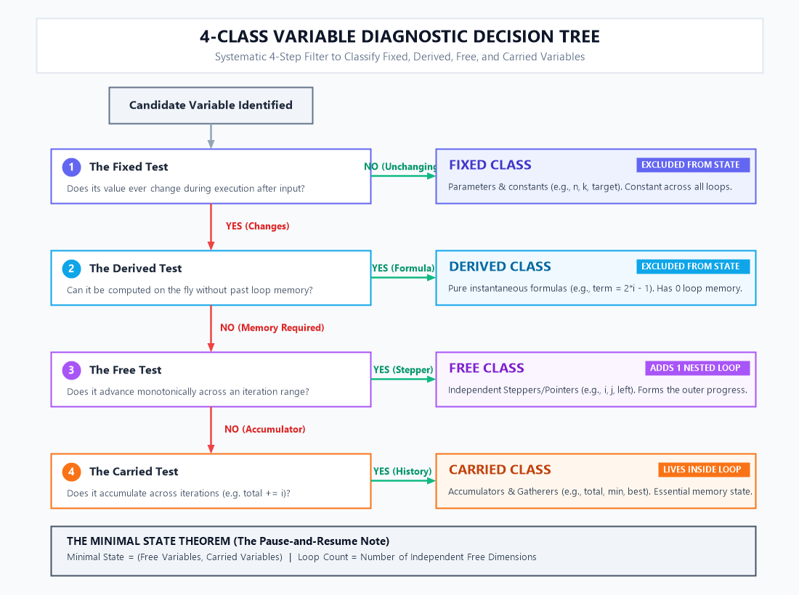

## What is a state?

**Definition.** A state is the smallest set of variables you need in order to resume the program from exactly this point and finish correctly. Imagine pausing the program and writing a note for someone else to continue it. Whatever you must write on that note is the state.

**Why it matters.** Before you write any loop, you must know what changes from one iteration to the next. That is the state. Once you know it, the loop is mostly bookkeeping: set the starting state, move to the next state, stop at the last one.

### Single-variable state

One value is enough to say where you are. Printing the numbers 1 to n is the simplest case: the note says "next number to print: 4", so the state is `(i)` and one loop is enough.

### Multi-variable state

Several values are needed together. This happens in three situations:

- **Your position has several dimensions.** A grid cell needs `(row, col)`.
- **You are choosing several things at once.** Picking 6 numbers from a list needs `(a, b, c, d, e, f)`.
- **You must remember something about the past.** Summing an array needs `(i, total)`, because `i` alone does not tell you what has been added so far.

| Problem | State | Single or multi | Number of loops |
| --- | --- | --- | --- |
| Print 1 to n | `(i)` | Single | 1 |
| Sum of an array | `(i, total)` | Multi | 1 (`total` is carried) |
| Number triangle | `(i, j)` | Multi | 2 |
| Kadane's maximum subarray | `(i, current_sum, best)` | Multi | 1 (the other two are carried) |
| Two pointers | `(left, right)` | Multi | 1 (they move together) |
| Choose 6 of k | `(a, b, c, d, e, f)` | Multi | 6 |

The last column shows that the number of variables in the state and the number of loops are different things. The number of loops is the number of **free** variables, the ones you must enumerate. Variables that are carried or derived never add a loop.

### Not every variable you list stays in the state

In step 1 you list every candidate variable the problem touches. In step 2 you classify them and identify their roles. In step 3 you form the true state. Fixed values (given and unchanging) and derived variables (a formula of the others) do not describe where you are, and temporaries live inside one iteration only, so they are dropped. What remains, the free and carried variables, is the state in the strict sense.

### Why only Free and Carried variables form the State

$$\text{State} = (\text{Free Variables}, \text{Carried Variables})$$

To understand why this equation holds rigorously, consider what happens when you pause an ongoing algorithm and write a note for someone else to resume it:

1. **Why Free variables MUST be in the state**:
   - Free variables (steppers and walkers, like `i`, `j`, `left`, `right`) tell you **WHERE you are** in the iteration space.
   - If you pause in the middle of a loop and omit `i`, the person resuming does not know which iteration to execute next—they cannot know if they are at element 3 or element 97.
   - Therefore, free variables are essential for knowing the current location and boundaries.

2. **Why Carried variables MUST be in the state**:
   - Carried variables (gatherers, holders, flags, like `total`, `best`, `found`) tell you **WHAT you have accumulated or discovered so far**.
   - Because carried variables depend on their own past history across iterations, their values **cannot be recomputed on the fly** without restarting the entire loop from the beginning.
   - If you omit `total`, the person resuming knows they are at element 5, but has completely lost the running sum of elements 1 through 4.

3. **Why Fixed values are EXCLUDED from the state**:
   - Fixed values (like `n`, `k`, `target`) are invariant constraints given once by the problem statement.
   - They do not change from iteration to iteration. Since they are global constants known everywhere in the function, they do not describe "where you currently are" or "what you just accumulated".

4. **Why Derived variables are EXCLUDED from the state**:
   - Derived variables (like `term = 2*i - 1`, `value = n + 1 - i + j`, `mirror = n - 1 - i`) have **zero memory**.
   - Their values depend exclusively on the current instantaneous values of the free/fixed variables.
   - If you have the free variable `i = 5`, you can instantly recalculate `term = 2*(5) - 1 = 9` using the algebraic formula at any moment. Storing them in the resume note would be pure redundancy.

5. **Why Temporaries are EXCLUDED from the state**:
   - Temporaries (like `tmp` in a swap, or `line` read per line) exist only inside a single iteration and die at the iteration boundary. They never cross from step $i$ to step $i+1$.

---

### How to Analyse a Problem to Find the 4 Variable Classes

When reading an algorithmic problem, do not begin by writing `for` loops. Follow this systematic 4-question decomposition technique illustrated in the diagram below:



#### The Diagnostic Questions:
1. **The Fixed Test**: *"Is this variable provided once by the input and strictly constant throughout all iterations?"*
   - If **YES** $\implies$ **Fixed**. (Example: size $N$, target sum $K$, modulus $M$).
2. **The Derived Test**: *"If I know the current loop indices, can I compute this variable right now with a single formula without knowing previous iterations?"*
   - If **YES** $\implies$ **Derived**. (Example: in row `i`, col `j`, the value printed is $i \times j$, or $(i+j)\%2$, or $2i-1$. It needs no loop, no storage).
3. **The Free Test**: *"Must I actively enumerate or try every value in a discrete sequence/range to visit every state?"*
   - If **YES** $\implies$ **Free**. (Example: row counter `i` from $1$ to $N$, inner column counter `j` from $1$ to $i$, sliding window left/right pointers). Each free variable creates an enumeration dimension.
4. **The Carried Test**: *"Does this variable appear on both sides of an update statement (e.g., `x = x + ...`, `best = max(best, ...)`), requiring memory of previous iterations?"*
   - If **YES** $\implies$ **Carried**. (Example: running sum `total += term`, minimum element `min_val = min(min_val, val)`, boolean flag `found = true`).

---

### 🚀 Cheatsheet: How to Know Exactly How Many Loops are Required

A common beginner mistake is thinking that if a state has 3 variables, the program needs 3 loops. **This is completely false.**

> [!IMPORTANT]
> **The Golden Law of Loop Counting**:
> $$\text{Number of Nested Loops} = \text{Number of Independent Enumeration Dimensions among FREE Variables}$$
> - **Carried variables NEVER add a loop.** (They are updated inside existing loops).
> - **Derived variables NEVER add a loop.** (They are formulas evaluated inside the loop body).
> - **Fixed variables NEVER add a loop.** (They merely define the outer bounds).

#### Loop Decision Matrix Cheatsheet:

| Problem Archetype / Pattern | Identified Variables & Classes | Free Variables Count | Loops Required | Structural Implementation Pattern |
| :--- | :--- | :---: | :---: | :--- |
| **Linear Series Summation**<br>($1 + 2 + \dots + n$ or $1 + 3 + \dots$) | `n` (Fixed)<br>`i` (Free)<br>`term = 2i-1` (Derived)<br>`total` (Carried) | **1** (`i`) | **1 Loop** | `for i in 1..n:`<br>&nbsp;&nbsp;`total += (2*i - 1)` |
| **Linear Search / Min / Max**<br>(Scan array of size $N$) | `n` (Fixed)<br>`i` (Free)<br>`best` (Carried) | **1** (`i`) | **1 Loop** | `for i in 0..n-1:`<br>&nbsp;&nbsp;`best = max(best, arr[i])` |
| **Sliding Window / Two Pointers**<br>(Subarray sum, pair sum) | `arr` (Fixed)<br>`left`, `right` (Free)<br>`curr_sum` (Carried) | **2** (`left`, `right` coupled) | **1 Loop** | Two pointers move in the same direction or converge; they share **1 while loop**: `while right < n:` |
| **2D Matrix Traversal / Grid**<br>(Scan rows and columns) | `rows`, `cols` (Fixed)<br>`r`, `c` (Free)<br>`grid[r][c]` (Derived) | **2** (`r`, `c` independent) | **2 Nested Loops** | `for r in 0..rows-1:`<br>&nbsp;&nbsp;`for c in 0..cols-1:` |
| **Triangular Pattern Printing**<br>(Pyramids, Floyd triangle) | `n` (Fixed)<br>`row` (Free)<br>`col` (Free, depends on row)<br>`val` (Derived) | **2** (`row`, `col`) | **2 Nested Loops** | `for row in 1..n:`<br>&nbsp;&nbsp;`for col in 1..row:` |
| **Centered Diamond / Pyramid with Padding**<br>(Rows with spaces & numbers) | `n` (Fixed)<br>`row` (Free)<br>`spaces` (Derived or Free)<br>`cols` (Free) | **2** (`row`, `col`) | **2 Nested Loops**<br>*(or outer loop + string repeat)* | `for row in 1..n:`<br>&nbsp;&nbsp;`print spaces(n - row)`<br>&nbsp;&nbsp;`for col in 1..row:` |
| **Subarray Enumeration ($O(N^2)$)**<br>(Check every pair $[i, j]$) | `n` (Fixed)<br>`i` (Free - start)<br>`j` (Free - end)<br>`total` (Carried/Derived) | **2** (`i`, `j`) | **2 Nested Loops** | `for i in 0..n-1:`<br>&nbsp;&nbsp;`for j in i..n-1:` |
| **3-Sum / Triplet Complete Search**<br>(Check all triplets $a < b < c$) | `n` (Fixed)<br>`i`, `j`, `k` (Free steppers) | **3** (`i`, `j`, `k`) | **3 Nested Loops** | `for i in 0..n-1:`<br>&nbsp;&nbsp;`for j in i+1..n-1:`<br>&nbsp;&nbsp;&nbsp;&nbsp;`for k in j+1..n-1:` |
| **$k$-Combination Exhaustive Search**<br>(e.g. Choose 6 numbers out of $N$) | `n` (Fixed)<br>`a, b, c, d, e, f` (Free) | **6** (`a` through `f`) | **6 Nested Loops** | Six nested `for` loops (or recursive backtracking if $k$ is variable). |

---

### State space

The **state space** is the set of every state the program can be in. Each time the loop body runs, the program is in one state. The tree in Part 2 is a drawing of the state space: every leaf is one state. This is why counting leaves gives the time cost.

### How to find the state

1. Ask the pause question: if I stopped here, what would I write on the note so someone else could continue?
2. Check each variable: does the note need it, or can it be recomputed from the others?
3. Check for something remembered from earlier iterations (a total, a best value, the previous item). It belongs in the state even though it is not a loop counter.
4. Check that nothing is missing: from the note alone, could you decide what the next iteration does?

## Terms for relationships and the tree

These terms are used in Part 2 of the template. Examples use the number triangle, where row `i` prints the numbers 1 to `i`.

### Free, derived, carried, fixed

These four classes say how a variable affects the loop design. The section Variable classes in detail, later in this doc, explains each class.

- **Free:** you choose it by iterating a range, so it becomes a loop (`i`, `j`).
- **Derived:** computed from other variables, so no loop (`value = n + 1 - i + j`).
- **Carried:** remembers something across iterations (`total`, `best`).
- **Fixed:** given by the problem and never changes (`n`, `k`).

### Parent and child variable

Among the free variables, one can set the range of another. The variable that sets the range is the **parent**, and the variable whose range it sets is the **child**.

In the triangle, `j` runs from 1 to `i`, so `i` is the parent and `j` is the child. In the six-loop code, each variable is the child of the one before it (`b` starts at `a + 1`, `c` starts at `b + 1`) and the parent of the one after it.

"Parent" is informal terminology, not a standard computer-science term. Others would say "outer variable" and "inner variable".

### Dependent and independent ranges

- **Dependent ranges:** the child's range changes with the parent. In the triangle, row 1 has 1 number and row 5 has 5, so `j` depends on `i`.
- **Independent ranges:** the ranges are unrelated. In a grid with `rows` and `cols`, every row has the same columns, so neither variable is the parent.

A quick test: in the tree, if every parent has the same number of children, the ranges are independent. If the counts differ, they are dependent.

### Outer loop, inner loop, nested loops

The **outer loop** runs the parent. The **inner loop** runs once for each iteration of the outer loop and runs the child. Loops placed inside each other are **nested loops**. Loops placed one after another (side by side) are **sequential**, and they do not multiply each other's work.

### Single loop

When only one variable is free, or when several variables move together under a condition (two pointers), one loop is enough. Having several variables in the state does not by itself mean nested loops.

### Tree terms

The tree is a drawing of the loops, with one level per free variable.

- **Root:** the starting point at the top. It stands for "nothing chosen yet".
- **Level:** one row of the tree, which is one loop. Level 1 is the outer loop.
- **Node:** one value of a variable. In the triangle, `i = 3` is a node on level 1.
- **Edge:** a line from a parent value to a child value it allows. It means "given this parent, the child can take this value".
- **Child count:** the number of edges leaving a node, which is the size of the inner loop's range for that parent.
- **Leaf:** a node at the bottom with no children. It is a complete state, and the loop body runs once there.
- **Descendant:** any node below a given node. A variable's bound must leave room for its descendants (`a < k - 5` in the six-loop code, because five more numbers must follow `a`).
- **Pruned branch:** a branch that does not exist because a bound removed it. In the six-loop tree with `k = 7`, there is no `a = 2` node, since it would leave too few numbers.
- **Root-to-leaf path:** one full state, for example `i = 3`, `j = 2`.

## Terms for building and checking the loop

These terms are used in Parts 3 and 4 of the template. The annotated code below shows where each one appears in the number triangle with `n = 5`.

```c
int n = 5;                                  // fixed value
for (int i = 1; i <= n; ++i) {              // initialization: i = 1 | bound: i <= n | transition: ++i
    for (int j = 1; j <= n - i + 1; ++j) {  // initialization: j = 1 | bound depends on parent i
        printf("%d ", n + 1 - i + j);       // loop body: runs once per leaf, derived value
    }
    printf("\n");                           // result so far: one printed row
}
```

### Initialization

The starting values of the state, set before the first iteration. For a free variable it is the first value of its range (`i = 1`). For a carried variable it is a neutral start: 0 for a sum, 1 for a product, the first element for a maximum, `false` for a flag. Always check the smallest case too, such as an empty input.

### Bounds

The start and end of each loop. In the tree they are the first and last child under a node. Two rules:

- **A child's bound can use its parent.** `j <= n - i + 1` uses `i`.
- **Leave room for descendants.** In the six-loop code `a` stops at `k - 5`, because five more numbers must still follow. Without that room, you get branches that cannot be completed.

### Transition

How the state changes from one iteration to the next.

- A free variable moves to its next value (`++j`, `left++`).
- A carried variable is updated from the current item (`total += x`, `best = max(best, x)`).
- A derived variable is recomputed from its parents, with no stored update.

In the tree, a transition is the move from one node to the next node in the traversal.

### Termination

The loop stops when its condition becomes false. To be safe, confirm that every iteration makes **progress**: the loop variable moves closer to the bound on every pass. If you forget `++j`, `j <= n - i + 1` stays true forever and the program never ends. Loops with conditions (`while`) need the extra check that something inside the loop changes the condition. Also check that a flag or `break` can end the loop early only when that is correct.

### Result

What the program returns or prints, and when.

- **After the loop:** the final value of a carried variable, such as `total` or `best`.
- **Inside the loop body:** printing something at each leaf, as the triangle does.

Decide this in advance, so you know which variable holds the answer.

### Validity

The check that the relationship you assumed holds on every path of the tree. For `a < b < c`, every root-to-leaf path must be strictly increasing. For a formula such as `value = n + 1 - i + j`, pick several leaves and check the formula by hand against the expected pattern.

### Missing cases

The check that no valid state is absent from the tree and no invalid state is present. Compare the code's output with the leaves one by one, and test the edge cases:

- empty input (`n = 0`) and the smallest input (`n = 1`)
- duplicates and all-equal input
- the largest and smallest allowed values
- branches removed by bounds (the pruned ones), to confirm they really have no valid state

### Complexity

How the work grows with the input. The number of **leaves** is the number of times the loop body runs, and it is roughly the product of the free variables' range sizes. In the number triangle the leaves number `1 + 2 + ... + n = n(n + 1) / 2`, so the time is O(n²). In the six-loop code the leaves number C(k, 6). Adding one independent free variable multiplies the work by that variable's range.

## Part 1: Define the state

1. **List Candidate Variables.** Write down every variable the problem touches (inputs, counters, totals, results, helpers).
2. **Assign Roles and Classify:**
   - Write each variable's role first using the table below.
   - Then classify it:
     - **Free:** you choose it by iterating a range (becomes a loop)
     - **Derived:** computed on the fly from others (an assignment, no loop)
     - **Carried:** accumulated across iterations (an update inside the loop)
     - **Fixed:** given and unchanging (`n`, `k`)
3. **Form the True State.** Filter down to the minimal note needed to pause and resume:
   $$\text{State} = (\text{Free Variables}, \text{Carried Variables})$$
   *(Fixed values, derived formulas, and temporaries are dropped from the state tuple).*

**Variable roles.** For each candidate variable, determine its role first, then read its class from this table. Only steppers and walkers add loops.

| Role | Typical example | Class |
| --- | --- | --- |
| Fixed value | `n`, `k` | Fixed |
| Stepper | `i`, `j`, `a` to `f` | Free (becomes a loop) |
| Walker | `left`, `right`, a pointer through a structure | Free (often a single loop) |
| Gatherer | `total`, `current_sum` | Carried |
| Most-wanted holder | `best`, `max_so_far` | Carried |
| Most-recent holder | `last`, `prev_value` | Carried |
| Follower | `prev` trailing `curr` | Carried |
| Flag | `found`, `is_valid` | Carried |
| Container | an array or list you fill | Carried |
| Organizer | an array you sort or rearrange | Carried |
| Temporary | `tmp` in a swap | Not part of the state |

Derived variables, such as `value = n + 1 - i + j`, have no role in the chart. They are computed fresh each time and need no loop. A Temporary lives inside one iteration only, so drop it from the state.

## Variable classes in detail

Every variable in a loop falls into one of four classes: free, derived, carried or fixed. The class tells you what the variable does to the loop design: whether it needs its own loop, whether it belongs in the state, and where it shows up in the tree. This section explains each class, how to recognise it, and how to tell the classes apart.

| Class | Who decides its value | Adds a loop? | Part of the state? | In the tree | Example |
| --- | --- | --- | --- | --- | --- |
| Free | You choose it by trying every value in a range | Yes, one loop for each | Yes | One level of the tree | `i`, `j` |
| Derived | A formula of other variables' current values | No | No | The leaf value | `value = n + 1 - i + j` |
| Carried | Its own previous value and the current item | No | Yes | Information passed along a path | `total`, `best` |
| Fixed | The problem, once and for all | No | No | Sets the size of the tree | `n`, `k` |

### Free

**What it is.** A variable you choose by trying every value in a range. Each value it takes gives a different state of the program, so the loop must visit all of them.

**How to recognise it.** Ask two questions. Must I try every value of this variable? Is it a choice rather than a consequence of other variables? If both answers are yes, it is free. Examples: the row `i` and the position `j` in a triangle, the six variables `a` to `f` in the six-loop code, and the pointers `left` and `right` in a two-pointer search.

```c
for (int i = 1; i <= n; ++i)          // free: try every row
    for (int j = 1; j <= i; ++j)      // free: try every position, range set by i
        printf("%d ", j);
```

**In the tree.** Each free variable is one level. Each value it takes is a node, and the number of children under a node is the size of that variable's range for that parent.

**Effect on the design.**

- The number of loops is the number of free variables.
- If one free variable's range depends on another, the one it depends on is the parent and goes in the outer loop.
- Free variables that move together under a condition (two pointers) share one loop instead of being nested.

**Common mistakes.**

- Treating a derived variable as free. This adds a loop that multiplies the work for nothing.
- Forgetting that a range can be empty, so the loop must handle `n = 0`.

### Derived

**What it is.** A variable whose value is fully determined by the current values of other variables. It remembers nothing from earlier iterations.

**How to recognise it.** You could delete it and recompute it at any moment from the other variables. No statement uses its own previous value.

```c
for (int i = 1; i <= n; ++i)
    for (int j = 1; j <= n - i + 1; ++j) {
        int value = n + 1 - i + j;    // derived: a formula of n, i and j
        printf("%d ", value);
    }
```

Other examples: `(i + j) % 2` in the alternating 1 and 0 triangle, and the mirror index `j = n - 1 - i`.

**In the tree.** A derived variable appears as the value on a leaf. It is never a level of its own.

**Effect on the design.** No loop, nothing to store between iterations. It is an expression or an assignment inside the loop body.

**Derived or carried?** A derived variable depends only on the current values of other variables. A carried variable depends on its own previous value. The descending triangle can be written both ways, with the same output:

```c
// derived: a formula of the current i and j
printf("%d ", n + 1 - i + j);

// carried: start remembers its own old value and drops by 1 each row
for (int i = 1, start = n + 1; i <= n; ++i, --start) {
    for (int j = 0; j < n - i + 1; ++j)
        printf("%d ", start + j);
    printf("\n");
}
```

Use a derived variable when a clean formula exists. Use a carried one when the rule is "one less than last time".

**Common mistakes.**

- Writing a loop for a variable that is a formula of the others.
- Storing a derived value and forgetting to update it when the variables it depends on change.

### Carried

**What it is.** A variable that remembers something from earlier iterations. Its new value is computed from its own old value, or from something it remembered, together with the current item.

**How to recognise it.** The variable appears on both sides of an update: `total += x`, `best = max(best, x)`, `last = x` (read in the next iteration), `found = 1`, `result[count++] = x`.

Common kinds:

- a running total or count
- the best value so far (largest, smallest)
- the previous item
- a yes/no answer about the data
- a collection that is filled or rearranged as you go

```c
int total = 0, best = arr[0];
for (int i = 0; i < n; ++i) {
    total += arr[i];                    // carried: uses its own old value
    if (arr[i] > best) best = arr[i];   // carried: keeps the best so far
}
```

**In the tree.** A carried variable is not a level. It travels along the path from the root to a leaf, and its value at any node summarises everything above that node. For example, the total at row `i` is the sum of the rows above it.

**Effect on the design.** No loop of its own, but it is part of the state, because you need it to resume from this point. It needs a neutral starting value (0 for a sum, 1 for a product, the first element for a maximum, `false` for a flag), and it must be initialised at the right level: inside the outer loop if it restarts for every row, before it if it lives for the whole run. Use its old value before you overwrite it.

**Common mistakes.**

- Forgetting to initialise it, or initialising it at the wrong level, so it is not reset for every row.
- Updating it before using its old value.
- Leaving it out of the state, so the loop cannot be resumed.

### Fixed

**What it is.** A value given by the problem that does not change while the program runs.

**How to recognise it.** It is read but never assigned inside the loop. Examples: `n` (the number of rows), `k` (how many numbers are in the input), `target` (the sum you are looking for), and the input array itself, whose contents stay as given.

```c
int n = 5;                       // fixed: the problem says 5 rows
for (int i = 1; i <= n; ++i) {   // n only appears in the bound
    ...
}
```

**In the tree.** A fixed variable is not a node. It sets the size and the shape of the tree through the loop bounds: a different `n` gives a different number of nodes.

**Effect on the design.** No loop, and it is not part of the state. It appears in bounds such as `i <= n`.

**Common mistakes.** Changing a fixed variable inside the loop (such as `n--`). This silently turns it into a carried variable and can change the bounds in the middle of the run. Mark it `const`, or work on a copy.

### How to classify a variable

Ask these questions in order and stop at the first yes.

1. **Is it given by the problem and never changes?** It is **fixed**.
2. **Can I recompute it at any moment from the current values of other variables, without knowing anything about earlier iterations?** It is **derived**.
3. **Must I try every value of it, because it is a choice and not a consequence?** It is **free**.
4. **Does it remember something from earlier iterations?** It is **carried**.
5. **None of these, and it lives inside a single iteration** (such as the helper in a swap)? It is a temporary. It is not part of the state, so drop it.

The order matters. Ask about derived before free: a variable that looks like a loop counter may be computable from another one. The mirror index shows this:

```c
for (int i = 0; i < n; ++i) {
    int j = n - 1 - i;           // derived from i, so there is no loop for j
    ...
}
```

In an all-pairs problem, `i` and `j` are both free. In the mirror problem, `j` is derived. The same name can belong to different classes in different problems, so classify by what the variable does, not by what it is called.

### How the classes connect to the template

- **Part 1:** every variable gets a class. Free and carried variables make up the state.
- **Part 2:** free variables become the levels of the tree. Derived variables become leaf values.
- **Part 3:** free variables give the loops and their bounds, carried variables give the initialization and updates, derived variables give the expressions in the body, and fixed variables appear in the bounds.
- **Part 4:** the number of free variables and their ranges give the leaf count and the complexity.

### Worked examples

| Problem | Variable | Class | Why |
| --- | --- | --- | --- |
| Number triangle (n = 5) | `n` | Fixed | Given by the problem |
| Number triangle (n = 5) | `i` (row) | Free | Try every row |
| Number triangle (n = 5) | `j` (position in row) | Free | Try every position, range set by `i` |
| Number triangle (n = 5) | `value` | Derived | A formula of `n`, `i` and `j` |
| Alternating 1 and 0 triangle | `value` | Derived | 1 if `i + j` is even, otherwise 0 |
| Kadane's maximum subarray | `n` | Fixed | Given by the problem |
| Kadane's maximum subarray | `i` | Free | Try every position |
| Kadane's maximum subarray | `current_sum` | Carried | Uses its own old value |
| Kadane's maximum subarray | `best` | Carried | Keeps the best so far |
| Two-pointer target sum | `target` | Fixed | Given by the problem |
| Two-pointer target sum | `left`, `right` | Free | Chosen by the search, and they move together in one loop |
| Two-pointer target sum | `found` | Carried | Remembers whether a pair was seen |
| Six nested loops (choose 6 of k) | `k`, `S[]` | Fixed | The input never changes |
| Six nested loops (choose 6 of k) | `a`, `b`, `c`, `d`, `e`, `f` | Free | Each is a choice, ordered by `parent + 1` |
| Mirror pairs | `i` | Free | Try every position |
| Mirror pairs | `j = n - 1 - i` | Derived | Fully determined by `i` |
| Bubble sort | `n` | Fixed | Given by the problem |
| Bubble sort | `i`, `j` | Free | Try every pass and position |
| Bubble sort | `arr` | Carried | Its contents change as you go |
| Bubble sort | `tmp` | Not in the state | Lives inside one swap |

In every row, the number of **Free** variables is the number of loops. That is why the number triangle has two loops, Kadane's has one, and the six-loop problem has six.

### Common mistakes with classes

- **Counting every variable as a loop.** Only free variables add loops.
- **Making a derived variable free.** The extra loop wastes time and can produce wrong states.
- **Mixing up derived and carried.** If the variable uses its own previous value it is carried. If it needs only other variables' current values it is derived.
- **Leaving a carried variable out of the state.** You cannot resume the loop without it.
- **Modifying a fixed variable inside the loop.** It stops being fixed.
- **Classifying by name.** `j` is free in one problem and derived in another.

## Part 2: Find the relationships and draw the tree

4. **Parent variable.** Among the free variables, find whose range depends on whose. The one that sets the range is the **parent**, and the other is the **child**.
   - Dependent ranges: nested loops, parent outermost
   - Independent ranges: nested loops, no parent
   - Variables move together under a condition: a single loop (two pointers)
   - One free variable only: a single loop
5. **Draw the tree (mandatory).** Do not move to Part 3 until the tree exists.
   - Root at the top, then **one level per free variable**, with the parent level first
   - **One node per value** of that variable
   - **Edges** from each parent value to the child values it allows
   - **Leaves** are the complete states, where the loop body runs
   - Use a small input (`n = 4` or `5`) so the whole tree fits
6. **Read the loop facts off the tree.** These are the facts you will code.
   - **Start and end of each loop:** the first and last child under a node
   - **Child count per parent:** the same for every parent means independent ranges, and different counts mean dependent ranges. The pattern of counts (1, 2, 3... or 5, 4, 3...) gives the bound formula.
   - **Leaf value:** what is printed or computed at each leaf, which is where the derived variables go
   - **Complexity:** the number of leaves

## Part 3: Build the loop from the tree

7. **Initialization.** Starting values, including the smallest case.
8. **Bounds.** Copy them from step 6, and leave room for the descendants (`a < k-5`).
9. **Transition.** How the derived and carried variables update.
10. **Termination.** Each iteration makes progress toward the bound.
11. **Result.** What is returned or printed, and when.

Part 3 turns the tree from Part 2 into code. Do not guess the loops from the printed output. Copy each fact from the tree, using the mapping below, and the loops follow.

### From the tree to the code

| What you need | Where to read it in the tree | What goes into the code |
| --- | --- | --- |
| Number of loops | Number of levels below the root | One loop per level |
| Nesting order | Top level is the outermost | Level 1 is the outer loop, the last level is the innermost |
| Start of a loop | First child under a node | Initialization, such as `j = 1` |
| End of a loop | Last child under a node | Bound, such as `j <= n - i + 1` |
| Step size | Difference between neighbouring children | Update, such as `++j` |
| How a bound changes | Child counts under different parents | A bound that uses the parent variable |
| What happens at a leaf | The leaf value | The loop body |
| What happens when a level finishes | Moving on to the next sibling at the parent level | Code placed after the inner loop, such as a newline |

### Step 7 in detail: Initialization

Initialization sets the starting state. Do it variable by variable.

- **Free variables.** Use the first child in the tree. The outer variable starts at the first child under the root. An inner variable starts at the first child under a node. If that start changes with the parent (`b` starts at `a + 1`), write it as a formula of the parent.
- **Carried variables.** Use a neutral start, one that cannot change the answer before the first item arrives.

| Carried variable | Neutral start |
| --- | --- |
| Sum or count | 0 |
| Product | 1 |
| Maximum | The first element, or a very small number |
| Minimum | The first element, or a very large number |
| Flag | The answer you expect before seeing any evidence |
| Container | Empty |

- **Where to initialise.** A carried variable belongs to one level of the tree. If it must restart for every node of level 1 (a total for each row), initialise it inside the outer loop, before the inner loop. If it lives for the whole run (a grand total), initialise it before the outer loop.
- **The empty case.** If a range is empty (`n = 0`), the loop must simply not run. Check that your starting values and bound give that.

```c
int grand_total = 0;                 // whole run: before the outer loop
for (int i = 1; i <= n; ++i) {
    int row_total = 0;               // restarts for every row: inside the outer loop
    for (int j = 1; j <= i; ++j)
        row_total += j;
    grand_total += row_total;
}
```

### Step 8 in detail: Bounds

A bound is a formula for the last child of a loop. Find it by reading the tree for two or three different parents and fitting a formula.

For the descending triangle with `n = 5`:

| Parent `i` | Children of `i` (the values of `j`) | Last `j` |
| --- | --- | --- |
| 1 | 1 to 5 | 5 |
| 2 | 1 to 4 | 4 |
| 3 | 1 to 3 | 3 |
| 4 | 1 to 2 | 2 |
| 5 | 1 to 1 | 1 |

The last `j` drops by 1 each time `i` grows by 1, starting at 5 when `i = 1`. The formula is `n - i + 1`, so the loop is `j <= n - i + 1`.

**Leave room for descendants.** When each variable must be larger than the one before it and there are `m` variables, the variable at level `l` (counting from 1) can be at most `k - m + l - 1` when indices start at 0. For the six-loop code, `m = 6`, so `a` (level 1) stops at `k - 6`, which is the loop condition `a < k - 5`. The last variable `f` (level 6) stops at `k - 1`, which is `f < k`.

**Check the bound at both ends.** After you write a bound, plug in the smallest and the largest parent value and compare the number of children with the tree. This catches nearly all off-by-one mistakes, such as writing `<` where `<=` is needed.

### Step 9 in detail: Transition

A transition moves the state from one iteration to the next. There are three kinds:

- **Free variable:** moves to its next value. The loop header does it (`++j`, `left++`).
- **Carried variable:** is updated from the current item (`total += x`, `best = max(best, x)`).
- **Derived variable:** is recomputed from its parents each time, so there is no update to write.

**Order matters.** Inside one iteration, use a carried variable's old value before you overwrite it, and move a follower before its leader.

```c
int last = arr[0];
for (int i = 1; i < n; ++i) {
    if (arr[i] == last)                       // 1. use the old value of last
        printf("duplicate: %d\n", last);
    last = arr[i];                            // 2. then update it for the next iteration
}
```

If the two lines were swapped, `last` would equal `arr[i]` every time and every element would look like a duplicate.

### Step 10 in detail: Termination

Termination means every loop ends. Check each loop with three questions:

1. **Does the loop variable move toward the bound on every pass?** A missing `++j` gives an infinite loop.
2. **Does the bound stay put while the loop runs?** If the loop body changes a variable that the bound uses, the loop can run longer than the tree says.
3. **Does the number of passes match the tree?** The number of iterations of an inner loop must equal the child count of its parent.

| Loop | Moves toward the bound by | Passes | Ends when |
| --- | --- | --- | --- |
| `for (i = 1; i <= n; ++i)` | +1 | `n` | `i` becomes `n + 1` |
| `for (j = 1; j <= n - i + 1; ++j)` | +1 | `n - i + 1` | `j` becomes `n - i + 2` |
| `while (left < right)` | `left` up or `right` down | at most `n` | the pointers meet |

For a `while` loop, name the statement inside the loop that changes the condition. If you cannot point to one, the loop may never end. If you leave early with `break` or a flag, check that the early exit happens only when the answer is already known.

### Step 11 in detail: Result

The result is what the program returns or prints. In the tree, it can happen at three places:

| Where in the tree | What it means | Example |
| --- | --- | --- |
| At every leaf | Output something for each state | Printing each number of the triangle |
| When a level finishes | Output something for each parent | A newline after each row, a row total |
| At the root, after everything | Output one final answer | `total`, `best`, `found` after the loop |

Decide this before writing the loop, so you know which variable holds the answer and where the output line goes.

### Worked example: the descending triangle

The problem (`n = 5`) prints rows `6 7 8 9 10`, `5 6 7 8`, `4 5 6`, `3 4`, `2`. Using the facts from the tree:

| Step | Decision |
| --- | --- |
| 6. Initialization | `i = 1` (first child of the root), `j = 1` (first child under any row). No carried variables. |
| 7. Bounds | `i <= n`. `j <= n - i + 1`, from child counts 5, 4, 3, 2, 1. |
| 8. Transition | `++i`, `++j`. The leaf value is derived: `n + 1 - i + j`, with no update to write. |
| 9. Termination | Both variables grow by 1 toward fixed bounds. The inner loop runs `n - i + 1` times per row, matching the tree. |
| 10. Result | Print the derived value at each leaf. Print a newline when a row (level 1 node) finishes. |

```c
int n = 5;
for (int i = 1; i <= n; ++i) {               // level 1: rows
    for (int j = 1; j <= n - i + 1; ++j) {   // level 2: bound from the parent
        printf("%d ", n + 1 - i + j);        // leaf: derived value
    }
    printf("\n");                            // level 1 node finished
}
```

### Tree shapes and the loops they give

Look at the shape of your tree and pick the loop shape from this table.

| Shape of the tree | Loop shape | Example |
| --- | --- | --- |
| Every parent has the same number of children | Nested loops with fixed bounds | A grid with `rows` and `cols` |
| Child count grows with the parent | The child's bound uses the parent (`j <= i`) | The ascending triangle |
| Child count shrinks as the parent grows | The child's bound counts down (`j <= n - i + 1`) | The descending triangle |
| Each child must come after its parent | The child starts at `parent + 1` | Pairs and combinations, the six-loop code |
| One child per node, a single long path | One loop with carried variables | Sum, Kadane's algorithm |
| Two separate groups of children under one parent | Two sequential loops inside the parent | Leading spaces, then numbers, on each row |
| A single path driven by a condition | A `while` loop with walkers | Two pointers |

### Common mistakes in Part 3

- **Writing the loops from the output instead of the tree.** The output hides the child counts, which are what give the bounds.
- **Off-by-one bounds.** Always test the smallest and the largest parent value against the tree.
- **Forgetting to reset a per-parent carried variable.** A row total initialised outside the outer loop keeps growing across rows.
- **Updating a carried variable before using its old value.** See the `last` example in step 9.
- **No room for descendants.** The bound lets a variable reach a value that leaves nothing for the variables after it, and the loop produces incomplete states.
- **Missing update in the loop.** The loop never ends.
- **Adding a loop for a derived variable.** If a variable is a formula of the others, compute it inside the loop body instead.

## Part 4: Verify against the tree

12. **Validity.** Every root-to-leaf path satisfies the relationship (`a < b < c`, or the formula on each leaf).
13. **Missing cases.** Compare the code's output with the leaves one by one, and test the edge cases: `n = 0`, `n = 1`, duplicates, extremes, pruned branches.
14. **Complexity.** Count the leaves and check the time is acceptable.

Part 4 checks the code against the tree. The tree is the specification: it lists every state that should exist. The code is the implementation. Verifying means comparing the two, not just running the code on the sample from the problem statement, because a sample can pass while a boundary case fails.

### How to verify

Compare the code with the tree in two directions:

- **Nothing extra.** Every state the code visits must appear in the tree. If it visits a state that is not in the tree, an invalid state is present. This is the validity check.
- **Nothing missing.** Every leaf in the tree must be visited by the code. If a leaf is never reached, a valid state is absent. This is the missing-cases check.

The practical method is a trace. Write the leaves of the tree from left to right as the expected output, trace the code by hand (or run it on a small input), and compare line by line. Also compare the order: a depth-first walk of the tree visits leaves from left to right, so the output should come out in that order.

### Step 12 in detail: Validity

Validity means every state the code visits is allowed by the relationship you assumed. Run these checks.

**1. The relationship holds on every path.** Write down the relationship in one line and check that the loop code forces it.

- For an ordered choice such as `a < b < c`, each child must start at `parent + 1`. Then every path is strictly increasing, so there are no duplicates and no reorderings. A path like `(1, 0, 2)` cannot appear, because `b` would have to start below `a`.
- For a formula on the leaves, such as `value = n + 1 - i + j`, check it against several leaves picked from the tree by hand.

**2. Spot-check leaves.** Choose the first leaf, the last leaf, and some in the middle, including the first and last child under a parent. For the descending triangle with `n = 5`:

| Leaf `(i, j)` | Formula `n + 1 - i + j` | Value in the tree | Match |
| --- | --- | --- | --- |
| (1, 1) | 6 | 6 | Yes |
| (1, 5) | 10 | 10 | Yes |
| (3, 3) | 6 | 6 | Yes |
| (4, 2) | 4 | 4 | Yes |
| (5, 1) | 2 | 2 | Yes |

**3. Count the passes of each inner loop.** The inner loop must run exactly as many times as the child count of its parent. For the descending triangle, `i = 1` to `5` must give 5, 4, 3, 2, 1 passes, and `n - i + 1` does.

**4. Check that every access is in range.** If the body reads an array, the largest value the loop variable can reach must still be a valid index. In the six-loop code, `f` stops at `k - 1`, so `S[f]` is always inside the array. If `f` could reach `k`, the program would read outside it.

| Symptom | Likely cause |
| --- | --- |
| Wrong value at some leaves, right at others | The formula is off by one |
| Duplicate or reordered tuples | A child does not start at `parent + 1` |
| Crash or garbage values | A bound allows an index outside the array |
| One row too long or too short | A bound uses `<` where `<=` is needed, or the reverse |

### Step 13 in detail: Missing cases

A case is missing when a valid state never appears. A case is extra when an invalid state appears. Check both.

**1. Compare the counts.** Count the leaves in the tree and the lines (or states) the code produces. They must be equal.

| Problem | Expected leaves | How to count |
| --- | --- | --- |
| Print 1 to `n` | `n` | One leaf per value |
| Number triangle | `n(n + 1) / 2` | Add the child counts: 1 + 2 + ... + n |
| Grid of `rows` by `cols` | `rows × cols` | Child count is the same under every parent |
| Choose 6 of `k` | C(k, 6) | One leaf per combination |

**2. Test the edge cases.** Use the tree to predict what each one should do, then confirm the code agrees.

| Case | What the tree looks like | Expected behaviour |
| --- | --- | --- |
| Empty input (`n = 0`) | Only the root | The loop does not run and nothing is printed |
| Smallest input (`n = 1`) | One node on each level | One leaf, one printed value |
| Fewer elements than needed (`k < 6`) | The bounds remove every branch | Nothing is printed, and no out-of-range access happens |
| Exactly enough (`k = 6`) | A single path | One line is printed |
| Duplicate values in the input | The tree is built on positions, not values | Equal values at different positions are different states, unless the problem says otherwise |
| All values equal | Same tree as any other input | Every leaf prints the same values |
| Largest allowed input | Many leaves | The time fits and no number overflows |

**3. Check the pruned branches.** Find the branches that the bounds removed and confirm that they have no valid state. For the six-loop tree with `k = 7`, there is no `a = 2` node, because it would leave only four numbers after it, and six are needed.

**4. Run the smallest inputs first.** Test `n = 0`, `n = 1`, `n = 2`, and only then a typical size. Most bound errors show up at the smallest sizes.

### Step 14 in detail: Complexity

Complexity tells you how the work grows with the input. The loop body runs once per leaf, so the number of leaves is the number of times the body runs. Counting leaves is usually enough, because the nodes above them are fewer.

**How to count the leaves**

- **Independent ranges:** multiply the range sizes. A grid with `rows` and `cols` has `rows × cols` leaves.
- **Dependent ranges:** add up the child counts. The triangle has 1 + 2 + ... + n = `n(n + 1) / 2` leaves, which is O(n²).
- **Ordered choice of `m` from `k`:** the leaves are the combinations, C(k, m). This is not `k^m`, even though there are `m` nested loops.
- **One loop with carried variables:** one pass over the input, so the leaves number `n`.
- **Two walkers moving toward each other:** each walker only moves forward, so the total number of moves is at most `n`.

| Problem | Leaves | Complexity |
| --- | --- | --- |
| Sum, Kadane's algorithm | `n` | O(n) |
| Two pointers | at most `n` moves | O(n) |
| Grid | `rows × cols` | O(rows × cols) |
| Number triangle | `n(n + 1) / 2` | O(n²) |
| Choose 6 of `k` | C(k, 6) | About `k⁶ / 720` for large `k` |

**Is it fast enough?** A rough rule is that a computer does around 10⁸ simple operations per second, so a limit of one second allows about that many leaves. The number of leaves can grow quickly: for the six-loop code, `k = 13` gives 1,716 lines, and `k = 49` gives 13,983,816 lines. If the leaf count is too large, look for a smarter design:

- Replace an inner loop with a carried variable, as Kadane's algorithm does.
- Use two walkers in one loop instead of nested loops.
- Cut branches early with a bound or a flag, so whole subtrees are never visited.

**Space.** Check also what you store. A container that grows with every leaf takes as much memory as there are leaves, and a few carried variables take almost none.

### Worked verification: the six-loop code with `k = 7`

The code picks 6 sorted numbers from `k` numbers and prints each choice, using the tree with 7 leaves.

| Check | What to look at | Result |
| --- | --- | --- |
| Validity: relationship | Each child starts at `parent + 1`, so every path is strictly increasing | Holds, so there are no duplicates or reorderings |
| Validity: spot-check | The first leaf is `(0, 1, 2, 3, 4, 5)` and the last is `(1, 2, 3, 4, 5, 6)` | Both appear in the tree |
| Validity: index range | `f` stops at `k - 1 = 6` | `S[f]` is always inside the array |
| Missing: counts | The tree has 7 leaves, and C(7, 6) = 7 | The counts match |
| Missing: pruned branch | There is no `a = 2` node, since only four numbers would remain | Correct, as the bound `a < k - 5` removes it |
| Edge: `k = 5` | `a < 0` is false at once | Nothing is printed, and no array access happens |
| Edge: `k = 6` | One path | Exactly one line is printed |
| Complexity | C(7, 6) = 7 leaves | Tiny, and C(k, 6) in general |

### Common mistakes in Part 4

- **Checking only the sample from the problem.** A sample passes easily. The bugs are at the edges, so run `n = 0`, `n = 1` and the smallest and largest allowed inputs.
- **Comparing the code with the output instead of the tree.** If the output itself was misread, the code will agree with a wrong target.
- **Estimating complexity from the nesting depth alone.** Six nested loops do not always mean `k⁶` work: ordered loops give C(k, 6), and the triangle gives `n(n + 1) / 2`, not `n × n`.
- **Ignoring the order of the output.** The leaves of the tree have a left-to-right order, and the output should follow it.
- **Skipping the pruned branches.** A bound that removes too much loses valid states, and a bound that removes too little leaves invalid ones. Check both.
- **Forgetting the empty case.** The loop must be safe when there is nothing to iterate over.

## Quick check

Count the **free** variables. That is the number of loops. Derived, carried and fixed variables never add a loop.

The tree is step 4 inside Part 2, right after you find the parent variable, because the parent decides what the levels of the tree are. Part 3 begins only once the tree exists, and its bounds are copied from what you read off it.
