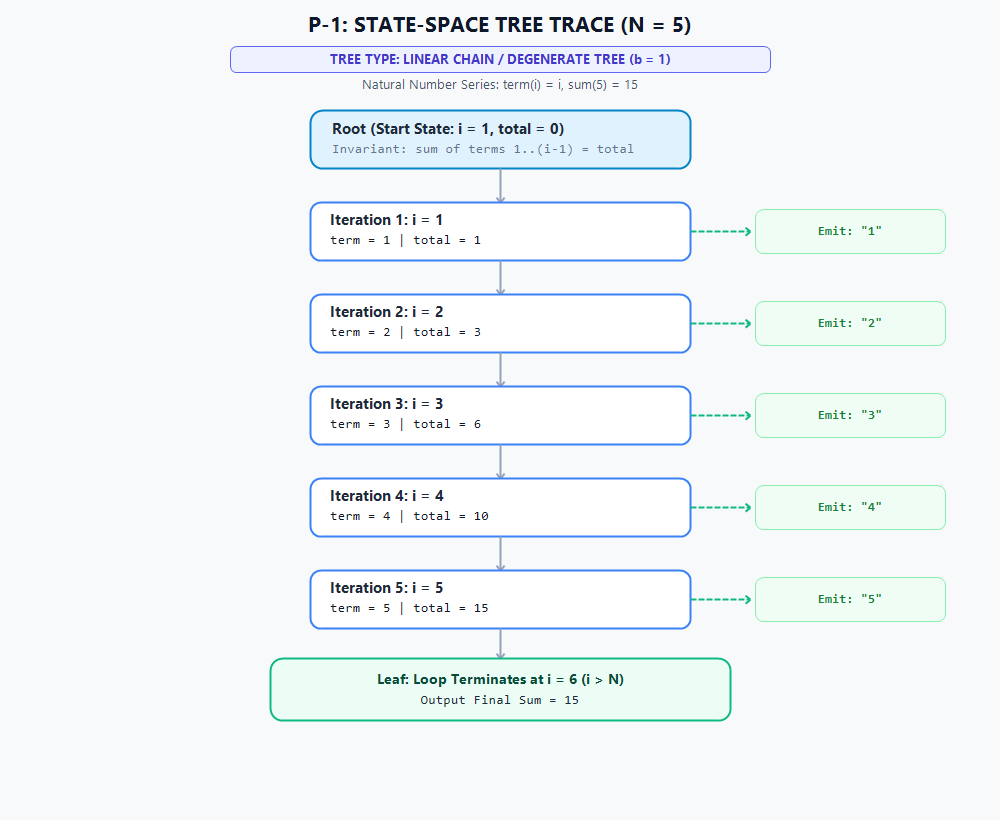

# Solution Derivation: P-1 - Series Summation: 1 + 2 + 3 + 4 + .............

## 📌 Metadata & Problem Reference
- **Problem ID**: P-1
- **Problem Title**: Series Summation: 1 + 2 + 3 + 4 + .............
- **Primary Category**: Repetitive Structures
- **Subcategory**: Pattern Printing
- **Applied Template**: [`Skills_Input/Templates/Repetitive Structure Template.md`](../../../../../../Skills_Input/Templates/Repetitive%20Structure%20Template.md)
- **Problem Statement Link**: [`question bank.md#p-1`](../../../../Problem%20Files/question%20bank.md#p-1)
- **Source**: `Recursion Vs Iteration, Part 1 (Series #1)`

---

## 🧠 Phase 1: State Definition & Variable Role Classification

### 1. Variable Discovery & Extraction Analysis
To derive the state machine systematically, we analyze the linguistic triggers, entities, and operations present in the problem statement:
- **Linguistic Trigger: *"positive integer $N$ as input"***:
  - Discovered entity: `n`.
  - *Diagnostic Test 1 (Fixed Test)*: `n` is set once upon reading input and remains constant throughout the execution. It acts as an unchanging limit. Hence, **Fixed**.
- **Linguistic Trigger: *"generate sequence $1 + 2 + 3 + \dots + N$"***:
  - Discovered entity: `i` (the progression index / term number) and `term` (the value emitted at step $i$).
  - *Diagnostic Test 2 (Derived Test)* on `term`: Can `term` be computed at any step directly from `i` without memory of previous terms? Yes, $\text{term} = i$. Because it requires no time-series accumulation and has an explicit direct closed form, it is **Derived**.
  - *Diagnostic Test 3 (Free Test)* on `i`: Does `i` advance monotonically across a known discrete range $[1, N]$ independent of previous sum accumulations? Yes, $i$ advances by $+1$ at each step to govern the domain. It dictates the iteration space. Hence, **Free** (Stepper).
- **Linguistic Trigger: *"calculate the sum of the series"***:
  - Discovered entity: `total`.
  - *Diagnostic Test 4 (Carried Test)* on `total`: Does `total` at iteration $i$ depend strictly on its value from iteration $i-1$? Yes, $\text{total}_i = \text{total}_{i-1} + i$. If execution paused at step $i$, we cannot reconstruct `total` solely from $i$ without replaying the entire loop from $1$. Therefore, `total` bridges across iterations. Hence, **Carried** (Gatherer).

### 2. Candidate Variables Inventory
- `n`: Total number of terms to generate and sum (given input).
- `i`: Current iteration counter / index of the term being generated.
- `term`: The value of the $i$-th element in the sequence ($i$).
- `total`: Running cumulative sum of all terms from $1$ up to the current term $i$.

### 3. Variable Roles & Classification Table

| Variable | Role | Class | Justification & Lifecycle |
| :--- | :--- | :--- | :--- |
| `n` | Fixed Value | **Fixed** | Read once from standard input; unchanging throughout loop execution. |
| `i` | Stepper | **Free** | Enumerates discrete values across range $[1, n]$; requires its own loop. |
| `term` | Derived Value | **Derived** | Trivial direct identity $\text{term} = i$; no separate loop needed. |
| `total` | Gatherer | **Carried** | Accumulates successive terms: $\text{total}_{\text{new}} = \text{total}_{\text{old}} + i$; must be retained across iterations. |

### 4. True Minimal State Formulation
Filtering out fixed parameters (which never change) and derived values (which can be recomputed instantaneously on demand), the minimal "pause-and-resume note" (state tuple) required to suspend and seamlessly restart execution is:

$$\text{State} = (i, \text{total})$$

- **Free variable**: $i$ (controls progress through the domain)
- **Carried variable**: $\text{total}$ (preserves accumulated history)

**Loop Requirement**: Because there is **exactly 1 free variable** ($i$), this algorithm requires **exactly 1 loop**.

---

## 🌲 Phase 2: State-Space & Relationship Derivation

### 1. Loop Bounds & Arithmetic Intervals
- Lower Bound: $i_{\text{start}} = 1$
- Upper Bound: $i_{\text{end}} = n$
- Step Size: $\Delta i = +1$
- Total Iterations: $n - 1 + 1 = n$

### 2. State-Space Tree Diagram (Trace for $n = 5$)
- **Tree Type**: **Linear Chain / Degenerate State-Space Tree ($b = 1$)**
- **Branching Factor**: Exactly 1 deterministic transition per step (no branching, decisions, or backtracking).
- **Topology**: Vertical linear spine of depth $N$, where each node represents an iteration step emitting a term, culminating in a single termination leaf.

### 3. State Transition Analysis ($T: \text{State}_t \to \text{State}_{t+1}$)
Every edge along the vertical linear spine maps directly to the deterministic transition function:
$$T(i, \text{total}) = \left(i + 1, \; \text{total} + i\right)$$

| State Component | Variable | Class | Current State ($S_t$) | Transition Rule / Operator | Next State ($S_{t+1}$) | Action / Side-Effect |
| :--- | :--- | :--- | :--- | :--- | :--- | :--- |
| **Stepper (Progress)** | `i` | Free | $i$ | $i \leftarrow i + 1$ | $i + 1$ | Advances counter toward bound $n$ |
| **Accumulator (Memory)** | `total` | Carried | $\text{total}$ | $\text{total} \leftarrow \text{total} + i$ | $\text{total} + i$ | Preserves inductive prefix sum |
| **Sequence Term** | `term` | Derived | $\text{term} = i$ | Direct closed evaluation | $\text{term}' = i + 1$ | Emit string `str(i)` to output buffer |

- **Termination Condition**: When $i = n + 1$, the loop condition $i \le n$ evaluates to `False`; execution transitions to the termination leaf emitting `Sum = total`.

---

## ⚖️ Phase 3: Mathematical Invariant Formulation

### 1. Loop Invariant
At the start of each iteration with counter $i \in [1, n + 1]$:
$$\text{total} = \sum_{k=1}^{i-1} k = \frac{(i - 1) \cdot i}{2}$$

### 2. Verification Steps
- **Initialization ($i = 1$)**:
  $$\text{total} = \sum_{k=1}^{0} k = 0$$
  The accumulator is correctly initialized to neutral value $0$.
- **Maintenance ($i \to i + 1$)**:
  Before step $i$, $\text{total} = \frac{(i - 1)i}{2}$. During the iteration, the term $i$ is added:
  $$\text{total}' = \frac{(i - 1)i}{2} + i = \frac{i(i - 1 + 2)}{2} = \frac{i(i + 1)}{2}$$
  The invariant holds for index $i + 1$.
- **Termination ($i = n + 1$)**:
  Loop stops when $i = n + 1$. Substituting into the invariant:
  $$\text{total} = \frac{n(n + 1)}{2} = \sum_{k=1}^{n} k$$
  The computed value exactly matches the mathematical sum of the arithmetic series.

---

## 🔍 Phase 4: Boundary Audits & Failure Mode Checks

| Edge / Boundary Case | Expected Behavior | Code Handling |
| :--- | :--- | :--- |
| **Minimum Bound ($N = 1$)** | Output single term `1` and `Sum = 1`. | Loop runs exactly once ($i=1$); correct. |
| **Empty / Zero Input ($N \le 0$)** | Empty sequence or termination. | Guarded by problem constraints $1 \le N \le 10^4$. |
| **Maximum Bound ($N = 10^4$)** | $\text{total} = \frac{10^4 \cdot 10001}{2} = 50,005,000$. | Fits within 32-bit signed integer ($\approx 2 \times 10^9$ limit). In Java, `long` is explicitly used for safety. |
| **Whitespace Formatting** | Terms space-separated; no trailing spaces. | Handled via `" ".join()` in Python and `StringBuilder` in Java. |

---

## ⏱️ Phase 5: Complexity Analysis

- **Time Complexity**: $\mathcal{O}(N)$
  - Total leaves in the state-space tree: $N$.
  - Each iteration performs $\mathcal{O}(1)$ arithmetic additions and string formatting operations.
- **Auxiliary Space Complexity**: $\mathcal{O}(1)$
  - Only two scalar registers (`i` and `total`) are maintained throughout the iteration.

