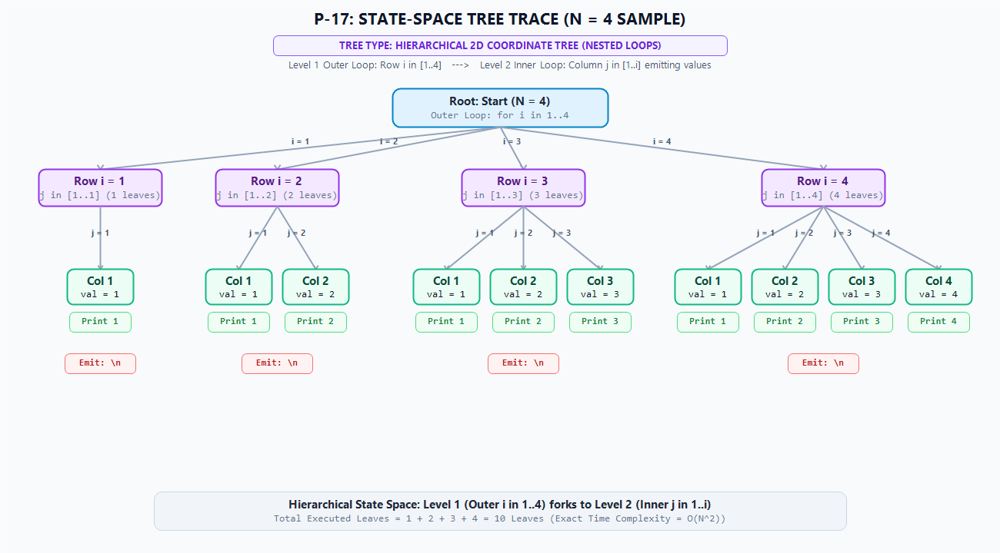

# Solution Derivation: P-17 - Pattern Printing: Pyramid #01 (starts with '1')

## 📌 Metadata & Problem Reference
- **Problem ID**: P-17
- **Problem Title**: Pattern Printing: Pyramid #01 (starts with '1')
- **Primary Category**: Repetitive Structures
- **Subcategory**: Pattern Printing
- **Applied Template**: [`Skills_Input/Templates/Repetitive Structure Template.md`](../../../../../../Skills_Input/Templates/Repetitive%20Structure%20Template.md)
- **Problem Statement Link**: [`question bank.md#p-17`](../../../../Problem%20Files/question%20bank.md#p-17)
- **Source**: `Recursion Vs Iteration, Part 2 (Pyramid #1)`

---

## 🧠 Phase 1: State Definition & Variable Role Classification

### 1. Variable Discovery & Extraction Analysis
To derive the state machine systematically, we analyze the linguistic triggers, mathematical relations, and formatting requirements present in the problem statement:
- **Linguistic Trigger: *"positive integer $N$ representing the number of lines/rows"***:
  - Discovered entity: `n`.
  - *Diagnostic Test 1 (Fixed Test)*: `n` is provided once via standard input and remains invariant throughout execution. It establishes the outer loop bound. Hence, **Fixed**.
- **Linguistic Trigger: *"construct 2D geometric pyramid / triangle pattern of $N$ rows"***:
  - Discovered entity: `i` (the row stepper index).
  - *Diagnostic Test 3 (Free Test)* on `i`: Does `i` advance across a discrete range $[1, n]$ independent of column state? Yes, `i` drives each individual line from row 1 down to row $N$. Hence, **Free** (Stepper).
- **Linguistic Trigger: *"row $i$ contains values from $1$ up to $i$"***:
  - Discovered entity: `j` (the column walker index).
  - *Diagnostic Test 3 (Free Test)* on `j`: For a given row `i`, does `j` enumerate across range $[1, i]$? Yes, each position across the row is visited sequentially. Hence, **Free** (Walker).
- **Linguistic Trigger: *"value printed at coordinate $(i, j)$ is $j$"***:
  - Discovered entity: `val`.
  - *Diagnostic Test 2 (Derived Test)* on `val`: At coordinate $(i, j)$, can the printed number be evaluated instantaneously with a formula without memory of previous cells? Yes, $\text{val} = j$. Hence, **Derived**.

### 2. Candidate Variables Inventory
- `n`: Total number of rows to print (input parameter).
- `i`: Current outer row counter ($1 \le i \le n$).
- `j`: Current inner column counter ($1 \le j \le i$).
- `val`: Value displayed at position $(i, j)$ ($\text{val} = j$).

### 3. Variable Roles & Classification Table

| Variable | Role | Class | Justification & Lifecycle |
| :--- | :--- | :--- | :--- |
| `n` | Fixed Value | **Fixed** | Read once from standard input; unchanging throughout entire execution. |
| `i` | Stepper | **Free** | Enumerates discrete rows across $[1, n]$; requires the outer loop. |
| `j` | Walker | **Free** | Enumerates columns across $[1, i]$; range depends on parent `i`; requires the inner loop. |
| `val` | Derived Value | **Derived** | Direct closed identity $\text{val} = j$; computed on the fly without loop or memory. |

### 4. True Minimal State Formulation
Filtering out fixed boundaries and derived instantaneous values, the minimal state required to pause and resume this 2D pattern generation at any instant is:

$$\text{State} = (i, j)$$

- **Free Variables**: $i$ (outer row index), $j$ (inner column index).
- **Loop Requirement**: Because there are **exactly 2 Free variables** ($i$ and $j$), this algorithm strictly requires **2 nested loops** (Outer loop for $i$, Inner loop for $j$).

---

## 🌲 Phase 2: State-Space & Relationship Derivation

### 1. Loop Bounds & Relationship Mapping
- **Parent / Child Hierarchy**: `i` is the **Parent variable** because its value defines the upper bound of `j`. `j` is the **Child variable**.
- **Outer Loop Bounds ($i$)**:
  - Lower Bound: $i_{\text{start}} = 1$
  - Upper Bound: $i_{\text{end}} = n$
  - Step Increment: $\Delta i = +1$
  - Total Outer Steps: $n$
- **Inner Loop Bounds ($j$ given $i$)**:
  - Lower Bound: $j_{\text{start}} = 1$
  - Upper Bound: $j_{\text{end}} = i$
  - Step Increment: $\Delta j = +1$
  - Total Inner Iterations for row $i$: $i$

### 2. State-Space Tree Diagram (Trace for $N = 4$)
- **Tree Type**: **Hierarchical 2D Coordinate Tree (Nested Loops)**
- **Branching Factor**: Multi-branching from Root to $N$ row nodes ($i \in [1, 4]$), and dependent branching from each row node $i$ to $i$ column children ($j \in [1, i]$).
- **Topology**: True 2D top-down hierarchical tree:
  - **Level 0 (Root)**: Top-center starting state ($N = 4$).
  - **Level 1 (Row Steppers)**: Horizontal spread of 4 outer row nodes ($i = 1, 2, 3, 4$).
  - **Level 2 (Column Walkers / Leaves)**: Downward branching from each row node into its respective column leaves ($1$ leaf under row 1, $2$ under row 2, $3$ under row 3, $4$ under row 4), each emitting its printed value and newline.

*Explanation of Tree Topology*:
- Level 1 branches into $N$ row nodes ($i = 1, 2, 3, 4$).
- Each row node $i$ spawns exactly $i$ inner leaf nodes ($j = 1, \dots, i$).
- Each leaf emits character $j$. At the conclusion of row $i$, an end-of-line (`\n`) is emitted.
- Total leaves generated: $\sum_{i=1}^4 i = 1 + 2 + 3 + 4 = 10$ leaves.

### 3. State Transition Analysis ($T: \text{State}_t \to \text{State}_{t+1}$)
In this 2D nested coordinate tree, transitions operate on two distinct hierarchical levels:

#### A. Inner Column Walker Transition ($j \to j + 1$)
For a fixed row $i$, the state transitions across adjacent column leaves:
$$T_{\text{inner}}(i, j) = (i, \; j + 1) \quad \text{for } 1 \le j < i$$

#### B. Row Boundary Transition & Inner Reset ($j = i \to \text{Row } i + 1$)
When column walker reaches row limit ($j = i$), the composite row-step and reset executes:
$$T_{\text{outer}}(i, i) = (i + 1, \; 1)$$

#### State Transition Matrix:
| Transition Phase | Current State ($i, j$) | Condition | Next State ($i', j'$) | Emitted Output / Action |
| :--- | :--- | :--- | :--- | :--- |
| **Inner Column Advance** | $(i, j)$ | $j < i$ | $(i, j + 1)$ | Print `j` followed by delimiter `"   "` |
| **Row Wrap & EOL** | $(i, i)$ | $j = i \text{ and } i < n$ | $(i + 1, 1)$ | Print `i` and emit newline `"\n"` |
| **Global Termination** | $(n, n)$ | $i = n, j = n$ | Terminated | Pattern rendering finished; program exits |

---

## ⚖️ Phase 3: Mathematical Invariant Formulation

### 1. Outer Loop Invariant
At the start of outer iteration $i \in [1, n + 1]$:
$$\text{Inv}_{\text{outer}}(i): \text{Rows } 1 \text{ through } (i - 1) \text{ have been completely and correctly printed to stdout.}$$

- **Initialization ($i = 1$)**:
  No rows have been printed yet. The invariant vacuously holds.
- **Maintenance ($i \to i + 1$)**:
  During iteration $i$, the inner loop executes for $j \in [1, i]$, outputting $1, 2, \dots, i$ followed by a newline. Hence, rows $1$ through $i$ are now rendered.
- **Termination ($i = n + 1$)**:
  The outer loop terminates. All $n$ rows have been printed.

### 2. Inner Loop Invariant
At the start of inner step $j \in [1, i + 1]$ for a fixed row $i$:
$$\text{Inv}_{\text{inner}}(i, j): \text{Values } 1, 2, \dots, (j - 1) \text{ have been appended to the current row buffer with proper column spacing.}$$

- **Initialization ($j = 1$)**:
  Current row is empty. Invariant holds.
- **Maintenance ($j \to j + 1$)**:
  Column value $j$ is emitted. Invariant holds for $j + 1$.
- **Termination ($j = i + 1$)**:
  Loop exits. Exactly values $1 \dots i$ have been placed into the row.

---

## 🔍 Phase 4: Boundary Audits & Failure Mode Checks

| Boundary / Edge Case | Input $N$ | Expected Behavior | Audit Verdict & Guard |
| :--- | :--- | :--- | :--- |
| **Minimum Bound** | $N = 1$ | Single line containing `1`. | Pass. Outer loop runs once ($i=1$), inner loop runs once ($j=1$). |
| **Small Pyramid** | $N = 2$ | Line 1: `1`, Line 2: `1   2`. | Pass. Correct spacing and bounds. |
| **Zero / Negative Input** | $N \le 0$ | No output emitted. | Pass. Loop condition $i \le n$ fails immediately at $i = 1$. |
| **Upper Constraint** | $N = 50$ | 50 lines printed without memory overflow. | Pass. Total leaves $= \frac{50 \times 51}{2} = 1275 \ll 10^7$ ops. |

---

## ⏱️ Phase 5: Complexity Analysis

### 1. Time Complexity
The total work performed is proportional to the total number of leaves in the state-space tree:
$$\text{Leaf Count} = \sum_{i=1}^{n} i = \frac{n(n + 1)}{2} = \frac{1}{2} n^2 + \frac{1}{2} n$$

Each leaf involves constant-time $\mathcal{O}(1)$ integer formatting and buffer appending.
$$\mathcal{O}(N^2)$$
For maximum constraint $N = 50$, total operations $\approx 1275$, executing in $< 1 \text{ ms}$ (well below the $1.0\text{s}$ limit).

### 2. Space Complexity
- **Auxiliary State Space**: The minimal state is tuple $(i, j)$ occupying $\mathcal{O}(1)$ auxiliary memory.
- **Buffer Overhead**: $\mathcal{O}(N)$ temporary buffer per line (or $\mathcal{O}(1)$ streaming). Overall auxiliary space: $\mathcal{O}(1)$.

