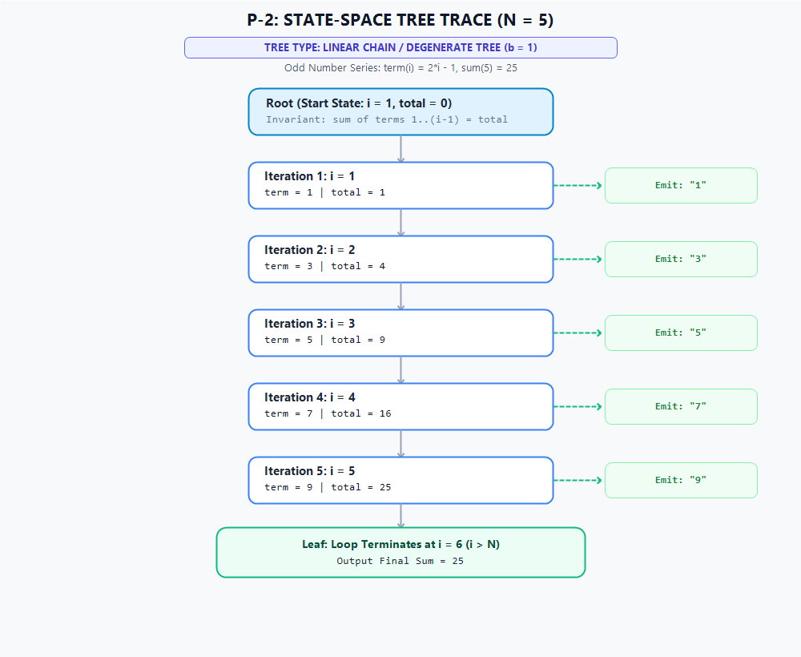

# Solution Derivation: P-2 - Series Summation: 2 + 4 + 6 + 8 + .............

## 📌 Metadata & Problem Reference
- **Problem ID**: P-2
- **Problem Title**: Series Summation: 2 + 4 + 6 + 8 + .............
- **Primary Category**: Repetitive Structures
- **Subcategory**: Pattern Printing
- **Applied Template**: [`Skills_Input/Templates/Repetitive Structure Template.md`](../../../../../../Skills_Input/Templates/Repetitive%20Structure%20Template.md)
- **Problem Statement Link**: [`question bank.md#p-2`](../../../../Problem%20Files/question%20bank.md#p-2)
- **Source**: `Recursion Vs Iteration, Part 1 (Series #2)`

---

## 🧠 Phase 1: State Definition & Variable Role Classification

### 1. Variable Discovery & Extraction Analysis
To uncover the variables and establish their roles from first principles, we analyze the problem requirements:
- **Linguistic Trigger: *"positive integer $N$ as input"***:
  - Discovered entity: `n`.
  - *Diagnostic Test 1 (Fixed Test)*: `n` is provided as an input bound. Its value is immutable once loaded into memory. It never transitions during execution. Hence, **Fixed**.
- **Linguistic Trigger: *"even numbers series: $2 + 4 + 6 + 8 + \dots$"***:
  - Discovered entities: `i` (index of the term from $1$ to $N$) and `term` (the actual even number at position $i$).
  - *Diagnostic Test 2 (Derived Test)* on `term`: Can `term` be computed solely from existing variables at step $i$? Yes, $\text{term} = 2 \times i$. It holds no independent lifecycle and remembers nothing of prior terms. Hence, **Derived**.
  - *Diagnostic Test 3 (Free Test)* on `i`: Does `i` autonomously march across a known discrete range $[1, N]$? Yes, $i$ increments by $+1$ at each step, defining the sequence of iterations. Hence, **Free** (Stepper).
- **Linguistic Trigger: *"calculate the sum of the series"***:
  - Discovered entity: `total`.
  - *Diagnostic Test 4 (Carried Test)* on `total`: Does `total` carry forward accumulated state across iterations? Yes, $\text{total}_i = \text{total}_{i-1} + 2i$. If the loop is paused at step $i$, `total` cannot be recomputed without knowing the past trajectory. Hence, **Carried** (Gatherer).

### 2. Candidate Variables Inventory
- `n`: Total count of terms in the sequence (given input parameter).
- `i`: Current iteration counter / index of the term ($1 \le i \le n$).
- `term`: Mathematical value of the $i$-th term in the even-integer sequence ($\text{term} = 2i$).
- `total`: Running cumulative sum of all terms from term $1$ through term $i$.

### 3. Variable Roles & Classification Table

| Variable | Role | Class | Justification & Lifecycle |
| :--- | :--- | :--- | :--- |
| `n` | Fixed Value | **Fixed** | Given once via standard input; remains unchanged throughout execution. |
| `i` | Stepper | **Free** | Enumerates discrete values across $[1, n]$; requires its own loop. |
| `term` | Derived Value | **Derived** | Pure mathematical formula $\text{term} = 2i$; computed fresh on the fly, needs no loop. |
| `total` | Gatherer | **Carried** | Accumulates successive terms: $\text{total}_{\text{new}} = \text{total}_{\text{old}} + 2i$; maintained across iterations. |

### 4. True Minimal State Formulation
Filtering out fixed parameters (constant context) and derived values (instantaneous on-the-fly expressions), the minimal "pause-and-resume note" (state tuple) is:

$$\text{State} = (i, \text{total})$$

- **Free variable**: $i$ (controls progression)
- **Carried variable**: $\text{total}$ (accumulates result across iterations)

**Loop Requirement**: Since there is **exactly 1 free variable** ($i$), the problem requires **exactly 1 loop**.

---

## 🌲 Phase 2: State-Space & Relationship Derivation

### 1. Loop Bounds & Arithmetic Intervals
- Lower Bound: $i_{\text{start}} = 1$
- Upper Bound: $i_{\text{end}} = n$
- Step Increment: $\Delta i = +1$
- Total Iterations / Steps: $n - 1 + 1 = n$
- Term Generation Rule: $\text{term}_i = 2 \cdot i$

### 2. State-Space Tree Diagram (Trace for $n = 5$)
- **Tree Type**: **Linear Chain / Degenerate State-Space Tree ($b = 1$)**
- **Branching Factor**: Exactly 1 deterministic transition per step (no branching, decisions, or backtracking).
- **Topology**: Vertical linear spine of depth $N$, where each node represents an iteration step emitting a term, culminating in a single termination leaf.

---

## ⚖️ Phase 3: Mathematical Invariant Formulation

### 1. Loop Invariant
At the start of each iteration with counter index $i \in [1, n + 1]$:
$$\text{total} = \sum_{k=1}^{i-1} 2k = 2 \sum_{k=1}^{i-1} k = 2 \cdot \frac{(i - 1)i}{2} = (i - 1)i$$

### 2. Inductive Verification Steps
- **Initialization ($i = 1$)**:
  $$\text{total} = (1 - 1) \cdot 1 = 0$$
  Matches the initial accumulator state prior to executing the first iteration.
- **Maintenance ($i \to i + 1$)**:
  Assume invariant holds before iteration $i$: $\text{total} = (i - 1)i$.
  During iteration $i$, the term $2i$ is evaluated and added:
  $$\text{total}' = \text{total} + 2i = (i - 1)i + 2i = i(i - 1 + 2) = i(i + 1)$$
  The property holds for index $i + 1$.
- **Termination ($i = n + 1$)**:
  The loop terminates immediately when $i = n + 1$. Substituting into the invariant:
  $$\text{total} = (n + 1 - 1)(n + 1) = n(n + 1) = \sum_{k=1}^{n} 2k$$
  The computed value is mathematically exact for the sum of the first $n$ positive even integers.

---

## 🔍 Phase 4: Boundary Audits & Failure Mode Checks

| Edge / Boundary Case | Expected Behavior | Code Handling |
| :--- | :--- | :--- |
| **Minimum Bound ($N = 1$)** | Single term `2` printed; `Sum = 2`. | Loop runs once for $i=1$; $\text{total} = 1 \cdot 2 = 2$. Handled correctly. |
| **Empty / Invalid Input ($N \le 0$)** | Handled by problem constraints ($1 \le N \le 10^4$). | Guarded by early return on empty input. |
| **Maximum Bound ($N = 10^4$)** | $\text{total} = 10^4 \cdot (10^4 + 1) = 100,010,000$. | Fits comfortably in 32-bit signed integer ($\approx 2.14 \times 10^9$). Java uses explicit `long` to prevent any overflow. |
| **Whitespace Formatting** | Strictly space-separated terms with no trailing space. | Python uses `" ".join(terms)`; Java uses `StringBuilder` with conditional separator. |

---

## ⏱️ Phase 5: Complexity Analysis

- **Time Complexity**: $\mathcal{O}(N)$
  - Total leaves in the linear execution tree: $N$.
  - Each step carries out $\mathcal{O}(1)$ multiplication, addition, and formatting operations.
- **Auxiliary Space Complexity**: $\mathcal{O}(1)$
  - Only two scalar registers (`i` and `total`) are maintained in memory across the loop.

