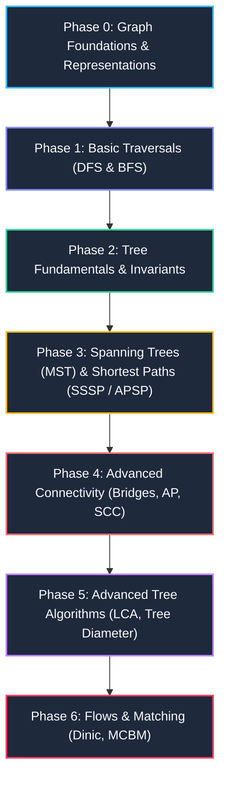

# 001. Graph and Tree Comprehensive Learning Roadmap & Revision Guide

> **Document Serial**: `001`  
> **Topic**: Graph and Tree Foundations, Algorithms, Paradigms & Quick Revision Guide  
> **Source Ground Truth**: *Competitive Programming 4 (CP4)* Book 1 (Chapters 2.4.1, 4.1–4.6) & Book 2 (Chapters 8.4–8.5, 9.5, 9.8)  
> **Authors**: Steven Halim, Felix Halim, Suhendry Effendy  
> **Languages Provided**: Complete, fully runnable **Python 3** and **Java 21**  
> **Generated Timestamp**: `2026-11-05T02:45:00+06:00`

---

## 🧭 Executive Summary & Pedagogical Blueprint

Graphs and Trees form the foundation of algorithmic computer science. In CP4, graphs are categorized not merely as static structures, but by their **structural invariants** (e.g., connectivity, cycle freedom, bipartiteness, directionality, and DAG structure).



---

## 📌 Phase 0: Graph Representations & Memory Bounds

Before executing any graph traversal, select the correct data representation based on vertex count $V$ and edge count $E$:

| Representation | Space Complexity | Enumerate Neighbors of $u$ | Check Edge $(u, v)$ | Ideal Use Case |
| :--- | :--- | :--- | :--- | :--- |
| **Adjacency Matrix (`AM`)** | $O(V^2)$ | $O(V)$ | $O(1)$ | Dense graphs ($E \approx V^2$), $V \le 1000$, Warshall / Floyd-Warshall |
| **Adjacency List (`AL`)** | $O(V + E)$ | $O(\text{deg}(u))$ | $O(\text{deg}(u))$ | **Standard default** for $95\%$ of contest & real-world problems ($V, E \le 2 \cdot 10^5$) |
| **Edge List (`EL`)** | $O(E)$ | $O(E)$ | $O(E)$ | Kruskal's MST, Bellman-Ford where edges are iterated in bulk |
| **Implicit Grid Graph** | $O(1)$ extra | $O(1)$ (using $\Delta r, \Delta c$) | $O(1)$ | 2D matrices, Flood Fill, Maze navigation |

### Complete Runnable Implementation: Graph Representations

````carousel
```python
# Python 3: Complete Runnable Graph Representation
from typing import List, Tuple

class GraphDemo:
    def __init__(self, num_vertices: int):
        self.V = num_vertices
        # 1. Adjacency List: list of tuples (neighbor, weight)
        self.adj_list: List[List[Tuple[int, int]]] = [[] for _ in range(self.V)]
        # 2. Adjacency Matrix: 2D array initialized to 0 (or infinity for weights)
        self.adj_matrix: List[List[int]] = [[0] * self.V for _ in range(self.V)]
        # 3. Edge List: list of tuples (u, v, weight)
        self.edge_list: List[Tuple[int, int, int]] = []

    def add_edge(self, u: int, v: int, w: int, directed: bool = False):
        self.adj_list[u].append((v, w))
        self.adj_matrix[u][v] = w
        self.edge_list.append((u, v, w))
        if not directed:
            self.adj_list[v].append((u, w))
            self.adj_matrix[v][u] = w
            self.edge_list.append((v, u, w))

    def display(self):
        print(f"--- Graph (V={self.V}) ---")
        print("Adjacency List:")
        for u in range(self.V):
            print(f"  Node {u}: {self.adj_list[u]}")
        print("\nEdge List Count:", len(self.edge_list))

if __name__ == "__main__":
    g = GraphDemo(num_vertices=4)
    g.add_edge(0, 1, 10)
    g.add_edge(1, 2, 20)
    g.add_edge(2, 3, 30)
    g.add_edge(3, 0, 40)
    g.display()
```
<!-- slide -->
```java
// Java 21: Complete Runnable Graph Representation
import java.util.*;

public class GraphDemo {
    public static class Edge {
        public int to, weight;
        public Edge(int to, int weight) {
            this.to = to;
            this.weight = weight;
        }
        @Override
        public String toString() { return "(" + to + ", w=" + weight + ")"; }
    }

    public static class Triple {
        public int u, v, weight;
        public Triple(int u, int v, int weight) {
            this.u = u; this.v = v; this.weight = weight;
        }
    }

    private final int V;
    public final List<List<Edge>> adjList;
    public final int[][] adjMatrix;
    public final List<Triple> edgeList;

    public GraphDemo(int numVertices) {
        this.V = numVertices;
        this.adjList = new ArrayList<>(V);
        for (int i = 0; i < V; i++) adjList.add(new ArrayList<>());
        this.adjMatrix = new int[V][V];
        this.edgeList = new ArrayList<>();
    }

    public void addEdge(int u, int v, int weight, boolean directed) {
        adjList.get(u).add(new Edge(v, weight));
        adjMatrix[u][v] = weight;
        edgeList.add(new Triple(u, v, weight));
        if (!directed) {
            adjList.get(v).add(new Edge(u, weight));
            adjMatrix[v][u] = weight;
            edgeList.add(new Triple(v, u, weight));
        }
    }

    public void display() {
        System.out.println("--- Graph (V=" + V + ") ---");
        System.out.println("Adjacency List:");
        for (int i = 0; i < V; i++) {
            System.out.println("  Node " + i + ": " + adjList.get(i));
        }
        System.out.println("\nEdge List Count: " + edgeList.size());
    }

    public static void main(String[] args) {
        GraphDemo g = new GraphDemo(4);
        g.addEdge(0, 1, 10, false);
        g.addEdge(1, 2, 20, false);
        g.addEdge(2, 3, 30, false);
        g.addEdge(3, 0, 40, false);
        g.display();
    }
}
```
````

---

## 🏃 Phase 1: Core Graph Traversals (DFS & BFS)

### Depth-First Search (DFS) & Breadth-First Search (BFS)
- **DFS**: Uses recursion or a LIFO stack. Complexity: $O(V + E)$. Ideal for connected components, cycle finding, flood fill, and topological sorting.
- **BFS**: Uses a FIFO queue to discover vertices level-by-level. Complexity: $O(V + E)$. In an **unweighted graph**, the layer count is guaranteed to be the exact **shortest path distance**.

### Complete Runnable Implementation: DFS & BFS

````carousel
```python
# Python 3: Complete Runnable DFS & BFS
from collections import deque
from typing import List

class Traversals:
    def __init__(self, V: int):
        self.V = V
        self.adj = [[] for _ in range(V)]

    def add_edge(self, u: int, v: int):
        self.adj[u].append(v)
        self.adj[v].append(u)

    def dfs(self, start: int) -> List[int]:
        visited = [False] * self.V
        order = []

        def _dfs(u: int):
            visited[u] = True
            order.append(u)
            for v in self.adj[u]:
                if not visited[v]:
                    _dfs(v)

        _dfs(start)
        return order

    def bfs(self, start: int) -> Tuple[List[int], List[int]]:
        dist = [-1] * self.V
        order = []
        q = deque([start])
        dist[start] = 0

        while q:
            u = q.popleft()
            order.append(u)
            for v in self.adj[u]:
                if dist[v] == -1:
                    dist[v] = dist[u] + 1
                    q.append(v)

        return order, dist

if __name__ == "__main__":
    t = Traversals(6)
    t.add_edge(0, 1)
    t.add_edge(0, 2)
    t.add_edge(1, 3)
    t.add_edge(2, 4)
    t.add_edge(3, 5)

    print("DFS Order starting from 0:", t.dfs(0))
    bfs_order, distances = t.bfs(0)
    print("BFS Order starting from 0:", bfs_order)
    print("Distances from 0:", distances)
```
<!-- slide -->
```java
// Java 21: Complete Runnable DFS & BFS
import java.util.*;

public class TraversalsDemo {
    private final int V;
    private final List<List<Integer>> adj;

    public TraversalsDemo(int V) {
        this.V = V;
        this.adj = new ArrayList<>(V);
        for (int i = 0; i < V; i++) adj.add(new ArrayList<>());
    }

    public void addEdge(int u, int v) {
        adj.get(u).add(v);
        adj.get(v).add(u);
    }

    public List<Integer> dfs(int start) {
        boolean[] visited = new boolean[V];
        List<Integer> order = new ArrayList<>();
        dfsInternal(start, visited, order);
        return order;
    }

    private void dfsInternal(int u, boolean[] visited, List<Integer> order) {
        visited[u] = true;
        order.add(u);
        for (int v : adj.get(u)) {
            if (!visited[v]) dfsInternal(v, visited, order);
        }
    }

    public static class BfsResult {
        public List<Integer> order;
        public int[] dist;
        public BfsResult(List<Integer> order, int[] dist) {
            this.order = order;
            this.dist = dist;
        }
    }

    public BfsResult bfs(int start) {
        int[] dist = new int[V];
        Arrays.fill(dist, -1);
        List<Integer> order = new ArrayList<>();
        Queue<Integer> q = new ArrayDeque<>();

        dist[start] = 0;
        q.offer(start);

        while (!q.isEmpty()) {
            int u = q.poll();
            order.add(u);
            for (int v : adj.get(u)) {
                if (dist[v] == -1) {
                    dist[v] = dist[u] + 1;
                    q.offer(v);
                }
            }
        }
        return new BfsResult(order, dist);
    }

    public static void main(String[] args) {
        TraversalsDemo t = new TraversalsDemo(6);
        t.addEdge(0, 1);
        t.addEdge(0, 2);
        t.addEdge(1, 3);
        t.addEdge(2, 4);
        t.addEdge(3, 5);

        System.out.println("DFS Order starting from 0: " + t.dfs(0));
        BfsResult res = t.bfs(0);
        System.out.println("BFS Order starting from 0: " + res.order);
        System.out.println("Distances from 0: " + Arrays.toString(res.dist));
    }
}
```
````

---

## 🌳 Phase 2: Tree Fundamentals & Invariants

A **Tree** is a connected, undirected acyclic graph.

### 🔑 Critical Theorems (CP4 Book 1 Section 4.6.2):
1. **$E = V - 1$**: Every $O(V + E)$ algorithm simplifies directly to $O(V)$.
2. **Unique Simple Path**: Exactly one simple path exists between any two vertices.
3. **No `visited[]` array needed**: Traversing a tree requires only tracking the parent `(u, p)` to prevent immediate back-stepping.
4. **Diameter in $2 \times O(V)$**:
   - Run DFS/BFS from any arbitrary root to find the furthest vertex $x$.
   - Run DFS/BFS from $x$ to find the furthest vertex $y$.
   - The distance $d(x, y)$ is the exact **tree diameter**.

### Complete Runnable Implementation: Tree Diameter & Path Finding

````carousel
```python
# Python 3: Complete Runnable Tree Diameter & Invariants
from typing import List, Tuple

class TreeAlgorithms:
    def __init__(self, V: int):
        self.V = V
        self.adj = [[] for _ in range(V)]

    def add_edge(self, u: int, v: int, w: int = 1):
        self.adj[u].append((v, w))
        self.adj[v].append((u, w))

    def _get_furthest_node(self, start: int) -> Tuple[int, int]:
        # Returns (furthest_node, max_distance) using O(V) DFS without visited array
        farthest_node = start
        max_dist = 0

        def dfs(u: int, p: int, current_dist: int):
            nonlocal farthest_node, max_dist
            if current_dist > max_dist:
                max_dist = current_dist
                farthest_node = u
            for v, w in self.adj[u]:
                if v != p:  # Avoid parent backtrack
                    dfs(v, u, current_dist + w)

        dfs(start, -1, 0)
        return farthest_node, max_dist

    def compute_diameter(self) -> int:
        if self.V <= 1:
            return 0
        # Pass 1: find node furthest from arbitrary node 0
        node_x, _ = self._get_furthest_node(0)
        # Pass 2: find node furthest from node_x
        node_y, diameter = self._get_furthest_node(node_x)
        return diameter

if __name__ == "__main__":
    tree = TreeAlgorithms(7)
    # Tree edges: 0-1 (w=3), 0-2 (w=2), 1-3 (w=5), 1-4 (w=1), 2-5 (w=4), 5-6 (w=7)
    tree.add_edge(0, 1, 3)
    tree.add_edge(0, 2, 2)
    tree.add_edge(1, 3, 5)
    tree.add_edge(1, 4, 1)
    tree.add_edge(2, 5, 4)
    tree.add_edge(5, 6, 7)

    print("Calculated Tree Diameter:", tree.compute_diameter())
```
<!-- slide -->
```java
// Java 21: Complete Runnable Tree Diameter & Invariants
import java.util.*;

public class TreeAlgorithmsDemo {
    public static class Edge {
        public int to, weight;
        public Edge(int to, int weight) { this.to = to; this.weight = weight; }
    }

    private final int V;
    private final List<List<Edge>> adj;

    public TreeAlgorithmsDemo(int V) {
        this.V = V;
        this.adj = new ArrayList<>(V);
        for (int i = 0; i < V; i++) adj.add(new ArrayList<>());
    }

    public void addEdge(int u, int v, int w) {
        adj.get(u).add(new Edge(v, w));
        adj.get(v).add(new Edge(u, w));
    }

    private static class FurthestResult {
        int node;
        int dist;
        FurthestResult(int node, int dist) { this.node = node; this.dist = dist; }
    }

    private FurthestResult getFurthest(int start) {
        FurthestResult best = new FurthestResult(start, 0);
        dfs(start, -1, 0, best);
        return best;
    }

    private void dfs(int u, int p, int curDist, FurthestResult best) {
        if (curDist > best.dist) {
            best.dist = curDist;
            best.node = u;
        }
        for (Edge e : adj.get(u)) {
            if (e.to != p) { // Tree property: check parent only
                dfs(e.to, u, curDist + e.weight, best);
            }
        }
    }

    public int computeDiameter() {
        if (V <= 1) return 0;
        FurthestResult pass1 = getFurthest(0);
        FurthestResult pass2 = getFurthest(pass1.node);
        return pass2.dist;
    }

    public static void main(String[] args) {
        TreeAlgorithmsDemo tree = new TreeAlgorithmsDemo(7);
        tree.addEdge(0, 1, 3);
        tree.addEdge(0, 2, 2);
        tree.addEdge(1, 3, 5);
        tree.addEdge(1, 4, 1);
        tree.addEdge(2, 5, 4);
        tree.addEdge(5, 6, 7);

        System.out.println("Calculated Tree Diameter: " + tree.computeDiameter());
    }
}
```
````

---

## ⚡ Phase 3: Shortest Paths — Dijkstra's Algorithm

When edge weights are **non-negative**, Dijkstra's algorithm solves Single-Source Shortest Paths in $O((V + E) \log V)$ using a Priority Queue / Min-Heap.

### Complete Runnable Implementation: Dijkstra's Algorithm

````carousel
```python
# Python 3: Complete Runnable Dijkstra's Algorithm
import heapq
from typing import List, Tuple

class Dijkstra:
    def __init__(self, V: int):
        self.V = V
        self.adj = [[] for _ in range(V)]

    def add_edge(self, u: int, v: int, w: int, directed: bool = False):
        self.adj[u].append((v, w))
        if not directed:
            self.adj[v].append((u, w))

    def compute_sssp(self, src: int) -> Tuple[List[float], List[int]]:
        dist = [float('inf')] * self.V
        parent = [-1] * self.V
        dist[src] = 0
        
        # Priority Queue stores: (distance, vertex)
        pq = [(0, src)]

        while pq:
            d, u = heapq.heappop(pq)

            # Lazy deletion check (skip outdated duplicate states)
            if d > dist[u]:
                continue

            for v, weight in self.adj[u]:
                if dist[u] + weight < dist[v]:
                    dist[v] = dist[u] + weight
                    parent[v] = u
                    heapq.heappush(pq, (dist[v], v))

        return dist, parent

    def reconstruct_path(self, parent: List[int], target: int) -> List[int]:
        path = []
        curr = target
        while curr != -1:
            path.append(curr)
            curr = parent[curr]
        return path[::-1]

if __name__ == "__main__":
    dijk = Dijkstra(5)
    dijk.add_edge(0, 1, 9)
    dijk.add_edge(0, 2, 6)
    dijk.add_edge(0, 3, 5)
    dijk.add_edge(0, 4, 3)
    dijk.add_edge(2, 1, 2)
    dijk.add_edge(2, 3, 4)

    distances, parent = dijk.compute_sssp(0)
    print("Shortest distances from 0:", distances)
    print("Reconstructed path 0 -> 1:", dijk.reconstruct_path(parent, 1))
```
<!-- slide -->
```java
// Java 21: Complete Runnable Dijkstra's Algorithm
import java.util.*;

public class DijkstraDemo {
    public static class Edge {
        int to, weight;
        public Edge(int to, int weight) { this.to = to; this.weight = weight; }
    }

    public static class NodeDist implements Comparable<NodeDist> {
        int u, dist;
        public NodeDist(int u, int dist) { this.u = u; this.dist = dist; }
        @Override
        public int compareTo(NodeDist other) { return Integer.compare(this.dist, other.dist); }
    }

    private final int V;
    private final List<List<Edge>> adj;

    public DijkstraDemo(int V) {
        this.V = V;
        this.adj = new ArrayList<>(V);
        for (int i = 0; i < V; i++) adj.add(new ArrayList<>());
    }

    public void addEdge(int u, int v, int w, boolean directed) {
        adj.get(u).add(new Edge(v, w));
        if (!directed) adj.get(v).add(new Edge(u, w));
    }

    public static class SSSPResult {
        public int[] dist;
        public int[] parent;
        public SSSPResult(int[] dist, int[] parent) { this.dist = dist; this.parent = parent; }
    }

    public SSSPResult computeSSSP(int src) {
        int[] dist = new int[V];
        int[] parent = new int[V];
        Arrays.fill(dist, Integer.MAX_VALUE);
        Arrays.fill(parent, -1);

        dist[src] = 0;
        PriorityQueue<NodeDist> pq = new PriorityQueue<>();
        pq.offer(new NodeDist(src, 0));

        while (!pq.isEmpty()) {
            NodeDist top = pq.poll();
            int u = top.u;
            int d = top.dist;

            if (d > dist[u]) continue; // Lazy deletion check

            for (Edge e : adj.get(u)) {
                if (dist[u] + e.weight < dist[e.to]) {
                    dist[e.to] = dist[u] + e.weight;
                    parent[e.to] = u;
                    pq.offer(new NodeDist(e.to, dist[e.to]));
                }
            }
        }
        return new SSSPResult(dist, parent);
    }

    public static List<Integer> reconstructPath(int[] parent, int target) {
        List<Integer> path = new ArrayList<>();
        for (int at = target; at != -1; at = parent[at]) path.add(at);
        Collections.reverse(path);
        return path;
    }

    public static void main(String[] args) {
        DijkstraDemo dijk = new DijkstraDemo(5);
        dijk.addEdge(0, 1, 9, false);
        dijk.addEdge(0, 2, 6, false);
        dijk.addEdge(0, 3, 5, false);
        dijk.addEdge(0, 4, 3, false);
        dijk.addEdge(2, 1, 2, false);
        dijk.addEdge(2, 3, 4, false);

        SSSPResult res = dijk.computeSSSP(0);
        System.out.println("Shortest distances from 0: " + Arrays.toString(res.dist));
        System.out.println("Path 0 -> 1: " + reconstructPath(res.parent, 1));
    }
}
```
````

---

## 🔗 Phase 4: Minimum Spanning Tree (MST) — Kruskal with UFDS

Kruskal's algorithm finds the Minimum Spanning Tree in $O(E \log V)$ by sorting edges and greedily uniting disjoint sets using **Union-Find Disjoint Sets (UFDS)** with path compression and union by rank.

### Complete Runnable Implementation: Kruskal's Algorithm

````carousel
```python
# Python 3: Complete Runnable Kruskal's Algorithm with UFDS
from typing import List, Tuple

class UnionFind:
    def __init__(self, n: int):
        self.parent = list(range(n))
        self.rank = [0] * n
        self.num_sets = n

    def find(self, i: int) -> int:
        if self.parent[i] == i:
            return i
        self.parent[i] = self.find(self.parent[i])  # Path compression
        return self.parent[i]

    def union(self, i: int, j: int) -> bool:
        root_i = self.find(i)
        root_j = self.find(j)
        if root_i == root_j:
            return False  # Already in same set (cycle)
        
        # Union by rank
        if self.rank[root_i] < self.rank[root_j]:
            self.parent[root_i] = root_j
        else:
            self.parent[root_j] = root_i
            if self.rank[root_i] == self.rank[root_j]:
                self.rank[root_i] += 1
        self.num_sets -= 1
        return True

def kruskal_mst(num_nodes: int, edges: List[Tuple[int, int, int]]) -> Tuple[int, List[Tuple[int, int, int]]]:
    # Sort edges ascending by weight: (u, v, weight)
    sorted_edges = sorted(edges, key=lambda e: e[2])
    uf = UnionFind(num_nodes)
    mst_weight = 0
    mst_edges = []

    for u, v, w in sorted_edges:
        if uf.union(u, v):
            mst_weight += w
            mst_edges.append((u, v, w))
            if len(mst_edges) == num_nodes - 1:
                break

    return mst_weight, mst_edges

if __name__ == "__main__":
    # Edge list: (u, v, weight)
    sample_edges = [
        (0, 1, 4), (0, 2, 4), (1, 2, 2),
        (1, 3, 3), (2, 3, 4), (2, 4, 2),
        (3, 4, 3)
    ]
    cost, tree_edges = kruskal_mst(5, sample_edges)
    print("MST Total Weight:", cost)
    print("MST Edges:", tree_edges)
```
<!-- slide -->
```java
// Java 21: Complete Runnable Kruskal's Algorithm with UFDS
import java.util.*;

public class KruskalDemo {
    public static class UFDS {
        private final int[] parent;
        private final int[] rank;

        public UFDS(int n) {
            parent = new int[n];
            rank = new int[n];
            for (int i = 0; i < n; i++) parent[i] = i;
        }

        public int find(int i) {
            if (parent[i] == i) return i;
            return parent[i] = find(parent[i]); // Path compression
        }

        public boolean union(int i, int j) {
            int rootI = find(i);
            int rootJ = find(j);
            if (rootI == rootJ) return false;

            if (rank[rootI] < rank[rootJ]) {
                parent[rootI] = rootJ;
            } else {
                parent[rootJ] = rootI;
                if (rank[rootI] == rank[rootJ]) rank[rootI]++;
            }
            return true;
        }
    }

    public static class Edge implements Comparable<Edge> {
        int u, v, weight;
        public Edge(int u, int v, int weight) { this.u = u; this.v = v; this.weight = weight; }
        @Override
        public int compareTo(Edge o) { return Integer.compare(this.weight, o.weight); }
        @Override
        public String toString() { return "(" + u + " - " + v + ", w=" + weight + ")"; }
    }

    public static void main(String[] args) {
        int V = 5;
        List<Edge> edges = new ArrayList<>(Arrays.asList(
            new Edge(0, 1, 4), new Edge(0, 2, 4), new Edge(1, 2, 2),
            new Edge(1, 3, 3), new Edge(2, 3, 4), new Edge(2, 4, 2),
            new Edge(3, 4, 3)
        ));

        Collections.sort(edges);
        UFDS uf = new UFDS(V);
        int mstWeight = 0;
        List<Edge> mstEdges = new ArrayList<>();

        for (Edge e : edges) {
            if (uf.union(e.u, e.v)) {
                mstWeight += e.weight;
                mstEdges.add(e);
                if (mstEdges.size() == V - 1) break;
            }
        }

        System.out.println("MST Total Weight: " + mstWeight);
        System.out.println("MST Edges: " + mstEdges);
    }
}
```
````

---

## ⚡ Quick Revision Summary Flashcards

> [!TIP]
> **Check 1: Is the graph a Tree?**  
> If connected and $E = V - 1$, discard Dijkstra, Bellman-Ford, and Floyd-Warshall! A single $O(V)$ DFS solves SSSP, and 2 DFS calls compute the diameter.

> [!IMPORTANT]
> **Check 2: Negative cycles?**  
> Dijkstra produces undefined behavior with negative edge weights. Always use Bellman-Ford or SPFA if edge weights can be negative.

> [!NOTE]
> **Check 3: Implicit DAG in DP?**  
> Any dynamic programming problem with state transitions is essentially an implicit Directed Acyclic Graph (DAG). Finding longest/shortest path on a DAG takes only $O(V + E)$ via topological ordering.
