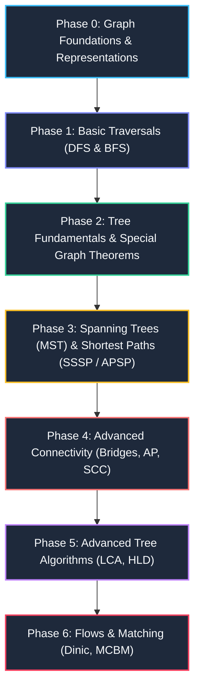

# 001. Graph and Tree Comprehensive Learning Roadmap & Revision Guide

> **Document Serial**: `001`  
> **Topic**: Graph and Tree Foundations, Algorithms, Paradigms & Quick Revision Guide  
> **Source Ground Truth**: *Competitive Programming 4 (CP4)* Book 1 (Chapters 2.4.1, 4.1–4.6) & Book 2 (Chapters 8.4–8.5, 9.5, 9.8)  
> **Authors**: Steven Halim, Felix Halim, Suhendry Effendy  
> **Generated Timestamp**: `2026-11-05T02:42:00+06:00`

---

## 🧭 Executive Summary & Pedagogical Blueprint

Graphs and Trees form the architectural backbone of computer science and competitive programming. In CP4, graphs are categorized not merely as static data structures, but by their **structural invariants** (e.g., connectivity, cycle freedom, bipartiteness, directionality, and DAG structure).



---

## 📌 Phase 0: Representations & Memory Trade-Offs

Before executing any graph traversal, select the correct data representation based on vertex count $V$ and edge count $E$:

| Representation | Space Complexity | Enumerate Neighbors of $u$ | Check Edge $(u, v)$ | Ideal Use Case |
| :--- | :--- | :--- | :--- | :--- |
| **Adjacency Matrix (`AM`)** | $O(V^2)$ | $O(V)$ | $O(1)$ | Dense graphs ($E \approx V^2$), $V \le 1000$, Warshall / Floyd-Warshall |
| **Adjacency List (`AL`)** | $O(V + E)$ | $O(\text{deg}(u))$ | $O(\text{deg}(u))$ | **Standard default** for $95\%$ of contest & real-world problems ($V, E \le 2 \cdot 10^5$) |
| **Edge List (`EL`)** | $O(E)$ | $O(E)$ | $O(E)$ | Kruskal's MST, Bellman-Ford where edges are iterated in bulk |
| **Implicit Grid Graph** | $O(1)$ extra | $O(1)$ (using $\Delta r, \Delta c$) | $O(1)$ | 2D matrices, Flood Fill, Maze navigation |

### Modern C++ Idiom for `AL`:
```cpp
// 0-indexed vertices, weighted graph
using ii = pair<int, int>;
using vii = vector<ii>;
vector<vii> AL(V); 

// Add directed edge u -> v with weight w
AL[u].push_back({v, w});

// Add undirected edge
AL[u].push_back({v, w});
AL[v].push_back({u, w});
```

---

## 🏃 Phase 1: Core Graph Traversals (DFS vs. BFS)

### 1. Depth-First Search (DFS)
- **Mechanics**: Explores as deep as possible along each branch before backtracking using a call stack or explicit stack.
- **Complexity**: $O(V + E)$ on Adjacency List.
- **Key Applications**:
  1. Connected components identification.
  2. Flood Fill on 2D implicit grids.
  3. Cycle checking (back-edges in directed graphs).
  4. Topological Sort on Directed Acyclic Graphs (DAG).

```cpp
vector<int> visited(V, 0);

void dfs(int u) {
    visited[u] = 1;
    for (auto &[v, w] : AL[u]) {
        if (!visited[v]) {
            dfs(v);
        }
    }
}
```

### 2. Breadth-First Search (BFS)
- **Mechanics**: Visits vertices level-by-level (layer-by-layer) using a FIFO queue.
- **Complexity**: $O(V + E)$ on Adjacency List.
- **Key Invariant**: In an **unweighted graph**, the first time BFS reaches vertex $v$ from source $s$, the path length is guaranteed to be the **shortest path** $d(s, v)$.

```cpp
const int INF = 1e9;
vector<int> dist(V, INF);
queue<int> q;

dist[s] = 0;
q.push(s);

while (!q.empty()) {
    int u = q.front(); q.pop();
    for (auto &[v, w] : AL[u]) {
        if (dist[v] == INF) {
            dist[v] = dist[u] + 1;
            q.push(v);
        }
    }
}
```

---

## 🌳 Phase 2: Tree Fundamentals & Special Properties

A **Tree** is a special connected undirected graph with zero cycles.

### 🔑 Fundamental Tree Theorems (CP4 Section 4.6.2):
1. **Edge Count**: $E = V - 1$. Any $O(V + E)$ algorithm simplifies to $O(V)$.
2. **Unique Path**: Between any pair of vertices $u$ and $v$, there is exactly **one simple path**.
3. **Bridges & Articulation Points**: Every single edge in a tree is a **bridge**. Every internal vertex ($\text{deg}(u) \ge 2$) is an **articulation point**.
4. **No Visited Array Needed**: A tree traversal only needs to pass `parent` to prevent immediate back-stepping:
   ```cpp
   void tree_dfs(int u, int p) {
       for (auto &[v, w] : AL[u]) {
           if (v != p) tree_dfs(v, u);
       }
   }
   ```
5. **SSSP on Weighted Tree**: Runs in simple $O(V)$ via DFS/BFS (no Dijkstra needed!).
6. **APSP on Weighted Tree**: Runs in $O(V^2)$ by repeating DFS $V$ times.
7. **Tree Diameter in $2 \times O(V)$**:
   - Run DFS from *any* arbitrary vertex $s$ to find the furthest vertex $x$.
   - Run DFS a second time from $x$ to find the furthest vertex $y$.
   - The path $x \to y$ is the **diameter** of the tree.

---

## ⚡ Phase 3: Shortest Paths & Spanning Trees Decision Guide

```mermaid
graph TD
    Start["Given Graph Problem"] --> PathQ{"Shortest Path or Minimum Tree?"}
    
    PathQ -->|Shortest Path| SSSP{"SSSP (Single Source) or APSP (All Pairs)?"}
    PathQ -->|Minimum Tree| MST["MST: Kruskal (UFDS) or Prim (PQ) - O(E log V)"]
    
    SSSP -->|SSSP| WeightQ{"Edge Weights?"}
    SSSP -->|APSP| APSPQ{"Dense (V <= 400) or Sparse?"}
    
    WeightQ -->|All Unweighted| BFS["BFS - O(V + E)"]
    WeightQ -->|Non-negative weights| Dijkstra["Dijkstra (Priority Queue) - O((V+E) log V)"]
    WeightQ -->|Negative weights / Cycles| BF["Bellman-Ford / SPFA - O(V * E)"]
    WeightQ -->|DAG (no cycles)| DAGDP["Topological Sort + DP - O(V + E)"]
    
    APSPQ -->|V <= 400| FW["Floyd-Warshall - O(V^3)"]
    APSPQ -->|Sparse / Tree| RepDijk["V x Dijkstra or Tree DFS - O(V * E log V)"]
```

---

## 🚀 Phase 4: Advanced Topics & Decompositions

| Topic | Book Section | Key Mechanism | Time Complexity |
| :--- | :--- | :--- | :--- |
| **Topological Sort** | Book 1, 4.2.6 | Kahn's Algorithm (indegree queue) or DFS post-order | $O(V + E)$ |
| **Bipartite Check** | Book 1, 4.2.7 | 2-Coloring via BFS or DFS | $O(V + E)$ |
| **Bridges & Articulation Points** | Book 1, 4.2.9 | Tarjan's DFS Lowlink (`dfs_num` & `dfs_low`) | $O(V + E)$ |
| **Strongly Connected Components (SCC)** | Book 1, 4.2.10 | Tarjan's or Kosaraju's algorithm | $O(V + E)$ |
| **Lowest Common Ancestor (LCA)** | Book 2, 9.8 | Binary Lifting (`up[node][k]`) | $O(V \log V)$ prep, $O(\log V)$ query |
| **Heavy-Light Decomposition (HLD)** | Book 2, 9.5 | Heavy edge prioritization flattened onto Segment Tree | $O(V)$ prep, $O(\log^2 V)$ query/update |
| **Max Flow / Min Cut** | Book 2, 8.4 | Dinic's Algorithm (Level graph + blocking flow) | $O(V^2 E)$ (Unit network: $O(\min(V^{2/3}, E^{1/2}) E)$) |
| **Bipartite Matching (MCBM)** | Book 2, 8.5 / 9.26 | Augmenting paths (Kuhn) or Hopcroft-Karp | $O(V E)$ or $O(\sqrt{V} E)$ |

---

## 📝 High-Yield Revision Flashcards

> [!TIP]
> **Check 1: Is the graph a Tree?**  
> If connected and $E = V - 1$, discard Dijkstra, Bellman-Ford, and Floyd-Warshall! A single $O(V)$ DFS solves SSSP, and 2 DFS calls compute the diameter.

> [!IMPORTANT]
> **Check 2: Negative cycles?**  
> Dijkstra produces undefined behavior with negative edge weights. Always use Bellman-Ford or SPFA if edge weights can be negative.

> [!NOTE]
> **Check 3: Implicit DAG in DP?**  
> Any dynamic programming problem with state transitions is essentially an implicit Directed Acyclic Graph (DAG). Finding longest/shortest path on a DAG takes only $O(V + E)$ via topological ordering.

