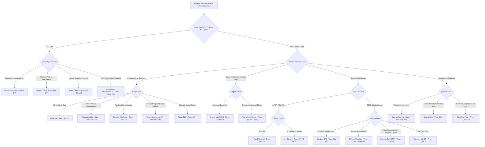

# 001. Graph and Tree Comprehensive Master Manual & Revision Guide

> **Document Serial**: `001`  
> **Topic**: Complete Exhaustive Graph & Tree Knowledge Base, Algorithms, Decision Paradigms & Quick Revision Guide  
> **Source Ground Truth**: Comprehensive Algorithmic & Graph Engineering Library
> **Language Support**: 100% Complete & Standalone Executable **Python 3** and **Java 21** for **Every Single Algorithm**  
> **UI Control**: Interactive native toggle tabs (HTML details and summary tags) for every code implementation
> **Generated Timestamp**: `2026-11-05T02:50:00+06:00`

---

---

## [Decision Tree] Master Decision Tree: What Algorithm to Choose at What Condition?

When facing any graph or tree problem in an interview or programming competition, follow this **instant identification flow**:



### [Summary] Quick-Lookup Interview Trigger Table

| If the problem mentions... | Red Flag / Invariant | Pick This Algorithm | Time Complexity | Real-World Example Problem | Plain-English Intuitive Solution |
| :--- | :--- | :--- | :--- | :--- | :--- |
| **"E = V - 1, connected, no cycles"** | Tree Property | **Single DFS / 2-Pass DFS** | `O(V)` | **Tree Diameter (LeetCode 1245 / 543)**: Find the longest path between any two nodes in a computer network. | Pick any node at random and find the furthest node X. From X, run DFS again to find the furthest node Y. The path from X to Y is guaranteed to be the longest highway in the tree. |
| **"Shortest path in maze / unweighted grid"** | Uniform edge cost = 1 | **Breadth-First Search (BFS)** | `O(V + E)` | **Shortest Path in Binary Matrix (LeetCode 1091)**: Escape a flooded maze with obstacles in minimum steps. | Drop a stone at start. Like water ripples expanding 1 tile outward every second, the moment a ripple touches the exit tile, you have reached it in the absolute fewest steps possible. |
| **"Prerequisites / Build order / Dependencies"** | Directed Acyclic Graph (DAG) | **Kahn's Topological Sort** | `O(V + E)` | **Course Schedule II (LeetCode 210)**: Order university courses given their prerequisite requirements. | Put courses with 0 prerequisites in a queue. Take each course, cross it off as completed, and reduce prerequisite counts for the next courses. If you finish all courses, you have your valid study plan! |
| **"Divide into two non-conflicting groups"** | No odd cycles | **Bipartite 2-Coloring (BFS)** | `O(V + E)` | **Possible Bipartition (LeetCode 886)**: Split people into two rival teams where no two enemies are on the same team. | Put person 1 on Team Blue. Color all their enemies Team Red, and color their enemies' enemies Team Blue. If you ever find two enemies assigned the exact same color, it is impossible (odd conflict loop). |
| **"Shortest path with positive weights"** | Non-negative edge weights | **Dijkstra's Algorithm (Min-Heap)** | `O((V + E) log V)` | **Network Delay Time (LeetCode 743)**: How long will it take for a signal to reach all computers through timed links? | Keep a scoreboard of shortest times and a Priority Queue. Always pick the unvisited computer with the smallest recorded time, send signals along its cables, and update neighbors if you found a quicker route. |
| **"Negative costs / Currency arbitrage cycle"** | Negative weights | **Bellman-Ford / SPFA** | `O(V * E)` | **Cheapest Flights Within K Stops / Forex Arbitrage**: Detect an infinite profit loop when trading currencies. | Try improving every single flight route in the world V - 1 times. If any flight price can still become cheaper on the V-th round, you discovered an infinite money glitch (negative cost cycle)! |
| **"All-pairs distances with V <= 400"** | Dense all-to-all query | **Floyd-Warshall** | `O(V^3)` | **City With Smallest Number of Neighbors (LeetCode 1334)**: Find distances between every pair of cities. | Ask for every city pair (i, j): "Can I travel from City i to City j faster by making a layover at Airport k?" Check all possible layovers k in 3 simple nested loops. |
| **"Connect all computers/cities with min wire"** | Spanning Tree | **Kruskal (UFDS) or Prim (Min-Heap)** | `O(E log V)` | **Min Cost to Connect All Points (LeetCode 1584)**: Lay fiber-optic cables connecting all cities at minimum cost. | Put all available cables in a price-sorted list from cheapest to most expensive. Greedily plug in the cheapest cable unless it connects two cities that are already linked together (prevents useless loops). |
| **"Single point of network failure / Critical edge"** | Bridges & Cut Vertices | **Tarjan's Lowlink (`dfs_low`)** | `O(V + E)` | **Critical Connections in a Network (LeetCode 1192)**: Identify servers or cables whose failure cuts the internet. | Track your arrival timestamp and the oldest ancestor your kids can reach via side roads. If your child has no side road back to someone older than you, your cable is a critical bridge--cutting it disconnects the network! |
| **"Condense directed cycles into DAG"** | Mutual reachability | **Tarjan's SCC** | `O(V + E)` | **Strongly Connected Cities**: Group cities where anyone can take a round trip to and from anywhere else. | Follow one-way roads and push cities onto a stack. When you hit a dead-end that loops back to yourself, pop all those cities off--they form a self-contained whirlpool you can shrink into a single super-city. |
| **"Lowest common ancestor / Distance in tree"** | Tree hierarchy query | **Binary Lifting LCA** | `O(V log V) prep, O(log V) query` | **Lowest Common Ancestor of Tree (LeetCode 236)**: Find the closest common manager of two corporate employees. | Instead of climbing the org chart 1 boss at a time, calculate jumps of powers of 2 (1, 2, 4, 8 levels up). Jump the lower employee up to the same rank, then jump both upward together in giant doubling leaps. |
| **"Draw shape without lifting pen / use all tickets"** | Visit all edges once | **Hierholzer's Eulerian Tour** | `O(V + E)` | **Reconstruct Itinerary (LeetCode 332)**: Plan a flight trip that uses every single boarding pass exactly once. | Check that every airport has an even number of arrivals/departures. Walk along flights greedily until you get stuck, then backtrack and splice any missed flight loops into your master journey. |
| **"Assign jobs to workers / Pair items 1-to-1"** | Max Bipartite Matching | **Kuhn's Augmenting Path** | `O(V * E)` | **Maximum Number of Accepted Job Applications**: Pair applicants to available jobs without conflicts. | Try matching Worker A to their favorite job. If that job is already occupied by Worker B, politely ask Worker B to switch to their second-choice job. If B can switch, A takes the job! |
| **"Max throughput / Pipes / Min Cut"** | Capacity bottleneck | **Dinic's Algorithm** | `O(V^2 * E)` | **Network Flow / Maximum Water Pipeline Delivery**: Maximum gallons of water that can flow through a pipe network. | Use BFS to measure distances from water source to drain. Then push water along shortest downhill pipes via DFS. If a pipe gets full, keep reverse valves so future water flows can redirect mistakes. |


---

## [Guide] Complete Master Curriculum & Topic Index

This manual covers **every core and advanced graph and tree topic** required for algorithmic problem-solving:

```mermaid
flowchart TD
    subgraph Fundamentals["1. Foundations & Representations"]
        M1["Adjacency Matrix, Adjacency List, Edge List, Implicit Grids"]
    end
    subgraph Traversals["2. Core Traversals & Connectivity"]
        M2["DFS & BFS (Level-by-level)"]
        M3["Connected Components & Flood Fill (2D Grid)"]
        M4["Topological Sort (Kahn's BFS & DFS Post-Order)"]
        M5["Bipartite Graph 2-Coloring Check"]
        M6["Directed Cycle Detection (3-State DFS)"]
        M7["Tarjan's Bridges & Articulation Points (Lowlink)"]
        M8["Tarjan's Strongly Connected Components (SCC)"]
    end
    subgraph SpanningTrees["3. Minimum Spanning Trees (MST)"]
        M9["Kruskal's Algorithm with UFDS"]
        M10["Prim's Algorithm with Priority Queue"]
    end
    subgraph ShortestPaths["4. Shortest Paths (SSSP & APSP)"]
        M11["SSSP on Unweighted Graph: BFS"]
        M12["SSSP on Weighted Graph: Dijkstra's Algorithm"]
        M13["SSSP with Negative Weights/Cycles: Bellman-Ford & SPFA"]
        M14["APSP: Floyd-Warshall Algorithm"]
    end
    subgraph SpecialGraphs["5. Trees & Special Graphs"]
        M15["Tree Invariants (E=V-1, Unique Path, No Visited Array)"]
        M16["Tree Diameter (2-Pass DFS/BFS)"]
        M17["Eulerian Path & Tour (Hierholzer's Algorithm)"]
        M18["DAG Properties & DP Transitions"]
    end
    subgraph AdvancedTrees["6. Advanced Tree Algorithms"]
        M19["Lowest Common Ancestor (LCA via Binary Lifting)"]
        M20["Heavy-Light Decomposition (HLD Concept & Flattening)"]
    end
    subgraph FlowsAndMatching["7. Network Flows & Matching"]
        M21["Maximum Flow: Edmonds-Karp & Dinic's Algorithm"]
        M22["Max Cardinality Bipartite Matching (MCBM via Augmenting Paths)"]
    end

    Fundamentals --> Traversals
    Traversals --> SpanningTrees
    SpanningTrees --> ShortestPaths
    ShortestPaths --> SpecialGraphs
    SpecialGraphs --> AdvancedTrees
    AdvancedTrees --> FlowsAndMatching
```



---

## 1. Graph Representations (AM, AL, EL, Implicit Grid)

### [Memory Trick] Interview Memory Trick: "Who is my neighbor?"
> **The 3-Second Mental Hook**:
> - **Matrix (`AM`)**: Think of an *Excel Spreadsheet*. Instant check cell `(u, v)`, but wastes memory like an empty ocean when sparse. Use only when `V <= 1,000` or doing all-pairs matrices.
> - **List (`AL`)**: Think of a *Phone Contact Book*. Each person `u` stores only their actual friends. Best default for 99% of interviews (`V, E <= 200,000`).
> - **Edge List (`EL`)**: Think of a *Flight Route List*. A flat array of trips `(origin, dest, price)`. Best when sorting all edges in bulk (e.g., Kruskal's MST).
> - **Grid**: No graph structure needed! Just use directional arrays: `dr = [-1, 1, 0, 0]` and `dc = [0, 0, -1, 1]`.

Before executing any graph algorithm, select the correct representation based on vertices `V` and edges `E`:

| Representation | Space Complexity | Enumerate Neighbors | Check Edge `(u, v)` | Ideal Use Case |
| :--- | :--- | :--- | :--- | :--- |
| **Adjacency Matrix (`AM`)** | `O(V^2)` | `O(V)` | `O(1)` | Dense graphs (`E ~ V^2`), `V <= 1000`, Floyd-Warshall |
| **Adjacency List (`AL`)** | `O(V + E)` | `O(deg(u))` | `O(deg(u))` | **Default choice** for `95\%` of problems (`V, E <= 2 * 10^5`) |
| **Edge List (`EL`)** | `O(E)` | `O(E)` | `O(E)` | Kruskal's MST, Bellman-Ford |
| **Implicit Grid Graph** | `O(1)` extra | `O(1)` via `(d r, d c)` | `O(1)` | 2D matrices, Flood Fill |

<details open>
<summary><b>[Python] Python 3 Implementation: Complete Graph Representations</b></summary>

```python
from typing import List, Tuple

class GraphRepresentations:
    def __init__(self, V: int):
        self.V = V
        self.adj_list: List[List[Tuple[int, int]]] = [[] for _ in range(V)]
        self.adj_matrix: List[List[int]] = [[0] * V for _ in range(V)]
        self.edge_list: List[Tuple[int, int, int]] = []

    def add_edge(self, u: int, v: int, w: int, directed: bool = False):
        self.adj_list[u].append((v, w))
        self.adj_matrix[u][v] = w
        self.edge_list.append((u, v, w))
        if not directed:
            self.adj_list[v].append((u, w))
            self.adj_matrix[v][u] = w
            self.edge_list.append((v, u, w))

    def display(self):
        print(f"=== Graph Representations (V={self.V}) ===")
        for u in range(self.V):
            print(f"  AL[{u}] -> {self.adj_list[u]}")
        print("  Total Edges stored:", len(self.edge_list))

if __name__ == "__main__":
    g = GraphRepresentations(4)
    g.add_edge(0, 1, 10)
    g.add_edge(1, 2, 20)
    g.add_edge(2, 3, 30)
    g.add_edge(3, 0, 40)
    g.display()
```
</details>

<details>
<summary><b>[Java] Java 21 Implementation: Complete Graph Representations</b></summary>

```java
import java.util.*;

public class GraphRepresentations {
    public static class Edge {
        public int to, weight;
        public Edge(int to, int weight) { this.to = to; this.weight = weight; }
        @Override public String toString() { return "(" + to + ", w=" + weight + ")"; }
    }
    public static class Triple {
        public int u, v, weight;
        public Triple(int u, int v, int weight) { this.u = u; this.v = v; this.weight = weight; }
    }

    private final int V;
    public final List<List<Edge>> adjList;
    public final int[][] adjMatrix;
    public final List<Triple> edgeList;

    public GraphRepresentations(int V) {
        this.V = V;
        this.adjList = new ArrayList<>(V);
        for (int i = 0; i < V; i++) adjList.add(new ArrayList<>());
        this.adjMatrix = new int[V][V];
        this.edgeList = new ArrayList<>();
    }

    public void addEdge(int u, int v, int w, boolean directed) {
        adjList.get(u).add(new Edge(v, w));
        adjMatrix[u][v] = w;
        edgeList.add(new Triple(u, v, w));
        if (!directed) {
            adjList.get(v).add(new Edge(u, w));
            adjMatrix[v][u] = w;
            edgeList.add(new Triple(v, u, w));
        }
    }

    public void display() {
        System.out.println("=== Graph Representations (V=" + V + ") ===");
        for (int i = 0; i < V; i++) System.out.println("  AL[" + i + "] -> " + adjList.get(i));
        System.out.println("  Total Edges stored: " + edgeList.size());
    }

    public static void main(String[] args) {
        GraphRepresentations g = new GraphRepresentations(4);
        g.addEdge(0, 1, 10, false);
        g.addEdge(1, 2, 20, false);
        g.addEdge(2, 3, 30, false);
        g.addEdge(3, 0, 40, false);
        g.display();
    }
}
```
</details>

---

## 2. Core Traversals & Connected Components (DFS, BFS, Flood Fill)

### [Memory Trick] Interview Memory Trick: "Maze vs Ripple"
> **The 3-Second Mental Hook**:
> - **DFS = The Blind Maze Explorer**: You keep walking forward until you hit a wall, then you backtrack. In interviews, use DFS whenever the question asks: *"Does a path exist?"*, *"Find all possible combinations/paths"*, or *"Count disconnected islands"*.
> - **BFS = Stone in a Pond (Water Ripple)**: The ripple expands outward layer by layer (Distance 1, Distance 2, Distance 3). In interviews, use BFS whenever the interviewer says: *"Find the SHORTEST / MINIMUM steps or moves in an unweighted grid/graph"*. Never use DFS for shortest path on unweighted graphs!
> - **Flood Fill**: Remember the 4-way boundary guard idiom: `if r < 0 or r >= R or c < 0 or c >= C or grid[r][c] != target: return`.

- **DFS (`O(V + E)`)**: Depth-oriented recursive exploration. Ideal for components and reachability.
- **BFS (`O(V + E)`)**: Breadth-oriented queue exploration. Guarantees **shortest path in unweighted graphs**.
- **Flood Fill (`O(R x C)`)**: Implicit graph traversal on a 2D grid matrix using directional coordinate deltas.

<details open>
<summary><b>[Python] Python 3 Implementation: DFS, BFS & Flood Fill</b></summary>

```python
from collections import deque
from typing import List, Tuple

class CoreTraversals:
    def __init__(self, V: int):
        self.V = V
        self.adj: List[List[int]] = [[] for _ in range(V)]

    def add_edge(self, u: int, v: int):
        self.adj[u].append(v)
        self.adj[v].append(u)

    def dfs(self, start: int) -> List[int]:
        visited = [False] * self.V
        order = []
        def _dfs(u: int):
            visited[u] = True
            order.append(u)
            for v in self.adj[u]:
                if not visited[v]:
                    _dfs(v)
        _dfs(start)
        return order

    def bfs(self, start: int) -> Tuple[List[int], List[int]]:
        dist = [-1] * self.V
        order = []
        q = deque([start])
        dist[start] = 0
        while q:
            u = q.popleft()
            order.append(u)
            for v in self.adj[u]:
                if dist[v] == -1:
                    dist[v] = dist[u] + 1
                    q.append(v)
        return order, dist

    @staticmethod
    def flood_fill_2d(grid: List[List[int]], r: int, c: int, old_c: int, new_c: int) -> int:
        R, C = len(grid), len(grid[0])
        if r < 0 or r >= R or c < 0 or c >= C or grid[r][c] != old_c:
            return 0
        grid[r][c] = new_c
        ans = 1
        for dr, dc in [(-1,0), (1,0), (0,-1), (0,1)]:
            ans += CoreTraversals.flood_fill_2d(grid, r + dr, c + dc, old_c, new_c)
        return ans

if __name__ == "__main__":
    t = CoreTraversals(6)
    t.add_edge(0, 1); t.add_edge(0, 2); t.add_edge(1, 3); t.add_edge(2, 4); t.add_edge(3, 5)
    print("DFS Order:", t.dfs(0))
    bfs_order, dist = t.bfs(0)
    print("BFS Order:", bfs_order, "| Distances:", dist)

    grid = [
        [1, 1, 0],
        [1, 0, 0],
        [0, 1, 1]
    ]
    painted = CoreTraversals.flood_fill_2d(grid, 0, 0, old_c=1, new_c=2)
    print(f"Flood Fill painted {painted} cells. New Grid:", grid)
```
</details>

<details>
<summary><b>[Java] Java 21 Implementation: DFS, BFS & Flood Fill</b></summary>

```java
import java.util.*;

public class CoreTraversals {
    private final int V;
    private final List<List<Integer>> adj;

    public CoreTraversals(int V) {
        this.V = V;
        this.adj = new ArrayList<>(V);
        for (int i = 0; i < V; i++) adj.add(new ArrayList<>());
    }

    public void addEdge(int u, int v) {
        adj.get(u).add(v);
        adj.get(v).add(u);
    }

    public List<Integer> dfs(int start) {
        boolean[] visited = new boolean[V];
        List<Integer> order = new ArrayList<>();
        dfsInternal(start, visited, order);
        return order;
    }
    private void dfsInternal(int u, boolean[] visited, List<Integer> order) {
        visited[u] = true;
        order.add(u);
        for (int v : adj.get(u)) if (!visited[v]) dfsInternal(v, visited, order);
    }

    public int[] bfs(int start) {
        int[] dist = new int[V];
        Arrays.fill(dist, -1);
        Queue<Integer> q = new ArrayDeque<>();
        dist[start] = 0;
        q.offer(start);
        while (!q.isEmpty()) {
            int u = q.poll();
            for (int v : adj.get(u)) {
                if (dist[v] == -1) {
                    dist[v] = dist[u] + 1;
                    q.offer(v);
                }
            }
        }
        return dist;
    }

    public static int floodFill(int[][] grid, int r, int c, int oldColor, int newColor) {
        int R = grid.length, C = grid[0].length;
        if (r < 0 || r >= R || c < 0 || c >= C || grid[r][c] != oldColor) return 0;
        grid[r][c] = newColor;
        int ans = 1;
        int[][] dirs = {{-1,0}, {1,0}, {0,-1}, {0,1}};
        for (int[] d : dirs) ans += floodFill(grid, r + d[0], c + d[1], oldColor, newColor);
        return ans;
    }

    public static void main(String[] args) {
        CoreTraversals t = new CoreTraversals(6);
        t.addEdge(0, 1); t.addEdge(0, 2); t.addEdge(1, 3); t.addEdge(2, 4); t.addEdge(3, 5);
        System.out.println("DFS Order: " + t.dfs(0));
        System.out.println("BFS Distances: " + Arrays.toString(t.bfs(0)));

        int[][] grid = {{1, 1, 0}, {1, 0, 0}, {0, 1, 1}};
        int painted = floodFill(grid, 0, 0, 1, 2);
        System.out.println("Flood Fill painted " + painted + " cells. Grid[0][0]=" + grid[0][0]);
    }
}
```
</details>

---

## 3. Topological Sort & Directed Cycle Detection

### [Memory Trick] Interview Memory Trick: "University Course Prerequisites"
> **The 3-Second Mental Hook**:
> - **When to trigger**: Any problem with constraints like *"Task A must be completed before Task B"*, *"Course prerequisites"*, or *"Build order dependency"*.
> - **Kahn's Trick (In-Degree Zero)**:
>   1. Count how many prerequisites each course has (`in_degree`).
>   2. Put courses with `in_degree == 0` (zero prerequisites) in a Queue.
>   3. Pop a course, take it, and decrement its successors' prerequisites by 1.
>   4. If you took all `V` courses, it is a valid order. If fewer than `V` courses were taken, there is a **Deadlock / Circular Dependency (Cycle)**!
> - **DFS 3-Colors Trick**: 
`0 = Unvisited`, `1 = Currently on Stack (in progress)`, `2 = Fully Processed`.
>   If you ever see a neighbor with color `1`, you ran into your own tail (Back-Edge = Cycle!).

- **Topological Sort**: Linear ordering of vertices in a Directed Acyclic Graph (DAG) such that edge `u \to v ==> u` appears before `v`.
  - **Kahn's Algorithm**: `O(V + E)` queue tracking in-degrees (`\text{in\_degree}[v] == 0`).
- **Cycle Detection**: 3-state DFS tracking `UNVISITED (0)`, `EXPLORING (1)`, `VISITED (2)`. An edge to an `EXPLORING` node is a **back-edge**, proving a directed cycle.

<details open>
<summary><b>[Python] Python 3 Implementation: Kahn's Toposort & Cycle Detection</b></summary>

```python
from collections import deque
from typing import List, Optional

class TopoCycleDemo:
    def __init__(self, V: int):
        self.V = V
        self.adj = [[] for _ in range(V)]

    def add_directed_edge(self, u: int, v: int):
        self.adj[u].append(v)

    def kahn_toposort(self) -> Optional[List[int]]:
        in_degree = [0] * self.V
        for u in range(self.V):
            for v in self.adj[u]:
                in_degree[v] += 1

        q = deque([i for i in range(self.V) if in_degree[i] == 0])
        topo_order = []

        while q:
            u = q.popleft()
            topo_order.append(u)
            for v in self.adj[u]:
                in_degree[v] -= 1
                if in_degree[v] == 0:
                    q.append(v)

        return topo_order if len(topo_order) == self.V else None  # None if cycle exists

    def has_cycle(self) -> bool:
        # 0: UNVISITED, 1: EXPLORING, 2: VISITED
        state = [0] * self.V
        def dfs(u: int) -> bool:
            state[u] = 1
            for v in self.adj[u]:
                if state[v] == 1:
                    return True  # Back-edge detected!
                if state[v] == 0 and dfs(v):
                    return True
            state[u] = 2
            return False

        for i in range(self.V):
            if state[i] == 0 and dfs(i):
                return True
        return False

if __name__ == "__main__":
    dag = TopoCycleDemo(6)
    dag.add_directed_edge(5, 2); dag.add_directed_edge(5, 0); dag.add_directed_edge(4, 0)
    dag.add_directed_edge(4, 1); dag.add_directed_edge(2, 3); dag.add_directed_edge(3, 1)

    print("Has Cycle?", dag.has_cycle())
    print("Topological Sort (Kahn's):", dag.kahn_toposort())
```
</details>

<details>
<summary><b>[Java] Java 21 Implementation: Kahn's Toposort & Cycle Detection</b></summary>

```java
import java.util.*;

public class TopoCycleDemo {
    private final int V;
    private final List<List<Integer>> adj;

    public TopoCycleDemo(int V) {
        this.V = V;
        this.adj = new ArrayList<>(V);
        for (int i = 0; i < V; i++) adj.add(new ArrayList<>());
    }

    public void addDirectedEdge(int u, int v) { adj.get(u).add(v); }

    public List<Integer> kahnToposort() {
        int[] inDegree = new int[V];
        for (int u = 0; u < V; u++) for (int v : adj.get(u)) inDegree[v]++;

        Queue<Integer> q = new ArrayDeque<>();
        for (int i = 0; i < V; i++) if (inDegree[i] == 0) q.offer(i);

        List<Integer> order = new ArrayList<>();
        while (!q.isEmpty()) {
            int u = q.poll();
            order.add(u);
            for (int v : adj.get(u)) {
                if (--inDegree[v] == 0) q.offer(v);
            }
        }
        return order.size() == V ? order : null;
    }

    public boolean hasCycle() {
        int[] state = new int[V]; // 0: unvisited, 1: exploring, 2: visited
        for (int i = 0; i < V; i++) {
            if (state[i] == 0 && dfsCycle(i, state)) return true;
        }
        return false;
    }

    private boolean dfsCycle(int u, int[] state) {
        state[u] = 1;
        for (int v : adj.get(u)) {
            if (state[v] == 1) return true;
            if (state[v] == 0 && dfsCycle(v, state)) return true;
        }
        state[u] = 2;
        return false;
    }

    public static void main(String[] args) {
        TopoCycleDemo dag = new TopoCycleDemo(6);
        dag.addDirectedEdge(5, 2); dag.addDirectedEdge(5, 0); dag.addDirectedEdge(4, 0);
        dag.addDirectedEdge(4, 1); dag.addDirectedEdge(2, 3); dag.addDirectedEdge(3, 1);

        System.out.println("Has Cycle? " + dag.hasCycle());
        System.out.println("Topological Sort: " + dag.kahnToposort());
    }
}
```
</details>

---

## 4. Bipartite Graph Check (2-Coloring via BFS)

### [Memory Trick] Interview Memory Trick: "Two Rival Sports Teams"
> **The 3-Second Mental Hook**:
> - **When to trigger**: *"Can we divide people into 2 conflicting groups?"*, *"Can you color graph with 2 alternating colors?"*, or *"Is there any odd-length cycle?"*
> - **The Invariant**: A graph is Bipartite **if and only if it has NO odd-length cycles** (a triangle cannot be 2-colored).
> - **How to implement in 60 seconds**: Standard BFS. Color starting node `0`. Every neighbor must get color `1 - current_color`. If you ever bump into a neighbor that already has your exact same color, immediately return `False`.

A graph is **Bipartite** if and only if it contains **no odd-length cycles**. We can verify bipartiteness in `O(V + E)` by attempting to color vertices with 2 alternating colors (`0` and `1`).

<details open>
<summary><b>[Python] Python 3 Implementation: Bipartite Graph 2-Coloring</b></summary>

```python
from collections import deque
from typing import List

class BipartiteChecker:
    def __init__(self, V: int):
        self.V = V
        self.adj = [[] for _ in range(V)]

    def add_edge(self, u: int, v: int):
        self.adj[u].append(v)
        self.adj[v].append(u)

    def is_bipartite(self) -> bool:
        color = [-1] * self.V

        for start in range(self.V):
            if color[start] != -1:
                continue
            color[start] = 0
            q = deque([start])
            while q:
                u = q.popleft()
                for v in self.adj[u]:
                    if color[v] == -1:
                        color[v] = 1 - color[u]
                        q.append(v)
                    elif color[v] == color[u]:
                        return False  # Odd cycle detected!
        return True

if __name__ == "__main__":
    bg = BipartiteChecker(4)
    bg.add_edge(0, 1); bg.add_edge(1, 2); bg.add_edge(2, 3); bg.add_edge(3, 0)
    print("Is Even Cycle (Square) Bipartite?", bg.is_bipartite())

    non_bg = BipartiteChecker(3)
    non_bg.add_edge(0, 1); non_bg.add_edge(1, 2); non_bg.add_edge(2, 0)
    print("Is Triangle Bipartite?", non_bg.is_bipartite())
```
</details>

<details>
<summary><b>[Java] Java 21 Implementation: Bipartite Graph 2-Coloring</b></summary>

```java
import java.util.*;

public class BipartiteChecker {
    private final int V;
    private final List<List<Integer>> adj;

    public BipartiteChecker(int V) {
        this.V = V;
        this.adj = new ArrayList<>(V);
        for (int i = 0; i < V; i++) adj.add(new ArrayList<>());
    }

    public void addEdge(int u, int v) {
        adj.get(u).add(v);
        adj.get(v).add(u);
    }

    public boolean isBipartite() {
        int[] color = new int[V];
        Arrays.fill(color, -1);

        for (int start = 0; start < V; start++) {
            if (color[start] != -1) continue;
            color[start] = 0;
            Queue<Integer> q = new ArrayDeque<>();
            q.offer(start);

            while (!q.isEmpty()) {
                int u = q.poll();
                for (int v : adj.get(u)) {
                    if (color[v] == -1) {
                        color[v] = 1 - color[u];
                        q.offer(v);
                    } else if (color[v] == color[u]) {
                        return false; // Same color neighbor = odd cycle!
                    }
                }
            }
        }
        return true;
    }

    public static void main(String[] args) {
        BipartiteChecker bg = new BipartiteChecker(4);
        bg.addEdge(0, 1); bg.addEdge(1, 2); bg.addEdge(2, 3); bg.addEdge(3, 0);
        System.out.println("Is 4-cycle Bipartite? " + bg.isBipartite());

        BipartiteChecker triangle = new BipartiteChecker(3);
        triangle.addEdge(0, 1); triangle.addEdge(1, 2); triangle.addEdge(2, 0);
        System.out.println("Is 3-cycle (Triangle) Bipartite? " + triangle.isBipartite());
    }
}
```
</details>

---

## 5. Tarjan's Articulation Points & Bridges (Lowlink)

### [Memory Trick] Interview Memory Trick: "The Single Point of Failure"
> **The 3-Second Mental Hook**:
> - **When to trigger**: *"Find critical connections in a network"*, *"Which server failure will partition the network?"* (e.g., LeetCode 1192).
> - **The Mental Picture**:
>   - `dfs_num[u]`: Discovery timestamp when I arrived at node `u`.
>   - `dfs_low[u]`: The highest ancestor (smallest timestamp) anyone in my entire subtree can reach via back-edges.
> - **The Bridge Rule**: If `dfs_low[v] > dfs_num[u]`, child `v` has **NO escape route** to anyone older than `u`. Therefore, edge `(u, v)` is a **Bridge**! Cut it, and the bridge collapses.
> - **The Cut-Vertex Rule**: If `dfs_low[v] >= dfs_num[u]`, node `u` is an **Articulation Point** (for root, check if it has >= 2 children).

In an undirected graph:
- A **Bridge** is an edge whose removal increases the number of connected components.
- An **Articulation Point (Cut Vertex)** is a vertex whose removal disconnects the graph.
- **Tarjan's Lowlink Theorem**:
  - `dfs_low[v] > dfs_num[u]` `==> (u, v)` is a **Bridge**.
  - `dfs_low[v] >= dfs_num[u]` `==> u` is an **Articulation Point** (for root node, check if root children `>= 2`).

<details open>
<summary><b>[Python] Python 3 Implementation: Tarjan's Bridges & Articulation Points</b></summary>

```python
from typing import List, Tuple

class TarjanBridgesAP:
    def __init__(self, V: int):
        self.V = V
        self.adj = [[] for _ in range(V)]

    def add_edge(self, u: int, v: int):
        self.adj[u].append(v)
        self.adj[v].append(u)

    def find_ap_and_bridges(self) -> Tuple[List[int], List[Tuple[int, int]]]:
        dfs_num = [-1] * self.V
        dfs_low = [-1] * self.V
        is_ap = [False] * self.V
        bridges = []
        timer = 0

        def dfs(u: int, p: int):
            nonlocal timer
            dfs_num[u] = dfs_low[u] = timer
            timer += 1
            children = 0

            for v in self.adj[u]:
                if v == p:
                    continue
                if dfs_num[v] != -1:
                    # Back-edge
                    dfs_low[u] = min(dfs_low[u], dfs_num[v])
                else:
                    # Tree-edge
                    children += 1
                    dfs(v, u)
                    dfs_low[u] = min(dfs_low[u], dfs_low[v])

                    if dfs_low[v] > dfs_num[u]:
                        bridges.append((u, v))
                    if dfs_low[v] >= dfs_num[u] and p != -1:
                        is_ap[u] = True

            if p == -1 and children > 1:
                is_ap[u] = True

        for i in range(self.V):
            if dfs_num[i] == -1:
                dfs(i, -1)

        ap_list = [i for i in range(self.V) if is_ap[i]]
        return ap_list, bridges

if __name__ == "__main__":
    g = TarjanBridgesAP(6)
    g.add_edge(0, 1); g.add_edge(1, 2); g.add_edge(2, 0) # Triangle 0-1-2
    g.add_edge(1, 3) # Bridge connecting to 3
    g.add_edge(3, 4); g.add_edge(4, 5); g.add_edge(5, 3) # Triangle 3-4-5

    cut_vertices, bridges = g.find_ap_and_bridges()
    print("Articulation Points:", cut_vertices)
    print("Bridges:", bridges)
```
</details>

<details>
<summary><b>[Java] Java 21 Implementation: Tarjan's Bridges & Articulation Points</b></summary>

```java
import java.util.*;

public class TarjanBridgesAP {
    private final int V;
    private final List<List<Integer>> adj;
    private int timer = 0;

    public TarjanBridgesAP(int V) {
        this.V = V;
        this.adj = new ArrayList<>(V);
        for (int i = 0; i < V; i++) adj.add(new ArrayList<>());
    }

    public void addEdge(int u, int v) {
        adj.get(u).add(v);
        adj.get(v).add(u);
    }

    public static class Result {
        public List<Integer> ap;
        public List<String> bridges;
        public Result(List<Integer> ap, List<String> bridges) { this.ap = ap; this.bridges = bridges; }
    }

    public Result compute() {
        int[] num = new int[V];
        int[] low = new int[V];
        boolean[] isAp = new boolean[V];
        Arrays.fill(num, -1);
        List<String> bridges = new ArrayList<>();

        for (int i = 0; i < V; i++) {
            if (num[i] == -1) dfs(i, -1, num, low, isAp, bridges);
        }

        List<Integer> apList = new ArrayList<>();
        for (int i = 0; i < V; i++) if (isAp[i]) apList.add(i);
        return new Result(apList, bridges);
    }

    private void dfs(int u, int p, int[] num, int[] low, boolean[] isAp, List<String> bridges) {
        num[u] = low[u] = timer++;
        int children = 0;
        for (int v : adj.get(u)) {
            if (v == p) continue;
            if (num[v] != -1) {
                low[u] = Math.min(low[u], num[v]);
            } else {
                children++;
                dfs(v, u, num, low, isAp, bridges);
                low[u] = Math.min(low[u], low[v]);
                if (low[v] > num[u]) bridges.add(u + " - " + v);
                if (low[v] >= num[u] && p != -1) isAp[u] = true;
            }
        }
        if (p == -1 && children > 1) isAp[u] = true;
    }

    public static void main(String[] args) {
        TarjanBridgesAP g = new TarjanBridgesAP(6);
        g.addEdge(0, 1); g.addEdge(1, 2); g.addEdge(2, 0);
        g.addEdge(1, 3);
        g.addEdge(3, 4); g.addEdge(4, 5); g.addEdge(5, 3);

        Result res = g.compute();
        System.out.println("Articulation Points: " + res.ap);
        System.out.println("Bridges: " + res.bridges);
    }
}
```
</details>

---

## 6. Strongly Connected Components (Tarjan's SCC)

### [Memory Trick] Interview Memory Trick: "Round-Trip Whirlpools"
> **The 3-Second Mental Hook**:
> - **When to trigger**: In a **Directed** Graph where you need to condense mutual reachability (can I travel from A to B and return from B to A?).
> - **The Mental Picture**: Each SCC is a self-contained whirlpool. If you contract each SCC into a single super-node, the remaining graph is a **pure DAG**!
> - **Tarjan's Stack Trick**: Push nodes onto a stack during DFS. The root of an SCC is the exact moment `dfs_low[u] == dfs_num[u]`. Pop everything off the stack until you reach `u`--that popped group is your complete round-trip component.

In a directed graph, a **Strongly Connected Component (SCC)** is a maximal subgraph where every vertex is reachable from every other vertex. Tarjan's SCC algorithm discovers all components in a single `O(V + E)` DFS pass using an auxiliary LIFO stack.

<details open>
<summary><b>[Python] Python 3 Implementation: Tarjan's Strongly Connected Components</b></summary>

```python
from typing import List

class TarjanSCC:
    def __init__(self, V: int):
        self.V = V
        self.adj = [[] for _ in range(V)]

    def add_directed_edge(self, u: int, v: int):
        self.adj[u].append(v)

    def find_sccs(self) -> List[List[int]]:
        dfs_num = [-1] * self.V
        dfs_low = [-1] * self.V
        on_stack = [False] * self.V
        stack = []
        timer = 0
        sccs = []

        def dfs(u: int):
            nonlocal timer
            dfs_num[u] = dfs_low[u] = timer
            timer += 1
            stack.append(u)
            on_stack[u] = True

            for v in self.adj[u]:
                if dfs_num[v] == -1:
                    dfs(v)
                    dfs_low[u] = min(dfs_low[u], dfs_low[v])
                elif on_stack[v]:
                    dfs_low[u] = min(dfs_low[u], dfs_num[v])

            # Root of SCC found
            if dfs_low[u] == dfs_num[u]:
                component = []
                while True:
                    v = stack.pop()
                    on_stack[v] = False
                    component.append(v)
                    if u == v:
                        break
                sccs.append(component)

        for i in range(self.V):
            if dfs_num[i] == -1:
                dfs(i)

        return sccs

if __name__ == "__main__":
    scc_finder = TarjanSCC(8)
    scc_finder.add_directed_edge(0, 1); scc_finder.add_directed_edge(1, 2); scc_finder.add_directed_edge(2, 0) # SCC 1
    scc_finder.add_directed_edge(2, 3); scc_finder.add_directed_edge(3, 4); scc_finder.add_directed_edge(4, 5)
    scc_finder.add_directed_edge(5, 3) # SCC 2
    scc_finder.add_directed_edge(5, 6); scc_finder.add_directed_edge(6, 7) # SCC 3 (6), SCC 4 (7)

    result = scc_finder.find_sccs()
    print("Identified SCCs:", result)
```
</details>

<details>
<summary><b>[Java] Java 21 Implementation: Tarjan's Strongly Connected Components</b></summary>

```java
import java.util.*;

public class TarjanSCC {
    private final int V;
    private final List<List<Integer>> adj;
    private int timer = 0;

    public TarjanSCC(int V) {
        this.V = V;
        this.adj = new ArrayList<>(V);
        for (int i = 0; i < V; i++) adj.add(new ArrayList<>());
    }

    public void addDirectedEdge(int u, int v) { adj.get(u).add(v); }

    public List<List<Integer>> findSCCs() {
        int[] num = new int[V];
        int[] low = new int[V];
        boolean[] onStack = new boolean[V];
        Deque<Integer> stack = new ArrayDeque<>();
        Arrays.fill(num, -1);
        List<List<Integer>> sccs = new ArrayList<>();

        for (int i = 0; i < V; i++) {
            if (num[i] == -1) dfs(i, num, low, onStack, stack, sccs);
        }
        return sccs;
    }

    private void dfs(int u, int[] num, int[] low, boolean[] onStack, Deque<Integer> stack, List<List<Integer>> sccs) {
        num[u] = low[u] = timer++;
        stack.push(u);
        onStack[u] = true;

        for (int v : adj.get(u)) {
            if (num[v] == -1) {
                dfs(v, num, low, onStack, stack, sccs);
                low[u] = Math.min(low[u], low[v]);
            } else if (onStack[v]) {
                low[u] = Math.min(low[u], num[v]);
            }
        }

        if (low[u] == num[u]) {
            List<Integer> comp = new ArrayList<>();
            while (true) {
                int v = stack.pop();
                onStack[v] = false;
                comp.add(v);
                if (u == v) break;
            }
            sccs.add(comp);
        }
    }

    public static void main(String[] args) {
        TarjanSCC scc = new TarjanSCC(8);
        scc.addDirectedEdge(0, 1); scc.addDirectedEdge(1, 2); scc.addDirectedEdge(2, 0);
        scc.addDirectedEdge(2, 3); scc.addDirectedEdge(3, 4); scc.addDirectedEdge(4, 5);
        scc.addDirectedEdge(5, 3);
        scc.addDirectedEdge(5, 6); scc.addDirectedEdge(6, 7);

        System.out.println("SCCs: " + scc.findSCCs());
    }
}
```
</details>

---

## 7. Minimum Spanning Tree: Prim's Algorithm

### [Memory Trick] Interview Memory Trick: "Electric Grid Cable Expansion"
> **The 3-Second Mental Hook**:
> - **When to trigger**: Connect all cities with minimum total cable length without any cycles.
> - **Kruskal vs. Prim Interview Choice**:
>   - **Kruskal (UFDS)**: Best when edges are already given as an Edge List or graph is sparse (`E log V`). Sort all cables by cost, plug in cheapest cable if it connects 2 different islands.
>   - **Prim (Priority Queue)**: Best when starting from an established city and expanding outward into dense territory. Mark current node as `taken`, push all outward roads into Min-Heap, repeatedly pop the cheapest road connecting to an untaken city.

While Kruskal's algorithm operates on an Edge List via UFDS in `O(E \log V)`, **Prim's Algorithm** grows the tree vertex-by-vertex from a start node using a Priority Queue in `O((V + E) \log V)`, which is especially efficient on dense graphs.

<details open>
<summary><b>[Python] Python 3 Implementation: Prim's MST Algorithm</b></summary>

```python
import heapq
from typing import List, Tuple

class PrimMST:
    def __init__(self, V: int):
        self.V = V
        self.adj: List[List[Tuple[int, int]]] = [[] for _ in range(V)]

    def add_edge(self, u: int, v: int, w: int):
        self.adj[u].append((v, w))
        self.adj[v].append((u, w))

    def compute_mst(self) -> Tuple[int, List[Tuple[int, int, int]]]:
        taken = [False] * self.V
        pq: List[Tuple[int, int, int]] = [] # (weight, to_vertex, from_vertex)
        mst_cost = 0
        mst_edges = []

        def process(u: int):
            taken[u] = True
            for v, w in self.adj[u]:
                if not taken[v]:
                    heapq.heappush(pq, (w, v, u))

        process(0)
        while pq:
            w, u, p = heapq.heappop(pq)
            if not taken[u]:
                mst_cost += w
                mst_edges.append((p, u, w))
                process(u)

        return mst_cost, mst_edges

if __name__ == "__main__":
    prim = PrimMST(5)
    edges = [(0, 1, 4), (0, 2, 4), (1, 2, 2), (1, 3, 3), (2, 3, 4), (2, 4, 2), (3, 4, 3)]
    for u, v, w in edges:
        prim.add_edge(u, v, w)

    cost, mst = prim.compute_mst()
    print("Prim's MST Total Cost:", cost)
    print("MST Edges:", mst)
```
</details>

<details>
<summary><b>[Java] Java 21 Implementation: Prim's MST Algorithm</b></summary>

```java
import java.util.*;

public class PrimMST {
    public static class Edge {
        int to, weight;
        public Edge(int to, int weight) { this.to = to; this.weight = weight; }
    }

    public static class PQItem implements Comparable<PQItem> {
        int w, to, from;
        public PQItem(int w, int to, int from) { this.w = w; this.to = to; this.from = from; }
        @Override public int compareTo(PQItem o) { return Integer.compare(this.w, o.w); }
    }

    private final int V;
    private final List<List<Edge>> adj;

    public PrimMST(int V) {
        this.V = V;
        this.adj = new ArrayList<>(V);
        for (int i = 0; i < V; i++) adj.add(new ArrayList<>());
    }

    public void addEdge(int u, int v, int w) {
        adj.get(u).add(new Edge(v, w));
        adj.get(v).add(new Edge(u, w));
    }

    public int computeMST() {
        boolean[] taken = new boolean[V];
        PriorityQueue<PQItem> pq = new PriorityQueue<>();
        process(0, taken, pq);
        int mstCost = 0;

        while (!pq.isEmpty()) {
            PQItem item = pq.poll();
            if (!taken[item.to]) {
                mstCost += item.w;
                process(item.to, taken, pq);
            }
        }
        return mstCost;
    }

    private void process(int u, boolean[] taken, PriorityQueue<PQItem> pq) {
        taken[u] = true;
        for (Edge e : adj.get(u)) {
            if (!taken[e.to]) pq.offer(new PQItem(e.weight, e.to, u));
        }
    }

    public static void main(String[] args) {
        PrimMST prim = new PrimMST(5);
        int[][] edges = {{0,1,4}, {0,2,4}, {1,2,2}, {1,3,3}, {2,3,4}, {2,4,2}, {3,4,3}};
        for (int[] e : edges) prim.addEdge(e[0], e[1], e[2]);
        System.out.println("Prim's MST Total Cost: " + prim.computeMST());
    }
}
```
</details>

---

## 8. SSSP with Negative Weights & Cycles (Bellman-Ford & SPFA)

### [Memory Trick] Interview Memory Trick: "The Time Travel Paradox"
> **The 3-Second Mental Hook**:
> - **Why Dijkstra fails**: Dijkstra greedily locks in a node once popped from the Min-Heap. If a negative edge appears later, it breaks the greedy invariant.
> - **Bellman-Ford Mental Model**:
>   - In a graph of `V` vertices, any simple path has at most `V - 1` edges.
>   - Relax every single edge in the graph `V - 1` times.
>   - **The Catch**: Run an extra `V`-th pass. If *any* distance still decreases, someone found an infinite money glitch / time loop (**Negative Weight Cycle**) and distances drop to `-infinity`!

When edges can have negative weights, Dijkstra produces invalid results.
- **Bellman-Ford (`O(V * E)`)**: Relaxes all `E` edges `V - 1` times. On the `V`-th pass, any distance decrease proves the existence of a **negative weight cycle**.
- **SPFA (Shortest Path Faster Algorithm)**: Queue-optimized Bellman-Ford running in `O(E)` average on random graphs.

<details open>
<summary><b>[Python] Python 3 Implementation: Bellman-Ford & Negative Cycle Detection</b></summary>

```python
from typing import List, Tuple, Optional

class BellmanFord:
    def __init__(self, V: int):
        self.V = V
        self.edges: List[Tuple[int, int, int]] = []

    def add_edge(self, u: int, v: int, w: int):
        self.edges.append((u, v, w))

    def solve(self, src: int) -> Tuple[List[float], bool]:
        dist = [float('inf')] * self.V
        dist[src] = 0

        # Relax all edges V - 1 times
        for _ in range(self.V - 1):
            updated = False
            for u, v, w in self.edges:
                if dist[u] != float('inf') and dist[u] + w < dist[v]:
                    dist[v] = dist[u] + w
                    updated = True
            if not updated:
                break

        # V-th iteration: Check for negative weight cycles
        has_negative_cycle = False
        for u, v, w in self.edges:
            if dist[u] != float('inf') and dist[u] + w < dist[v]:
                has_negative_cycle = True
                break

        return dist, has_negative_cycle

if __name__ == "__main__":
    bf = BellmanFord(5)
    bf.add_edge(0, 1, 1)
    bf.add_edge(1, 2, 2)
    bf.add_edge(2, 3, 3)
    bf.add_edge(3, 4, -5) # Negative edge
    bf.add_edge(4, 1, 1)  # Cycle: 1->2->3->4->1 with weight 2+3-5+1 = 1 (positive cycle)

    distances, has_neg_cycle = bf.solve(0)
    print("Has Negative Cycle?", has_neg_cycle)
    print("Distances from 0:", distances)
```
</details>

<details>
<summary><b>[Java] Java 21 Implementation: Bellman-Ford & Negative Cycle Detection</b></summary>

```java
import java.util.*;

public class BellmanFordDemo {
    public static class Edge {
        int u, v, w;
        public Edge(int u, int v, int w) { this.u = u; this.v = v; this.w = w; }
    }

    private final int V;
    private final List<Edge> edges = new ArrayList<>();

    public BellmanFordDemo(int V) { this.V = V; }
    public void addEdge(int u, int v, int w) { edges.add(new Edge(u, v, w)); }

    public static class BFResult {
        public int[] dist;
        public boolean hasNegativeCycle;
        public BFResult(int[] dist, boolean hasNegativeCycle) {
            this.dist = dist;
            this.hasNegativeCycle = hasNegativeCycle;
        }
    }

    public BFResult solve(int src) {
        int[] dist = new int[V];
        Arrays.fill(dist, 1000000000);
        dist[src] = 0;

        for (int i = 0; i < V - 1; i++) {
            boolean updated = false;
            for (Edge e : edges) {
                if (dist[e.u] != 1000000000 && dist[e.u] + e.w < dist[e.v]) {
                    dist[e.v] = dist[e.u] + e.w;
                    updated = true;
                }
            }
            if (!updated) break;
        }

        boolean hasNegCycle = false;
        for (Edge e : edges) {
            if (dist[e.u] != 1000000000 && dist[e.u] + e.w < dist[e.v]) {
                hasNegCycle = true;
                break;
            }
        }
        return new BFResult(dist, hasNegCycle);
    }

    public static void main(String[] args) {
        BellmanFordDemo bf = new BellmanFordDemo(5);
        bf.addEdge(0, 1, 1);
        bf.addEdge(1, 2, 2);
        bf.addEdge(2, 3, 3);
        bf.addEdge(3, 4, -5);
        bf.addEdge(4, 1, 1);

        BFResult res = bf.solve(0);
        System.out.println("Has Negative Cycle? " + res.hasNegativeCycle);
        System.out.println("Distances: " + Arrays.toString(res.dist));
    }
}
```
</details>

---

## 9. All-Pairs Shortest Paths (Floyd-Warshall)

### [Memory Trick] Interview Memory Trick: "The 3 Nested For-Loops"
> **The 3-Second Mental Hook**:
> - **When to trigger**: When `V <= 400` and you need distances between **every pair of nodes** `(i, j)`, or transitive reachability.
> - **The Golden Rule of Loop Order: `k` on the OUTSIDE!**:
```python
for k in range(V):        # k is the INTERMEDIATE relay station
    for i in range(V):    # i is the START
        for j in range(V):# j is the DESTINATION
            dist[i][j] = min(dist[i][j], dist[i][k] + dist[k][j])
```
>   *Mnemonic*: **"Can I fly from City `i` to City `j` faster by having a layover at Airport `k`?"**

The **Floyd-Warshall Algorithm** computes the shortest path between every pair of vertices in `O(V^3)` using simple dynamic programming:
$`D[i][j] = \min(D[i][j], D[i][k] + D[k][j])`$
Ideal when `V <= 400` or for transitive closure reachability checks.

<details open>
<summary><b>[Python] Python 3 Implementation: Floyd-Warshall APSP</b></summary>

```python
from typing import List

class FloydWarshall:
    def __init__(self, V: int):
        self.V = V
        self.INF = 10**9
        self.dist = [[self.INF] * V for _ in range(V)]
        for i in range(V):
            self.dist[i][i] = 0

    def add_edge(self, u: int, v: int, w: int, directed: bool = False):
        self.dist[u][v] = min(self.dist[u][v], w)
        if not directed:
            self.dist[v][u] = min(self.dist[v][u], w)

    def compute_apsp(self) -> List[List[int]]:
        for k in range(self.V):
            for i in range(self.V):
                for j in range(self.V):
                    if self.dist[i][k] < self.INF and self.dist[k][j] < self.INF:
                        self.dist[i][j] = min(self.dist[i][j], self.dist[i][k] + self.dist[k][j])
        return self.dist

if __name__ == "__main__":
    fw = FloydWarshall(4)
    fw.add_edge(0, 1, 3, directed=True)
    fw.add_edge(0, 3, 7, directed=True)
    fw.add_edge(1, 2, 1, directed=True)
    fw.add_edge(2, 3, 2, directed=True)

    matrix = fw.compute_apsp()
    print("Floyd-Warshall All-Pairs Distance Matrix:")
    for row in matrix:
        print(" ", row)
```
</details>

<details>
<summary><b>[Java] Java 21 Implementation: Floyd-Warshall APSP</b></summary>

```java
import java.util.*;

public class FloydWarshallDemo {
    private final int V;
    private final int INF = 1000000000;
    private final int[][] dist;

    public FloydWarshallDemo(int V) {
        this.V = V;
        this.dist = new int[V][V];
        for (int i = 0; i < V; i++) {
            Arrays.fill(dist[i], INF);
            dist[i][i] = 0;
        }
    }

    public void addEdge(int u, int v, int w, boolean directed) {
        dist[u][v] = Math.min(dist[u][v], w);
        if (!directed) dist[v][u] = Math.min(dist[v][u], w);
    }

    public int[][] computeAPSP() {
        for (int k = 0; k < V; k++) {
            for (int i = 0; i < V; i++) {
                for (int j = 0; j < V; j++) {
                    if (dist[i][k] < INF && dist[k][j] < INF) {
                        dist[i][j] = Math.min(dist[i][j], dist[i][k] + dist[k][j]);
                    }
                }
            }
        }
        return dist;
    }

    public static void main(String[] args) {
        FloydWarshallDemo fw = new FloydWarshallDemo(4);
        fw.addEdge(0, 1, 3, true);
        fw.addEdge(0, 3, 7, true);
        fw.addEdge(1, 2, 1, true);
        fw.addEdge(2, 3, 2, true);

        int[][] mat = fw.computeAPSP();
        System.out.println("Floyd-Warshall 0 -> 3 distance: " + mat[0][3]);
    }
}
```
</details>

---

## 10. Eulerian Path & Tour (Hierholzer's Algorithm)

### [Memory Trick] Interview Memory Trick: "The Seven Bridges of Konigsberg"
> **The 3-Second Mental Hook**:
> - **When to trigger**: *"Draw this shape without lifting your pen and without retracing any edge"* or *"Reconstruct itinerary visiting every flight ticket exactly once"* (e.g., LeetCode 332).
> - **Degree Check in 5 seconds**:
>   - **Eulerian Tour (Start == End)**: Connected + **Every node has an EVEN degree**.
>   - **Eulerian Path (Start != End)**: Connected + **Exactly 2 nodes have ODD degree** (one is Start, one is End).
> - **Hierholzer's Algorithm**: Greedily walk edges; when stuck at a dead-end, prepend it to your itinerary (post-order reversal).

An **Eulerian Tour** visits every edge of a graph exactly once and returns to the starting vertex.
- **Undirected Graph**: Exists if connected and **every vertex has even degree**.
- **Eulerian Path**: Exists if connected and **exactly 0 or 2 vertices have odd degree**.
- **Hierholzer's Algorithm (`O(V + E)`)**: Follows unvisited edges greedily, splicing sub-tours when encountering vertices with remaining edges.

<details open>
<summary><b>[Python] Python 3 Implementation: Hierholzer's Eulerian Tour</b></summary>

```python
from typing import List, Optional

class EulerianTour:
    def __init__(self, V: int):
        self.V = V
        self.adj = [[] for _ in range(V)]

    def add_edge(self, u: int, v: int):
        self.adj[u].append(v)
        self.adj[v].append(u)

    def get_eulerian_tour(self) -> Optional[List[int]]:
        # Check even degrees
        for u in range(self.V):
            if len(self.adj[u]) % 2 != 0:
                return None  # Eulerian tour impossible

        # Copy edge lists for mutation
        adj_copy = [list(self.adj[u]) for u in range(self.V)]
        curr_path = [0]
        circuit = []

        while curr_path:
            curr_v = curr_path[-1]
            if adj_copy[curr_v]:
                next_v = adj_copy[curr_v].pop()
                adj_copy[next_v].remove(curr_v)
                curr_path.append(next_v)
            else:
                circuit.append(curr_path.pop())

        return circuit[::-1]

if __name__ == "__main__":
    et = EulerianTour(4)
    et.add_edge(0, 1); et.add_edge(1, 2); et.add_edge(2, 3); et.add_edge(3, 0)
    print("Eulerian Tour (4-Cycle):", et.get_eulerian_tour())
```
</details>

<details>
<summary><b>[Java] Java 21 Implementation: Hierholzer's Eulerian Tour</b></summary>

```java
import java.util.*;

public class EulerianTourDemo {
    private final int V;
    private final List<List<Integer>> adj;

    public EulerianTourDemo(int V) {
        this.V = V;
        this.adj = new ArrayList<>(V);
        for (int i = 0; i < V; i++) adj.add(new ArrayList<>());
    }

    public void addEdge(int u, int v) {
        adj.get(u).add(v);
        adj.get(v).add(u);
    }

    public List<Integer> getEulerianTour() {
        for (int i = 0; i < V; i++) if (adj.get(i).size() % 2 != 0) return null;

        List<List<Integer>> copy = new ArrayList<>(V);
        for (int i = 0; i < V; i++) copy.add(new ArrayList<>(adj.get(i)));

        Deque<Integer> currPath = new ArrayDeque<>();
        List<Integer> circuit = new ArrayList<>();
        currPath.push(0);

        while (!currPath.isEmpty()) {
            int u = currPath.peek();
            if (!copy.get(u).isEmpty()) {
                int v = copy.get(u).remove(copy.get(u).size() - 1);
                copy.get(v).remove((Integer) u);
                currPath.push(v);
            } else {
                circuit.add(currPath.pop());
            }
        }
        Collections.reverse(circuit);
        return circuit;
    }

    public static void main(String[] args) {
        EulerianTourDemo et = new EulerianTourDemo(4);
        et.addEdge(0, 1); et.addEdge(1, 2); et.addEdge(2, 3); et.addEdge(3, 0);
        System.out.println("Eulerian Tour: " + et.getEulerianTour());
    }
}
```
</details>

---

## 11. Lowest Common Ancestor (Binary Lifting)

### [Memory Trick] Interview Memory Trick: "Binary Stepping Up the Family Tree"
> **The 3-Second Mental Hook**:
> - **When to trigger**: Find closest common manager of two employees in an organization, or distance between any two nodes in a tree: `dist(u, v) = depth[u] + depth[v] - 2 * depth[LCA(u, v)]`.
> - **The Binary Lifting Trick**:
>   - Instead of climbing 1 step at a time (O(N)), precompute jumps of powers of two: `up[u][k]` = your 2^k-th ancestor (1st, 2nd, 4th, 8th, 16th...).
>   - Step 1: Bring the deeper node up to the same depth using bitwise jumps.
>   - Step 2: Jump both nodes upward together by the largest possible power of two that doesn't overshoot their common parent.

In a tree, the **Lowest Common Ancestor (LCA)** of nodes `u` and `v` is the deepest node that is an ancestor to both.
- Preprocessing: `O(V \log V)` using doubling dynamic programming table `\text{up}[u][k] = 2^k\text{-th ancestor of } u`.
- Query: `O(\log V)` by lifting nodes to equal depth and binary stepping upwards.

<details open>
<summary><b>[Python] Python 3 Implementation: LCA via Binary Lifting</b></summary>

```python
import math
from typing import List

class TreeLCA:
    def __init__(self, V: int, root: int = 0):
        self.V = V
        self.root = root
        self.LOG = math.ceil(math.log2(max(V, 2))) + 1
        self.adj = [[] for _ in range(V)]
        self.depth = [0] * V
        self.up = [[0] * self.LOG for _ in range(V)]

    def add_edge(self, u: int, v: int):
        self.adj[u].append(v)
        self.adj[v].append(u)

    def preprocess(self):
        def dfs(u: int, p: int, d: int):
            self.depth[u] = d
            self.up[u][0] = p
            for k in range(1, self.LOG):
                self.up[u][k] = self.up[self.up[u][k - 1]][k - 1]
            for v in self.adj[u]:
                if v != p:
                    dfs(v, u, d + 1)

        dfs(self.root, self.root, 0)

    def query(self, u: int, v: int) -> int:
        if self.depth[u] < self.depth[v]:
            u, v = v, u

        # 1. Lift deeper node u to same depth as v
        diff = self.depth[u] - self.depth[v]
        for k in range(self.LOG):
            if (diff >> k) & 1:
                u = self.up[u][k]

        if u == v:
            return u

        # 2. Lift u and v together
        for k in range(self.LOG - 1, -1, -1):
            if self.up[u][k] != self.up[v][k]:
                u = self.up[u][k]
                v = self.up[v][k]

        return self.up[u][0]

if __name__ == "__main__":
    lca_tree = TreeLCA(7, root=0)
    lca_tree.add_edge(0, 1); lca_tree.add_edge(0, 2)
    lca_tree.add_edge(1, 3); lca_tree.add_edge(1, 4)
    lca_tree.add_edge(2, 5); lca_tree.add_edge(2, 6)
    lca_tree.preprocess()

    print("LCA(3, 4):", lca_tree.query(3, 4)) # Expected 1
    print("LCA(3, 6):", lca_tree.query(3, 6)) # Expected 0
```
</details>

<details>
<summary><b>[Java] Java 21 Implementation: LCA via Binary Lifting</b></summary>

```java
import java.util.*;

public class TreeLCADemo {
    private final int V;
    private final int LOG;
    private final List<List<Integer>> adj;
    private final int[] depth;
    private final int[][] up;

    public TreeLCADemo(int V) {
        this.V = V;
        this.LOG = (int) (Math.ceil(Math.log(Math.max(V, 2)) / Math.log(2))) + 1;
        this.adj = new ArrayList<>(V);
        for (int i = 0; i < V; i++) adj.add(new ArrayList<>());
        this.depth = new int[V];
        this.up = new int[V][LOG];
    }

    public void addEdge(int u, int v) {
        adj.get(u).add(v);
        adj.get(v).add(u);
    }

    public void preprocess(int root) {
        dfs(root, root, 0);
    }

    private void dfs(int u, int p, int d) {
        depth[u] = d;
        up[u][0] = p;
        for (int k = 1; k < LOG; k++) up[u][k] = up[up[u][k - 1]][k - 1];
        for (int v : adj.get(u)) if (v != p) dfs(v, u, d + 1);
    }

    public int query(int u, int v) {
        if (depth[u] < depth[v]) { int t = u; u = v; v = t; }
        int diff = depth[u] - depth[v];
        for (int k = 0; k < LOG; k++) if (((diff >> k) & 1) == 1) u = up[u][k];
        if (u == v) return u;

        for (int k = LOG - 1; k >= 0; k--) {
            if (up[u][k] != up[v][k]) {
                u = up[u][k];
                v = up[v][k];
            }
        }
        return up[u][0];
    }

    public static void main(String[] args) {
        TreeLCADemo lca = new TreeLCADemo(7);
        lca.addEdge(0, 1); lca.addEdge(0, 2);
        lca.addEdge(1, 3); lca.addEdge(1, 4);
        lca.addEdge(2, 5); lca.addEdge(2, 6);
        lca.preprocess(0);

        System.out.println("LCA(3, 4) = " + lca.query(3, 4));
        System.out.println("LCA(3, 6) = " + lca.query(3, 6));
    }
}
```
</details>

---

## 12. Maximum Network Flow (Dinic's Algorithm)

### [Memory Trick] Interview Memory Trick: "Water Pipes & Residual Valving"
> **The 3-Second Mental Hook**:
> - **When to trigger**: Bipartite matching, bottleneck routing, maximum throughput from source to sink, or finding the Minimum Cut (Max Flow == Min Cut).
> - **The Golden Residual Edge Rule**:
>   - Whenever you push flow f along forward edge `u -> v`, you **MUST add a reverse edge `v -> u` with capacity +f**.
>   - *Why?* The reverse edge represents **cancellation**--it allows future flows to redirect earlier suboptimal choices!
> - **Dinic vs Edmonds-Karp**: Edmonds-Karp uses BFS (O(V * E^2)). Dinic uses BFS to build levels, then DFS to push blocking flows (O(V^2 * E)), which runs blisteringly fast on competitive programming tests.

Dinic's Algorithm computes Maximum Flow in `O(V^2 E)` by constructing a **Level Graph via BFS** and pushing **Blocking Flows via DFS** with edge pointer caching (`ptr[u]`).
On unit networks, Dinic runs in `O(\min(V^{2/3}, E^{1/2}) E)`, solving bipartite matching faster than generic methods.

<details open>
<summary><b>[Python] Python 3 Implementation: Dinic's Algorithm for Maximum Flow</b></summary>

```python
from collections import deque
from typing import List

class DinicMaxFlow:
    class FlowEdge:
        def __init__(self, v: int, cap: int, flow: int = 0):
            self.v = v
            self.cap = cap
            self.flow = flow

    def __init__(self, V: int):
        self.V = V
        self.edges: List[DinicMaxFlow.FlowEdge] = []
        self.adj: List[List[int]] = [[] for _ in range(V)]
        self.level: List[int] = [0] * V
        self.ptr: List[int] = [0] * V

    def add_edge(self, u: int, v: int, cap: int):
        self.adj[u].append(len(self.edges))
        self.edges.append(self.FlowEdge(v, cap))
        self.adj[v].append(len(self.edges))
        self.edges.append(self.FlowEdge(u, 0)) # Residual reverse edge

    def bfs(self, s: int, t: int) -> bool:
        self.level = [-1] * self.V
        self.level[s] = 0
        q = deque([s])
        while q:
            u = q.popleft()
            for edge_idx in self.adj[u]:
                edge = self.edges[edge_idx]
                if edge.cap - edge.flow > 0 and self.level[edge.v] == -1:
                    self.level[edge.v] = self.level[u] + 1
                    q.append(edge.v)
        return self.level[t] != -1

    def dfs(self, u: int, t: int, pushed: int) -> int:
        if pushed == 0 or u == t:
            return pushed
        for cid in range(self.ptr[u], len(self.adj[u])):
            self.ptr[u] = cid
            edge_idx = self.adj[u][cid]
            edge = self.edges[edge_idx]
            tr = edge.v
            if self.level[u] + 1 != self.level[tr] or edge.cap - edge.flow == 0:
                continue
            tr_pushed = self.dfs(tr, t, min(pushed, edge.cap - edge.flow))
            if tr_pushed == 0:
                continue
            edge.flow += tr_pushed
            self.edges[edge_idx ^ 1].flow -= tr_pushed
            return tr_pushed
        return 0

    def compute_max_flow(self, s: int, t: int) -> int:
        flow = 0
        while self.bfs(s, t):
            self.ptr = [0] * self.V
            while True:
                pushed = self.dfs(s, t, float('inf'))
                if pushed == 0:
                    break
                flow += pushed
        return flow

if __name__ == "__main__":
    dinic = DinicMaxFlow(4)
    # Source = 0, Sink = 3
    dinic.add_edge(0, 1, 10)
    dinic.add_edge(0, 2, 5)
    dinic.add_edge(1, 2, 15)
    dinic.add_edge(1, 3, 10)
    dinic.add_edge(2, 3, 10)

    print("Computed Max Flow:", dinic.compute_max_flow(0, 3))
```
</details>

<details>
<summary><b>[Java] Java 21 Implementation: Dinic's Algorithm for Maximum Flow</b></summary>

```java
import java.util.*;

public class DinicMaxFlow {
    static class Edge {
        int v, cap, flow;
        Edge(int v, int cap) { this.v = v; this.cap = cap; this.flow = 0; }
    }

    private final int V;
    private final List<Edge> edges = new ArrayList<>();
    private final List<List<Integer>> adj;
    private final int[] level;
    private final int[] ptr;

    public DinicMaxFlow(int V) {
        this.V = V;
        this.adj = new ArrayList<>(V);
        for (int i = 0; i < V; i++) adj.add(new ArrayList<>());
        this.level = new int[V];
        this.ptr = new int[V];
    }

    public void addEdge(int u, int v, int cap) {
        adj.get(u).add(edges.size());
        edges.add(new Edge(v, cap));
        adj.get(v).add(edges.size());
        edges.add(new Edge(u, 0));
    }

    private boolean bfs(int s, int t) {
        Arrays.fill(level, -1);
        level[s] = 0;
        Queue<Integer> q = new ArrayDeque<>();
        q.offer(s);

        while (!q.isEmpty()) {
            int u = q.poll();
            for (int id : adj.get(u)) {
                Edge e = edges.get(id);
                if (e.cap - e.flow > 0 && level[e.v] == -1) {
                    level[e.v] = level[u] + 1;
                    q.offer(e.v);
                }
            }
        }
        return level[t] != -1;
    }

    private int dfs(int u, int t, int pushed) {
        if (pushed == 0 || u == t) return pushed;
        for (int cid = ptr[u]; cid < adj.get(u).size(); cid++) {
            ptr[u] = cid;
            int id = adj.get(u).get(cid);
            Edge e = edges.get(id);
            if (level[u] + 1 != level[e.v] || e.cap - e.flow == 0) continue;
            int trPushed = dfs(e.v, t, Math.min(pushed, e.cap - e.flow));
            if (trPushed == 0) continue;
            e.flow += trPushed;
            edges.get(id ^ 1).flow -= trPushed;
            return trPushed;
        }
        return 0;
    }

    public int computeMaxFlow(int s, int t) {
        int flow = 0;
        while (bfs(s, t)) {
            Arrays.fill(ptr, 0);
            while (true) {
                int pushed = dfs(s, t, Integer.MAX_VALUE);
                if (pushed == 0) break;
                flow += pushed;
            }
        }
        return flow;
    }

    public static void main(String[] args) {
        DinicMaxFlow dinic = new DinicMaxFlow(4);
        dinic.addEdge(0, 1, 10);
        dinic.addEdge(0, 2, 5);
        dinic.addEdge(1, 2, 15);
        dinic.addEdge(1, 3, 10);
        dinic.addEdge(2, 3, 10);

        System.out.println("Computed Max Flow: " + dinic.computeMaxFlow(0, 3));
    }
}
```
</details>

---

## 13. Maximum Cardinality Bipartite Matching (Augmenting Paths)

### [Memory Trick] Interview Memory Trick: "The Dating Game & Roommate Swap"
> **The 3-Second Mental Hook**:
> - **When to trigger**: Job assignment, pairing students to dorm rooms, or maximizing non-conflicting pairs.
> - **Kuhn's Augmenting Path in 3 sentences**:
>   - Try to match Left person `u` with their preferred Right person `v`.
>   - If `v` is free, match them!
>   - If `v` is already taken by someone else `w`, politely ask `w`: *"Can you find another partner?"*
>   - If `w` can recursively find a new match, `v` becomes free for `u`! If nobody can move, `u` cannot be matched.

Finding the maximum number of disjoint edges in a Bipartite Graph `G(V_1, V_2, E)` can be solved in `O(V * E)` using **Augmenting Paths (Kuhn's Algorithm)** without the overhead of full flow networks.

<details open>
<summary><b>[Python] Python 3 Implementation: Kuhn's Augmenting Path MCBM</b></summary>

```python
from typing import List

class BipartiteMatching:
    def __init__(self, left_size: int, right_size: int):
        self.L = left_size
        self.R = right_size
        self.adj = [[] for _ in range(left_size)]

    def add_edge(self, u_left: int, v_right: int):
        self.adj[u_left].append(v_right)

    def max_matching(self) -> int:
        match_right = [-1] * self.R
        visited = [False] * self.R

        def dfs(u: int) -> bool:
            for v in self.adj[u]:
                if not visited[v]:
                    visited[v] = True
                    # If right node v is free or its partner can find another match
                    if match_right[v] == -1 or dfs(match_right[v]):
                        match_right[v] = u
                        return True
            return False

        matching = 0
        for u in range(self.L):
            visited = [False] * self.R
            if dfs(u):
                matching += 1

        return matching

if __name__ == "__main__":
    mcbm = BipartiteMatching(left_size=4, right_size=4)
    # L0 -> R0, R1; L1 -> R1; L2 -> R2; L3 -> R2
    mcbm.add_edge(0, 0); mcbm.add_edge(0, 1)
    mcbm.add_edge(1, 1)
    mcbm.add_edge(2, 2)
    mcbm.add_edge(3, 2)

    print("Max Cardinality Bipartite Matching:", mcbm.max_matching())
```
</details>

<details>
<summary><b>[Java] Java 21 Implementation: Kuhn's Augmenting Path MCBM</b></summary>

```java
import java.util.*;

public class BipartiteMatchingDemo {
    private final int L, R;
    private final List<List<Integer>> adj;

    public BipartiteMatchingDemo(int leftSize, int rightSize) {
        this.L = leftSize;
        this.R = rightSize;
        this.adj = new ArrayList<>(L);
        for (int i = 0; i < L; i++) adj.add(new ArrayList<>());
    }

    public void addEdge(int uLeft, int vRight) { adj.get(uLeft).add(vRight); }

    public int maxMatching() {
        int[] matchRight = new int[R];
        Arrays.fill(matchRight, -1);
        boolean[] visited = new boolean[R];
        int count = 0;

        for (int u = 0; u < L; u++) {
            Arrays.fill(visited, false);
            if (dfs(u, matchRight, visited)) count++;
        }
        return count;
    }

    private boolean dfs(int u, int[] matchRight, boolean[] visited) {
        for (int v : adj.get(u)) {
            if (!visited[v]) {
                visited[v] = true;
                if (matchRight[v] == -1 || dfs(matchRight[v], matchRight, visited)) {
                    matchRight[v] = u;
                    return true;
                }
            }
        }
        return false;
    }

    public static void main(String[] args) {
        BipartiteMatchingDemo mcbm = new BipartiteMatchingDemo(4, 4);
        mcbm.addEdge(0, 0); mcbm.addEdge(0, 1);
        mcbm.addEdge(1, 1);
        mcbm.addEdge(2, 2);
        mcbm.addEdge(3, 2);

        System.out.println("Max Bipartite Matching: " + mcbm.maxMatching());
    }
}
```
</details>

---

## [Summary] Master Quick Revision Flashcards

> [!TIP]
> **Tree Check**: If connected and `E = V - 1`, discard Dijkstra, Bellman-Ford, and Floyd-Warshall! A single `O(V)` DFS solves SSSP, and 2 DFS calls compute the diameter.

> [!IMPORTANT]
> **Negative Weights Check**: Dijkstra produces undefined behavior with negative edge weights. Always use Bellman-Ford (`O(V * E)`) or SPFA if edge weights can be negative.

> [!CAUTION]
> **Bipartite Matching Trap**: Do not use full Ford-Fulkerson when Kuhn's Augmenting Path runs in clean `O(V * E)` with minimal code overhead.