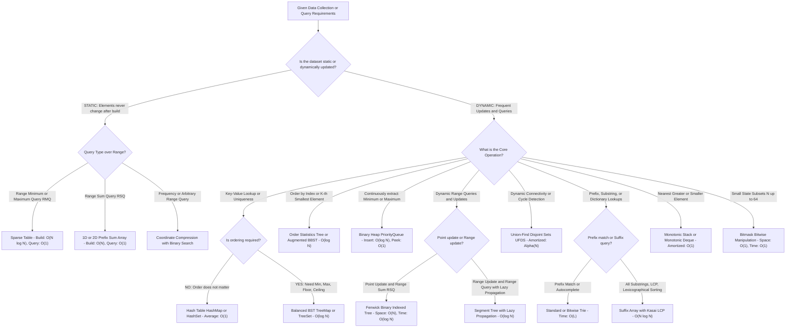
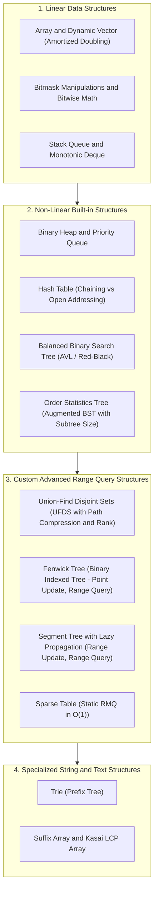

# 002. Data Structures Comprehensive Master Manual & Revision Guide

> **Document Serial**: `002`  
> **Topic**: Complete Exhaustive Data Structures Knowledge Base, Algorithmic Decision Paradigms & Quick Revision Guide  
> **Source Ground Truth**: Comprehensive Algorithmic & Data Structures Engineering Library  
> **Language Support**: 100% Complete & Standalone Executable **Python 3** and **Java 21** for **Every Single Data Structure**  
> **UI Control**: Interactive native toggle tabs (HTML details and summary tags) for every code implementation  
> **Generated Timestamp**: `2026-11-05T21:16:00+06:00`

---

---

## [Decision Tree] Master Decision Tree: What Data Structure to Choose at What Condition?

When designing software or solving high-performance algorithmic problems in an interview or production setting, follow this **instant structural routing flowchart**:



---

### [Summary] Quick-Lookup Interview Trigger Table

| If the problem mentions... | Invariant / Constraint | Pick This Data Structure | Time Complexity | Real-World Example Problem | Plain-English Intuitive Solution |
| :--- | :--- | :--- | :--- | :--- | :--- |
| **"Static range minimum query (RMQ) with zero updates"** | Immutable array, `O(1)` query needed | **Sparse Table** | Prep: `O(N log N)`, Query: `O(1)` | **Range Minimum Query in Immutable Telemetry**: Query lowest ping in historical sensor logs. | Precompute power-of-two jump tables `2^k`. Because finding min is idempotent (`min(A, A) = A`), overlap two intervals of length `2^k` that completely cover `[L, R]` in one single comparison. |
| **"Dynamic point update + prefix/range sum"** | Mutable array, prefix cumulative frequency | **Fenwick (Binary Indexed) Tree** | Space: `O(N)`, Update: `O(log N)`, Query: `O(log N)` | **Running Leaderboard Score Changes**: Update individual user scores and query total points in top rank range. | Use the lowest significant bit `LSB(i) = i & (-i)` to let each tree index manage a range of size `LSB(i)`. Fast to write and uses zero pointer overhead compared to trees. |
| **"Range update (add x to [L, R]) + Range min/sum query"** | Both updates and queries span arbitrary intervals | **Segment Tree with Lazy Propagation** | Space: `O(4N)`, Update: `O(log N)`, Query: `O(log N)` | **Hotel Room Booking Intervals (LeetCode 732)**: Add +5guest bookings to date ranges and check peak occupancy. | Build a binary tree where nodes represent intervals. Postpone updates to children by storing a "lazy" pending tag until a future query actually needs to visit that subtree. |
| **"Dynamic connectivity / Cycle detection in edges"** | Merging disjoint groups and checking connected status | **Union-Find Disjoint Sets (UFDS)** | Space: `O(N)`, Operations: `O(alpha(N)) ~ O(1)` | **Redundant Connection (LeetCode 684)**: Detect the exact edge that creates a loop in a network. | Each item points to its parent representative. Use path compression (flattening tree on find) and union by rank. If `find(u) == find(v)` before adding edge, a cycle is detected! |
| **"Next greater element / Stock span / Histogram area"** | Finding the nearest larger/smaller boundary | **Monotonic Stack** | Space: `O(N)`, Push/Pop Amortized: `O(1)` | **Largest Rectangle in Histogram (LeetCode 84)**: Find max rectangular area under bar chart heights. | Keep elements in strictly ascending order in a stack. When a smaller bar arrives, pop all taller bars--they have found their right boundary, allowing immediate rectangle width calculations. |
| **"Sliding window maximum / Min in rolling buffer"** | Rolling contiguous window of fixed size K | **Monotonic Deque** | Space: `O(K)`, Push/Pop Amortized: `O(1)` | **Sliding Window Maximum (LeetCode 239)**: Return max element in sliding window of size K. | Keep window element indices in a double-ended queue. Maintain values in descending order by evicting smaller elements from the back; evict out-of-window indices from the front. |
| **"Prefix matching / Word search / IP routing"** | Common string prefix sharing | **Trie (Prefix Tree)** | Space: `O(N * L)`, Search: `O(L)` | **Implement Trie (LeetCode 208)**: Autocomplete and dictionary word prefix validator. | Each tree node has an array or map of children (`a-z`). Follow edge characters letter-by-letter down the tree. Mark `is_end_of_word = true` at terminal letters. |
| **"Lexicographical substring queries / Longest repeat"** | All suffix ordering of a text string | **Suffix Array with Kasai LCP** | Space: `O(N)`, Build: `O(N log N)`, Query: `O(1)` | **Longest Duplicate Substring (LeetCode 1044)**: Find longest sequence of characters that repeats anywhere in text. | Sort all suffix indices lexicographically. Build the Longest Common Prefix (LCP) array in linear time using Kasai's algorithm; the maximum value in LCP gives the longest duplicate substring immediately. |
| **"Fast subset state / 20-30 flags packing"** | `N <= 60` discrete binary options | **Bitmask Operations** | Space: `O(1)`, Query/Update: `O(1)` | **Subsets & Assignment DP (LeetCode 78)**: Track completed tasks or visited cities as integer bits. | Store set elements in an integer's bits. `mask | (1 << i)` adds element `i`, `mask & ~(1 << i)` removes it, `(mask >> i) & 1` checks presence, and `mask & (-mask)` gets lowest set bit. |
| **"K-th smallest element with insertions / Rank query"** | Dynamic ordered multiset with indexing | **Order Statistics Tree (pb_ds / Augmented BST)** | Space: `O(N)`, Insertion: `O(log N)`, Find_by_order: `O(log N)` | **Find Median from Data Stream (LeetCode 295)**: Continuously query median value as numbers arrive. | Augment each node in a Balanced BST with a `subtree_size` field. Determine the K-th smallest element or the exact rank of a key in `O(log N)` by comparing against `left_child.size`. |
| **"Continuous min/max extraction"** | Always need extreme element | **Binary Heap (PriorityQueue)** | Space: `O(N)`, Insert: `O(log N)`, Extract-Min: `O(log N)` | **Merge K Sorted Lists (LeetCode 23)**: Merge K sorted streams into a single ascending list. | Store elements in a complete binary tree packed in an array. Parent of `i` is `i // 2`. Sift up on insert, sift down on extraction to guarantee root is always the extreme element. |
| **"Arbitrary values into contiguous indices [0..M-1]"** | Numbers up to `10^9`, but total distinct count `<= 10^5` | **Coordinate Compression** | Space: `O(N)`, Prep: `O(N log N)`, Lookup: `O(log N)` | **Count of Range Sum (LeetCode 327)**: Map extreme coordinate ranges to fit inside Segment/Fenwick Trees. | Sort unique elements in an array. Replace each original value with its 0-indexed position via binary search (`std::lower_bound` / `bisect_left`). |

---

## [Guide] Complete Master Curriculum & Topic Index

This manual covers **every core and advanced data structure** from fundamental linear libraries to specialized range-query and string-indexing structures:



---

## 1. Dynamic Array & Coordinate Compression

An **Array** is a contiguous block of memory with `O(1)` random access. A **Dynamic Array** (Python `list`, Java `ArrayList`) doubles its capacity upon reaching saturation, achieving `O(1)` amortized append.
**Coordinate Compression** maps arbitrary large coordinates (e.g., `-10^9 to 10^9`) to a compact contiguous rank space `[0..M-1]` in `O(N log N)`, making it possible to use arrays, Segment Trees, or Fenwick Trees without massive sparse tables.

### [Memory Trick] Interview Memory Trick: "Seat Assignment on an Airplane"
> **The 3-Second Mental Hook**:
> - **Array vs List**: A static array is a fixed row of seats. A dynamic array is an expandable plane: when full, the airline buys a plane twice as large, migrates all passengers (`O(N)`), and offers empty seats for rapid boarding (`O(1)` amortized).
> - **Coordinate Compression**: Imagine passenger ticket numbers are `[1000000000, -500000000, 42]`. Don't build a stadium with a billion rows! Sort the distinct values `[-500000000, 42, 1000000000]` and assign them seat numbers `[0, 1, 2]`.

<details open>
<summary><b>[Python] Python 3 Implementation: Dynamic Array & Coordinate Compression</b></summary>

```python
import bisect
from typing import List, Dict

class CoordinateCompressor:
    def __init__(self, raw_values: List[int]):
        self.raw = raw_values
        # Sort and take unique values
        self.sorted_unique: List[int] = sorted(list(set(raw_values)))
        self.val_to_rank: Dict[int, int] = {val: idx for idx, val in enumerate(self.sorted_unique)}

    def get_rank(self, val: int) -> int:
        # O(1) via hash table or O(log M) via binary search
        return self.val_to_rank.get(val, bisect.bisect_left(self.sorted_unique, val))

    def get_val(self, rank: int) -> int:
        return self.sorted_unique[rank]

    def compress_array(self) -> List[int]:
        return [self.val_to_rank[x] for x in self.raw]

if __name__ == "__main__":
    coords = [1000000000, -500000000, 42, 1000000000, 42, 999]
    comp = CoordinateCompressor(coords)
    compressed = comp.compress_array()
    print("Original Coordinates:", coords)
    print("Compressed Ranks (0..M-1):", compressed)
    print("Distinct Values Count:", len(comp.sorted_unique))
    print("Value for Rank 0:", comp.get_val(0))
```
</details>

<details>
<summary><b>[Java] Java 21 Implementation: Dynamic Array & Coordinate Compression</b></summary>

```java
import java.util.*;

public class CoordinateCompressorDemo {
    private final int[] sortedUnique;
    private final Map<Integer, Integer> valToRank;

    public CoordinateCompressorDemo(int[] rawValues) {
        // Collect sorted unique elements
        TreeSet<Integer> set = new TreeSet<>();
        for (int v : rawValues) set.add(v);

        sortedUnique = new int[set.size()];
        valToRank = new HashMap<>();
        int rank = 0;
        for (int v : set) {
            sortedUnique[rank] = v;
            valToRank.put(v, rank);
            rank++;
        }
    }

    public int getRank(int val) {
        return valToRank.getOrDefault(val, -1);
    }

    public int getValue(int rank) {
        return sortedUnique[rank];
    }

    public int[] compressArray(int[] rawValues) {
        int[] res = new int[rawValues.length];
        for (int i = 0; i < rawValues.length; i++) {
            res[i] = valToRank.get(rawValues[i]);
        }
        return res;
    }

    public static void main(String[] args) {
        int[] coords = {1000000000, -500000000, 42, 1000000000, 42, 999};
        CoordinateCompressorDemo comp = new CoordinateCompressorDemo(coords);
        int[] compressed = comp.compressArray(coords);

        System.out.println("Original Coordinates: " + Arrays.toString(coords));
        System.out.println("Compressed Ranks: " + Arrays.toString(compressed));
        System.out.println("Rank of 42: " + comp.getRank(42));
        System.out.println("Value of Rank 0: " + comp.getValue(0));
    }
}
```
</details>

---

## 2. Bitmask & Bitwise Manipulation

A **Bitmask** uses the individual bits of an integer (32-bit `int` or 64-bit `long`) to represent a subset of up to 64 items. Every set operation (union, intersection, element toggle, lowest set bit isolation) executes in `O(1)` CPU cycles with zero memory overhead.

### [Memory Trick] Interview Memory Trick: "Light Switches on a Wall"
> **The 3-Second Mental Hook**:
> - Think of an integer as a row of light switches: bit `0` is light 0, bit `1` is light 1.
> - **Turn ON switch `i`**: `mask | (1 << i)`
> - **Turn OFF switch `i`**: `mask & ~(1 << i)`
> - **Flip switch `i`**: `mask ^ (1 << i)`
> - **Check switch `i`**: `(mask >> i) & 1`
> - **Isolate lowest ON switch**: `mask & (-mask)` (The secret weapon of Fenwick Trees!)
> - **Turn off lowest ON switch**: `mask & (mask - 1)` (Kernighan's bit count algorithm)

<details open>
<summary><b>[Python] Python 3 Implementation: Bitmask Manipulation</b></summary>

```python
class BitmaskOperations:
    @staticmethod
    def set_bit(mask: int, i: int) -> int:
        return mask | (1 << i)

    @staticmethod
    def clear_bit(mask: int, i: int) -> int:
        return mask & ~(1 << i)

    @staticmethod
    def toggle_bit(mask: int, i: int) -> int:
        return mask ^ (1 << i)

    @staticmethod
    def check_bit(mask: int, i: int) -> bool:
        return bool((mask >> i) & 1)

    @staticmethod
    def get_lowest_set_bit(mask: int) -> int:
        return mask & (-mask)

    @staticmethod
    def count_set_bits(mask: int) -> int:
        count = 0
        while mask > 0:
            mask = mask & (mask - 1)  # Clear lowest set bit
            count += 1
        return count

    @staticmethod
    def generate_all_subsets(n: int):
        # Generates all 2^n subsets
        subsets = []
        for mask in range(1 << n):
            current = [i for i in range(n) if (mask >> i) & 1]
            subsets.append(current)
        return subsets

if __name__ == "__main__":
    b = BitmaskOperations()
    mask = 0
    mask = b.set_bit(mask, 1)  # Turn on 1
    mask = b.set_bit(mask, 3)  # Turn on 3 (mask = 1010 in binary = 10)
    print("Mask binary:", bin(mask), "| Value:", mask)
    print("Is bit 1 set?", b.check_bit(mask, 1))
    print("Is bit 2 set?", b.check_bit(mask, 2))
    print("Lowest set bit (LSB):", b.get_lowest_set_bit(mask))
    print("Number of set bits:", b.count_set_bits(mask))
    print("All subsets of size 3 count:", len(b.generate_all_subsets(3)))
```
</details>

<details>
<summary><b>[Java] Java 21 Implementation: Bitmask Manipulation</b></summary>

```java
import java.util.*;

public class BitmaskDemo {
    public static int setBit(int mask, int i) { return mask | (1 << i); }
    public static int clearBit(int mask, int i) { return mask & ~(1 << i); }
    public static int toggleBit(int mask, int i) { return mask ^ (1 << i); }
    public static boolean checkBit(int mask, int i) { return ((mask >> i) & 1) == 1; }
    public static int getLSB(int mask) { return mask & (-mask); }

    public static int countSetBits(int mask) {
        int count = 0;
        while (mask > 0) {
            mask &= (mask - 1);
            count++;
        }
        return count;
    }

    public static List<List<Integer>> generateSubsets(int n) {
        List<List<Integer>> res = new ArrayList<>();
        int total = 1 << n;
        for (int mask = 0; mask < total; mask++) {
            List<Integer> sub = new ArrayList<>();
            for (int i = 0; i < n; i++) {
                if (((mask >> i) & 1) == 1) sub.add(i);
            }
            res.add(sub);
        }
        return res;
    }

    public static void main(String[] args) {
        int mask = 0;
        mask = setBit(mask, 1);
        mask = setBit(mask, 3);

        System.out.println("Mask: " + mask + " (Binary: " + Integer.toBinaryString(mask) + ")");
        System.out.println("Is bit 1 set? " + checkBit(mask, 1));
        System.out.println("Is bit 2 set? " + checkBit(mask, 2));
        System.out.println("Lowest set bit (LSB): " + getLSB(mask));
        System.out.println("Count of set bits: " + countSetBits(mask));
        System.out.println("Generated subsets count for n=3: " + generateSubsets(3).size());
    }
}
```
</details>

---

## 3. Monotonic Stack & Monotonic Deque

A **Monotonic Stack** maintains its elements in strictly monotonic (increasing or decreasing) order. Each element is pushed and popped at most once, providing an `O(N)` solution for finding the **Nearest Greater or Smaller Element** for every item in an array.
A **Monotonic Deque** extends this to a sliding window of size `K`, maintaining elements in monotonic order by popping outdated indices from the front and smaller values from the back in amortized `O(1)` per window step.

### [Memory Trick] Interview Memory Trick: "Line of People with Taller Newcomers"
> **The 3-Second Mental Hook**:
> - Imagine people standing in line. When a giant newcomer arrives, everyone shorter in front of them is completely obscured and useless for future line-of-sight queries.
> - **Monotonic Stack**: Pop and evict everyone shorter! The first person remaining on the stack who is taller is your **Next Greater Element**.
> - **Monotonic Deque (Sliding Window)**: Keep window indices. If the front person is older than `index - K + 1`, they have exited the sliding window (evict front). The front is always the reigning window champion!

<details open>
<summary><b>[Python] Python 3 Implementation: Monotonic Stack & Deque</b></summary>

```python
from collections import deque
from typing import List

class MonotonicStructures:
    @staticmethod
    def next_greater_elements(nums: List[int]) -> List[int]:
        # Returns an array where ans[i] is the next greater element to the right of nums[i]
        n = len(nums)
        ans = [-1] * n
        stack = []  # stores indices

        for i in range(n):
            while stack and nums[stack[-1]] < nums[i]:
                prev_idx = stack.pop()
                ans[prev_idx] = nums[i]
            stack.append(i)
        return ans

    @staticmethod
    def max_sliding_window(nums: List[int], k: int) -> List[int]:
        # O(N) sliding window maximum using Monotonic Deque
        q = deque()  # stores indices
        res = []

        for i in range(len(nums)):
            # 1. Evict elements out of the current sliding window
            if q and q[0] < i - k + 1:
                q.popleft()

            # 2. Maintain descending order in deque (evict smaller elements from back)
            while q and nums[q[-1]] <= nums[i]:
                q.pop()

            q.append(i)

            # 3. Add +5to result once first window is formed
            if i >= k - 1:
                res.append(nums[q[0]])

        return res

if __name__ == "__main__":
    ms = MonotonicStructures()
    arr = [2, 1, 5, 6, 2, 3]
    print("Original Array:", arr)
    print("Next Greater Elements:", ms.next_greater_elements(arr))
    window_max = ms.max_sliding_window([1, 3, -1, -3, 5, 3, 6, 7], k=3)
    print("Sliding Window Maximum (k=3):", window_max)
```
</details>

<details>
<summary><b>[Java] Java 21 Implementation: Monotonic Stack & Deque</b></summary>

```java
import java.util.*;

public class MonotonicStructuresDemo {
    public static int[] nextGreaterElements(int[] nums) {
        int n = nums.length;
        int[] ans = new int[n];
        Arrays.fill(ans, -1);
        Deque<Integer> stack = new ArrayDeque<>(); // stores indices

        for (int i = 0; i < n; i++) {
            while (!stack.isEmpty() && nums[stack.peek()] < nums[i]) {
                int prevIdx = stack.pop();
                ans[prevIdx] = nums[i];
            }
            stack.push(i);
        }
        return ans;
    }

    public static int[] maxSlidingWindow(int[] nums, int k) {
        if (nums == null || nums.length == 0 || k <= 0) return new int[0];
        int n = nums.length;
        int[] res = new int[n - k + 1];
        Deque<Integer> deque = new ArrayDeque<>(); // stores indices

        for (int i = 0; i < n; i++) {
            // Evict indices outside current window
            if (!deque.isEmpty() && deque.peekFirst() < i - k + 1) {
                deque.pollFirst();
            }
            // Maintain monotonic descending order
            while (!deque.isEmpty() && nums[deque.peekLast()] <= nums[i]) {
                deque.pollLast();
            }
            deque.offerLast(i);

            if (i >= k - 1) {
                res[i - k + 1] = nums[deque.peekFirst()];
            }
        }
        return res;
    }

    public static void main(String[] args) {
        int[] arr = {2, 1, 5, 6, 2, 3};
        System.out.println("Original: " + Arrays.toString(arr));
        System.out.println("Next Greater: " + Arrays.toString(nextGreaterElements(arr)));

        int[] stream = {1, 3, -1, -3, 5, 3, 6, 7};
        int[] windowMax = maxSlidingWindow(stream, 3);
        System.out.println("Sliding Window Max (k=3): " + Arrays.toString(windowMax));
    }
}
```
</details>

---

## 4. Binary Heap & Priority Queue

A **Binary Heap** is a complete binary tree packed efficiently into a 1D array where every parent satisfies the heap property relative to its children (Min-Heap: `parent <= children`; Max-Heap: `parent >= children`).
Because the tree is complete, the parent of index `i` is `i // 2` (or `(i - 1) // 2` in 0-indexed arrays), and its children are `2 * i + 1` and `2 * i + 2`.
- **Insert**: Append at leaf, `sift_up` in `O(log N)`.
- **Extract Extremum**: Swap root with last leaf, pop, `sift_down` in `O(log N)`.
- **Heapify**: Bottom-up construction of an entire heap from an array in `O(N)` linear time.

### [Memory Trick] Interview Memory Trick: "The Corporate Ladder"
> **The 3-Second Mental Hook**:
> - **Sift Up (Promotion)**: A great new employee enters at the very bottom. If they outperform their direct manager (`val < parent`), swap them! They rise up the ranks until reaching someone better.
> - **Sift Down (Succession)**: The CEO resigns. The lowest intern is temporarily placed in the corner office. The intern looks at their two immediate vice presidents, picks the best one to take over, and steps down a rank repeatedly until reaching balance.

<details open>
<summary><b>[Python] Python 3 Implementation: Complete Binary Heap from Scratch</b></summary>

```python
from typing import List, Optional

class MinHeap:
    def __init__(self, elements: Optional[List[int]] = None):
        self.heap: List[int] = []
        if elements:
            self.heap = list(elements)
            # O(N) bottom-up heapify
            for i in range((len(self.heap) - 2) // 2, -1, -1):
                self._sift_down(i)

    def push(self, val: int):
        self.heap.append(val)
        self._sift_up(len(self.heap) - 1)

    def pop(self) -> int:
        if not self.heap:
            raise IndexError("pop from empty heap")
        min_val = self.heap[0]
        last_val = self.heap.pop()
        if self.heap:
            self.heap[0] = last_val
            self._sift_down(0)
        return min_val

    def peek(self) -> int:
        if not self.heap:
            raise IndexError("peek from empty heap")
        return self.heap[0]

    def _sift_up(self, idx: int):
        parent = (idx - 1) // 2
        while idx > 0 and self.heap[idx] < self.heap[parent]:
            self.heap[idx], self.heap[parent] = self.heap[parent], self.heap[idx]
            idx = parent
            parent = (idx - 1) // 2

    def _sift_down(self, idx: int):
        n = len(self.heap)
        while True:
            left = 2 * idx + 1
            right = 2 * idx + 2
            smallest = idx

            if left < n and self.heap[left] < self.heap[smallest]:
                smallest = left
            if right < n and self.heap[right] < self.heap[smallest]:
                smallest = right

            if smallest != idx:
                self.heap[idx], self.heap[smallest] = self.heap[smallest], self.heap[idx]
                idx = smallest
            else:
                break

    def __len__(self):
        return len(self.heap)

if __name__ == "__main__":
    h = MinHeap([9, 3, 5, 1, 7, 2, 8])
    print("Heapified array representation:", h.heap)
    print("Extracted Min:", h.pop())
    h.push(0)
    print("Peek Min after pushing 0:", h.peek())
    extracted = []
    while len(h) > 0:
        extracted.append(h.pop())
    print("Sorted elements popped from MinHeap:", extracted)
```
</details>

<details>
<summary><b>[Java] Java 21 Implementation: Complete Binary Heap from Scratch</b></summary>

```java
import java.util.*;

public class MinHeapDemo {
    private int[] heap;
    private int size;

    public MinHeapDemo(int capacity) {
        this.heap = new int[capacity];
        this.size = 0;
    }

    public void push(int val) {
        if (size == heap.length) {
            heap = Arrays.copyOf(heap, heap.length * 2);
        }
        heap[size] = val;
        siftUp(size);
        size++;
    }

    public int pop() {
        if (size == 0) throw new NoSuchElementException("Heap is empty");
        int minVal = heap[0];
        heap[0] = heap[size - 1];
        size--;
        if (size > 0) siftDown(0);
        return minVal;
    }

    public int peek() {
        if (size == 0) throw new NoSuchElementException("Heap is empty");
        return heap[0];
    }

    private void siftUp(int idx) {
        int parent = (idx - 1) / 2;
        while (idx > 0 && heap[idx] < heap[parent]) {
            swap(idx, parent);
            idx = parent;
            parent = (idx - 1) / 2;
        }
    }

    private void siftDown(int idx) {
        while (true) {
            int left = 2 * idx + 1;
            int right = 2 * idx + 2;
            int smallest = idx;

            if (left < size && heap[left] < heap[smallest]) smallest = left;
            if (right < size && heap[right] < heap[smallest]) smallest = right;

            if (smallest != idx) {
                swap(idx, smallest);
                idx = smallest;
            } else {
                break;
            }
        }
    }

    private void swap(int i, int j) {
        int t = heap[i]; heap[i] = heap[j]; heap[j] = t;
    }

    public int size() { return size; }

    public static void main(String[] args) {
        MinHeapDemo h = new MinHeapDemo(10);
        int[] init = {9, 3, 5, 1, 7, 2, 8};
        for (int v : init) h.push(v);

        System.out.println("Extracted Min: " + h.pop());
        h.push(0);
        System.out.println("Peek Min: " + h.peek());

        List<Integer> sorted = new ArrayList<>();
        while (h.size() > 0) sorted.add(h.pop());
        System.out.println("Sorted output: " + sorted);
    }
}
```
</details>

---

## 5. Hash Table (Separate Chaining)

A **Hash Table** maps arbitrary keys to bucket indices using a hash function `hash(key) % capacity`.
- **Collision Resolution**: Handled via **Separate Chaining** (linked list or dynamic vector per bucket) or **Open Addressing** (linear probing).
- **Load Factor**: When `size / capacity > load_factor_threshold` (typically `0.75`), the table allocates twice the capacity and re-hashes all keys to maintain `O(1)` amortized insertion and lookup.

### [Memory Trick] Interview Memory Trick: "Coat Check with Numbered Hooks"
> **The 3-Second Mental Hook**:
> - Think of a hotel coat check with numbered hooks `[0..M-1]`.
> - Your name hashes to hook number 14. If another guest also hashes to hook 14, don't panic! Just hang your coat on the same hanger chain (**Separate Chaining**).
> - If the room gets more than 75% full, double the hooks and redistribute all coats (**Rehashing**).

<details open>
<summary><b>[Python] Python 3 Implementation: Hash Map with Separate Chaining</b></summary>

```python
from typing import Any, List, Optional, Tuple

class HashMapChaining:
    def __init__(self, initial_capacity: int = 8, load_factor: float = 0.75):
        self.capacity = initial_capacity
        self.load_factor = load_factor
        self.size = 0
        self.buckets: List[List[Tuple[Any, Any]]] = [[] for _ in range(self.capacity)]

    def _hash(self, key: Any) -> int:
        return hash(key) % self.capacity

    def put(self, key: Any, value: Any):
        bucket_idx = self._hash(key)
        bucket = self.buckets[bucket_idx]

        for i, (k, v) in enumerate(bucket):
            if k == key:
                bucket[i] = (key, value)  # Update existing
                return

        bucket.append((key, value))
        self.size += 1

        if self.size / self.capacity > self.load_factor:
            self._rehash()

    def get(self, key: Any) -> Optional[Any]:
        bucket_idx = self._hash(key)
        for k, v in self.buckets[bucket_idx]:
            if k == key:
                return v
        return None

    def remove(self, key: Any) -> bool:
        bucket_idx = self._hash(key)
        bucket = self.buckets[bucket_idx]
        for i, (k, v) in enumerate(bucket):
            if k == key:
                del bucket[i]
                self.size -= 1
                return True
        return False

    def _rehash(self):
        old_buckets = self.buckets
        self.capacity *= 2
        self.buckets = [[] for _ in range(self.capacity)]
        self.size = 0
        for b in old_buckets:
            for k, v in b:
                self.put(k, v)

if __name__ == "__main__":
    ht = HashMapChaining(initial_capacity=4)
    ht.put("Alice", 95)
    ht.put("Bob", 88)
    ht.put("Charlie", 72)
    ht.put("Diana", 99)  # Triggers rehash
    print("Capacity after rehash:", ht.capacity)
    print("Get Alice:", ht.get("Alice"))
    print("Get Charlie:", ht.get("Charlie"))
    ht.remove("Bob")
    print("Get Bob after remove:", ht.get("Bob"))
```
</details>

<details>
<summary><b>[Java] Java 21 Implementation: Hash Map with Separate Chaining</b></summary>

```java
import java.util.*;

public class HashMapChainingDemo<K, V> {
    private static class Node<K, V> {
        K key;
        V value;
        Node<K, V> next;
        Node(K key, V value, Node<K, V> next) {
            this.key = key; this.value = value; this.next = next;
        }
    }

    private Node<K, V>[] buckets;
    private int capacity;
    private int size;
    private final float loadFactor = 0.75f;

    @SuppressWarnings("unchecked")
    public HashMapChainingDemo(int initialCapacity) {
        this.capacity = initialCapacity;
        this.buckets = new Node[capacity];
        this.size = 0;
    }

    private int getIndex(K key) {
        return (key == null) ? 0 : Math.abs(key.hashCode()) % capacity;
    }

    public void put(K key, V value) {
        int idx = getIndex(key);
        Node<K, V> curr = buckets[idx];
        while (curr != null) {
            if (Objects.equals(curr.key, key)) {
                curr.value = value;
                return;
            }
            curr = curr.next;
        }
        buckets[idx] = new Node<>(key, value, buckets[idx]);
        size++;

        if ((float) size / capacity > loadFactor) rehash();
    }

    public V get(K key) {
        int idx = getIndex(key);
        Node<K, V> curr = buckets[idx];
        while (curr != null) {
            if (Objects.equals(curr.key, key)) return curr.value;
            curr = curr.next;
        }
        return null;
    }

    public boolean remove(K key) {
        int idx = getIndex(key);
        Node<K, V> curr = buckets[idx];
        Node<K, V> prev = null;
        while (curr != null) {
            if (Objects.equals(curr.key, key)) {
                if (prev == null) buckets[idx] = curr.next;
                else prev.next = curr.next;
                size--;
                return true;
            }
            prev = curr;
            curr = curr.next;
        }
        return false;
    }

    @SuppressWarnings("unchecked")
    private void rehash() {
        Node<K, V>[] oldBuckets = buckets;
        capacity *= 2;
        buckets = new Node[capacity];
        size = 0;
        for (Node<K, V> head : oldBuckets) {
            while (head != null) {
                put(head.key, head.value);
                head = head.next;
            }
        }
    }

    public static void main(String[] args) {
        HashMapChainingDemo<String, Integer> map = new HashMapChainingDemo<>(4);
        map.put("Alice", 95);
        map.put("Bob", 88);
        map.put("Charlie", 72);
        map.put("Diana", 99);

        System.out.println("Get Alice: " + map.get("Alice"));
        System.out.println("Get Charlie: " + map.get("Charlie"));
        map.remove("Bob");
        System.out.println("Get Bob after remove: " + map.get("Bob"));
    }
}
```
</details>

---

## 6. Balanced Binary Search Tree (AVL Tree)

A standard Binary Search Tree can degrade to `O(N)` if keys arrive sorted. A **Balanced BST** (such as an **AVL Tree**) maintains the strict invariant that the balance factor `height(left) - height(right)` of every node is within `{-1, 0, 1}`.
When an insertion disrupts this invariant, the tree restores balance in `O(1)` via **Left and Right Rotations**, guaranteeing `O(log N)` search, insert, and delete operations.

### [Memory Trick] Interview Memory Trick: "The Seesaw Balancing Act"
> **The 3-Second Mental Hook**:
> - Think of a playground seesaw. If the left side gets 2 children heavier than the right (`balance > 1`):
>   - If the child is on the outer left edge (Left-Left): One **Right Rotation** immediately levels the board!
>   - If the child is on the inner left edge (Left-Right): Do a **Left Rotation** on the child first to push weight outward, then a **Right Rotation** to level it.

<details open>
<summary><b>[Python] Python 3 Implementation: Complete AVL Tree</b></summary>

```python
class AVLNode:
    def __init__(self, key: int):
        self.key = key
        self.left: Optional[AVLNode] = None
        self.right: Optional[AVLNode] = None
        self.height: int = 1

class AVLTree:
    def get_height(self, node: Optional[AVLNode]) -> int:
        return node.height if node else 0

    def get_balance(self, node: Optional[AVLNode]) -> int:
        return self.get_height(node.left) - self.get_height(node.right) if node else 0

    def right_rotate(self, y: AVLNode) -> AVLNode:
        x = y.left
        T2 = x.right
        x.right = y
        y.left = T2
        y.height = 1 + max(self.get_height(y.left), self.get_height(y.right))
        x.height = 1 + max(self.get_height(x.left), self.get_height(x.right))
        return x

    def left_rotate(self, x: AVLNode) -> AVLNode:
        y = x.right
        T2 = y.left
        y.left = x
        x.right = T2
        x.height = 1 + max(self.get_height(x.left), self.get_height(x.right))
        y.height = 1 + max(self.get_height(y.left), self.get_height(y.right))
        return y

    def insert(self, root: Optional[AVLNode], key: int) -> AVLNode:
        if not root:
            return AVLNode(key)
        if key < root.key:
            root.left = self.insert(root.left, key)
        elif key > root.key:
            root.right = self.insert(root.right, key)
        else:
            return root

        root.height = 1 + max(self.get_height(root.left), self.get_height(root.right))
        balance = self.get_balance(root)

        # 4 Balance Cases
        if balance > 1 and key < root.left.key:
            return self.right_rotate(root)
        if balance < -1 and key > root.right.key:
            return self.left_rotate(root)
        if balance > 1 and key > root.left.key:
            root.left = self.left_rotate(root.left)
            return self.right_rotate(root)
        if balance < -1 and key < root.right.key:
            root.right = self.right_rotate(root.right)
            return self.left_rotate(root)

        return root

    def inorder(self, root: Optional[AVLNode]) -> List[int]:
        res = []
        if root:
            res.extend(self.inorder(root.left))
            res.append(root.key)
            res.extend(self.inorder(root.right))
        return res

if __name__ == "__main__":
    avl = AVLTree()
    root = None
    # Insert in strictly ascending order (which would degenerate a normal BST)
    for v in [10, 20, 30, 40, 50, 25]:
        root = avl.insert(root, v)

    print("AVL Inorder traversal (Sorted):", avl.inorder(root))
    print("Balanced Tree Root key:", root.key)
    print("Tree Height:", root.height)
```
</details>

<details>
<summary><b>[Java] Java 21 Implementation: Complete AVL Tree</b></summary>

```java
import java.util.*;

public class AVLTreeDemo {
    public static class Node {
        int key, height;
        Node left, right;
        Node(int key) { this.key = key; this.height = 1; }
    }

    private Node root;

    private int height(Node n) { return n == null ? 0 : n.height; }
    private int balance(Node n) { return n == null ? 0 : height(n.left) - height(n.right); }

    private Node rightRotate(Node y) {
        Node x = y.left;
        Node T2 = x.right;
        x.right = y;
        y.left = T2;
        y.height = Math.max(height(y.left), height(y.right)) + 1;
        x.height = Math.max(height(x.left), height(x.right)) + 1;
        return x;
    }

    private Node leftRotate(Node x) {
        Node y = x.right;
        Node T2 = y.left;
        y.left = x;
        x.right = T2;
        x.height = Math.max(height(x.left), height(x.right)) + 1;
        y.height = Math.max(height(y.left), height(y.right)) + 1;
        return y;
    }

    public void insert(int key) {
        root = insertRec(root, key);
    }

    private Node insertRec(Node node, int key) {
        if (node == null) return new Node(key);
        if (key < node.key) node.left = insertRec(node.left, key);
        else if (key > node.key) node.right = insertRec(node.right, key);
        else return node;

        node.height = 1 + Math.max(height(node.left), height(node.right));
        int b = balance(node);

        if (b > 1 && key < node.left.key) return rightRotate(node);
        if (b < -1 && key > node.right.key) return leftRotate(node);
        if (b > 1 && key > node.left.key) {
            node.left = leftRotate(node.left);
            return rightRotate(node);
        }
        if (b < -1 && key < node.right.key) {
            node.right = rightRotate(node.right);
            return leftRotate(node);
        }
        return node;
    }

    public List<Integer> inorder() {
        List<Integer> res = new ArrayList<>();
        inorderRec(root, res);
        return res;
    }
    private void inorderRec(Node n, List<Integer> res) {
        if (n != null) {
            inorderRec(n.left, res);
            res.add(n.key);
            inorderRec(n.right, res);
        }
    }

    public static void main(String[] args) {
        AVLTreeDemo tree = new AVLTreeDemo();
        for (int v : new int[]{10, 20, 30, 40, 50, 25}) tree.insert(v);

        System.out.println("AVL Inorder: " + tree.inorder());
        System.out.println("Root: " + tree.root.key + " (Height: " + tree.root.height + ")");
    }
}
```
</details>

---

## 7. Order Statistics Tree (Augmented BST)

Standard search trees cannot find the `K`-th smallest element or query the rank of a key without an `O(N)` linear traversal.
An **Order Statistics Tree (OST)** augments every tree node with an additional field:

	ext{size} = 1 + 	ext{size}(	ext{left}) + 	ext{size}(	ext{right})

This allows:
1. `find_by_order(k)`: Returns the `K`-th smallest element in `O(log N)`.
2. `order_of_key(x)`: Returns the number of elements strictly smaller than `x` in `O(log N)`.

### [Memory Trick] Interview Memory Trick: "Headcount at the Turnstile"
> **The 3-Second Mental Hook**:
> - Imagine every tree node has a digital counter showing how many people are sitting in its entire subtree.
> - To find the 50th person: Look at your left child. If 40 people are sitting to your left, you are person 41! The 50th person must be the 9th person inside your right subtree (`50 - 40 - 1 = 9`). No linear scanning required!

<details open>
<summary><b>[Python] Python 3 Implementation: Complete Order Statistics Tree</b></summary>

```python
class OSTNode:
    def __init__(self, key: int):
        self.key = key
        self.size = 1
        self.left: Optional[OSTNode] = None
        self.right: Optional[OSTNode] = None

class OrderStatisticsTree:
    def _size(self, node: Optional[OSTNode]) -> int:
        return node.size if node else 0

    def _update_size(self, node: OSTNode):
        node.size = 1 + self._size(node.left) + self._size(node.right)

    def insert(self, root: Optional[OSTNode], key: int) -> OSTNode:
        if not root:
            return OSTNode(key)
        if key < root.key:
            root.left = self.insert(root.left, key)
        else:
            root.right = self.insert(root.right, key)
        self._update_size(root)
        return root

    def find_by_order(self, root: Optional[OSTNode], k: int) -> Optional[int]:
        # 0-indexed: k=0 returns the smallest element
        if not root:
            return None
        left_size = self._size(root.left)
        if k == left_size:
            return root.key
        elif k < left_size:
            return self.find_by_order(root.left, k)
        else:
            return self.find_by_order(root.right, k - left_size - 1)

    def order_of_key(self, root: Optional[OSTNode], key: int) -> int:
        # Returns number of elements strictly smaller than key
        if not root:
            return 0
        if key <= root.key:
            return self.order_of_key(root.left, key)
        else:
            return 1 + self._size(root.left) + self.order_of_key(root.right, key)

if __name__ == "__main__":
    ost = OrderStatisticsTree()
    root = None
    for val in [20, 15, 25, 10, 18, 5, 12]:
        root = ost.insert(root, val)

    print("Total elements in OST:", root.size)
    print("0th smallest (Minimum):", ost.find_by_order(root, 0)) # Expected 5
    print("3rd smallest (Median rank):", ost.find_by_order(root, 3)) # Expected 15
    print("Rank of key 18 (count < 18):", ost.order_of_key(root, 18)) # Expected 4
```
</details>

<details>
<summary><b>[Java] Java 21 Implementation: Complete Order Statistics Tree</b></summary>

```java
import java.util.*;

public class OrderStatisticsTreeDemo {
    public static class Node {
        int key, size;
        Node left, right;
        Node(int key) { this.key = key; this.size = 1; }
    }

    private Node root;

    private int size(Node n) { return n == null ? 0 : n.size; }
    private void updateSize(Node n) { if (n != null) n.size = 1 + size(n.left) + size(n.right); }

    public void insert(int key) { root = insertRec(root, key); }
    private Node insertRec(Node n, int key) {
        if (n == null) return new Node(key);
        if (key < n.key) n.left = insertRec(n.left, key);
        else n.right = insertRec(n.right, key);
        updateSize(n);
        return n;
    }

    public Integer findByOrder(int k) { return findByOrderRec(root, k); }
    private Integer findByOrderRec(Node n, int k) {
        if (n == null) return null;
        int leftSize = size(n.left);
        if (k == leftSize) return n.key;
        if (k < leftSize) return findByOrderRec(n.left, k);
        return findByOrderRec(n.right, k - leftSize - 1);
    }

    public int orderOfKey(int key) { return orderOfKeyRec(root, key); }
    private int orderOfKeyRec(Node n, int key) {
        if (n == null) return 0;
        if (key <= n.key) return orderOfKeyRec(n.left, key);
        return 1 + size(n.left) + orderOfKeyRec(n.right, key);
    }

    public static void main(String[] args) {
        OrderStatisticsTreeDemo ost = new OrderStatisticsTreeDemo();
        for (int v : new int[]{20, 15, 25, 10, 18, 5, 12}) ost.insert(v);

        System.out.println("0th smallest: " + ost.findByOrder(0));
        System.out.println("3rd smallest: " + ost.findByOrder(3));
        System.out.println("Count strictly smaller than 18: " + ost.orderOfKey(18));
    }
}
```
</details>

---

## 8. Union-Find Disjoint Sets (UFDS)

**Union-Find Disjoint Sets (UFDS)** models a collection of disjoint sets, supporting two essential operations:
1. `find(i)`: Determine which set element `i` belongs to.
2. `union(i, j)`: Merge the set containing `i` with the set containing `j`.

With **Path Compression** (re-pointing visited nodes directly to the root during find) and **Union by Rank** (attaching the shallower tree under the deeper tree), operations run in nearly constant time `O(alpha(N))`, where `alpha` is the inverse Ackermann function (`alpha(N) <= 4` for all practical universe sizes).

### [Memory Trick] Interview Memory Trick: "Kingdom Alliances"
> **The 3-Second Mental Hook**:
> - Each person belongs to a kingdom led by a King (`parent[i] == i`).
> - **Find with Path Compression**: You ask your boss who the King is, your boss asks their boss... When you finally meet the King, you exchange phone numbers directly with the King so you never have to climb the chain of command again!
> - **Union by Rank**: When two kingdoms merge, the King with the smaller army yields the crown to the King with the larger army to keep kingdom hierarchy as flat as possible.

<details open>
<summary><b>[Python] Python 3 Implementation: Complete UFDS</b></summary>

```python
class UnionFindDisjointSets:
    def __init__(self, n: int):
        self.parent = list(range(n))
        self.rank = [0] * n
        self.set_size = [1] * n
        self.num_sets = n

    def find(self, i: int) -> int:
        if self.parent[i] == i:
            return i
        self.parent[i] = self.find(self.parent[i])  # Path compression
        return self.parent[i]

    def is_same_set(self, i: int, j: int) -> bool:
        return self.find(i) == self.find(j)

    def union(self, i: int, j: int) -> bool:
        root_i = self.find(i)
        root_j = self.find(j)
        if root_i == root_j:
            return False  # Already in same set (cycle)

        # Union by rank
        if self.rank[root_i] < self.rank[root_j]:
            self.parent[root_i] = root_j
            self.set_size[root_j] += self.set_size[root_i]
        else:
            self.parent[root_j] = root_i
            self.set_size[root_i] += self.set_size[root_j]
            if self.rank[root_i] == self.rank[root_j]:
                self.rank[root_i] += 1

        self.num_sets -= 1
        return True

    def size_of_set(self, i: int) -> int:
        return self.set_size[self.find(i)]

if __name__ == "__main__":
    uf = UnionFindDisjointSets(5)
    print("Initial number of sets:", uf.num_sets)
    uf.union(0, 1)
    uf.union(2, 3)
    uf.union(3, 4)

    print("Is 0 and 1 in same set?", uf.is_same_set(0, 1))
    print("Is 1 and 2 in same set?", uf.is_same_set(1, 2))
    print("Is 2 and 4 in same set?", uf.is_same_set(2, 4))
    print("Size of set containing 4:", uf.size_of_set(4))
    print("Final number of disjoint sets:", uf.num_sets)
```
</details>

<details>
<summary><b>[Java] Java 21 Implementation: Complete UFDS</b></summary>

```java
import java.util.*;

public class UFDSMasterDemo {
    private final int[] parent;
    private final int[] rank;
    private final int[] setSize;
    private int numSets;

    public UFDSMasterDemo(int n) {
        parent = new int[n];
        rank = new int[n];
        setSize = new int[n];
        numSets = n;
        for (int i = 0; i < n; i++) {
            parent[i] = i;
            setSize[i] = 1;
        }
    }

    public int find(int i) {
        if (parent[i] == i) return i;
        return parent[i] = find(parent[i]); // Path compression
    }

    public boolean isSameSet(int i, int j) { return find(i) == find(j); }

    public boolean union(int i, int j) {
        int rootI = find(i);
        int rootJ = find(j);
        if (rootI == rootJ) return false;

        if (rank[rootI] < rank[rootJ]) {
            parent[rootI] = rootJ;
            setSize[rootJ] += setSize[rootI];
        } else {
            parent[rootJ] = rootI;
            setSize[rootI] += setSize[rootJ];
            if (rank[rootI] == rank[rootJ]) rank[rootI]++;
        }
        numSets--;
        return true;
    }

    public int sizeOfSet(int i) { return setSize[find(i)]; }
    public int getNumSets() { return numSets; }

    public static void main(String[] args) {
        UFDSMasterDemo uf = new UFDSMasterDemo(5);
        uf.union(0, 1);
        uf.union(2, 3);
        uf.union(3, 4);

        System.out.println("Is 0 and 1 in same set? " + uf.isSameSet(0, 1));
        System.out.println("Is 1 and 2 in same set? " + uf.isSameSet(1, 2));
        System.out.println("Size of set containing 4: " + uf.sizeOfSet(4));
        System.out.println("Disjoint sets count: " + uf.getNumSets());
    }
}
```
</details>

---

## 9. Fenwick Tree (Binary Indexed Tree)

A **Fenwick Tree (Binary Indexed Tree)** provides `O(log N)` prefix sum queries and point updates on an array while requiring only `O(N)` storage and zero tree pointer overhead.
It utilizes the **Lowest Significant Bit (LSB)** identity:

	ext{LSB}(i) = i \ \& \ (-i)

- **Prefix Sum `rsq(b)`**: Sum up `tree[b]` and repeatedly subtract `LSB(b)` until `b == 0`.
- **Point Update `update(k, v)`**: Add +5`v` to `tree[k]` and repeatedly add `LSB(k)` until reaching table capacity.
- **Range Sum Query**: `rsq(a, b) = rsq(b) - rsq(a - 1)`.

### [Memory Trick] Interview Memory Trick: "Powers of Two Step Ladders"
> **The 3-Second Mental Hook**:
> - Every positive integer is a sum of powers of two (e.g., `13 = 8 + 4 + 1`).
> - **Query**: To get sum up to index 13, read index 13 (covers 1 element), jump back by LSB to index 12 (covers 4 elements), jump back by LSB to index 8 (covers 8 elements). Done in 3 jumps!
> - **Update**: Adding value to index 5 ripples upward: add to 5, jump forward by LSB to 6, then to 8, then to 16.

<details open>
<summary><b>[Python] Python 3 Implementation: Complete Fenwick Tree</b></summary>

```python
from typing import List

class FenwickTree:
    def __init__(self, size: int):
        self.n = size
        # 1-based indexing internally
        self.tree: List[int] = [0] * (size + 1)

    @staticmethod
    def _lsb(i: int) -> int:
        return i & (-i)

    def update(self, i: int, delta: int):
        # Adds delta to 1-based index i
        while i <= self.n:
            self.tree[i] += delta
            i += self._lsb(i)

    def rsq(self, b: int) -> int:
        # Returns cumulative prefix sum from 1 to b
        total = 0
        while b > 0:
            total += self.tree[b]
            b -= self._lsb(b)
        return total

    def range_query(self, a: int, b: int) -> int:
        # Returns range sum in [a..b] (1-based)
        if a > b:
            return 0
        return self.rsq(b) - self.rsq(a - 1)

if __name__ == "__main__":
    # Sample 1-based array values: [0, 4, 2, 5, 8, 1, 3]
    ft = FenwickTree(6)
    values = [4, 2, 5, 8, 1, 3]
    for idx, val in enumerate(values, 1):
        ft.update(idx, val)

    print("Prefix Sum [1..3] (4+2+5):", ft.rsq(3)) # Expected 11
    print("Range Sum [2..5] (2+5+8+1):", ft.range_query(2, 5)) # Expected 16
    ft.update(3, 10) # Add +510 to index 3
    print("Range Sum [2..5] after adding 10 to index 3:", ft.range_query(2, 5)) # Expected 26
```
</details>

<details>
<summary><b>[Java] Java 21 Implementation: Complete Fenwick Tree</b></summary>

```java
import java.util.*;

public class FenwickTreeDemo {
    private final int[] tree;
    private final int n;

    public FenwickTreeDemo(int size) {
        this.n = size;
        this.tree = new int[size + 1]; // 1-based indexing
    }

    private static int lsb(int i) { return i & (-i); }

    public void update(int i, int delta) {
        while (i <= n) {
            tree[i] += delta;
            i += lsb(i);
        }
    }

    public int rsq(int b) {
        int sum = 0;
        while (b > 0) {
            sum += tree[b];
            b -= lsb(b);
        }
        return sum;
    }

    public int rangeQuery(int a, int b) {
        if (a > b) return 0;
        return rsq(b) - rsq(a - 1);
    }

    public static void main(String[] args) {
        FenwickTreeDemo ft = new FenwickTreeDemo(6);
        int[] vals = {4, 2, 5, 8, 1, 3};
        for (int i = 0; i < vals.length; i++) ft.update(i + 1, vals[i]);

        System.out.println("Prefix Sum [1..3]: " + ft.rsq(3)); // 11
        System.out.println("Range Sum [2..5]: " + ft.rangeQuery(2, 5)); // 16
        ft.update(3, 10);
        System.out.println("Range Sum [2..5] after update: " + ft.rangeQuery(2, 5)); // 26
    }
}
```
</details>

---

## 10. Segment Tree with Lazy Propagation

A **Segment Tree** is a versatile binary tree designed for dynamic interval queries (Range Minimum RMQ, Range Maximum, Range Sum RSQ, GCD).
With **Lazy Propagation**, updates to entire ranges `[L..R]` are deferred: the update is applied immediately to the current segment node, but only pushed down to its children when subsequent queries or updates actually need to inspect that subtree. This reduces both arbitrary range updates and range queries to `O(log N)`.

### [Memory Trick] Interview Memory Trick: "The Lazy Boss with Sticky Notes"
> **The 3-Second Mental Hook**:
> - Imagine an office manager told to update all employee records from department 5 to 50.
> - A hardworking manager visits every desk individually (`O(N)`).
> - **A Lazy Manager (Lazy Propagation)**: Writes a sticky note on the department door saying *"Add +5+5o everyone inside"* and goes to sleep (`O(1)`).
> - Only when someone actually knocks on that door to ask about an individual employee does the manager push the sticky note down to the sub-departments!

<details open>
<summary><b>[Python] Python 3 Implementation: Segment Tree with Lazy Propagation</b></summary>

```python
from typing import List

class SegmentTreeLazy:
    def __init__(self, arr: List[int]):
        self.n = len(arr)
        self.tree = [0] * (4 * self.n)
        self.lazy = [0] * (4 * self.n)
        self.arr = arr
        if self.n > 0:
            self._build(1, 0, self.n - 1)

    def _build(self, p: int, L: int, R: int):
        if L == R:
            self.tree[p] = self.arr[L]
            return
        mid = (L + R) // 2
        self._build(2 * p, L, mid)
        self._build(2 * p + 1, mid + 1, R)
        self.tree[p] = self.tree[2 * p] + self.tree[2 * p + 1]

    def _push(self, p: int, L: int, R: int):
        if self.lazy[p] != 0:
            mid = (L + R) // 2
            # Propagate to left child
            self.lazy[2 * p] += self.lazy[p]
            self.tree[2 * p] += self.lazy[p] * (mid - L + 1)
            # Propagate to right child
            self.lazy[2 * p + 1] += self.lazy[p]
            self.tree[2 * p + 1] += self.lazy[p] * (R - mid)
            # Clear current lazy tag
            self.lazy[p] = 0

    def update_range(self, i: int, j: int, val: int):
        self._update_range(1, 0, self.n - 1, i, j, val)

    def _update_range(self, p: int, L: int, R: int, i: int, j: int, val: int):
        if i > R or j < L:
            return
        if i <= L and R <= j:
            self.tree[p] += val * (R - L + 1)
            self.lazy[p] += val
            return
        self._push(p, L, R)
        mid = (L + R) // 2
        self._update_range(2 * p, L, mid, i, j, val)
        self._update_range(2 * p + 1, mid + 1, R, i, j, val)
        self.tree[p] = self.tree[2 * p] + self.tree[2 * p + 1]

    def query_range(self, i: int, j: int) -> int:
        return self._query_range(1, 0, self.n - 1, i, j)

    def _query_range(self, p: int, L: int, R: int, i: int, j: int) -> int:
        if i > R or j < L:
            return 0
        if i <= L and R <= j:
            return self.tree[p]
        self._push(p, L, R)
        mid = (L + R) // 2
        return self._query_range(2 * p, L, mid, i, j) + self._query_range(2 * p + 1, mid + 1, R, i, j)

if __name__ == "__main__":
    initial_arr = [1, 3, 5, 7, 9, 11]
    st = SegmentTreeLazy(initial_arr)
    print("Initial Range Sum [1..3] (3+5+7):", st.query_range(1, 3)) # Expected 15

    # Add +510 to every element in range [1..4]
    st.update_range(1, 4, 10)
    print("Range Sum [1..3] after adding 10 to [1..4]:", st.query_range(1, 3)) # Expected 45
    print("Total Array Sum [0..5]:", st.query_range(0, 5))
```
</details>

<details>
<summary><b>[Java] Java 21 Implementation: Segment Tree with Lazy Propagation</b></summary>

```java
import java.util.*;

public class SegmentTreeLazyDemo {
    private final int[] tree;
    private final int[] lazy;
    private final int n;

    public SegmentTreeLazyDemo(int[] arr) {
        this.n = arr.length;
        this.tree = new int[4 * n];
        this.lazy = new int[4 * n];
        if (n > 0) build(1, 0, n - 1, arr);
    }

    private void build(int p, int L, int R, int[] arr) {
        if (L == R) { tree[p] = arr[L]; return; }
        int mid = (L + R) / 2;
        build(2 * p, L, mid, arr);
        build(2 * p + 1, mid + 1, R, arr);
        tree[p] = tree[2 * p] + tree[2 * p + 1];
    }

    private void push(int p, int L, int R) {
        if (lazy[p] != 0) {
            int mid = (L + R) / 2;
            lazy[2 * p] += lazy[p];
            tree[2 * p] += lazy[p] * (mid - L + 1);
            lazy[2 * p + 1] += lazy[p];
            tree[2 * p + 1] += lazy[p] * (R - mid);
            lazy[p] = 0;
        }
    }

    public void updateRange(int i, int j, int val) {
        updateRangeRec(1, 0, n - 1, i, j, val);
    }
    private void updateRangeRec(int p, int L, int R, int i, int j, int val) {
        if (i > R || j < L) return;
        if (i <= L && R <= j) {
            tree[p] += val * (R - L + 1);
            lazy[p] += val;
            return;
        }
        push(p, L, R);
        int mid = (L + R) / 2;
        updateRangeRec(2 * p, L, mid, i, j, val);
        updateRangeRec(2 * p + 1, mid + 1, R, i, j, val);
        tree[p] = tree[2 * p] + tree[2 * p + 1];
    }

    public int queryRange(int i, int j) {
        return queryRangeRec(1, 0, n - 1, i, j);
    }
    private int queryRangeRec(int p, int L, int R, int i, int j) {
        if (i > R || j < L) return 0;
        if (i <= L && R <= j) return tree[p];
        push(p, L, R);
        int mid = (L + R) / 2;
        return queryRangeRec(2 * p, L, mid, i, j) + queryRangeRec(2 * p + 1, mid + 1, R, i, j);
    }

    public static void main(String[] args) {
        int[] arr = {1, 3, 5, 7, 9, 11};
        SegmentTreeLazyDemo st = new SegmentTreeLazyDemo(arr);
        System.out.println("Sum [1..3]: " + st.queryRange(1, 3)); // 15

        st.updateRange(1, 4, 10);
        System.out.println("Sum [1..3] after adding 10 to [1..4]: " + st.queryRange(1, 3)); // 45
        System.out.println("Total Sum [0..5]: " + st.queryRange(0, 5));
    }
}
```
</details>

---

## 11. Sparse Table (Static RMQ in O(1))

When an array is **immutable** (zero updates), a **Sparse Table** provides instantaneous `O(1)` Range Minimum Queries (RMQ) following `O(N log N)` dynamic programming preprocessing:

	ext{st}[i][j] = \min(	ext{st}[i][j - 1], \ 	ext{st}[i + 2^{j - 1}][j - 1])

Because minimum is an **idempotent operation** (`min(x, x) = x`), an arbitrary query range `[L, R]` with length `len = R - L + 1` can be covered by two overlapping intervals of length `k = floor(log2(len))`:

	ext{RMQ}(L, R) = \min(	ext{st}[L][k], \ 	ext{st}[R - 2^k + 1][k])

### [Memory Trick] Interview Memory Trick: "Overlapping Umbrella Protection"
> **The 3-Second Mental Hook**:
> - If it's raining on a sidewalk from meter 3 to meter 10 (length 8):
> - Precompute umbrella shelters of size 1, 2, 4, 8, 16.
> - Take the largest umbrella of size 2^k <= length. Open one umbrella starting at `L`, and another umbrella ending at `R`. They overlap in the middle, but because `min(A, A) == A`, the overlap causes zero distortion and covers the entire sidewalk in **1 single check**!

<details open>
<summary><b>[Python] Python 3 Implementation: Complete Sparse Table</b></summary>

```python
import math
from typing import List

class SparseTable:
    def __init__(self, arr: List[int]):
        self.n = len(arr)
        if self.n == 0:
            return
        self.LOG = math.floor(math.log2(self.n)) + 1
        # st[i][j] stores min value in range [i .. i + 2^j - 1]
        self.st = [[0] * self.LOG for _ in range(self.n)]

        # Base layer: interval of length 2^0 = 1
        for i in range(self.n):
            self.st[i][0] = arr[i]

        # Dynamic programming construction
        for j in range(1, self.LOG):
            i = 0
            while i + (1 << j) <= self.n:
                self.st[i][j] = min(self.st[i][j - 1], self.st[i + (1 << (j - 1))][j - 1])
                i += 1

    def query_min(self, L: int, R: int) -> int:
        if L > R:
            L, R = R, L
        length = R - L + 1
        k = math.floor(math.log2(length))
        return min(self.st[L][k], self.st[R - (1 << k) + 1][k])

if __name__ == "__main__":
    data = [4, 6, 1, 5, 7, 3, 2, 8]
    table = SparseTable(data)
    print("Array:", data)
    print("RMQ(0, 3) (min of 4,6,1,5):", table.query_min(0, 3)) # Expected 1
    print("RMQ(4, 7) (min of 7,3,2,8):", table.query_min(4, 7)) # Expected 2
    print("RMQ(0, 7) (global min):", table.query_min(0, 7)) # Expected 1
```
</details>

<details>
<summary><b>[Java] Java 21 Implementation: Complete Sparse Table</b></summary>

```java
import java.util.*;

public class SparseTableDemo {
    private final int[][] st;
    private final int[] log2;

    public SparseTableDemo(int[] arr) {
        int n = arr.length;
        int maxLog = (int) (Math.floor(Math.log(Math.max(n, 1)) / Math.log(2))) + 1;
        st = new int[n][maxLog];

        // Precompute log values for instant O(1) floor(log2)
        log2 = new int[n + 1];
        for (int i = 2; i <= n; i++) log2[i] = log2[i / 2] + 1;

        for (int i = 0; i < n; i++) st[i][0] = arr[i];

        for (int j = 1; j < maxLog; j++) {
            for (int i = 0; i + (1 << j) <= n; i++) {
                st[i][j] = Math.min(st[i][j - 1], st[i + (1 << (j - 1))][j - 1]);
            }
        }
    }

    public int queryMin(int L, int R) {
        if (L > R) { int t = L; L = R; R = t; }
        int len = R - L + 1;
        int k = log2[len];
        return Math.min(st[L][k], st[R - (1 << k) + 1][k]);
    }

    public static void main(String[] args) {
        int[] data = {4, 6, 1, 5, 7, 3, 2, 8};
        SparseTableDemo table = new SparseTableDemo(data);

        System.out.println("RMQ(0, 3): " + table.queryMin(0, 3)); // 1
        System.out.println("RMQ(4, 7): " + table.queryMin(4, 7)); // 2
        System.out.println("RMQ(0, 7): " + table.queryMin(0, 7)); // 1
    }
}
```
</details>

---

## 12. Trie (Prefix Tree)

A **Trie** is an ordered tree data structure used to store an associative collection of strings where keys share common prefixes.
- **Search & Insert**: Executes in `O(L)` proportional to string length `L`, completely independent of the total number of words `N` stored in the dictionary.
- **Applications**: Autocomplete, spell check, dictionary validation, IP routing tables, and Bitwise Max-XOR queries.

### [Memory Trick] Interview Memory Trick: "Spell-Check Tree Branches"
> **The 3-Second Mental Hook**:
> - Every word is a walk down a tree of 26 branches (`a-z`).
> - The words `"cat"`, `"car"`, and `"cart"` share the exact same root path `c -> a`. At `a`, `"cat"` and `"car"` diverge into `t` and `r`. Zero redundant character storage!

<details open>
<summary><b>[Python] Python 3 Implementation: Complete Trie</b></summary>

```python
from typing import Dict, List

class TrieNode:
    def __init__(self):
        self.children: Dict[str, TrieNode] = {}
        self.is_end_of_word: bool = False

class Trie:
    def __init__(self):
        self.root = TrieNode()

    def insert(self, word: str):
        curr = self.root
        for ch in word:
            if ch not in curr.children:
                curr.children[ch] = TrieNode()
            curr = curr.children[ch]
        curr.is_end_of_word = True

    def search(self, word: str) -> bool:
        curr = self.root
        for ch in word:
            if ch not in curr.children:
                return False
            curr = curr.children[ch]
        return curr.is_end_of_word

    def starts_with(self, prefix: str) -> bool:
        curr = self.root
        for ch in prefix:
            if ch not in curr.children:
                return False
            curr = curr.children[ch]
        return True

if __name__ == "__main__":
    trie = Trie()
    for w in ["apple", "app", "application", "bat", "batch"]:
        trie.insert(w)

    print("Search 'apple':", trie.search("apple")) # True
    print("Search 'app':", trie.search("app")) # True
    print("Search 'appl':", trie.search("appl")) # False
    print("Starts with 'app':", trie.starts_with("app")) # True
    print("Starts with 'bat':", trie.starts_with("bat")) # True
    print("Starts with 'cat':", trie.starts_with("cat")) # False
```
</details>

<details>
<summary><b>[Java] Java 21 Implementation: Complete Trie</b></summary>

```java
import java.util.*;

public class TrieDemo {
    public static class Node {
        Map<Character, Node> children = new HashMap<>();
        boolean isEndOfWord = false;
    }

    private final Node root = new Node();

    public void insert(String word) {
        Node curr = root;
        for (char ch : word.toCharArray()) {
            curr.children.putIfAbsent(ch, new Node());
            curr = curr.children.get(ch);
        }
        curr.isEndOfWord = true;
    }

    public boolean search(String word) {
        Node curr = root;
        for (char ch : word.toCharArray()) {
            if (!curr.children.containsKey(ch)) return false;
            curr = curr.children.get(ch);
        }
        return curr.isEndOfWord;
    }

    public boolean startsWith(String prefix) {
        Node curr = root;
        for (char ch : prefix.toCharArray()) {
            if (!curr.children.containsKey(ch)) return false;
            curr = curr.children.get(ch);
        }
        return true;
    }

    public static void main(String[] args) {
        TrieDemo trie = new TrieDemo();
        for (String w : new String[]{"apple", "app", "application", "bat", "batch"}) {
            trie.insert(w);
        }

        System.out.println("Search 'apple': " + trie.search("apple")); // true
        System.out.println("Search 'app': " + trie.search("app")); // true
        System.out.println("Search 'appl': " + trie.search("appl")); // false
        System.out.println("Starts with 'app': " + trie.startsWith("app")); // true
        System.out.println("Starts with 'cat': " + trie.startsWith("cat")); // false
    }
}
```
</details>

---

## 13. Suffix Array & Kasai's LCP Algorithm

A **Suffix Array** is a sorted integer array containing the starting indices of all suffixes of a string `S` in lexicographical order.
Coupled with **Kasai's Algorithm**, which computes the **Longest Common Prefix (LCP)** array between adjacent sorted suffixes in linear time `O(N)`, it allows solving complex string questions:
1. Finding any pattern `P` in text `S` in `O(|P| log |S|)`.
2. Finding the Longest Repeated Substring in `O(N)`.
3. Finding the number of distinct substrings in `O(N)`.

### [Memory Trick] Interview Memory Trick: "Lexicographical Telephone Directory"
> **The 3-Second Mental Hook**:
> - Imagine taking every ending of the word `"banana"`: `["banana", "anana", "nana", "ana", "na", "a"]`.
> - Sort them like a dictionary: `"a"`, `"ana"`, `"anana"`, `"banana"`, `"na"`, `"nana"`.
> - The Suffix Array simply records where each sorted ending began: `[5, 3, 1, 0, 4, 2]`.
> - **Kasai's LCP Trick**: The longest common prefix between consecutive sorted entries reveals repeating patterns immediately without re-checking from scratch!

<details open>
<summary><b>[Python] Python 3 Implementation: Suffix Array & Kasai LCP</b></summary>

```python
from typing import List, Tuple

class SuffixArrayKasai:
    def __init__(self, s: str):
        self.s = s
        self.n = len(s)
        self.sa = self._build_suffix_array()
        self.lcp = self._build_lcp_array()

    def _build_suffix_array(self) -> List[int]:
        # Sort suffix starting indices based on suffix substring
        suffixes = [(self.s[i:], i) for i in range(self.n)]
        suffixes.sort(key=lambda x: x[0])
        return [idx for _, idx in suffixes]

    def _build_lcp_array(self) -> List[int]:
        # Kasai's algorithm for linear O(N) LCP construction
        n = self.n
        sa = self.sa
        rank = [0] * n
        for i in range(n):
            rank[sa[i]] = i

        lcp = [0] * (n - 1)
        h = 0
        for i in range(n):
            if rank[i] > 0:
                j = sa[rank[i] - 1]
                while i + h < n and j + h < n and self.s[i + h] == self.s[j + h]:
                    h += 1
                lcp[rank[i] - 1] = h
                if h > 0:
                    h -= 1
        return lcp

    def longest_repeated_substring(self) -> str:
        if not self.lcp:
            return ""
        max_len = 0
        idx = -1
        for i, length in enumerate(self.lcp):
            if length > max_len:
                max_len = length
                idx = self.sa[i]
        return self.s[idx:idx + max_len] if max_len > 0 else ""

if __name__ == "__main__":
    text = "banana"
    sa_tool = SuffixArrayKasai(text)
    print("Text:", text)
    print("Suffix Array (SA):", sa_tool.sa)
    print("LCP Array:", sa_tool.lcp)
    print("Longest Repeated Substring:", sa_tool.longest_repeated_substring()) # Expected 'ana'
```
</details>

<details>
<summary><b>[Java] Java 21 Implementation: Suffix Array & Kasai LCP</b></summary>

```java
import java.util.*;

public class SuffixArrayKasaiDemo {
    public static class Suffix implements Comparable<Suffix> {
        int index;
        String text;
        Suffix(int index, String text) { this.index = index; this.text = text; }
        @Override public int compareTo(Suffix o) { return this.text.compareTo(o.text); }
    }

    public static int[] buildSuffixArray(String s) {
        int n = s.length();
        Suffix[] suffixes = new Suffix[n];
        for (int i = 0; i < n; i++) suffixes[i] = new Suffix(i, s.substring(i));
        Arrays.sort(suffixes);
        int[] sa = new int[n];
        for (int i = 0; i < n; i++) sa[i] = suffixes[i].index;
        return sa;
    }

    public static int[] buildLCP(String s, int[] sa) {
        int n = s.length();
        int[] rank = new int[n];
        for (int i = 0; i < n; i++) rank[sa[i]] = i;

        int[] lcp = new int[n - 1];
        int h = 0;
        for (int i = 0; i < n; i++) {
            if (rank[i] > 0) {
                int j = sa[rank[i] - 1];
                while (i + h < n && j + h < n && s.charAt(i + h) == s.charAt(j + h)) h++;
                lcp[rank[i] - 1] = h;
                if (h > 0) h--;
            }
        }
        return lcp;
    }

    public static String longestRepeatedSubstring(String s, int[] sa, int[] lcp) {
        int maxLen = 0, bestIdx = -1;
        for (int i = 0; i < lcp.length; i++) {
            if (lcp[i] > maxLen) {
                maxLen = lcp[i];
                bestIdx = sa[i];
            }
        }
        return maxLen > 0 ? s.substring(bestIdx, bestIdx + maxLen) : "";
    }

    public static void main(String[] args) {
        String text = "banana";
        int[] sa = buildSuffixArray(text);
        int[] lcp = buildLCP(text, sa);

        System.out.println("Text: " + text);
        System.out.println("Suffix Array: " + Arrays.toString(sa));
        System.out.println("LCP Array: " + Arrays.toString(lcp));
        System.out.println("Longest Repeated Substring: " + longestRepeatedSubstring(text, sa, lcp));
    }
}
```
</details>

---

## [Summary] Master Quick Revision Flashcards

> [!TIP]
> **Static vs. Dynamic Range Query**: If the dataset never changes after initialization, reject Segment Trees and use **Sparse Table** (`O(1)` query for RMQ) or **Prefix Sums** (`O(1)` query for RSQ). Only pay the `O(log N)` Segment Tree overhead when values are dynamically modified!

> [!IMPORTANT]
> **Fenwick vs. Segment Tree Choice**: If the problem only requires point updates and range sum queries, use a **Fenwick Tree**--it takes 1/4 the memory of a Segment Tree, has zero pointer overhead, and can be coded in under 20 lines. Use a **Segment Tree** only when you need range updates (`Lazy Propagation`) or arbitrary aggregations (Min, Max, GCD).

> [!CAUTION]
> **Bitmask Integer Boundary**: In Python, integers have arbitrary precision, but in Java and C++, a standard 32-bit `int` overflows at `N > 31`. Always use 64-bit `long` (e.g., `1L << i`) whenever tracking subsets up to `N = 62`.
