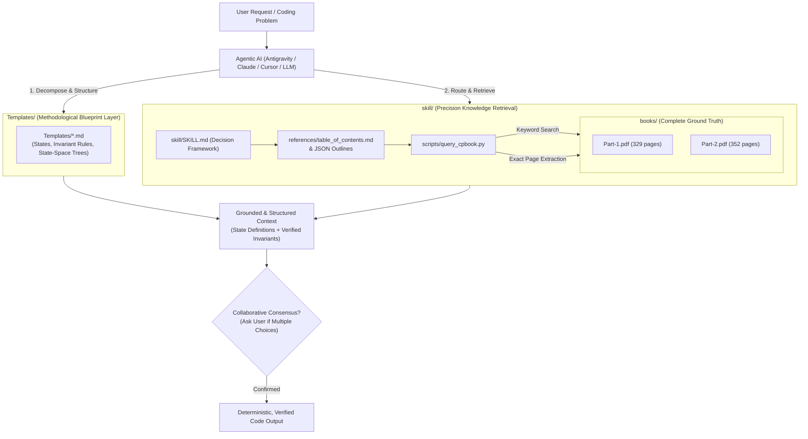

# Architecture & Operational Mechanics: `cpbook4` Skill

## 1. System Overview & Purpose

The `cpbook4` skill is a **portable, self-contained, agent-agnostic knowledge and retrieval module** encapsulating comprehensive reference volumes:
* **Volume 1 (`Part-1.pdf`)**: 329 pages (Data Structures, Paradigms, Graphs)
* **Volume 2 (`Part-2.pdf`)**: 352 pages (Math, Strings, Geometry, Advanced Topics, Rare Topics)
* **Total Volume**: 681 pages, ~328,000 words, ~436,000 tokens.

This package can be moved into any AI agent environment (Antigravity, Claude Code, Cursor, AutoGPT, custom LangChain/LlamaIndex pipelines) without modifying agent source code.

---

## 2. Directory Layout of `skill/`

```
skill/
├── ARCHITECTURE.md                 <-- Detailed operational manual (this file)
├── SKILL.md                        <-- Universal agent entrypoint & decision rules
├── books/
│   ├── Flowchart/                  <-- Flowcharts & programming techniques
│   ├── Overall/                    <-- Comprehensive reference books
│   │   ├── Part-1.pdf              <-- Volume 1 complete PDF (329 pages)
│   │   └── Part-2.pdf              <-- Volume 2 complete PDF (352 pages)
│   └── Programming Logic/          <-- Logic, loops & pattern books
├── references/
│   ├── table_of_contents.md        <-- Fast human & agent markdown topic index with page numbers
│   ├── toc_book1.json              <-- Machine-readable outline tree for Book 1
│   └── toc_book2.json              <-- Machine-readable outline tree for Book 2
└── scripts/
    └── query_cpbook.py             <-- Resilient, UTF-8 safe CLI search & page extractor
```

---

## 3. High-Level Architecture Diagram



---

## 4. Why This Architecture? (Context Efficiency + Structured Problem Solving)

Loading raw text of 436,000 tokens into an LLM context window at every step causes context overflow, hallucinated details, and high latency. Furthermore, retrieving raw algorithmic theory without a structured decomposition methodology causes agents to guess loops and produce unverified code.

### The 4-Tier Precision Pipeline:

Instead of dumping raw tokens or writing unstructured code, the system implements a **4-tier precision pipeline**:

1. **Tier 1: Methodological Blueprints (`Templates/`)**:
   - Before writing code or choosing libraries, the agent selects the matching template (e.g., [`Templates/Repetitive Structure Template.md`](../Templates/Repetitive%20Structure%20Template.md)).
   - This guides the agent to inventory candidate variables, classify variable roles (Free, Carried, Derived, Fixed), construct the state-space tree, derive bounds, and audit failure modes.

2. **Tier 2: Global Routing (Zero Token Overhead)**:
   - When the agent needs algorithmic ground truth (e.g. *Segment Tree with Lazy Propagation* or *Pollard's Rho*), it inspects [`references/table_of_contents.md`](references/table_of_contents.md).
   - This pinpoints the exact volume (`Volume 1` or `Volume 2`) and exact page range (e.g., `Volume 1, Section 2.4.4, pages 143-152`).

3. **Tier 3: Targeted Index Search**:
   - If the agent needs to check if a niche problem or variation appears in the books:
     ```bash
     python skill/scripts/query_cpbook.py search --book 1 --query "Lazy Propagation" --limit 3
     ```
   - Returns matched page numbers and snippet contexts in milliseconds.

4. **Tier 4: Surgical Page Extraction**:
   - The agent extracts only the relevant 3–5 pages containing the formal proofs, edge cases, formulas, and reference implementations:
     ```bash
     python skill/scripts/query_cpbook.py extract --book 1 --start 143 --end 148 --output st_lazy.txt
     ```
   - This feeds the LLM with verified formulas and mathematical definitions.

---

## 5. Portability & Cross-Agent Usage

This skill has zero proprietary dependencies:
- Written in standard Markdown, JSON, and standard Python (`pypdf`).
- Works on Windows, Linux, and macOS.
- Can be zipped and shared with any other project or AI platform.

### How to use across specific Agentic AIs:

#### 1. Google Antigravity
- Place or point to the skill in `.agent/skills/cpbook4/SKILL.md` (pre-configured in this repository).
- Antigravity automatically indexes the skill upon workspace startup.
- Mention `@skill:cpbook4` or ask algorithm questions directly in chat; the agent will consult `references/table_of_contents.md` and invoke `scripts/query_cpbook.py` as needed.

#### 2. Claude Code
- Claude Code natively searches for skills under `.claude/skills/<skill-name>/SKILL.md`.
- You can enable it by copying `skill/SKILL.md` to `.claude/skills/cpbook4/SKILL.md`, or by adding a reference line to your root `CLAUDE.md`:
  ```markdown
  Refer to `skill/SKILL.md` for algorithm design and reference queries.
  ```
- Invoke by asking Claude Code: *"Consult the cpbook4 skill to find the optimal DP approach for Longest Common Subsequence."*

#### 3. OpenAI Codex / Cursor / Custom Agent Frameworks
- For Codex, Cursor, Copilot Workspace, or custom LangChain/AutoGPT agents:
- Include a directive in `.cursorrules`, `AGENTS.md`, or the agent system prompt:
  ```markdown
  For algorithmic problems, consult the skill in `skill/SKILL.md`. Use `python skill/scripts/query_cpbook.py search|extract` to retrieve exact pages and code patterns from `skill/books/`.
  ```
- The agent will use its bash/terminal tool to query the books deterministically.
