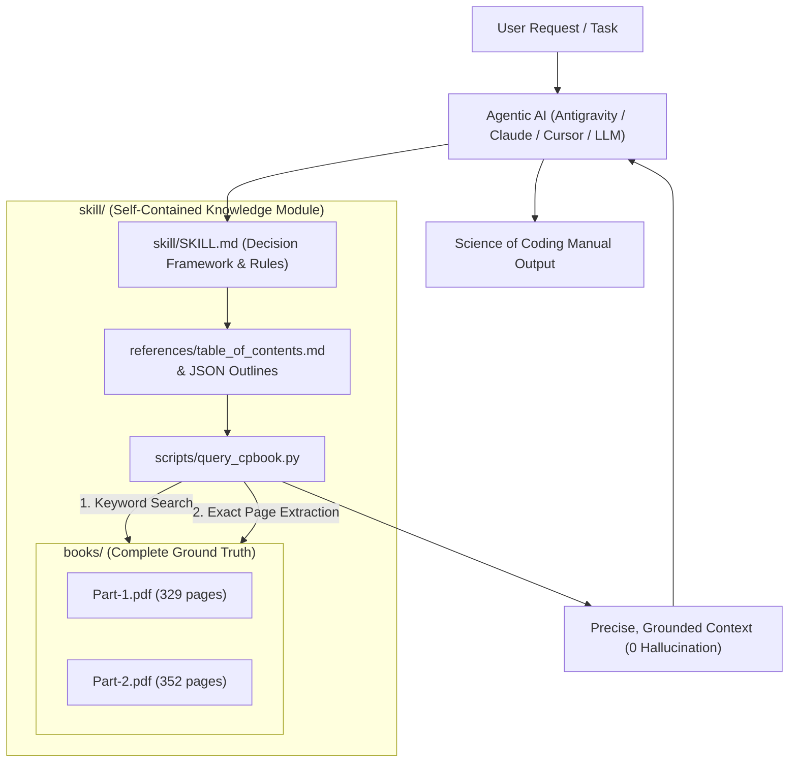

# Architecture & Operational Mechanics: `cpbook4` Skill

## 1. System Overview & Purpose

The `cpbook4` skill is a **portable, self-contained, agent-agnostic knowledge and retrieval module** encapsulating both volumes of *Competitive Programming 4 (CP4)* by Steven Halim, Felix Halim, and Suhendry Effendy:
* **Book 1 (`Part-1.pdf`)**: 329 pages (Data Structures, Paradigms, Graphs)
* **Book 2 (`Part-2.pdf`)**: 352 pages (Math, Strings, Geometry, Advanced Topics, Rare Topics)
* **Total Volume**: 681 pages, ~328,000 words, ~436,000 tokens.

This package can be moved into any AI agent environment (Antigravity, Claude Code, Cursor, AutoGPT, custom LangChain/LlamaIndex pipelines) without modifying agent source code.

---

## 2. Directory Layout of `skill/`

```
skill/
├── ARCHITECTURE.md                 <-- Detailed operational manual (this file)
├── SKILL.md                        <-- Universal agent entrypoint & decision rules
├── books/
│   ├── Part-1.pdf                  <-- CP4 Book 1 complete original PDF (329 pages)
│   └── Part-2.pdf                  <-- CP4 Book 2 complete original PDF (352 pages)
├── references/
│   ├── table_of_contents.md        <-- Fast human & agent markdown topic index with page numbers
│   ├── toc_book1.json              <-- Machine-readable outline tree for Book 1
│   └── toc_book2.json              <-- Machine-readable outline tree for Book 2
└── scripts/
    └── query_cpbook.py             <-- Resilient, UTF-8 safe CLI search & page extractor
```

---

## 3. High-Level Architecture Diagram



---

## 4. Why This Architecture? (Context Efficiency vs. Ground Truth)

Loading raw text of 436,000 tokens into an LLM context window at every step causes:
1. Context overflow and excessive token latency.
2. Context degradation ("lost in the middle" phenomenon and hallucinated algorithm details).
3. Exponential compute cost.

### The 3-Tier Retrieval Strategy:
Instead of dumping raw tokens into memory, the skill implements a **3-tier precision pipeline**:

1. **Tier 1: Global Routing (Zero Token Overhead)**:
   - When the agent receives a topic (e.g. *Segment Tree with Lazy Propagation* or *Pollard's Rho*), it inspects [`references/table_of_contents.md`](references/table_of_contents.md).
   - This pinpoints the exact volume (`Book 1` or `Book 2`) and exact page range (e.g., `Book 1, Section 2.4.4, pages 143-152`).

2. **Tier 2: Targeted Index Search**:
   - If the agent needs to check if a niche problem or variation appears in the books:
     ```bash
     python skill/scripts/query_cpbook.py search --book 1 --query "Lazy Propagation" --limit 3
     ```
   - Returns matched page numbers and snippet contexts in milliseconds.

3. **Tier 3: Surgical Page Extraction**:
   - The agent reads only the relevant 5–10 pages containing the formal proofs, edge cases, formulas, and C++/Python/Java implementations:
     ```bash
     python skill/scripts/query_cpbook.py extract --book 1 --start 143 --end 148 --output st_lazy.txt
     ```
   - This feeds the LLM with 100% verified, author-written code and mathematical definitions.

---

## 5. Portability & Cross-Agent Usage

This skill has zero proprietary dependencies:
- Written in standard Markdown, JSON, and standard Python (`pypdf`).
- Works on Windows, Linux, and macOS.
- Can be zipped and shared with any other project or AI platform.
- Cross-compatible symlinks/mirrors exist at `.agent/skills/cpbook4/` and `.claude/skills/cpbook4/`.

